# 菜单·功能·按钮·后端动作·业务链全图

> **生成日期**：2026-11-08 ｜ **仓库版本**：`882ad63a`（git log：2026-11-07 23:56:28 +0800） ｜ **性质**：只读审计合成文档（合成过程未改动任何源代码）

## 使用说明

1. **先看总图，再逐菜单细看**：先读「业务链总览」（23 条业务链 + 3 张总 mermaid 图）建立全局业务图景，再用「核查重点总表」锁定 9 条待拍板事项，最后按总目录进入正文各章，逐菜单细看按钮级明细。
2. 正文 12 章由 12 份审计章节**忠实拼接**而成：不改写原文内容，仅统一标题层级（章标题=## 级，章内各节顺延降一级）与章节编号；每章的「审计方式」引言、「概述 / 功能清单 / 按钮明细 / 业务链条 / ⚠️ 疑点」结构原样保留。
3. 章内所有按钮均落到 `文件:行号` 代码证据；「谁能看到」列一律引用《菜单功能按钮数据范围验收表-20261107》，不重新推导。
4. 各章「⚠️ 疑点」已在**附录 A** 汇总并标注出处章节；章节间明显冲突以**附录 B「编辑注」**标出，不做取舍，留待管理层拍板。

## 素材来源

| # | 素材 | 在本册中的用途 |
|---|---|---|
| 1 | 《页面按钮全量对照-20261107.md》（docs/） | §0 的 23 条业务链总图（本册「业务链总览」底稿）与 §8 审计发现（F1-F6） |
| 2 | 《菜单功能对照-20261107.md》（docs/） | 菜单→功能骨架对照 |
| 3 | 《菜单功能按钮数据范围验收表-20261107.md》（docs/） | 角色×菜单可见矩阵、数据范围档位、9 条核查重点（各章「谁能看到」列引用源） |
| 4 | 本次 12 路代码审计（2026-11-08，`out/menu-audit-20261108/01~12 章`，基准仓库 `882ad63a`） | 正文全部 12 章的原始内容 |

## 总目录

- 业务链总览（23 条主链 + 3 张总 mermaid 图）
- 核查重点总表（9 条，状态＝待您拍板）
- 第 01 章｜PC·首页与登录
- 第 02 章｜PC·客户管理
- 第 03 章｜PC·文件管理
- 第 04 章｜PC·四项激励
- 第 05 章｜PC·四项服务与提醒
- 第 06 章｜PC·公海与审批
- 第 07 章｜PC·学分与统计
- 第 08 章｜PC·系统管理
- 第 09 章｜MP·应用壳
- 第 10 章｜MP·激励链路
- 第 11 章｜MP·客户经营与其余模块
- 第 12 章｜后端公共机制
- 附录 A｜各章「⚠️ 疑点」汇总清单（标注出处章节）
- 附录 B｜跨章节冲突「编辑注」

## 业务链总览（23 条主链）

以下 23 条业务链改写自《页面按钮全量对照-20261107.md》§0（每条一行文字链；各链在正文中的展开位置见本节末尾映射表）。

1. **登录链**：登录（记住账号/密码、协议勾选）→ 首登强制改密 → 工作台；忘记密码=账号核验→短信验证码→重置三步向导
2. **客户建档链**：列表「新客户」/Excel 批量导入 → 表单（查重拦截/归属链大区→办事处→负责人/联系人行编辑/受保护日期权限门）→ 幂等保存 → 详情
3. **客户跟进链**：详情「新增跟进记录」→ 日志落库 →（勾选"生成下一步任务"）→ 任务页完成（结果必填）/取消（原因必填）→ 闭环留痕
4. **客户处置链**：列表行/批量 → 释放（原因必填）→ 公海池 →（他人）捞取审批 → 归属转移；归档=停止跟进；删除=软删 → 回收站恢复/彻底删
5. **保护期延期链**：提醒列表/客户详情「申请延期」→ 审批单(type=extend) → 审批人通过（可调整天数 1~3650）→ 保护期重算 → 提醒消除
6. **财务·核心判定链**：详情财务 tab → 录入半年/全年阶段总额（开票+回款）→ 核心三态重算（50/100 万门槛可配）→ 保护期刷新 → 工作台/六项指标反映
7. **公海捞取链**：公海池筛选 → 捞取（type=claim 审批）→ 通过 → 客户进名下 → 列表/详情可见
8. **激励上传链**：上传入口 → 选客户/分类 → 槽位文件（拍照/相册/聊天/H5 直传）→ 提交 → 学分落库 → 统计/排行刷新
9. **激励追改链**：记录表行点击/详情「追加」→ 槽位增删（remove-file 原子移除+学分重算）→ 审计信息留痕
10. **阅读闭环链**：激励查询详情弹开 → 滚动进入视野 40% 自动上报已读 → 阅读统计/本月阅读排行榜
11. **文件协作链**：上传 → 分享选人 → 对方"分享给我"页签 → 预览/下载；文件夹 ACL 角色授权+下载开关
12. **文件扩容链**：存储满 → 申请扩容（type=storage 审批，禁自审自批）→ 通过 → 配额上调
13. **客户转移链**：详情「转移客户」→ type=transfer 审批 → 通过 → 归属变更 → 数据范围即时生效
14. **审批中枢链**：四类单据（捞取/转移/延期/扩容）→ 审批列表六页签 → 通过/驳回（意见留痕）→ 轨迹 → admin 可转交节点
15. **权限治理链**：权限中心（给谁→功能勾选→范围档→锚点）→ 保存即生效 → 生效预览验证 → 变更审计入账
16. **字典链**：字典管理（类型/数据）→ 各端下拉即时消费（行业/开发类型等）
17. **分类维护链**：激励类别管理（两级+分值）→ 上传弹窗分类树 → 学分计算
18. **回收站链**：软删（客户/人员/文件）→ 回收站三类页签 → 恢复 / 彻底删除（双码守卫）
19. **排行激励链**：学分录入（网格+即时落库学分项）→ 批量保存 → 排行 → 个人/部门明细钻取；客户排行三体系（四项服务/客情/核心指标）
20. **统计下钻链**：统计分析 → 行业/办事处点击 → 跳客户列表带条件 → 闭环
21. **提醒闭环链**：到期天级批生成 → 提醒列表 → 已跟进/已处理/一键清空 → 或申请延期
22. **组织初始化链**：集团 → 部门树 → 岗位+权限规则绑定 → 人员（初始密码一次性转交→首登改密）→ 角色 → 权限中心勾选
23. **移动办公链**：tabBar/应用中心 43 页 → 转发分享 → H5 直传回挂 → 草稿续办

> **编辑注（链数口径）**：源文档 §0 标题写「22 条主链」，但其列表实际列出 23 项、文末核对说明亦称「业务链 23 条」（第 06 章「待核汇总」同样指出该口径漂移）；本册按列表顺序取 **23 条**。
>
> **编辑注（链 1「协议勾选」）**：链 1 文字保留源文原样。代码证据：**PC 登录无协议勾选环节**（第 01 章 N2：`login/index.vue` 表单选项区仅记住账号/记住密码/7 天保持登录三项，登录不校验协议）；**MP 登录确有协议勾选前置**（第 09 章：未勾协议不允许登录）。双端差异以各章代码证据为准。

### 总图 A：登录与客户·流程主线（链 1-7、13-14、21-22）

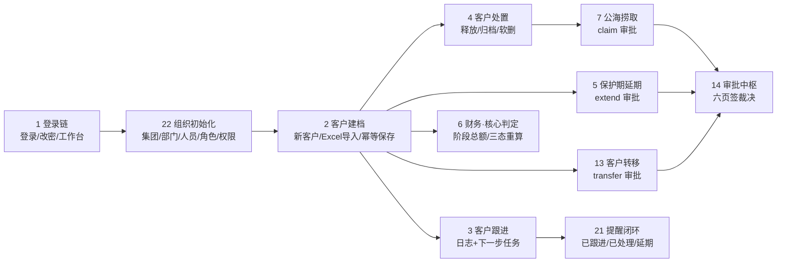

### 总图 B：激励·文件·权限支撑域（链 8-12、15-18）

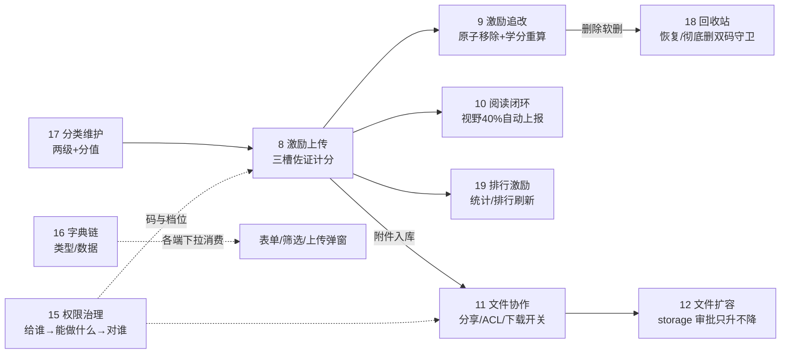

### 总图 C：统计下钻与移动办公（链 19-20、23）

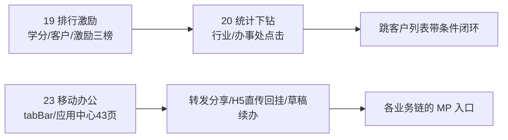

### 链 → 正文展开章节映射

| 链 | 主要展开章节 | 链 | 主要展开章节 |
|---|---|---|---|
| 1 登录链 | 第 01、09、12 章 | 13 客户转移链 | 第 02、12 章 |
| 2 客户建档链 | 第 02、11 章 | 14 审批中枢链 | 第 06、11、12 章 |
| 3 客户跟进链 | 第 02、11 章 | 15 权限治理链 | 第 08、12 章 |
| 4 客户处置链 | 第 02、06、11 章（回收站段=第 08 章） | 16 字典链 | 第 08、12 章 |
| 5 保护期延期链 | 第 02、05、06、11、12 章 | 17 分类维护链 | 第 08 章 |
| 6 财务·核心判定链 | 第 02、11、12 章 | 18 回收站链 | 第 08 章（软删来源：第 02、03 章；MP 无入口：第 09、11 章） |
| 7 公海捞取链 | 第 06、11 章 | 19 排行激励链 | 第 07、10、11 章 |
| 8 激励上传链 | 第 04、10 章 | 20 统计下钻链 | 第 07、11 章 |
| 9 激励追改链 | 第 04、10 章 | 21 提醒闭环链 | 第 05 章（生成段=第 12 章定时任务） |
| 10 阅读闭环链 | 第 04、10 章 | 22 组织初始化链 | 第 08 章 |
| 11 文件协作链 | 第 03、09、11 章 | 23 移动办公链 | 第 09、10、11 章 |
| 12 文件扩容链 | 第 03、09、11、12 章 |  |  |

## 核查重点总表（9 条）

> 「内容」列为各章代码审计结论的综合；「状态」统一为**待您拍板**——各章疑点详情见正文对应章节与附录 A。

| # | 内容 | 涉及章节 | 状态 |
|---|---|---|---|
| 1 | 销售员持有客户导入码 `customer:import`——属实：PC「批量导入」按钮可见、后端 `@PreAuthorize customer:import` 放行，导入客户强制落导入人本人名下/本人办事处（技术面无越权放大）；公海导入为独立 `sea:import`（销售员✗，两码互不影响）；MP 无导入入口、码零消费。是否保留一线导入码待裁决 | 02 / 06 / 09 / 11 | 待您拍板 |
| 2 | 销售员持有客户删除码 `customer:delete`——属实但为「范围内软删」四道闸（码→范围层 canDelete→有票款/在途审批拒删→软删+审计快照）；软删进回收站而恢复/清空仅 admin；MP 详情页同码可见删除按钮且手机端不可逆感知更强 | 02 / 06 / 09 / 11 | 待您拍板 |
| 3 | 行政打开学分录入＝只读——已核实前后端同门（前端 score:manage 门控、后端 items/导出同码、批量保存另有范围+区间服务端校验），非故障；MP 无学分录入页，无风险面 | 07 / 09 / 11 | 待您拍板 |
| 4 | 行政激励 view-all=region——口径存在分叉：激励记录列表可见性只认授权表布尔（`biz_incentive_grant` 纯 0/1，region 无处落地）；机制侧 `OrgScopeResolver` 支持 (incentive, view_all/view_shared) 的 region 档位解析；PC 文件中心全量旁路无 region 维度。实际可见面取决于生产库授权行/档位实际值 | 03 / 04 / 05 / 10 / 12 | 待您拍板 |
| 5 | 激励分享制 29 条授权 can_view_all 全=0——机制吻合（无授权行=默认分享可见开/其余关）；存量数据未连生产库现场复核；注意全量旁路=admin∨can_view_all∨can_edit∨can_delete，29 条中是否存在 can_edit/can_delete=1 者未核 | 03 / 04 / 05 / 08 / 10 / 12 | 待您拍板 |
| 6 | 马吉亮全公司客户范围特例（USER 级 customer 全组=all）——客户列表/页签计数/导出全面生效；案例库/激励查询（走 customer,view 档位）随之放大为全公司；提醒域走 reminder 独立档位、是否有用户级 override 未载明；验收表标注 11-12 事件后特例，是否保留待核 | 02 / 05 / 10 / 11 / 12 | 待您拍板 |
| 7 | 阅读排行榜/日志查看仅 admin——路由/接口同码、验收表绑定一致、机制与授权相符（日志另经集团收口范围过滤）；但依赖码而非 admin 硬闸（阅读统计面板另叠 ∨admin；码可经角色管理授出），「仅 admin」为 DB 绑定现状 | 01 / 04 / 08 / 10 / 12 | 待您拍板 |
| 8 | 总监无回收站恢复/清空按钮——属实且后端更强：`RecycleController` 全端点 requireAdmin() 硬闸，即使补授 system:recycle:restore/purge 两码也 403；总监删客户/文件后无法自助恢复（依赖 admin 兜底）；MP 无回收站入口 | 02 / 03 / 08 / 09 / 11 / 12 | 待您拍板 |
| 9 | 六项指标/客户排行对销售员的实际数据口径——代码已按「客户可见范围」收口（visibleCustomers；statistics 档位缺失时回退角色 self），但方法注释与历史裁决口径三方并存：第 07 章判「最终线上行为取决于生产库档位，待核」，第 11 章判「代码证据已可核实，建议按销售员账号线上抽验后销项」 | 02 / 07 / 10 / 11 / 12 | 待您拍板 |

---


---

## 第 01 章｜PC·首页与登录

> 审计方式：逐文件通读前端 `aigicrm-ui/src`（login / dashboard / layout / router / store / api）与后端 `aigicrm-backend` 对应 Controller+Service 源码，每个按钮落到代码行号；「谁能看到」一律引用《菜单功能按钮数据范围验收表-20261107》。

### 概述（侧栏位置/路由、权限码、谁能看到该菜单）

- **工作台（首页）**：路由 `/dashboard`，挂 layout 子路由，`meta.permission='dashboard:view'`（`aigicrm-ui/src/router/index.js:39-44`）。侧栏位置=「首页」分组（组名与菜单项来自后端 `/auth/info` 下发的 menus 树，前端动态渲染，`layout/index.vue:25-53`）。直接输 URL 无权限时路由守卫跳首个有权限页面（`router/index.js:345-348` + `router/access.js:3-10`）。
- **登录页**：路由 `/login`，顶层路由不走 layout（`router/index.js:6-11`）；全局路由守卫对未登录访问一律踢回 `/login`（`router/index.js:320-328`）。
- **谁能看到**：验收表「角色×菜单可见矩阵」：`首页/工作台 | admin ✓ | 总监 ✓ | 行政 ✓ | 销售员 ✓`（四角色全员可见）。数据范围（验收表§三.1）：admin/总监=全公司（dashboard view=all）；行政=本大区（region）；销售员=仅本人（self）。
- **顶栏全局功能**（提醒铃铛/帮助/集团切换/用户菜单）挂在 layout 上，不属于菜单树，登录后全员渲染（`layout/index.vue:61-125`）。
- **权限码清单**（工作台页面内实际用到的门控码）：`dashboard:view`（页面）、`task:view`（待办/本月完成卡，`dashboard/index.vue:65,75`）、`approval:view`（待我审批卡，`:353`）、`reminder:view`（提醒数据，`:354`）、`incentive:stats:view|incentive:rank:view`（激励学分卡数据源，后端 `IncentiveController.java:155-157`）、`incentive:read-stats`（阅读完成卡，`dashboard/index.vue:351`）。

### 功能清单（每功能一行）

- 登录：账号+密码登录，失败限流（同 IP+账号 5 次/同 IP 20 次锁 15 分钟），成功签发 JWT（默认 24h 档，勾选保持登录=7 天档）。
- 记住账号：账号名明文存 localStorage，默认勾选；记住密码：口令加密（HTTPS=WebCrypto 设备密钥 AES-GCM，HTTP=XOR 弱混淆）存 7 天；7 天保持登录：登录请求带 rememberMe 换 7 天档 JWT 并滑动续期。
- 首登强制改密：后端标记 `pwdResetRequired=1` 时登录响应触发强制改密弹窗，改完 token 作废需重登。
- 忘记密码三步向导：①输账号查验证方式（手机掩码）→ ②发短信验证码（60s 倒计时）→ ③设置新密码（8-30 位）。
- 顶栏：折叠侧栏（持久化偏好）、面包屑、提醒铃铛（未读角标）、帮助（占位无功能）、多集团切换（仅多集团用户）、用户菜单（个人信息/修改密码/退出登录）。
- 30 分钟无操作自动退出：提前 2 分钟弹通知，到期登出跳登录页。
- 工作台看板：hero 四指标卡（客户总数/在保护期/即将到期/已超期，可点钻取）、运营指标卡（待办任务/本月完成/我的激励学分/我的阅读完成/待我审批/数据范围，按角色与权限码差异化）、统计口径条+立即刷新、六个快捷入口、本月新增客户/文件上传周条形图、待处理提醒列表、团队动态流、待审批面板（行内可直接通过/驳回）。
- 全局搜索：**当前 PC 顶栏不存在全局搜索功能**（见⚠️疑点 N1）。

### 按钮明细

#### 块1：登录页（`views/login/index.vue`）

| 按钮 | 在哪 | 前端行为 | 后端动作 | 谁能看到 |
|---|---|---|---|---|
| 登 录 | 右栏表单底部（`login/index.vue:41`） | 表单校验→trim 账号→`login({...form, rememberMe})`，成功存 token、应用集团信息、跳 `/dashboard`（`:145-195`） | 登录限流校验（同 IP+账号 5 次、同 IP 20 次，锁 15 分钟，Redis 计数，`AuthService.java:76-89`）→BCrypt 验密、统一报「账号或密码错误」防枚举（`:97-114`）→成功清失败计数+写登录审计日志（`AuthController.java:29-41` SysLog 落库）+安全审计留痕（`AuthService.java:120`）→推导集团集合、签发 JWT（24h/7d 档，`:124-128`+`JwtTokenProvider.java:66-84`）→返回 pwdResetRequired 标记（`:141`） | 未登录访客（公开页） |
| 记住账号 ☑ | 表单选项区（`:32`） | 默认勾选；登录成功按勾选写/删 `aigicrm_remember_username`（`:88-94`）；挂载时回填（`:111-115`） | 无后端交互（纯 localStorage） | 未登录访客 |
| 记住密码 ☑ | 同上（`:35`） | 勾选联动勾上记住账号+保持登录；取消则清加密记忆并清空密码框（`:98-106`）；登录成功经 `saveRememberedAuth` 加密落盘 7 天（`:192`） | 无后端交互；口令以 WebCrypto AES-GCM+IndexedDB 设备密钥加密存 localStorage，HTTP 档降级 XOR 弱混淆（`remembered-auth.js:96-112`） | 未登录访客 |
| 7天内保持登录 ☑ | 同上（`:37`） | 勾选（或记住密码）→登录请求带 `rememberMe=true`（`:155-156`） | 签发 7 天档 JWT+写入 `rm` 声明，活跃后半周期滑动续期（`JwtTokenProvider.java:66-84,96-104`） | 未登录访客 |
| 忘记密码? | 表单选项区右侧（`:39`） | 打开找回密码弹窗（`forgotPwdVisible=true`） | 无 | 未登录访客 |
| ICP 备案链接 | 页脚（`:47-49`） | 新窗口跳工信部备案系统 | 无 | 未登录访客 |

#### 块2：首登强制改密（登录成功流程内嵌弹窗，`login/index.vue:163-189`）

| 按钮 | 在哪 | 前端行为 | 后端动作 | 谁能看到 |
|---|---|---|---|---|
| 确认修改 | 强制改密弹窗确认键（`:165-173`，ElMessageBox.prompt） | 校验新密码≥8 位→`changePassword({oldPassword,newPassword})`→清加密口令记忆+只留记住账号→清 token→提示用新密码重登（`:172-181`） | 校验原密码→新密码 8-30 位后端兜底（`SysUserService.java:537-549`）→BCrypt 落新口令+DB 级 `pwd_changed_at`（旧 token 全失效）+清 `pwdResetRequired` 标记（`:550-558`）；端点 `POST /system/users/change-password`（`SysUserController.java:75-79`，登录态本人） | 仅 `pwdResetRequired=1` 的登录响应触发（初始/被重置口令用户） |
| 退出登录 | 同弹窗取消键（`:170,182-188`） | 清 token、提示未完成改密、留在登录页 | 无（本地清 token；带坏 token 的后续请求被 JwtAuthFilter 拒） | 同上 |

#### 块3：忘记密码三步向导（`views/login/ForgotPasswordDialog.vue`）

| 按钮 | 在哪 | 前端行为 | 后端动作 | 谁能看到 |
|---|---|---|---|---|
| 下一步（步骤1 验证账号） | 弹窗底部主键（`:90-92`，文案随步骤切换） | 校验账号非空→`forgotPasswordLookup`；无手机号提示联系管理员（`:161-175`） | 匿名探测留痕+阈值告警（`AuthController.java:94` anonymousProbe）→IP 60s 限流（`:96-98`+`AuthService.java:47-52`）→查活跃用户，不存在返回全 false 中性响应防枚举（`AuthService.java:310-319`）→返回手机/邮箱掩码 | 未登录访客 |
| 手机验证卡 | 步骤2 验证方式区（`:44-56`） | 选中 `method='phone'`，展示掩码手机号 | 无（本地选择） | 步骤1 查到 hasPhone 者 |
| 获取验证码 | 步骤2 验证码行（`:61-64`） | `forgotPasswordSendCode`→60s 倒计时禁点（`:204-217`） | 匿名探测留痕→email 显式拒绝（`AuthService.java:334-337`）→用户名 60s+同 IP 1h/10 次双限流（`:340-352`）→用户不可用/无手机对外中性返回（`:354-367`）→6 位随机码 Redis 存 5 分钟→阿里云短信下发（`:369-385`） | 选定手机验证者 |
| 上一步 | 弹窗底部（`:88`） | 步骤号-1 | 无 | 步骤≥2 |
| 取消 | 弹窗底部（`:89`） | 关闭弹窗（closed 钩子重置全部状态，`:152-158`） | 无 | 全程 |
| 确认重置（步骤3） | 弹窗底部主键（`:90-92`） | 校验新密码 8-30 位+两次一致→`forgotPasswordReset`→成功清账号与口令记忆键、关弹窗（`:180-197`） | 匿名探测留痕（`AuthService.java:396`）→验码错误计数≤5（`:407-412`）→三态文案归一「验证码错误或已过期」防枚举（`:414-424`）→BCrypt 落新口令+`pwd_changed_at` 秒级截断+旧 token 立即拉黑+清验证码（`:426-435`） | 三步走通者 |

#### 块4：顶栏全局（`layout/index.vue`）

| 按钮 | 在哪 | 前端行为 | 后端动作 | 谁能看到 |
|---|---|---|---|---|
| 折叠侧栏 | 顶栏左侧（`:63-66`） | 切换折叠态并持久化 localStorage（`:273-282`） | 无 | 登录全员 |
| 面包屑「首页」 | 面包屑首项（`:68`） | 跳 `/`（重定向 `/dashboard`） | 无（/dashboard 需 dashboard:view，无权限被守卫跳首个可访问页） | 登录全员 |
| 提醒铃铛 | 顶栏右侧（`:74-79`） | 跳 `/reminder`；角标=`badgeReminder`（99+ 封顶） | 角标来自 `GET /reminder/pending-count`（`store/user.js:81-85`）：`@PreAuthorize reminder:view`（`ReminderController.java:53-57`），Service 统计本人范围内 pending 提醒 | 登录全员（图标）；角标数据需 reminder:view |
| 帮助 ❓ | 顶栏右侧（`:80-84`） | **无任何点击 handler，纯占位图标** | 无 | 登录全员 |
| 集团切换下拉 | 顶栏（`:87-96`，`v-if canSwitchGroup`） | 选集团→`switchGroup`→存新 token→重拉用户信息+角标+成功提示（`:371-380`；`store/user.js:102-108`） | `POST /auth/switch-group`：校验目标集团在本人集团集合内（`AuthService.java:176-184`）→集团切换审计留痕（`:183-184`）→按原 token 的保持登录档重签 JWT（`:187-189`） | 仅多集团用户（groupIds>1，`store/user.js:44`） |
| 用户下拉（头像区） | 顶栏最右（`:97-108`） | 展开菜单（个人信息/修改密码/退出登录） | 无 | 登录全员 |
| 个人信息 | 用户菜单（`:118`） | 打开只读弹窗：用户名/部门/办事处/角色/数据范围/权限项数（`:128-156`） | 无（数据来自已加载的 `/auth/info`） | 登录全员 |
| 修改密码 | 用户菜单（`:119`） | 打开弹窗→校验非空/两次一致/8-30 位→`changePassword`→成功后本地登出跳登录页（`:159-175,296-317`） | 同块2 确认修改（`SysUserController.java:75-79`+`SysUserService.java:537-558`：原密码校验、8-30 兜底、pwd_changed_at 令旧 token 失效） | 登录全员 |
| 退出登录 | 用户菜单（`:120`） | `userStore.logout()`（先调后端注销再本地清理）→跳 `/login`（`:390-393`；`store/user.js:112-122`） | `POST /auth/logout`：按 jti 拉黑当前 token 即时失效（`AuthController.java:66-74`+`AuthService.java:202-207`）；本地清 token+遗留口令键 | 登录全员 |
| 侧栏菜单项×N | 侧栏（`:25-53`） | 点击跳对应路由（el-menu router 模式）；「提醒/审批」两项带未读角标（`:247-251`） | 菜单树来自 `GET /auth/info`（登录态）：角色勾选菜单按 path 去重、滤按钮码与隐藏路由后组树下发（`AuthService.java:209-262,275-306`） | 各自菜单授权角色（验收表二矩阵） |

另：layout 挂载时 `fetchUserInfo`（30s 缓存）+工作台权限兜底+路由级权限守卫+无操作 30 分钟自动登出（28 分钟先预警）（`layout/index.vue:319-359`）。

#### 块5：工作台 hero 指标带（`views/dashboard/index.vue`，四卡均支持 Enter/Space 键盘等效 `:253-258`）

| 按钮 | 在哪 | 前端行为 | 后端动作 | 谁能看到 |
|---|---|---|---|---|
| hero·客户总数 | 深蓝指标带第1卡（`:9-15`） | 跳 `/customer?tab=all` | 数字来自 `GET /statistics/dashboard`：按 customer×view 数据范围统计未删非公海非归档客户数（`StatisticsController.java:26-30` 权限 `statistics:view` 或 `dashboard:view`；`CustomerService.java:1029-1034`，范围守卫 `applyDataScope` `:1370-1405`：admin 全量+规则引擎追加，非 admin 按 OrgScopeResolver OWNER/ORG 锚点，空集=不可见；结果带 30s 范围签名缓存，`StatisticsQueryService.java:216-248`） | dashboard:view 全员（验收表✓✓✓✓）；数字按各自范围 |
| hero·在保护期 | 第2卡（`:17-24`） | 跳 `/customer?status=normal&tab=all` | 同端点：`protection_status='active'` 计数+占比进度条（`CustomerService.java:1066-1074`，2026-11-01 起排公海/归档对齐统计页） | 同上 |
| hero·即将到期 | 第3卡（`:26-40`） | 跳 `/reminder` | 同端点：`expiring`（30 天内）计数+前 2 条明细（客户名/办事处/剩余天数，`StatisticsQueryService.java:335-350`，取 `getExpiringByScope(5)`）；todayExpiring 当日到期单列（`CustomerService.java:1085-1092`） | 同上；⚠️跳转目标 /reminder 需 reminder:view，无权限者被守卫跳首个可访问页（`router/index.js:345-348`） |
| hero·已超期 | 第4卡（`:44-52`） | 跳 `/customer?status=expired&tab=all` | 同端点：`expireDate<今日` 且排公海/归档（2026-10-09 用户裁决口径，`CustomerService.java:1094-1104`） | 同上 |

#### 块6：工作台运营指标卡（`dashboard/index.vue:63-118`）

| 按钮 | 在哪 | 前端行为 | 后端动作 | 谁能看到 |
|---|---|---|---|---|
| 待办任务卡 | 运营卡区（`:65-73`，`v-if task:view`） | 跳 `/task`；数字=pending/todayDue/overdue | `GET /task/statistics`（`TaskController.java:38-42`，`@PreAuthorize task:view`）：按指派人统计 pending/当日到期/逾期/本月完成（`TaskService.java:230-251`；传他人 userId 时先过可见性校验 `assertAssigneeVisible`） | 有 task:view 者（验收表：任务查看 admin/总监/销售员 ✓，行政 ✗→卡片隐藏且不发请求 `dashboard/index.vue:502`） |
| 本月完成任务卡 | 同区（`:75-82`，`v-if task:view`） | 纯展示 | 同上端点 completedThisMonth | 同上 |
| 我的激励学分卡 | 同区（`:83-92`，`v-if dataScope==='self'`） | 跳 `/score/ranking`；数字=全年 scoreboard 本人 totalScore+上传次数 | `GET /incentive/scoreboard?period=<年>全年`（`IncentiveController.java:155-158`，权限 `incentive:stats:view` 或 `incentive:rank:view`）：非 admin 榜单按调用人数据范围收口+集团+身份分键缓存（`IncentiveService.java:980-1008,1010+`）；前端取本人行，找不到显示 0（`dashboard/index.vue:363-381`） | 数据范围=self 的角色（销售员；验收表：四项激励组四角色 ✓，故正常有码） |
| 我的阅读完成卡 | 同区（`:93-100`，`v-if isSalesRole && incentive:read-stats`） | 纯展示 已读/本月发布 | `GET /incentive/read-stats`（无参=本月，`IncentiveController.java:201-204`，`@PreAuthorize incentive:read-stats` 默认仅 admin）：月度聚合本月发布为分母、本人已读为分子；前端只取本人行（`dashboard/index.vue:366-379`） | self 范围且有 incentive:read-stats 者（默认 admin；对应核查重点7） |
| 待我审批卡 | 同区（`:101-109`，`v-if approval:view`） | 跳 `/approval`；数字=待我审批 pending/本月通过/驳回 | `GET /approval/list?tab=pending`（`ApprovalController.java:22-24`，`@PreAuthorize approval:view`）：按审批节点 approverId=本人 且 pending 的单（`ApprovalService.page` pending 分支）；卡片顶部数字来自 dashboard 端点 `approvalService.statistics(userId)`（本人 pending/月度通过驳回，非 admin 限本人相关，`ApprovalService.java:809-845`） | 有 approval:view 者（2026-11-01 起按权限码门控，`:353`） |
| 数据范围卡 | 同区（`:110-117`，`v-if !isSalesRole`） | 纯展示：范围文案+客户数+公海数 | 客户数同 hero；公海数=dashboard 端点 `seaService.statistics()`（按可见公海池过滤统计，`SeaService.java:134-152`） | 非 self 范围角色（管理岗） |

#### 块7：工作台其他区块

| 按钮 | 在哪 | 前端行为 | 后端动作 | 谁能看到 |
|---|---|---|---|---|
| 立即刷新 | 统计口径条右侧（`:129`） | 重跑 loadData 五路并发（dashboard/提醒/动态/审批/日报），刷新时间戳更新（`:457-470`） | 同首屏五路端点（首路失败其余不受影响，各自 catch） | 登录全员（页面内） |
| 快捷入口×6（新增客户/上传文件/录入激励/待审批/公海捞取/数据统计） | 快捷区（`:133-139`，配置 `:265-272`） | 分别跳 `/customer/add` `/file` `/incentive` `/approval` `/sea` `/statistics` | 无（纯跳转；目标页各按其权限码守卫，无权限被路由守卫跳首个可访问页） | 登录全员可见入口；落地受各页权限码 |
| 待处理提醒·全部→ | 提醒面板头（`:182`） | 跳 `/reminder` | 列表数据：`GET /reminder/expiring-list?size=5`（`ReminderController.java:20-30`，`reminder:view`）：warningDays 配置+数据范围+部门子树并发预解析后按到期日升序分页，排公海/归档（`ReminderService.java:265-310`）；再并发拉三类分享提醒 `GET /reminder/list?type=share_to/by/owner&status=pending`（`dashboard/index.vue:416-435`，同码，按 reminder 模块范围过滤 owner） | reminder:view 门控（无码不发请求 `:354,398`） |
| 待审批·全部→ | 待审批面板头（`:222`） | 跳 `/approval` | 面板数据 `GET /approval/list?tab=pending&size=3`（同块6） | approval:view |
| 待审批行·通过 | 待审批面板行内（`:230`） | `apiApprove(id,{})`→成功提示+刷新数据+角标（`:473-475`） | `POST /approval/{id}/approve`（`ApprovalController.java:75-88`，`@PreAuthorize approval:approve`）：主行悲观锁串行化并发（`ApprovalService.java:552-557`）→终态守卫防复活（`:563-565`）→校验本人有 pending 节点（`:567-573`）→禁自审自批（`:578-580`）→节点条件流转（affected=1 才生效防重复点击 `:596-605`）→阶段推进（或签取消同组/会签清零/串行激活下一阶段 `:624-695`）→整单通过仅一个事务执行业务回写（捞取/转移/延期/扩容各副作用，`:698-707`） | 有 approval:approve 且是该单当前节点审批人（后端二次校验）；✅ 前端已补 canApprove/canReject 码门控（2026-11-08 修复批，`dashboard/index.vue:230-233/358-359`，N4 已闭） |
| 待审批行·驳回 | 同行（`:231`） | `apiReject(id,{})`→同上刷新 | `POST /approval/{id}/reject`（`ApprovalController.java:92-96`，`approval:reject`）：与通过同款锁/终态守卫/节点校验/条件流转，驳回即整单 rejected+业务回滚副作用（`ApprovalService.java:709-740+`） | 同上 |

#### 块8：周统计/团队动态（只读区块）

| 按钮 | 在哪 | 前端行为 | 后端动作 | 谁能看到 |
|---|---|---|---|---|
| 本周条形高亮（非按钮，展示） | 周统计两卡（`:142-175`） | 本月按周聚合新增客户/文件上传横向条形 | `GET /statistics/daily-stats`（`StatisticsController.java:32-36`，dashboard:view 同码）：客户日增走 customer 范围口径；文件按天/周计数并套 `applyFileScope`（statistics 模块可见用户集，空集显式 1=0 防越权，`StatisticsQueryService.java:362-415,1106-1114`） | dashboard:view |
| 团队动态（只读流） | 双列面板（`:200-216`） | 最近 15 条动态（跟进/激励/文件/审批/新增客户/系统日志六源合并） | `GET /statistics/team-activities`（`:64-68`）：六路来源各 LIMIT 查询后按时间归并；按当前账号 statistics 模块数据范围过滤（admin 全量/其他按可见用户集，空集恒空守卫，`StatisticsQueryService.java:981-1085`） | dashboard:view；内容随范围 |

### 业务链条

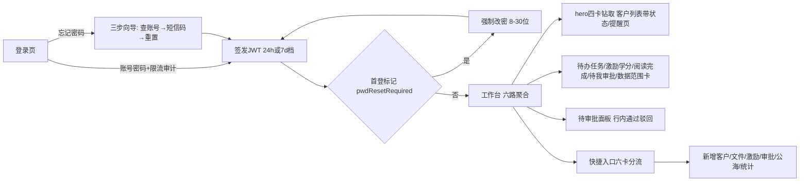

文字链：登录（记住账号/密码/保持登录，限流+登录审计日志）→ 忘记密码三步向导（短信码）或直接登录 → 首登强制改密（旧 token 全作废）→ 重登 → 工作台（六路聚合，30s 缓存）→ hero 卡钻取客户列表/提醒页 → 待审批面板行内通过/驳回即时闭环并刷角标 → 快捷入口分流至客户/文件/激励/审批/公海/统计。对应业务链总图：**1 登录链**（本章节主链）+ **4 客户处置链 / 7 公海捞取链 / 8 激励上传链 / 14 审批中枢链 / 20 统计下钻链 / 21 提醒闭环链**的汇聚入口（工作台为各链分流起点）。

### ⚠️ 疑点

- **N1【新发现】顶栏无全局搜索、帮助按钮无功能**：本次任务范围提到「顶部导航与全局搜索等全局功能」，但 `layout/index.vue` 全文无任何搜索输入/入口（grep「全局搜索」前端零命中），「帮助」图标无点击 handler 纯占位（`layout/index.vue:80-84`）。属功能缺失或文档预期过宽——待管理层定夺是否补全局搜索。
- **N2【文档漂移】参考文档写的「协议勾选」在代码中不存在**：《页面按钮全量对照-20261107》login 表写「登 录 | 需先勾协议」、业务链1写「登录（记住账号/密码、协议勾选）」，但当前 `login/index.vue:30-41` 表单选项区只有记住账号/记住密码/7天保持登录三项+忘记密码链接，无任何协议 checkbox，登录也不校验协议。以代码为准：无协议勾选环节。
- **N3【核查重点7 相关·已验证一致】工作台「我的阅读完成」卡与「阅读排行榜仅 admin」口径同源**：卡与数据请求双重门控 `incentive:read-stats`（`dashboard/index.vue:351,366-370`），后端 `GET /incentive/read-stats` 同码硬校验（`IncentiveController.java:201-204`），默认仅 admin 勾选（验收表「本月激励查询阅读排行榜」行 admin ✓ 其余 ✗ 同源）。无越权路径；无码角色卡片隐藏且不发请求（防 403 假错，`:366-370` 注释）。
- **N4【✅已修复 2026-11-08】待审批行内「通过/驳回」前端无 approve/reject 码门控**：原按钮渲染只依赖父面板 `approval:view`——修复批已补 `canApprove/canReject` 门控（`dashboard/index.vue:230-233/358-359`，无两码时整组不渲染），与后端 `ApprovalController.java:75,92` 硬校验对齐，缺口闭合。
- **N5【口径双轨·部分待核】工作台各卡数据范围锚点不同源**：hero 四卡与「数据范围」卡走 **customer×view** 锚点（`CustomerService.java:1029-1114` 的 applyDataScope `:1370-1405`）；团队动态/日报/周报走 **statistics×view** 锚点（`getCurrentScopeUserIds` 读 `anchorOf(user,"statistics","view")`，`CustomerService.java:1423-1440`）；激励学分榜按调用人范围+集团分键（`IncentiveService.java:980-1008`）；审批按审批人/数据范围（`ApprovalService.java:809-845`）。admin=全量、销售=self 两条已核一致；**行政（region）/总监（all）中间档在 statistics 锚点下的实际可见集合未在本章实测**（验收表只给 dashboard 的范围口径，statistics 锚点属统计域章节），标注待核。另 dashboard 结果带 30s 范围签名缓存+0~50% 抖动（`StatisticsQueryService.java:216-248`），写操作后最迟 30s 才反映——同一时刻工作台数字可能落后列表页。
- **N6【风险知悉】「记住密码」仍将口令驻留浏览器存储**：生产 HTTPS 走 WebCrypto AES-GCM+IndexedDB 不可导出设备密钥+7 天过期（`remembered-auth.js:95-112`）；HTTP 非安全上下文降级 XOR+base64 弱混淆并显式标记 `v:'xor-1'`（`:106,109`）。旧 B1 审计（口令落盘 high 级问题，`login/index.vue:77-86` 注释）后被产品决策恢复（2026-11-05），强档下风险可控，但任何能读 localStorage+IndexedDB 的本机攻击面仍可取回口令；且「记住密码」联动「7 天保持登录」会把 JWT 掉线窗口放大到 7 天不活跃（`login/index.vue:154-156`）。
- **N7【核查重点9 沾边】工作台销售员卡片数字口径**：销售员 hero 四卡=self 范围已核（applyDataScope OWNER 锚点）；「我的激励学分」取全年 scoreboard 本人行（`dashboard/index.vue:363-374`）——若管理员给某 self 角色未勾 `incentive:stats:view/rank:view`，请求 403 被静默 catch、卡片恒 0 无提示（`:380` catch 注释「数据缺失时卡片显示 0」）；当前验收表销售员有四项激励组全码，生产正常。六项指标页本身不属本章（统计域）。
- **N8【小体验】hero「即将到期」卡跳转 /reminder 对无 reminder:view 角色不直达**：卡片本身不判权限（`dashboard/index.vue:26-40`），无码者点击后被路由守卫静默跳到首个可访问页（`router/index.js:345-348`）而非 403——功能不破但体验突兀；提醒列表数据侧已有 `reminder:view` 门控不发请求（`:354,398`），数字卡本身仍有值展示（dashboard 端点仅要求 dashboard:view）。

（核查重点 1/2/3/4/5/6/8 均属客户域/激励域/学分域/回收站章节，与本章节无关，不在本节展开。）


---

## 第 02 章｜PC·客户管理

> 审计日期 2026-11-08。方法：逐文件通读 `aigicrm-ui/src/views/customer`（16 个组件 + 2 个 composable）与后端 `CustomerController`/`CustomerService`/`CustomerAccessService`/`CustomerEventService`/`TaskController`/`ApprovalController`/`SeaService.addToSea` 源码，按钮全部落到 `文件:行号`；「谁能看到」列一律引用《菜单功能按钮数据范围验收表-20261107》（§二矩阵与 §三逐菜单表），不重新推导。

### 概述

- **侧栏位置/路由**：业务核心组「客户管理」，侧栏主路由 `/customer`（路由定义 `aigicrm-ui/src/router/index.js:49-73`）：
  - `/customer` 客户列表（`views/customer/list.vue`，`permission: 'customer:view'`）
  - `/customer/add` 新增客户（`views/customer/add.vue`，`customer:add`）
  - `/customer/edit/:id` 编辑客户（同 `add.vue`，`customer:edit`）
  - `/customer/detail/:id` 客户详情（`views/customer/detail.vue`，`customer:view`）
- **菜单权限码**：`customer:view`。谁能看到：验收表 §二「客户管理（列表/详情/新增）」行——admin ✓ / 销售总监 ✓ / 行政 ✓ / 销售员 ✓（4 角色全员可见）。
- **本菜单消费的按钮级权限码**（前端 `userStore.hasPermission` 门控，代码证据见各表）：`customer:add`、`customer:edit`、`customer:delete`、`customer:import`、`customer:export`、`customer:date:edit`（注册日）、`customer:invoice-date:edit`（最近开票日）、`finance:view`、`finance:manage`、`customer:finance:edit`（开票回款三通道）、`contact:view`、`incentive:view`、`task:manage`（跟进日志生成任务）。
- **数据范围**（验收表 §三.2/§四）：admin/总监=全公司（all）；行政=本办事处（office，行政三人另有 USER 级 custom）；销售员=本人+团队（team）+**分享给我的客户（只读）**。列表过滤由后端 `CustomerService.applyDataScope` 统一走 OrgScopeResolver（`CustomerService.java:1370-1405`），详情/编辑/删除单条守卫由 `CustomerAccessService.canView/canEdit/canDelete`（`CustomerAccessService.java:48-131`）把关，两者同一解析链路。
- **归档口径**（议题五.4）：归档客户默认隐藏、不参与统计与到期提醒，可恢复（`CustomerService.java:850-877`）。
- **核心判定口径**：真核心/争核心/非核心三态由后端按阶段总额年度口径算好回传（`CustomerService.computeCoreTypeFromRows`，`CustomerService.java:1952-1985`），双门槛走 sys_config（`customer.core.minor.wan`/`major.wan`，默认 50/100 万，`CustomerService.java:1909-1912`），前端只消费不落死值（`useCustomerDetail.js:102-108`）。

### 功能清单

| 功能 | 一句话说明 |
|---|---|
| 客户列表查询 | 关键字（名称/别名/编号多词 AND）+行业+状态+开发类型页签（全部/成熟创新/突破开拓/铺垫宣传/新建改建扩建大修）服务端分页查询 |
| 高级筛选 | 省/市/保护状态/负责人/注册日与到期日区间/部门树（含子部门）/组织多选/人员多选，全部服务端参数化 |
| 统计条 | 页签计数+「预警中/已超期」覆盖计数，服务端口径（`/list/counts-by-filter`） |
| 列设置 | 21 列白名单勾选，localStorage 持久化 |
| Excel 批量导入 | 下载模板→上传 xlsx→逐行校验建客，返回成功/失败/提示明细 |
| 导出 Excel | 与列表同一份筛选参数全量导出（护栏 5 万行） |
| 新增/编辑客户 | 分段长表单：基本信息/业务分类/归属负责人/地址/联系人（+编辑态经营指标），名称失焦查重、保存带幂等键 |
| 客户详情六页签 | 基本信息（含联系人/客情/转移/延期）/生命线/开票回款（阶段总额制）/四项服务/核心指标/跟进日志 |
| 释放到公海 | 负责人专属动作，原因必填，入池后清分享/清提醒/写生命线 |
| 归档/恢复 | 停止跟进（默认隐藏+不参与统计提醒），可随时恢复 |
| 删除（软删） | 移入回收站，有票/款/在途审批的客户拒删，删除留审计快照 |
| 申请延期/转移客户 | 详情页发起 type=extend / type=transfer 审批单 |
| 分享客户 | 选人只读共享（admin 入口隐藏） |
| 跟进日志+生成任务 | 记录跟进并可一键建待办任务（task:manage 门控） |

### 按钮明细

#### ① 列表·查询与筛选（`list.vue` + `TopBar.vue` + `MainTable.vue` + `AdvFilterDialog.vue` + `ColPickerDialog.vue`）

| 按钮 | 在哪 | 前端行为 | 后端动作 | 谁能看到 |
|---|---|---|---|---|
| 搜索输入框 | TopBar.vue:3 | 输入 400ms 防抖 + 回车立即重载（`useCustomerList.js:405-413,484`），重置页码 | `GET /api/customer/list`（keyword 多词 AND、名称/别名/编号 OR 模糊，`CustomerService.java:184-194`） | 4 角色（customer:view） |
| 高级筛选按钮（带条件角标） | TopBar.vue:4 | 打开 AdvFilterDialog，角标统计已填条件数（`useCustomerList.js:171-185`） | — | 4 角色 |
| 高级筛选·基本筛选组（行业/省/市/状态/保护/负责人/注册日区间/到期日区间） | AdvFilterDialog.vue:7-17 | v-model 即时生效，watch 统一重置页码+防抖重载（`useCustomerList.js:481`） | `GET /api/customer/list`（protectionStatus 精确、province/city LIKE 转义通配符、日期 ge/le，`CustomerService.java:210-224,257-260`） | 4 角色 |
| 高级筛选·所属部门树（含子部门） | AdvFilterDialog.vue:24（canFilterByOrg 才渲染，`useCustomerList.js:342`） | onDeptFilterChange 收集该部门全部子部门 id（`useCustomerList.js:425-448`） | `GET /api/customer/list?deptId=`（后端递归子树 IN，`CustomerService.java:202-207`）；组织树数据 `GET /api/system/depts/tree` | admin/总监/行政（数据范围 all/office/managedOrgIds 派生，验收表 §三.2） |
| 高级筛选·组织多选 | AdvFilterDialog.vue:36 | 多选组织写 advFilter.orgIds（officeIds CSV 参数） | 同上（office 或 dept 命中即算，`CustomerService.java:230-235`；CSV 去重+200 上限防巨型 IN，`CustomerController.java:116-136`） | 同上 |
| 高级筛选·人员多选 | AdvFilterDialog.vue:52 | 多选人员写 userIds | 同上（ownerId IN；候选来自 `GET /api/customer/users/simple`——按集团成员收敛、无需 system:user:view，`CustomerService.java:355-385`） | 数据范围 all/org_and_children/managedOrgs 且候选>1（`useCustomerList.js:349-354`） |
| 高级筛选·清空全部/取消/确定 | AdvFilterDialog.vue:62-64 | 清空全部字段（含 deptId 派生 deptIds，`useCustomerList.js:450-454`）/关弹窗（条件即时生效不回滚） | — | 4 角色 |
| 行业/状态快速筛选下拉 | MainTable.vue:18-23 | onQuickFilterChange 重置页码+防抖重载（`useCustomerList.js:487`） | `GET /api/customer/list`；状态 expired=expireDate<今日 且排公海/归档（与统计页同判据，`CustomerService.java:173-179`） | 4 角色 |
| 显示已归档勾选 | MainTable.vue:25 | toggleArchived：状态优先、勾选时传 include_archived（`useCustomerList.js:92-93,239-243`） | 同上（include_archived=仅排 sea，归档可见；`CustomerService.java:164-169`） | 4 角色 |
| 开发类型页签 ×5（全部/成熟创新/突破开拓/铺垫宣传/新建改建扩建大修） | MainTable.vue:3-13 | 切页签清快速筛选、重置页码重载（`useCustomerList.js:415-422`）；默认页签 'all'（`useCustomerList.js:27`） | `GET /api/customer/list?devType=` + 并发 `GET /api/customer/list/counts-by-filter`（五页签+预警/超期计数，`CustomerService.java:93-103`；`@PreAuthorize customer:view`，`CustomerController.java:76`） | 4 角色 |
| 列设置按钮 | MainTable.vue:26 | 打开 ColPickerDialog | — | 4 角色 |
| 列设置·全选/全不选/取消/确定 | ColPickerDialog.vue:4-5,12 | 勾选 21 列白名单（`useCustomerList.js:32-47`），watch 写 localStorage 持久化（`useCustomerList.js:131-133`） | — | 4 角色 |
| 分页（页码/页大小） | list.vue:15-25 | 服务端分页：onCurrentChange/onSizeChange 重载（`useCustomerList.js:490-491`） | `GET /api/customer/list`（current/size；`CustomerService.pageList` 排序 createdAt desc，`CustomerService.java:83-89`） | 4 角色 |
| 空态「清空搜索与筛选」 | MainTable.vue:57 | clearSearch 一键清空搜索词+快速+高级筛选回第一页（`useCustomerList.js:467-477`） | 同列表 | 4 角色 |
| 失败条「重试」 | MainTable.vue:45 | 重跑 loadData（请求序号守卫防旧响应覆盖，`useCustomerList.js:264-266,287-308`） | 同列表 | 4 角色 |
| 统计条（MetricStrip） | StatCards.vue:6-9 | **纯展示无交互**：客户总数(全部页签口径)/当前分类/预警中/已超期（`StatCards.vue:29-37`） | 数据来自 `GET /customer/list/counts-by-filter` + 列表 total | 4 角色 |

#### ② 列表·顶栏动作（TopBar.vue）

| 按钮 | 在哪 | 前端行为 | 后端动作 | 谁能看到 |
|---|---|---|---|---|
| 批量导入 | TopBar.vue:7（`v-if hasPerm('customer:import')`） | 打开 ImportDialog | 见 ④ | 4 角色（验收表 §二「客户导入按钮」行 ✓✓✓✓） |
| 导出 | TopBar.vue:8（`customer:export`） | handleExport 与列表共用 `buildListParams` 拼 URL 下载（`useCustomerList.js:510-522`，token 走统一入口） | `GET /api/customer/export`（`@PreAuthorize customer:export`，`CustomerController.java:655`；不分页 selectList+数据范围 applyDataScope，内存护栏 5 万行截断留痕，`CustomerService.java:118-130`；名称回填四列，`CustomerService.java:1563-1594`） | 4 角色（验收表「客户导出/导入按钮」行） |
| 新客户（主按钮） | TopBar.vue:9（`customer:add`） | 跳 `/customer/add` | — | 4 角色（`customer:add` 全员有码，验收表 §三.3） |

#### ③ 列表·行操作与批量操作（MainTable.vue + useCustomerList.js）

| 按钮 | 在哪 | 前端行为 | 后端动作 | 谁能看到 |
|---|---|---|---|---|
| 行勾选框 | MainTable.vue:60 | 被分享行（非本人客户）禁选（`:selectable !isShared`） | — | 4 角色 |
| 表格行点击 → 详情 | MainTable.vue:53（row-click viewDetail） | 携 tab/kw/page 跳详情；被分享行追加 `readonly=1`（`useCustomerList.js:493-507`） | — | 4 角色 |
| 行内「恢复」（仅归档行） | MainTable.vue:110（`canRelease`=customer:edit） | 直接恢复+刷新 | `POST /api/customer/{id}/restore`（`customer:edit` + canEdit 范围守卫；仅 archived 状态可恢复→normal，`CustomerService.java:866-877`） | customer:edit（4 角色均有码，验收表 §三.2「行内：…恢复（归档行）」） |
| 行内「释放」 | MainTable.vue:113 | 打开 ReleaseDialog（见 ⑤） | — | customer:edit |
| 行内「归档」 | MainTable.vue:114 | confirmAction 确认（danger:false）后归档 | `POST /api/customer/{id}/archive`（customer:edit + canEdit；status→archived + 清全部 pending 提醒，`CustomerService.java:851-863`） | customer:edit |
| 行内「删除」 | MainTable.vue:116（`canDelete`=customer:delete，`useCustomerList.js:151`） | confirmAction 红色确认，文案「移入回收站，保留期内可由管理员恢复」（`useCustomerList.js:524-543`） | `DELETE /api/customer/{id}`（`@PreAuthorize customer:delete`，`CustomerController.java:270`；canDelete=池级 PERM_DELETE 或"删除范围"统一层判定，`CustomerAccessService.java:116-131`；事务内：有未捞取池行拒删→assertDeletable 有开票/回款/在途审批拒删→软删+删分享+清全部 pending 提醒+sys_log 删除快照，`CustomerService.java:747-798`） | customer:delete（4 角色均有码，验收表 §二「客户删除…」行；⚠️见疑点2） |
| 批量释放（勾选后出现） | MainTable.vue:29 | ElMessageBox.prompt 统一填写必填原因→逐条 POST+成功/失败计数+清勾选（`useCustomerList.js:621-640,608-619`）；范围过滤 batchReleasable 排除共享行与已归档行（`useCustomerList.js:603`） | 逐条 `POST /api/customer/{id}/release`（见 ⑤ 后端） | customer:edit |
| 批量归档 | MainTable.vue:30 | confirmAction 确认后逐条归档 | 逐条 `POST /{id}/archive` | customer:edit |
| 批量删除 | MainTable.vue:31 | confirmAction 红色确认后逐条软删 | 逐条 `DELETE /{id}` | customer:delete |

#### ④ Excel 批量导入弹窗（ImportDialog.vue）

| 按钮 | 在哪 | 前端行为 | 后端动作 | 谁能看到 |
|---|---|---|---|---|
| 下载导入模板 (.xlsx) | ImportDialog.vue:4 | downloadFile 下载（token 统一入口，`api/customer.js:183-190`） | `GET /api/customer/import/template`（`@PreAuthorize customer:import`，`CustomerController.java:593`；EasyExcel 双 sheet：模板+填写说明，示意行/16 行字段说明硬编码，`CustomerController.java:595-653`） | customer:import（4 角色） |
| 拖拽/点击上传区（限 1 个文件） | ImportDialog.vue:6 | handleFileChange 暂存 raw；on-remove 清引用防"已移除仍可导入"（`ImportDialog.vue:73-81`）；超限提示（`:84-86`） | — | 同上 |
| 开始导入（无文件禁用） | ImportDialog.vue:27 | doImport 上传后映射后端 `{successCount,failCount,totalCount,failures,warnings}` 分区展示成功/失败/提示（`ImportDialog.vue:49-71,97-112`）；成功>0 触发 refreshAll | `POST /api/customer/import`（`@PreAuthorize customer:import`，`CustomerController.java:585`；ImportGuard 非空/仅 xlsx·xls/≤5MB/≤5000 行，`ImportGuard.java:32-46`；EasyExcel 逐行：必填校验→范围内重名查重→`customerService.create`（导入客户 ownerId=当前导入人、officeId=当前人办事处，`CustomerImportListener.java:46-54`；注册日缺失按导入当天兜底并出提示）；**非整体事务**：逐行独立成败，单行失败记入 failures 不回滚已成功行 | customer:import（4 角色；⚠️销售员有码见疑点1） |
| 取消 | ImportDialog.vue:26 | 关弹窗并重置文件与结果（`ImportDialog.vue:115-119`） | — | 同上 |

#### ⑤ 释放确认弹窗（ReleaseDialog.vue）

| 按钮 | 在哪 | 前端行为 | 后端动作 | 谁能看到 |
|---|---|---|---|---|
| 释放原因输入（必填，≤200 字） | ReleaseDialog.vue:10 | v-model releaseReason，默认「放弃客户」（`useCustomerList.js:142,575`）；空值/纯空格禁用确认钮（`ReleaseDialog.vue:33`） | — | customer:edit |
| 确认释放 | ReleaseDialog.vue:21 | composable 内再兜底校验原因非空（`useCustomerList.js:579-584`）→ `POST /api/customer/{id}/release {reason}` → 刷新列表/统计/计数 | `@PreAuthorize customer:edit`（`CustomerController.java:473`）+ assertCanEdit（`CustomerController.java:476`）+ **仅客户负责人可释放**（dataScope≠all 时 ownerId 不匹配即 403，`CustomerController.java:481-485`）+ 办事处必须已配公海池（`:487-489`）+ 在途审批守卫 assertNoActiveApprovals（`:492`，`CustomerService.java:839-848`）；事务内 `SeaService.addToSea`：幂等防重复入池、插池行(status=available)、客户 status→sea+保护 expired、**写生命线 released 事件**、**删全部分享**、**清全部 pending 提醒**（`SeaService.java:162-216`）；控制器侧再删一次分享（`CustomerController.java:496`） | customer:edit 且是负责人（admin 例外） |
| 取消 | ReleaseDialog.vue:20 | 关弹窗 | — | 同上 |

#### ⑥ 新增/编辑客户表单（add.vue + 5 个分段组件 + useCustomerForm.js）

| 按钮 | 在哪 | 前端行为 | 后端动作 | 谁能看到 |
|---|---|---|---|---|
| 返回 | add.vue:5 | 编辑回详情、新增回列表（`useCustomerForm.js:195-201`） | — | customer:add / customer:edit（按路由 meta，`router/index.js:55-67`） |
| 分段锚点 chips（基本信息/业务分类/归属负责人/地址/联系人/经营指标[仅编辑态]） | add.vue:15-18,68-78 | IntersectionObserver 滚动高亮+平滑定位；经营指标区新建不渲染（裁决 2026-10-10，add.vue:28） | — | 同上 |
| 客户名称输入失焦查重 | BasicSection.vue:9（checkDup） | `GET /customer/check-name`，命中展示创建人/创建时间；编辑态 excludeId 排除自身（`useCustomerForm.js:204-212`） | `GET /api/customer/check-name`（`customer:view` 即可调，`CustomerController.java:692`；**查重限定当前用户数据范围**——scopeUserIds IN 过滤防跨范围探测，空集 fail-closed，`CustomerService.java:523-542`） | 4 角色 |
| 联系人「添加联系人」/行删除 | ContactsSection.vue:6,20 | 行内增删；提交时校验"有其他字段必填姓名"并滚动定位（`useCustomerForm.js:172-181,259-267`） | 随保存 diff 提交：`POST/PUT/DELETE /api/customer/{id}/contacts…`（后端 `customer:edit∨contact:manage` + assertCanEdit，`CustomerController.java:519-542`） | 同上 |
| 注册日选择 | AddressSection.vue:22（`:disabled="!canEditProtectedDates"`） | 新增默认今天；编辑态仅 admin 或 `customer:date:edit` 可改（`useCustomerForm.js:72`） | 编辑时 protectCustomerDateFields 硬校验：无 `customer:date:edit` 改注册日→BusinessException「注册日录入后仅总监或行政可修改」，未改则强制回填库内值（`CustomerService.java:709-728`） | 编辑修改=admin 或 customer:date:edit（验收表 §三.3）；后端注释指明该码绑定总监0/行政05/admin（`CustomerService.java:720`） |
| 最近开票日选择（编辑态） | AddressSection.vue:27（`v-if canEditInvoiceDate`，无码显示只读输入框） | 人工设定=新基准 | protectCustomerDateFields：非 `customer:invoice-date:edit` 改开票日→BusinessException；人工改动→清零已批延期+三线公式重算+写生命线 invoice_manual 事件（`CustomerService.java:709-737,679-693`） | admin 或 customer:invoice-date:edit（后端注释名单=毛颖娜/肖赟/李艳梅/马吉亮/admin，`CustomerService.java:710-712`；前端同码三入口：AddressSection.vue:27/InfoTab.vue:55/FinanceTab.vue:14） |
| 捞取日期（只读展示） | AddressSection.vue:38 | disabled 输入框 | 捞取日为审批域派生字段，创建/编辑一律清空或保持库内值，任何请求体不可直写（`CustomerService.java:414,683`） | 只读 |
| 取消 | add.vue:40 | goBack | — | 同表单 |
| 保存客户/更新客户（吸底主按钮） | add.vue:41（handleSubmit） | 校验+联系人 diff；新建 `POST /customer/full` 带 Idempotency-Key（失败弃用旧键，`useCustomerForm.js:304-307,331-335`）；编辑 `PUT /customer/{id}/full`+联系人三路 diff（增/改/删，`useCustomerForm.js:276-302`）；新建成功跳新客户详情，联系人保存失败引导去详情补录防重复建客（`useCustomerForm.js:310-321`） | `POST /api/customer/full`（`customer:add`，`CustomerController.java:195`；带指标时另须 customer:edit，`:203-206`；**Redis 幂等**：awaitResult/tryBegin/finish/abort，重复请求回同一客户 id+响应头 Idempotent-Replay，`:207-241`）→ `createWithIndicator` 单事务（`CustomerService.java:1863-1870`）→create：强制清 approved_extend_days/claim_date/last_invoice_date、注册日缺失兜底当天、三线公式算到期日、**非 admin 强制 ownerId=当前用户**（防挂单到他人，`CustomerService.java:398-439`）、集团行 FOR UPDATE 取号+唯一键冲突 3 次退让重试（`:441-482`）、dept_id=负责人部门、写生命线 created 事件。`PUT /{id}/full`（customer:edit + assertCanEdit + 行锁读现值；公海池客户禁改负责人/状态；非 admin 禁改负责人与状态字段；日期字段保护见上行；`CustomerService.java:629-698`） | customer:add / customer:edit（4 角色均有码，验收表 §三.3） |

#### ⑦ 客户详情·头部与分享（detail.vue）

| 按钮 | 在哪 | 前端行为 | 后端动作 | 谁能看到 |
|---|---|---|---|---|
| 返回客户列表/公海池 | detail.vue:17 | goBack 携 tab/kw/page 带参回跳（`detail.vue:219-229`）；readonly 时回公海 | — | 4 角色（customer:view） |
| 分区失败警示条「重试加载」 | detail.vue:10 | 重跑 loadAll（首屏 getCustomer 单独锚定+9 路分区 allSettled，单路失败不连坐，`useCustomerDetail.js:156-199`） | `GET /api/customer/{id}` 等 | 4 角色 |
| 首屏错误态「重试/返回」 | detail.vue:167-168 | loadAll / goBack | 同上 | 4 角色 |
| 编辑 | detail.vue:21（`customer:edit`） | 跳 `/customer/edit/{id}` | — | customer:edit |
| 分享 | detail.vue:22（`customer:edit && !isAdmin()`，detail.vue:194） | 打开分享弹窗 | — | customer:edit 且非 admin（admin 无集团归属分享必 403，入口隐藏防误导，detail.vue:191-194 注释） |
| 分享弹窗·用户多选/确认分享/已分享 tag×移除 | detail.vue:151-157 | handleAddShare 批量分享 / handleRemoveShare 撤回（`useCustomerDetail.js:302,319`） | `POST /api/customer/{id}/shares`、`DELETE /api/customer/{id}/shares/{userId}`（`customer:edit` + assertCanEdit，`CustomerController.java:454-468`）；`GET /{id}/shares`（customer:view + assertCanView，`:447-452`） | customer:edit（非 admin 入口） |

#### ⑧ 详情·基本信息页签（detail/InfoTab.vue）

| 按钮 | 在哪 | 前端行为 | 后端动作 | 谁能看到 |
|---|---|---|---|---|
| 最近开票日「笔形」编辑→保存/取消 | InfoTab.vue:55-61（canEditInvoiceDate=admin∨`customer:invoice-date:edit` 且非只读，InfoTab.vue:181） | 行内日期编辑→`PUT /{id} {lastInvoiceDate}`→loadAll | 同 ⑥ 开票日条目（新基准清零延期+重算+生命线） | admin 或 customer:invoice-date:edit |
| 申请延期 | InfoTab.vue:75（仅 `!readonly`，**无权限码门控**） | confirm 后提交 `{type:'extend'}` 审批，天数由服务端快照 sys_config 进 extraData、审批人可调（`useCustomerDetail.js:252`） | `POST /api/approval/submit`（`@PreAuthorize approval:view`——4 角色均有码；ApprovalController.java:40-54） | 所有非只读入口（4 角色；发起≠审批） |
| 转移客户→弹窗接收人下拉/「提交转移审批」/取消 | InfoTab.vue:77-98（仅 `!readonly`，无权限码门控） | 接收人候选=可分享用户列表排除当前负责人（InfoTab.vue:210-211）；前端校验接收人≠当前负责人（`useCustomerDetail.js:305-318`）；提交 `{type:'transfer', extraData:{newOwnerId}}` | `POST /api/approval/submit`（同上）；审批**通过后**后端才落库负责人/部门/转移日（转移链，见业务链） | 所有非只读入口（4 角色） |
| 联系人「添加」/行「编辑」/行「删除」/弹窗确认 | InfoTab.vue:104,114-115,159（卡片随 `canViewContacts` 渲染，操作随 `!readonly`） | 弹窗增改删+刷新（`useCustomerDetail.js:297-299`） | `GET /{id}/contacts`（customer:view+assertCanView；**无 contact:view 只回空列表不报错**，`CustomerController.java:511-517`）；`POST/PUT/DELETE /{id}/contacts…`（customer:edit∨contact:manage + assertCanEdit，`:519-542`） | 查看=contact:view（4 角色，验收表）；写=customer:edit 或 contact:manage |
| 客情四档选项卡（0-3 分直存） | InfoTab.vue:125-129（`!readonly`） | selectRelationship 保存并回读（`useCustomerDetail.js:301`） | `PUT /api/customer/{id}/relationship`（`customer:edit` + assertCanEdit；0-3 域校验+触发核心三态重算，`CustomerController.java:437-443`，`CustomerService.java:1882-1904`） | customer:edit |
| 核心客户指标摘要卡 | InfoTab.vue:134-150 | **纯展示**（只读，编辑在核心指标页签） | 数据来自 `GET /{id}/stage-amounts` 摘要 | 随详情页 |

#### ⑨ 详情·开票回款页签（detail/FinanceTab.vue，页签本身 `v-if canViewFinance`，detail.vue:120）

| 按钮 | 在哪 | 前端行为 | 后端动作 | 谁能看到 |
|---|---|---|---|---|
| 最近开票日「更新」 | FinanceTab.vue:11-16（canEditInvoiceDate 同码，FinanceTab.vue:197） | 日期选择+更新→loadAll | 同 ⑥ 开票日条目 | admin 或 customer:invoice-date:edit |
| 「+ 录入阶段数据」/阶段行「编辑」 | FinanceTab.vue:33,62-66（`canWriteFinance`= finance:manage ∨ (customer:edit ∧ finance:view)，FinanceTab.vue:218-220——与后端三通道对齐，readonly 不再锁财务写） | openStageDialog 空白/回填弹窗 | — | finance:manage 或 customer:edit+finance:view 或 customer:finance:edit（后端 `@PreAuthorize` 三通道，`CustomerController.java:406`） |
| 阶段弹窗「保存」/「取消」 | FinanceTab.vue:173-174 | 前端校验两项至少一项>0（`useCustomerDetail.js:281-296`）→ `POST /{id}/stage-amounts` → reloadFinance（7 路并发刷新台账/汇总/指标/客户/阶段） | `@PreAuthorize` 三通道（同上）+ assertCanManageFinance（`finance:manage` 全通 / `customer:finance:edit` 按自身 finance_edit 范围 / 否则 assertCanEdit，`CustomerAccessService.java:197-221`）+ 先过客户存在/未删/同集团校验（`assertFinanceCustomerWritable`，`:229-242`）；事务内：周期/年份/金额校验（类型白名单、≥2000、非负、至少一项>0、上限 1e12）→ 唯一键 FOR UPDATE 行锁 upsert → **sys_log 审计快照（改动前后值）** → 开票额>0 时以阶段末日期（不晚于今天）前移最近开票日（仅前移才清零已批延期）→ 清 invoice 类 pending 提醒 → **核心三态重算落库**（`CustomerService.java:2143-2198`） | 三通道码（验收表：行政 finance_edit=region；销售员只可查看） |
| 「历史逐笔明细」折叠 | FinanceTab.vue:77-148 | 展开只读台账（2026-10-10 前逐笔流水，作废行置灰悬停看原因） | `GET /{id}/invoices`、`GET /{id}/invoices/summary`、`GET /{id}/payments`、`GET /{id}/payments/summary`（customer:view + assertCanView；**无 finance:view 一律回空骨架不外露财务数据**，`CustomerController.java:312-326,546-560`） | 页签=finance:view（4 角色，销售员只读查看）；无 finance:view 者整个分区空 |

#### ⑩ 详情·核心指标页签（detail/IndicatorTab.vue）

| 按钮 | 在哪 | 前端行为 | 后端动作 | 谁能看到 |
|---|---|---|---|---|
| 五项评分下拉（客情/指标02-05，各 0-3 分四档） | IndicatorTab.vue:20-22（readonly 禁用） | v-model indicatorForm；五项总分仅客情参考不参与核心判定 | — | customer:view（随详情页） |
| 「保存指标」 | IndicatorTab.vue:26（`!readonly`） | `POST /{id}/indicator` 整表保存并回读（`useCustomerDetail.js:300`） | `@PreAuthorize customer:edit`（`CustomerController.java:429`）+ assertCanEdit；0-3 分值域硬校验（越界拒入库防污染排行口径）、core_type/is_core 强制置空由服务端重算写、存在则 update 不存在则 insert、触发核心三态重算（`CustomerService.java:1823-1856`） | customer:edit |
| 硬性门槛行（真核心/争核心/非核心三态） | IndicatorTab.vue:4-16 | 纯展示，门槛数字随接口回传不落死值 | 来自 `GET /{id}/stage-amounts`（coreType/coreMinorWan/coreMajorWan） | 随详情页 |

#### ⑪ 详情·四项服务页签（detail/IncentiveTab.vue，页签 `v-if canViewIncentive`，detail.vue:134）

| 按钮 | 在哪 | 前端行为 | 后端动作 | 谁能看到 |
|---|---|---|---|---|
| 图片缩略图点击放大 | IncentiveTab.vue:21-38 | el-image 缩略墙（thumbnail=1）+内建查看器看原图 | `GET /api/file/download/{id}?token=…&thumbnail=1`（文件下载门禁，属文件域） | incentive:view（4 角色） |
| 非图片文件条点击预览 | IncentiveTab.vue:39-45 | FilePreview 阅读器（previewKindOf 判型） | 同上 | 同上 |
| （页面加载） | useCustomerDetail.js:204-211 | 按 customerId 拉记录列表；无 incentive:view 不发请求 | `GET /api/incentive/records?customerId=`、`GET /api/incentive/score/customer/{id}`（激励域范围口径——行政 view-all=region 即本大区该客户全部记录） | incentive:view（4 角色） |

#### ⑫ 详情·跟进日志页签（detail/LogsTab.vue）

| 按钮 | 在哪 | 前端行为 | 后端动作 | 谁能看到 |
|---|---|---|---|---|
| 「记录」按钮（textarea 必填） | LogsTab.vue:17（`!readonly` 区） | 先 submitLog 存日志（失败不建任务、保留内容供重试，`useCustomerDetail.js:249`）；勾选任务时再 `POST /api/task` | `POST /api/customer/{id}/logs`（`customer:edit` + assertCanEdit，落 biz_customer_log 带当前用户，`CustomerController.java:294-301`，`CustomerService.java:1023-1026`）；`GET /{id}/logs`（customer:view+assertCanView，时间倒序） | 日志写=customer:edit；读=customer:view |
| 「生成下一步任务」勾选（+任务标题/截止时间） | LogsTab.vue:8-14（有内容且 `task:manage` 才渲染，LogsTab.vue:48） | 勾选后展开标题/截止输入；建任务 assignee=当前用户（LogsTab.vue:69-77） | `POST /api/task`（`@PreAuthorize task:manage`，TaskController.java:45-49——**仅 admin/总监/销售员有码、行政无**，验收表 §二「任务查看/管理按钮」行） | task:manage（无码者隐藏勾选项，防"日志已存+任务 403"部分成功） |

#### ⑬ 详情·生命线页签（detail/EventsTab.vue）

| 按钮 | 在哪 | 前端行为 | 后端动作 | 谁能看到 |
|---|---|---|---|---|
| （无按钮，纯只读时间线） | EventsTab.vue:1-57 | 展示建档/开票推进/人工维护开票日/延期/释放进公海/捞取/转移七类事件（时间倒序、变更前后值、操作人） | `GET /api/customer/{id}/events`（customer:view + assertCanView，与详情同口径，`CustomerController.java:287-292`；事件表只增不改、与主业务同事务写入，`CustomerEventService.java:47-71`，上限 200 条） | 4 角色（customer:view） |

### 业务链条

#### 链A：客户建档链（对应 23 条业务链之 **#2 客户建档链**）

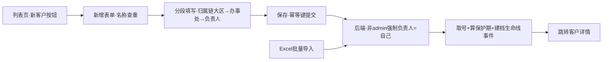

文字链：列表「新客户」/Excel 批量导入 → 表单（查重拦截 → 归属链 → 联系人行）→ 幂等保存（customer:add，Redis Idempotency-Key 防重）→ 服务端强制归属（非 admin 建在自己名下）→ 取号/保护期三线公式/生命线建档事件 → 详情页。

#### 链B：客户处置链（对应 **#4 客户处置链** + **#7 公海捞取链** 的本侧起点）

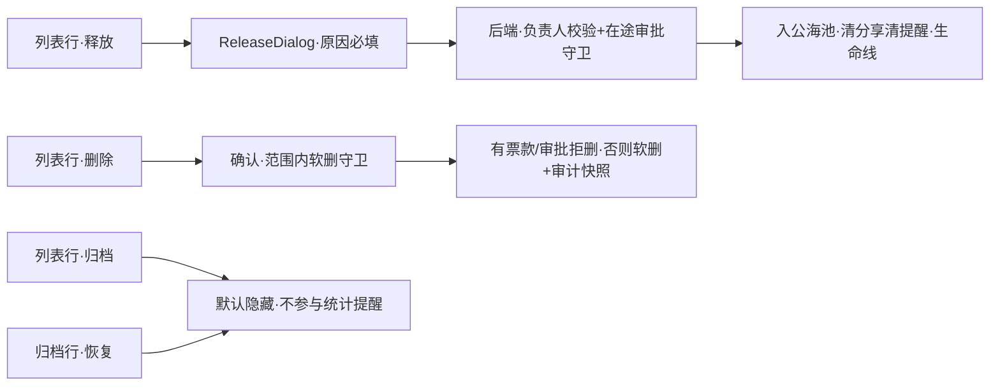

文字链：释放（customer:edit+负责人专属，原因必填）→ 公海池 →（他侧）捞取审批转移归属；归档=停止跟进可恢复；删除=customer:delete 范围内软删 → 回收站（恢复=system:recycle:restore **仅 admin**）。

#### 链C：财务·核心判定链（对应 **#6 财务·核心判定链**）

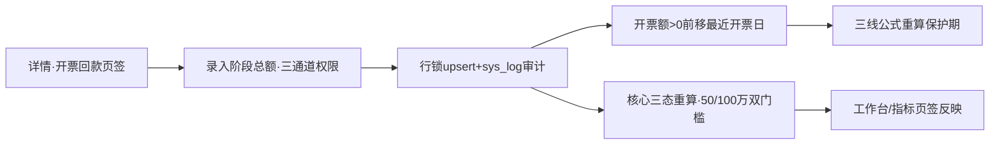

文字链：详情「录入阶段数据」（finance:manage ∨ customer:edit∧finance:view ∨ customer:finance:edit）→ upsert+审计 → 保护期接力（只前移不清延期）→ 真核心/争核心三态落库 → 详情徽章/概览条联动。

#### 链D：客户转移/延期链（对应 **#5 保护期延期链** + **#13 客户转移链**）

文字链：详情基本信息页签「申请延期」→ type=extend 审批（天数走 sys_config 快照，审批人可调）→ 通过后 applyExtendApproval 累加延期重算保护期；「转移客户」→ type=transfer 审批（extraData.newOwnerId）→ 通过后负责人/部门/转移日落库、数据范围即时随新负责人锚点生效。前端入口仅 `!readonly` 门控（无独立权限码），后端 submit 统一 `approval:view`。

#### 链E：客户跟进链（对应 **#3 客户跟进链**）

文字链：详情跟进日志页签输入 →「记录」落库（customer:edit）→ 可选勾选「生成下一步任务」（task:manage）→ POST /api/task 建待办 → 任务页完成/取消闭环。

### ⚠️ 疑点

> 9 条核查重点中与本章节相关者逐条展开；标注【核查重点 N】的为指定清单项，标注【新发现】的为本次审计新检出。核查重点 3（学分录入只读）、4（激励 view-all=region）、5（激励分享制）、7（阅读排行榜/日志仅 admin）属其他菜单章节，不在此展开（4/5 仅在本章四项服务页签的数据口径处沾边，已在该表注明）。

#### 【核查重点 1】销售员有客户导入码（customer:import）——属实，且导入即建在自己名下

- 前端：`TopBar.vue:7` 以 `hasPerm('customer:import')` 显示「批量导入」；验收表 §二「客户导入按钮」行 4 角色全 ✓。
- 后端：`POST /api/customer/import` 挂 `@PreAuthorize customer:import`（`CustomerController.java:585`）。`CustomerImportListener.java:53-54` 将导入客户 `ownerId=currentUserId`、`officeId=currentOfficeId` ——即销售员批量导入的客户**全部落在导入人自己名下、按本人办事处归属**，数据范围天然收敛为本人可见。资源护栏齐备（5MB/5000 行，`ImportGuard.java:32-46`），范围内重名查重（`CustomerImportListener.java:44-46`）。是否预期由管理者裁决；技术面无越权放大点。

#### 【核查重点 2】销售员有客户删除码（customer:delete）——属实，但为"范围内软删"而非任意删

- 前端：`MainTable.vue:116` 行内删除、`:31` 批量删除，均以 `canDelete`=customer:delete 显示（`useCustomerList.js:151`）。
- 后端删除为四道闸：① `@PreAuthorize customer:delete`（`CustomerController.java:270`）；② `assertCanDelete` → canDelete=公海池行级 PERM_DELETE 或统一层"删除范围"判定（`CustomerAccessService.java:116-131`）——销售员 team/self 档位下只能删范围内客户；③ `assertDeletable`：有任何开票/回款记录（含已作废）或在途审批即拒删，文案引导改用「归档」（`CustomerService.java:805-832`）；④ 软删+删分享+清提醒+sys_log 快照留痕（`CustomerService.java:773-798`）。实害有限；是否保留一线删除码待裁决。

#### 【核查重点 6】马吉亮全公司客户范围特例——在客户列表全面生效，含导出

- 验收表 §四 USER 行：马吉亮 NO001 customer 增/删/改/导/入/查看/分享 **全部=all**。
- 代码链路：列表 `applyDataScope`（`CustomerService.java:1370-1405`）经 `rolePermScopeService.anchorOf` 读取该 USER 级档位，all=本集团不过滤 → 他打开客户列表/页签计数/导出（`/export` 走同一 `buildListFilter`+applyDataScope，`CustomerController.java:683-685`）均为**全公司客户**；批量导入上限与 5 万行导出护栏是唯一规模约束。验收表标注「11-12 可见性事件后的特例，是否仍需保留？」——本章仅记录代码事实，不裁决。

#### 【核查重点 8】总监无回收站恢复/清空按钮——与客户删除链衔接的实害点

- 本章删除确认文案明确承诺「删除后将移入回收站，保留期内可由管理员恢复」（`useCustomerList.js:529,661`）。
- 回收站恢复/彻底删两码仅 admin（验收表 §二「恢复/清空回收站按钮」行 ✓✗✗✗；§18「恢复（restore 码=admin）」）。即：**总监（及行政/销售员）删除客户后自己无法恢复，只有 admin 能在回收站捞回**。前端文案与权限现实一致（说的是"管理员"），不算误导，但"可恢复"承诺对总监本人不可自助兑现，属流程依赖点。

#### 【核查重点 9】六项指标对销售员的实际数据口径——本章的"核心指标页签"不受该待核影响（口径区分）

- 待核项针对的是独立菜单页 `/indicator`（statistics:view 档位兜底 self），不在本章节范围。
- 本章客户详情「核心指标」页签是**单客户五项评分**维护/展示：读 `GET /{id}/indicator`、写 `POST /{id}/indicator`，均先过 `assertCanView`/`assertCanEdit`（`CustomerController.java:422-435`）——口径=客户数据范围（销售员 self/team+分享），与第 9 条待核的榜单口径无关。另注：核心三态判定已与五项评分解耦（2026-10-10 裁决，金额三态），五项总分仅客情参考（`CustomerService.java:1934-1941` 注释）。

#### 【新发现 A】逐笔开票/回款的前端按钮已整体下线，但后端写端点与前端 handler 原样保留——休眠入口

- FinanceTab 模板只有「录入阶段数据/阶段行编辑/历史明细折叠」，无任何逐笔发票/回款按钮；`useCustomerDetail.js:258-265` 的 `handleAddInvoice/handleDeleteInvoice/handleConfirmInvoice/handleVoidInvoice/handleAddPayment/handleDeletePayment/handleConfirmPayment/handleVoidPayment` 八个 handler 仍定义、仍从 composable 返回（`:342-343`），但全 UI 无调用点。
- 后端对应端点仍在暴露：`POST /{id}/invoices`、`POST /{id}/invoices/{invoiceId}/confirm|void`、`DELETE /{id}/invoices/{invoiceId}`、`POST /{id}/payments`、`POST /{id}/payments/{paymentId}/confirm|void`、`DELETE /{id}/payments/{paymentId}`（`CustomerController.java:329-389,562-581`，均带三通道 @PreAuthorize 与 assertCanManageFinance 守卫，权限面完整）。
- 结论：UI 层不可达（直连接口仍可写，属"下线未摘除"状态）。建议后续版本删 handler/端点或明确保留为 API 兼容层。

#### 【新发现 B】「申请延期」「转移客户」两个高危发起入口无独立权限码门控

- 前端仅 `!readonly` 判定（`InfoTab.vue:75,77`），不要求 customer:edit；被分享只读客户因 `readonly=1` 被挡住（`useCustomerList.js:505`），但任何持 customer:view 且非只读入口的角色都可发起。后端 `POST /approval/submit` 也仅 `approval:view`（`ApprovalController.java:40-42`，4 角色均有码）。
- 缓解：发起≠生效——延期/转移均须审批通过才落库（转移经 ApprovalService 执行侧校验，延期天数走审批单）。与验收表 §三.4「申请延期→type=extend 审批 / 转移客户→type=transfer 审批」口径一致，属有意设计；但"发起权限宽、执行权限严"的不对称值得管理者知悉。

#### 【新发现 C】详情页 readonly 判据三通道，PC 内部实际只产生两通道

- `useCustomerDetail.js:45-48`：`from==='share' || from==='sea' || readonly==='1'`。PC 端生成点：列表 viewDetail 对被分享行产 `readonly=1`（`useCustomerList.js:505`）；公海页跳详情产 `from=sea`（公海章节）。`from=share` 在 PC 全库无生成点（小程序分享页使用）。结果正确但存在一条 PC 死判据，属低危一致性瑕疵。

#### 【新发现 D】导入为逐行独立成败（非整体事务），部分成功是设计行为

- `CustomerService.importCustomers`（`:544-561`）+ `CustomerImportListener.invoke`：单行失败记入 failures 继续下一行，已成功行不回滚；前端按成功/失败/提示三区回显（`ImportDialog.vue:49-71`）。与 `POST /customer/full` 的强幂等单事务形成对照。提示：导入接口无事务包裹意味着"导入到一半崩进程"会留下部分数据——与模板「5000 行上限」组合后风险可控，如实记录。

#### 【新发现 E】行政的「客户财务管理」码 finance:manage 为休眠码（零绑定）——开票回款编辑实际走 customer:finance:edit

- 后端写通道三选一（`CustomerAccessService.assertCanManageFinance`，`:197-206` + `CustomerController.java:329` 注释「2026-11-03 拆码」）；验收表 §二「客户财务管理/开票回款编辑」行标注 admin/总监/行政 ✓、销售员 ✗，且页面按钮全量对照 §8-F6 已记 finance:manage 休眠。行政场景正解=勾 `customer:finance:edit` + 范围 region（验收表 §四 05 行政行 customer finance_edit=region）。本章 FinanceTab 写门控已与该三通道对齐（`FinanceTab.vue:213-220` 注释「2026-11-01 审计修复…与后端口径统一」）。

---

*本文件为只读审计产出，未改动任何源代码。所有行号以 2026-11-08 工作区代码为准。*


---

## 第 03 章｜PC·文件管理

> 审计口径：一律以代码为准；「谁能看到」列引用《菜单功能按钮数据范围验收表-20261107.md》，不重新推导。
> 前端根目录简写 `ui/` = `aigicrm-ui/src`，后端简写 `be/` = `aigicrm-backend/src/main/java`。

### 概述（侧栏位置/路由、权限码、谁能看到该菜单——引用验收表）

- **侧栏位置/路由**：业务核心组「文件管理」，路由 `/file`（`ui/router/index.js:77-80`，`meta.permission='file:view'`）；菜单行来自 `sys_menu` id=14（`sql/migration/20260802/sys_menu_all.sql:11`，`/file` / `file/index` / `file:view`）。
- **权限码全景**（按钮码均挂在菜单 14 下）：
  | 码 | 出处 | 后端消费 |
  |---|---|---|
  | `file:view` | sys_menu id=14 | 列表/树/存储/分享给我/下载/permissions 读（FileController.java:50,57,120,131,146,207,273,282；FolderAclController.java:47） |
  | `file:upload` / `file:delete` | sys_menu id=47/48（sys_menu_all.sql:11） | 上传（FileController.java:68）、删除文件（:98） |
  | `file:edit` | sys_menu id=81 | 替换（:106）、文件改名（:113） |
  | `file:share` | V26__split_file_mutation_permissions.sql:24-29 | 分享（FileController.java:266） |
  | `file:folder:manage` | 同上 :31-36 | 建/改/删文件夹（FileController.java:77,84,91）、对账（FileReconciliationController.java:28） |
  | `file:acl:manage` | rbac-convergence-m1.sql:28-31 建码；V2026.09.11.6__seed…sql:1130-1141 绑 admin/05/0/06 | ACL 读写五端点（FolderAclController.java:20,24,33,37,59） |
  - 历史事故记录：V22 曾把 upload/delete/edit/share/folder:manage 五码误停（status=0+删绑定，致全员含 admin 写端点 403），V2026.09.11.3__restore_file_mutation_permission_bindings.sql:1-126 恢复 status=1 并按 file:view 角色重建绑定——五码现为"持有 file:view 的角色默认继承"。
- **谁能看到该菜单**（验收表 §7 + 角色矩阵）：
  - 验收表 L95：「文件管理（file:view，**全员**）」。
  - 角色矩阵 L38：「文件管理 + 上传/删除/编辑/分享/ACL 五码 | admin ✓ | 总监 ✓ | 行政 ✓ | 销售员 ✓」。
  - 数据范围（验收表 L98，原样引用）：admin/总监=全公司文件（view=all，仍受夹 ACL 约束）；行政=本大区（region）+上传不限（upload=all）；销售员=本人上传+被 ACL/分享授权的夹（兜底 self）；"分享给我"=被点名的文件；四项服务页签=激励附件按激励可见性。
  - 页内按钮显隐的代码实现是**双重门**：全局权限码（`userStore.hasPermission`）× 文件夹级 ACL 权限位（`folderPerms`，来自 GET /file/folders/{id}/permissions 或树内嵌 perms），见 `ui/composables/useFilePage.js:88-98`、`ui/views/file/FolderPanel.vue:26-36,61-64`。

### 功能清单（每功能一行，说人话）

1. **四页签文件库**：公共/私人/四项服务/分享给我四个 Tab，各带计数徽标（`ui/views/file/index.vue:47-58`，计数来自 useFilePage.js:171-184）。
2. **文件夹树**：左侧树+「全部文件」根节点，按 scope 过滤且只显示我有权看的夹（be/…/file/service/FileService.java:115-152）。
3. **文件列表与全局搜索**：文件名/上传人/所在文件夹三字段 LIKE（FileService.java:161-166），分页 30/页。
4. **上传**：弹窗多选/拖拽，逐个直传，支持落到选中文件夹（ui/views/file/UploadDialog.vue）。
5. **预览**：图片渐进加载/视频/音频/PDF/Word/Excel/文本内嵌阅读器（ui/components/FilePreview.vue:19-49）。
6. **下载**：下载完成即用系统阅读器打开；下载走 1h 短时专用 token，主 JWT 不进 URL（be/…/FileController.java:36-48）。
7. **替换（出新版本）**：行内选定新文件覆盖，version+1，激励佐证禁替换（FileService.java:488-543）。
8. **分享**：点对点分享给同事（只读），对方在「分享给我」页签看到（FileService.java:1421-1487）。
9. **文件夹管理**：新建/重命名/删除（仅空夹），删除级联清 ACL（FileService.java:318-395）。
10. **夹级 ACL 权限**：按角色授 6 项权限（查看/上传/编辑/删除/分享/下载）+ 夹级下载开关（FolderAclController.java 全部）。
11. **删除=进回收站**：软删+配额即时归还，保留期 30 天到期自动清（FileService.java:404-450；FileRecycleCleanupTask.java:32-46）。
12. **存储配额与扩容申请**：顶部配额条+进度；「申请扩容」走 type=storage 审批，通过后自动调额+写安全审计（ApprovalService.java:225-240,962-968；SysUserService.java:653-676）。
13. **附件对账（后端 Only）**：元数据 vs 磁盘全量核对，无前端入口（FileReconciliationController.java:27-32）。
14. **文件改名（后端 Only，PC 未接）**：PUT /file/{id}/rename 仅小程序接入（FileController.java:113-118）。

### 按钮明细（每个功能块一张表）

#### A. 宿主页顶部「存储概览条 + Tab」（ui/views/file/index.vue）

| 按钮 | 在哪 | 前端行为 | 后端动作 | 谁能看到 |
|---|---|---|---|---|
| 申请扩容 | index.vue:26-31 | `openStorageApply` 打开弹窗（useFilePage.js:248）；按钮载入 `/file/storage/apply-info` 资格（useFilePage.js:198-206），不可申请时禁用+tooltip 显示原因（index.vue:19-24,111） | 无（纯打开弹窗）；资格数据来自 GET /api/file/storage/apply-info（file:view）：读用户 used/quota、生效上限（配置键 file.storage.max.quota，钳位 [1GB,1TB]，SysUserService.java:575-604,679-700），资格=管理员∨开关开+在授权名单（SysUserService.java:607-637 同口径），再叠加在途单判定——有 reviewing/pending 的 storage 单则 canApply=false（FileController.java:137-143 → ApprovalService.java:984-993） | 全员可见按钮；**可点资格**由后端 apply-info 裁定（admin 恒可；非 admin 须开关+名单，SysUserService.java:575-585），无码（无 file:view）整页不可达 |
| 搜索框（回车） | index.vue:35 | `searchFiles` 回第 1 页重查（useFilePage.js:231） | GET /api/file/list（file:view）：scope 白名单（public/private/incentive 之外返回空页，FileService.java:173-175）→ 可见文件夹过滤（本人创建/上级链/ACL view/公共，:209-233 → FolderPermissionService.java:69-90 上级链）→ incentive 另加本人+shared=1 旁路（:186-201）→ 关键字三字段 EXISTS 子查询参数绑定无注入（:161-166） | 全员（能进本页者） |
| 新建文件夹 | index.vue:37 | 显隐=全局码 `file:folder:manage`（useFilePage.js:88）× Tab/夹 upload 权（useFilePage.js:93-98：公共根仅 admin）；点击 `openCreateFolder`（useFilePage.js:235） | 弹窗「创建」触发 POST /api/file/folders（file:folder:manage）——见 C 表 | 持 file:folder:manage 且当前夹有 upload 权者（公共根目录再叠加 admin） |
| 上传文件 | index.vue:38-39 | 显隐=非 incentive/shared_to_me Tab 且 `folderPerms` 含 upload（useFilePage.js:105-126：选中夹时来自 GET /file/folders/{id}/permissions，根目录硬编码：公共根非 admin 也含 upload——⚠️见疑点4）；点击 `openUpload`（useFilePage.js:234） | 弹窗「开始上传」触发 POST /api/file/upload（file:upload）——见 D 表 | 全员显示资格同上；⚠️公共 Tab 根目录非 admin 显示但后端必拒 |
| Tab 公共/私人/四项服务/分享给我 ×4 | index.vue:47-58 | `switchTab`：重置选中夹/页码，重拉树+权限+列表（useFilePage.js:214-221）；incentive/shared_to_me 两 Tab 不渲染文件夹树（index.vue:62-66），权限固定 view+download（useFilePage.js:106-110） | 每个 Tab 各发 GET /api/file/folders（file:view：scope 白名单+可见性过滤+批量填充 perms/fileCount，FileService.java:115-152）与 GET /api/file/list（见上）；分享给我 Tab 走 GET /api/file/shared-to-me（file:view：biz_file_share 按 shared_to=本人 取 fileId 集合再查 biz_file，keyword 同款三字段，FileService.java:1466-1487）与计数 GET /api/file/shared-to-me/count（:1489-1498） | 四 Tab 全员可见；**数据行**按上述范围裁定（验收表 L98） |

#### B. 左侧文件夹树（ui/views/file/FolderPanel.vue）

| 按钮 | 在哪 | 前端行为 | 后端动作 | 谁能看到 |
|---|---|---|---|---|
| 「全部文件」根节点 | FolderPanel.vue:6-11 | `selectFolder(null)` 回根（useFilePage.js:223-228，重拉权限+列表） | GET /api/file/list（folderId 空则返回无夹文件+可见夹文件集合，FileService.java:209-233） | 全员 |
| 文件夹行（选中） | FolderPanel.vue:14-20 | `selectFolder(folder)`，选中即调 GET /file/folders/{id}/permissions 刷新按钮权限（useFilePage.js:223-228,105-126） | GET /api/file/folders/{id}/permissions（**file:view**，2026-11-01 由 acl:manage 降码，FolderAclController.java:42-50）：admin→6 项全；夹主/上级链→6 项全（FolderPermissionService.java:93-114,98-100）；ACL 角色匹配→并集；公共夹兜底 view+download（:109-112）；夹不存在返回空 | 全员（树内只渲染可见夹，可见性=本人创建/上级链/ACL view/公共，FileService.java:132-136,1144-1169） |
| 重命名（悬停铅笔） | FolderPanel.vue:27-29 | 显隐=夹 perms 含 edit **且** 全局码 file:folder:manage（useFilePage.js:88；FolderPanel.vue:26）；打开 RenameFolderDialog | 弹窗「保存」触发 PUT /api/file/folders/{id}（file:folder:manage）——见 C 表 | 夹主/上级链/ACL edit 持有者 且 勾了 file:folder:manage 的角色 |
| 权限设置（悬停齿轮） | FolderPanel.vue:30-32 | 显隐=夹 perms 含 edit **且** 全局码 `file:acl:manage`（FolderPanel.vue:61-64，2026-11-01 审计修复：无码者不再看到恒 403 空壳入口）；打开 AclDialog | 弹窗内各按钮触发 FolderAclController 五端点（file:acl:manage）——见 G 表 | 持 file:acl:manage（admin/05/0/06，V2026.09.11.6 迁移绑定）且对该夹有 edit 权者 |
| 删除（悬停垃圾桶） | FolderPanel.vue:33-35 | 显隐=夹 perms 含 delete 且 file:folder:manage（FolderPanel.vue:26,33-35）；`handleDeleteFolder`：红色确认框文案已对齐后端"仅空夹可删"（useFilePage.js:297-312）；成功后清选中、刷新树/权限/列表 | DELETE /api/file/folders/{id}（file:folder:manage）：夹存在性→P_DELETE 权限（admin/夹主/上级链/ACL，FolderPermissionService.java:45-56）→夹内有未删文件拒绝（"请先清空"，FileService.java:377-383）→有子夹拒绝（:385-389）→级联删该夹全部 ACL 行防孤儿（:392）→删夹 | 同重命名（换 delete 权位） |
| 个人存储空间进度条 | FolderPanel.vue:42-46 | 仅私人 Tab 渲染，读共享态 storagePercent | 数据来自 GET /api/file/storage（file:view）：读 sys_user.storage_used/storage_quota 并格式化（FileService.java:1127-1137） | 全员（私人 Tab） |

#### C. 文件夹新建/重命名弹窗（ui/views/file/CreateFolderDialog.vue、RenameFolderDialog.vue）

| 按钮 | 在哪 | 前端行为 | 后端动作 | 谁能看到 |
|---|---|---|---|---|
| 创建 | CreateFolderDialog.vue:10 | `handleCreateFolder`：非空名校验，POST /file/folders 带 {folderName, folderType=当前Tab, parentId=选中夹\|\|0}（CreateFolderDialog.vue:24-37），成功刷树 | POST /api/file/folders（**file:folder:manage**，FileController.java:77-82）：folderType 白名单仅 public/private（FileService.java:322-324）；parentId=0 归一化为根（0 是 DDL 哨兵，:329-331 修复 PC/MP 传 0 被 403 的事故）；子夹→父夹 P_UPLOAD 校验（:335-338）；公共根（无父）→仅 admin（:339-341）；私人夹 ownerId=当前人（:342-344）后 insert | 弹窗入口见 A 表「新建文件夹」 |
| 取消 | CreateFolderDialog.vue:9 | 关弹窗 | — | 同上 |
| 保存（含输入框回车） | RenameFolderDialog.vue:10,5 | `handleRenameFolder`：trim 非空→PUT /file/folders/{id} {folderName}（RenameFolderDialog.vue:31-40）；打开时回填原名（watch :25-29） | PUT /api/file/folders/{id}（**file:folder:manage**，FileController.java:84-89）：非空校验→P_EDIT 权限唯一仲裁（FileService.java:348-363→FolderPermissionService.check）→updateById 改名 | 夹主/上级链/ACL edit 且持 file:folder:manage |
| 取消 | RenameFolderDialog.vue:9 | 关弹窗 | — | 同上 |

#### D. 上传弹窗（ui/views/file/UploadDialog.vue）

| 按钮 | 在哪 | 前端行为 | 后端动作 | 谁能看到 |
|---|---|---|---|---|
| 拖拽区（点击选择/拖放） | UploadDialog.vue:3-20 | 点击 `pickFiles`（:44）调起多选 input（:19）；拖放 `handleDrop` 合并待传列表（:45-48）；提示语按 Tab 区分公共/私人（:16-18） | — | 弹窗由「上传文件」按钮唤起（A 表） |
| 取消 | UploadDialog.vue:22 | 关弹窗并清空待传（@close :2） | — | 同上 |
| 开始上传（N 个） | UploadDialog.vue:23-25 | `startUploads` 逐个 `uploadOne`（:65-80）：FormData 带 file+scope+folderId（folderId 为 null 不携带，防后端 400，:59-60）；单文件超时 600s（:61）；全部完成汇总成功/失败名单并 `refreshAll`（useFilePage.js:209-211 刷列表/树/计数/配额） | POST /api/file/upload（**file:upload**，FileController.java:68-75）：①scope 白名单 public/private/incentive 之外 403（FileService.java:255-257）；②公共 scope+无夹+非 admin→拒绝"公共根目录文件仅管理员可上传"（:262-264，与匿名公共下载通道对称的门槛）；③落夹→夹 P_UPLOAD 校验（:267-269）；④私人 scope→`tryConsumeQuota` DB 端原子扣配额（WHERE used+size<=quota，并发安全，:273-280）；⑤文件名消毒防路径穿越（sanitizeFilename :1183-1191）+扩展名白名单（30 类，html/svg/js 等被拒、无扩展名拒绝，:1199-1230）→落盘 scope/userId/唯一文件名（重名加 (1) 后缀 :1235-1254）→本地写后回读字节数校验（:620-630）→插 biz_file；失败补偿归还配额（:310-315）。无重算/通知副作用 | 入口按 A 表；后端再按 scope/夹权二次裁定 |

#### E. 文件列表行操作（ui/views/file/FileTable.vue）

| 按钮 | 在哪 | 前端行为 | 后端动作 | 谁能看到 |
|---|---|---|---|---|
| 打开（眼睛） | FileTable.vue:29-31 | `handlePreview`：先 `refreshDownloadToken`（utils/token.js:60,75 → GET /api/file/download-token）再拼下载 URL，按扩展名定预览种类（useFilePage.js:261-271）→ FilePreview 弹窗 | GET /api/file/download-token：签发 1h 专用下载 token（scope=download），并携带主 token 的 jti——登出拉黑主 token 后下载 token 联动失效（FileController.java:36-48）；预览内容走 GET /api/file/download/{id}（见「下载」行） | 全员（列表可见即可打开预览——预览与下载同一鉴权端点，实际可看面由后端裁定） |
| 下载 | FileTable.vue:32-34 | 显隐=夹 perms 含 download **且** `folderDownloadable===1`（FileTable.vue:32；permissions 接口返回）；`handleDownload`：下载保存后自动唤起预览弹窗（2026-10-17 客户口径"下载完成即打开"，useFilePage.js:273-283）；带实时 Bearer 头（防切换集团旧 token，:276-281 注释） | GET /api/file/download/{id}（file:view，FileController.java:146-153）：`canDownloadFile` 判定（FileService.java:1302-1321）= canAccessFile（admin/公共文件/上传者/被分享者 :1272-1281）∨ 夹 P_DOWNLOAD ∨ 激励文件按 admin∨can_view_all∨shared 可见（:1307-1310）；再叠加**夹级下载开关**——非 admin 且夹 downloadable≠1 一律仅预览不可下（:1314-1319）；本地文件支持 Range 断点/206（:769-783）与 ≤300px 缩略图分支（thumbnail 参数 :757-760）；OSS 文件 302（仅 https:// 白名单，:811-815）；Content-Disposition：纯图/视频/PDF inline，SVG/HTML 等活性内容强制 attachment 防存储型 XSS（:733-738）。另有按 key 的 GET /api/file/download/**（:207-262，同权 canDownloadFile+路径穿越 normalize 校验 :216-219）与匿名 GET /api/file/download/public/**（:155-205，无登录、物理路径限 public/ 段+元数据须 file_scope=public+忽略租户拦截器专用查询，:175-188） | 夹内文件=有 download 权位且开关开者；根级公共文件=全员（含匿名）；根级私人/激励=上传者/被分享者/admin |
| 分享 | FileTable.vue:35-37 | 显隐=非 public/shared_to_me Tab 且夹 perms 含 share；`openShareDialog`（useFilePage.js:240-243） | 弹窗「确认分享」触发 POST /api/file/{id}/share（**file:share**，FileController.java:266-271）——见 F 表 | 私人/四项服务 Tab 中有夹 share 权位者 |
| 替换 | FileTable.vue:38-40 | 显隐=夹 perms 含 edit；`openReplaceFile` 触发隐藏 input 选文件（FileTable.vue:64,88-91）；选定后 `handleReplaceChosen` POST 替换并提示"替换成功，版本 N"（:93-113），刷列表/树/计数 | POST /api/file/{id}/replace（**file:edit**，FileController.java:106-110）：`checkFile(P_EDIT)`（admin/夹 edit 权/无夹文件按上传者+上级链，FolderPermissionService.java:59-66）→**激励计分佐证禁替换**（五槽任一被激励记录引用即拒绝，引导走激励模块删除重传触发重算，FileService.java:499,579-595）→@Transactional：新文件先落盘（旧扩展兜底过白名单 :504-506,609-617）→更新 oss_key/oss_url/file_size/version+1/replace_by/replaced_at（:513-522）→私人文件按差额原子调配额（同事务 :528-530）→**旧文件物理删除注册 afterCommit**（回滚不删防"报失败但文件已丢"，:531-534,549-561）；失败路径 best-effort 清孤儿新媒体（:536-541,568-575）；清旧版本缩略图缓存（:523-525） | 夹主/上级链/ACL edit 且持 file:edit 码 |
| 删除 | FileTable.vue:41-43 | 显隐=夹 perms 含 delete；`handleDelete`：确认框文案"移入回收站，保留期内可由管理员恢复"（useFilePage.js:286-295）→DELETE 成功后 `refreshAll` | DELETE /api/file/{id}（**file:delete**，FileController.java:98-103）：非 admin 时夹内文件按 P_DELETE（FolderPermissionService.checkFile）、公共根文件仅 admin、私人/激励根文件仅上传者本人、其余 scope 一律拒绝（IDOR 修复，FileService.java:417-431）→@Transactional 逻辑删（deleted=1）影响行数≠1 即并发重复删，幂等成功不二次退款（:438-442）→清缩略图缓存（:444）→私人文件 DB 原子归还配额（:447-449）；**不物理删字节**——回收站保留期由定时任务清（FileRecycleCleanupTask.java:32-46，每天 03:30，sys_config file.recycle.retention.days 默认 30，0=不清理）；物理清空/恢复入口在系统管理→回收站（RecycleService） | 夹内文件=有夹 delete 权位且持 file:delete；根级按 scope 归属（见左） |
| 分页器 | FileTable.vue:51-60 | 改页/改每页条数→`loadFiles`（keyword 搜索回第 1 页由 searchFiles 单独处理，useFilePage.js:230-231） | 同列表 GET（范围过滤每次请求都重新生效） | 全员 |

#### F. 分享弹窗（ui/views/file/ShareDialog.vue）

| 按钮 | 在哪 | 前端行为 | 后端动作 | 谁能看到 |
|---|---|---|---|---|
| 确认分享 | ShareDialog.vue:11 | 多选用户（懒加载 GET /customer/users/simple 简版字典，ShareDialog.vue:28-35；api/customer.js:73-74）→`confirmShare` POST 分享→刷 Tab 计数（:37-45） | POST /api/file/{id}/share（**file:share**）：夹内文件按 P_SHARE（admin/夹主/上级链/ACL share，FileService.java:1430-1433）；无夹文件仅上传者本人（:1434-1436）；**集团边界守卫**——目标用户不在当前集团直接拒绝（GroupScopeUtil 比对，防跨集团死行，:1440-1451）；逐目标幂等去重插 biz_file_share（已存在跳过，:1452-1464）；只读语义（被分享人获得查看/下载权，无写权） | 私人/四项服务 Tab 有夹 share 权位且持 file:share 者（验收表 L38：四角色均有码；实际按钮再看夹权位） |
| 取消 | ShareDialog.vue:10 | 关弹窗 | — | 同上 |

#### G. 权限设置（夹级 ACL）弹窗（ui/views/file/AclDialog.vue）

| 按钮 | 在哪 | 前端行为 | 后端动作 | 谁能看到 |
|---|---|---|---|---|
| 角色多选（字典） | AclDialog.vue:5-7 | 打开弹窗懒加载 GET /file/folders/acl-roles（AclDialog.vue:89-97）——专用轻量端点替代要求 system:role:view 的 /system/roles，修复 05/06 及非 admin 夹主打开时下拉恒空（api/file.js:56-58 注释） | GET /api/file/folders/acl-roles（**file:acl:manage**，FolderAclController.java:58-62）：只暴露启用角色的 id+名称最小面（FolderAclService.java:55-64） | 弹窗入口本身需 file:acl:manage（FolderPanel.vue:30-32,61-64）+ 夹 edit 权位 |
| 保存授权 | AclDialog.vue:14-16 | 选角色+勾 6 项权限（查看/上传/编辑/删除/分享/下载，PERM_OPTIONS :60-67）→**逐角色循环** POST /file/folders/{id}/acl（:106-108）→刷 ACL 列表与列表页按钮权限（:112-114）；⚠️循环中途失败 catch 静默，无部分成功提示（见疑点7） | POST /api/file/folders/{id}/acl（**file:acl:manage**，FolderAclController.java:23-30）：body 畸形（缺 roleId/非数字/perms 非数组）→"参数错误"不冒泡 500（FolderAclService.java:71-87）；每次仍先 `requireEdit` 夹 P_EDIT（:130-135）→权限项白名单校验（6 项之外拒绝 :93）→按 (folderId,roleId) upsert biz_folder_acl，新插记 createdBy（:95-104） | 持 file:acl:manage 且对该夹有 edit 权者（admin/夹主/上级链） |
| 下载开关（el-switch） | AclDialog.vue:24 | `handleDownloadableChange` PUT {downloadable:0\|1}，失败回滚开关态（:133-145）；即时回写共享态 folderDownloadable | PUT /api/file/folders/{id}/download（**file:acl:manage**，FolderAclController.java:36-40）：requireEdit→值域 0/1 校验→更新 biz_file_folder.downloadable（FolderAclService.java:113-120）；开关在下载端点生效（非 admin 且 ≠1 的夹内文件拒绝下载字节，FileService.java:1314-1319） | 同上 |
| 移除（已授权角色行） | AclDialog.vue:36 | DELETE /file/folders/{id}/acl/{roleId}→刷列表（:122-131） | DELETE /api/file/folders/{id}/acl/{roleId}（**file:acl:manage**，FolderAclController.java:32-34）：requireEdit→删对应 ACL 行（FolderAclService.java:107-111） | 同上 |
| （读）已授权角色列表 | AclDialog.vue:29-40 | 打开弹窗 GET /file/folders/{id}/acl 渲染 | GET /api/file/folders/{id}/acl（**file:acl:manage**，FolderAclController.java:19-21）：requireEdit→ACL 行展开 roleId→角色名+perms 数组（FolderAclService.java:36-47） | 同上 |

#### H. 存储扩容申请弹窗（ui/views/file/StorageApplyDialog.vue）

| 按钮 | 在哪 | 前端行为 | 后端动作 | 谁能看到 |
|---|---|---|---|---|
| 提交申请 | StorageApplyDialog.vue:51 | `handleSubmit`：前端预检——整数 GB、须大于当前配额（min=当前+1GB，:72,90-92）、不超上限（max 向下取整 :71,94-96）、理由非空≤200 字（:98-105）→`submitApproval({type:'storage', extraData:{quota(bytes), reason}})`（:109-112）→成功关弹窗并只刷 apply-info 资格（:114-115，不重拉列表） | POST /api/approval/submit（审批模块）：类型白名单（claim/transfer/extend/storage，ApprovalService.java:77,217-220）；storage 分支：解析 extraData（quota 正整数 bytes、reason 规范化 1-200 字，ApprovalService.java:225-240→parse :996-1040、SysUserService.java:640-649）→**申请人行 SELECT…FOR UPDATE 串行化**（:231-233）→资格/只升不降/上限复核（SysUserService.java:607-637）→在途单拒绝（:234-236）→extraData 规范化落单（忽略客户端 oldQuota，库取当前值快照 :239,1042-1048）。审批通过执行侧：申请人行锁内再复核（并发导致不升反降→明确报错随事务回滚）→改 sys_user.storage_quota→**写安全审计**（oldQuota/newQuota/approvalId，SysUserService.java:653-676）。禁自审由审批中心通用规则保证（验收表/审批章节） | 按钮「可点资格」由 GET /file/storage/apply-info 裁定：admin 恒可；非 admin 须系统开关开+在授权名单 JSON（SysUserService.java:575-585）；配额已达上限也关入口（:587-589）；有在途单入口置灰并提示（FileController.java:137-143） |
| 取消 | StorageApplyDialog.vue:50 | 关弹窗 | — | 同上 |

#### I. 预览弹窗（ui/components/FilePreview.vue，由「打开/下载」唤起）

| 按钮 | 在哪 | 前端行为 | 后端动作 | 谁能看到 |
|---|---|---|---|---|
| 关闭 | FilePreview.vue:52 | 关弹窗 | — | 随预览入口 |
| 下载文件 | FilePreview.vue:53 | `download()`：downloadFile 保存本地副本（带实时 Bearer 头），成功提示"已下载"（:113-120）——只存副本不再弹新页（:108-110 注释口径） | 同「下载」行的 download/{id} 端点（每次请求重新鉴权+下载开关复核） | 随预览入口；可否取到字节仍由后端裁定 |
| （渲染器）图片渐进/视频/音频/PDF/Docx/Sheet/Text | FilePreview.vue:19-49 | 按扩展名 previewKindOf 分流，重渲染器按需懒加载不进首屏（:66-70）；图片先缩略秒开再换高清（:95-106） | 内容流同 download/{id}（图片缩略图走 thumbnail 参数分支，FileService.java:829-890，缓存键含 version/mtime 防替换后旧图命中） | 同上 |

### 业务链条（mermaid + 文字链）

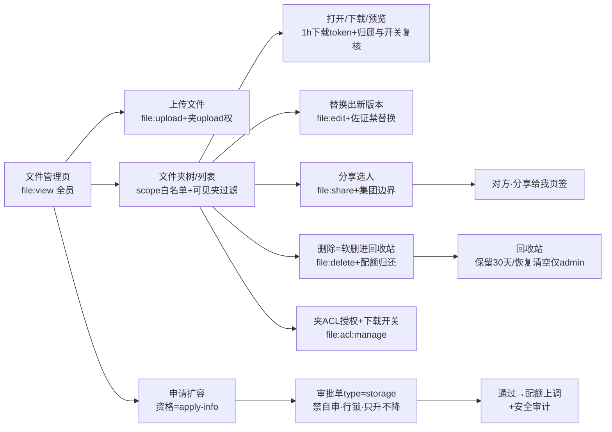

文字链：**上传**（file:upload+夹 upload 权，公共根仅 admin）→**树/列表**（可见夹过滤+激励 shared 旁路）→**打开/下载/预览**（短时下载 token、夹级下载开关）→**分享选人**（集团边界内点对点）→**对方「分享给我」页签**预览下载；支线①**替换/删除**（删除=软删→回收站，30 天保留期定时清，恢复/清空按钮仅 admin）；支线②**夹 ACL 授权**（六项权限+下载开关，file:acl:manage）；支线③**申请扩容**（apply-info 资格→type=storage 审批→通过配额上调+审计）。对应《页面按钮全量对照-20261107.md》§0 业务链：**#11 文件协作链、#12 文件扩容链、#18 回收站链**（删除入回收站段）、#14 审批中枢链（storage 单审批段）。

### ⚠️ 疑点（9 条核查重点中与本章节相关者 + 本次新发现）

**疑点1（核查重点 #5：激励分享制 29 条授权 can_view_all 全=0）——已核实，PC 文件中心与分享制同源，无缺陷。**
「四项服务」Tab 列表与下载共用一套激励可见性：全量旁路=admin∨`biz_incentive_grant.can_view_all=1`（FileService.java:186-190,1293-1300），否则=本人上传 ∨ 他人 shared=1 记录五槽附件并集（:191-201,1330-1390，指纹+30s TTL 缓存 :55-58,1348-1366）。销售员 can_view_all 全 0（验收表 §9 登记）→ 在文件中心只能看到自己上传的激励附件+被点对点分享的，与激励模块分享制口径一致。旁路数据源与激励模块同表（IncentiveService.java:49-51），非独立配置。

**疑点2（核查重点 #8：总监无回收站恢复/清空按钮）——已核实，代码与验收表一致；总监删除文件后依赖 admin 兜底。**
文件删除为软删（FileService.java:404-450），字节保留至回收站保留期（默认 30 天，FileRecycleCleanupTask.java:26,32-46，sys_config `file.recycle.retention.days`）；恢复/清空入口在系统管理→回收站「已删除文件」页签，前端按钮显隐用 `system:recycle:restore`/`system:recycle:purge`（ui/views/system/recycle.vue:350-351,48-50,218）。验收表角色矩阵：「回收站」菜单 admin✓总监✓，而「恢复/清空回收站按钮」仅 admin✓总监✗——即总监在文件页删错文件无法自恢复，需找 admin。口径成立，登记提醒业务侧。

**疑点3（核查重点 #4：行政激励 view-all=region 与文件中心的口径分叉）——待核生产授权行。**
文件侧激励全量旁路只认 `can_view_all=1` 这一个布尔（FileService.java:1293-1300），**没有 region/大区维度**；且激励模块自身的"看全部"资格还叠加 can_edit/can_delete 旁路（IncentiveService.java:185-191），文件侧没有这两个旁路。若行政的激励授权行是"本大区"档位（can_view_all=0，大区范围另存），则行政在激励查询能看本大区全部记录，但在 PC 文件中心「四项服务」Tab 看不到本大区未分享记录的附件（只能看本人+shared=1）→ 同一份材料两端可见面不一致。验收表 L98 写"四项服务页签=激励附件按激励可见性"，未明确 region 是否传导到文件侧。**待核**：生产 `biz_incentive_grant` 行政行的实际字段值，及产品预期（附件可见是否要求跟随大区）。

**疑点4（本次新发现）公共 Tab 根目录「上传文件」对非管理员是"必败按钮"。**
前端根目录权限硬编码：非管理员公共根= `['view','upload','download']`（useFilePage.js:113-117），于是「上传文件」按钮在公共 Tab 根目录对普通用户可见可点（index.vue:38-39）；但后端明确拒绝——公共 scope+无夹+非 admin 抛"公共根目录文件仅管理员可上传"（FileService.java:262-264，2026-10-27 加的门槛，与匿名公共下载通道对称）。2026-10-27 已对「新建文件夹」修过同款不对称（canCreateFolder 公共根叠加 isAdmin，useFilePage.js:85-98 注释），**上传按钮未同步修**：普通用户每次点都会得到失败提示。建议同款收口（公共根非 admin 隐藏按钮或改 tooltip 说明）。

**疑点5（本次新发现）PC 端无「文件改名」入口——后端端点已上线但 PC 未接。**
PUT /api/file/{id}/rename 于 2026-11-06 上线（FileController.java:113-118，file:edit+checkFile(P_EDIT)，仅改 file_name 不动物理对象，FileService.java:459-474），当前只有小程序接入（aigicrm-miniprogram/api/file.js:57-59、pages/files/index.js:1145）；PC `api/file.js` 无 renameFile 函数（全文核对 ：1-83），FileTable 行操作只有 打开/下载/分享/替换/删除 五个（FileTable.vue:29-43）。PC 用户无法改文件名——若产品预期双端同功能，PC 需补按钮。

**疑点6（本次新发现）附件对账端点无任何前端入口，且仅 local 存储模式有效。**
GET /api/file/reconciliation（file:folder:manage，FileReconciliationController.java:27-32）在全前端（PC aigicrm-ui + 小程序）零调用（本次 `grep -rn "file/reconciliation"` 仅命中 PermScopeManager.vue 中无关的"范围对账"注释）；Service 自认潜伏项——存在性检查只查本地磁盘，`STORAGE_TYPE=oss` 部署后对账失真（FileReconciliationService.java:27-28 注释、:91-100 仅 Files.exists）。当前只能手工调 API 做数据治理；若切 OSS 需先补 OSS 探测。

**疑点7（本次新发现）ACL「保存授权」多角色循环无部分失败提示。**
选中多个角色时前端逐角色串行 POST（AclDialog.vue:106-108），任一失败即中断循环进 catch 静默（:115-116）——已成功的角色不提示、失败角色不点名，用户只看到"无反应"。低频操作且每笔后端都有独立校验（FolderAclService.java:89-105），影响为体验而非数据正确性；建议改为汇总成功/失败名单（同上传弹窗的 failedNames 模式 UploadDialog.vue:75）。

**疑点8（备查）「下载」按钮的实际行为=保存+自动打开阅读器。**
`handleDownload` 在 downloadFile 成功后立刻 `handlePreview(row)`（useFilePage.js:273-283），即点一次「下载」会先后出现保存与预览两个动作——这是 2026-10-17 按客户口径"下载完成即用系统文件阅读器打开"刻意实现的（代码注释在案），非缺陷；但与图标语义有出入，pptx 等浏览器不可渲染格式会弹"暂不支持"说明（文件本体已存本地）。培训口径需说明。

---
#### 附：端点覆盖清单（本章节实际核对的后端端点，共 26 个）

FileController（18）：GET /file/download-token、GET /file/folders、GET /file/list、POST /file/upload、POST /file/folders、PUT /file/folders/{id}、DELETE /file/folders/{id}、DELETE /file/{id}、POST /file/{id}/replace、PUT /file/{id}/rename（PC 未接）、GET /file/storage、GET /file/storage/apply-info、GET /file/download/{id}、GET /file/download/public/**、GET /file/download/**、POST /file/{id}/share、GET /file/shared-to-me、GET /file/shared-to-me/count。
FolderAclController（6）：GET /file/folders/{id}/acl、POST /file/folders/{id}/acl、DELETE /file/folders/{id}/acl/{roleId}、PUT /file/folders/{id}/download、GET /file/folders/{id}/permissions、GET /file/folders/acl-roles。
FileReconciliationController（1）：GET /file/reconciliation（无前端入口）。
审批模块（1）：POST /approval/submit（type=storage 扩容链；其 approve 侧 storage 执行段随审批章节详审）。
辅助字典（未计入）：GET /customer/users/simple（ShareDialog 用户下拉，api/customer.js:73-74）。


---

## 第 04 章｜PC·四项激励

> 审计基准：以 2026-11-08 仓库源代码为准（前端 aigicrm-ui/src、后端 aigicrm-backend/src/main/java）；三份 docs 参考文档仅作骨架与「谁能看到」列的引用来源，正文一律以代码证据为准。
> 仓库根：`/Users/dongjun/东来/项目/02-已上线/01-AIGICRM/02-迭代源代码`（下文相对路径均以此为基）。

### 概述

- **侧栏位置/路由**（`aigicrm-ui/src/router/index.js`）：
  - 激励上传 `/incentive`（index.js:84-93，meta 权限码 `incentive:add`，parentTitle「四项激励」）
  - 激励统计 `/incentive/stats`（index.js:95-102，码 `incentive:stats:view`）；下钻明细 `/incentive/stats/detail/:childId`（index.js:105-110，同码）
  - 激励查询 `/incentive/search`（index.js:112-117，码 `incentive:view`）
  - 案例库 `/case-library`（index.js:122-126，码 `incentive:view`，parentTitle「四项服务」）
  - 授权管理不在本组侧栏：位于 系统设置→权限中心→「激励专项授权」页签（`views/system/PermCenter.vue:25`），页面码 `system:config:view`
- **谁能看到该菜单**（引自《菜单功能按钮数据范围验收表-20261107.md》第 39-41 行，不重新推导）：「四项激励组（上传/查询/统计+查看/排行/编辑/阅读统计）」admin ✓ / 总监 ✓ / 行政 ✓ / 销售员 ✓；「案例库（四项服务组）」四角色 ✓；授权面板本身见验收表 §13（权限中心，system:config:view/edit，canEdit=isAdmin∧system:config:edit）。
- **权限码全景**：`incentive:view`（查询/案例库/记录列表数据面）、`incentive:add`（上传）、`incentive:stats:view`（统计表）、`incentive:rank:view`（排行页签）、`incentive:rank:export`（客户排行导出，默认仅 admin，RankTableView.vue:9-11 注释）、`incentive:person-rank:export`（个人排行导出，PersonRankTableView.vue:8-9）、`incentive:read-stats`（阅读统计，工作台卡，dashboard/index.vue:350-351）、`incentive:read-ranking:view`（本月阅读排行榜，仅 admin，router/index.js:291-300）。旧码 `incentive:view-shared / view-all / manage` 已废弃（IncentivePermissionController.java:19 注释），改为用户级授权表 `biz_incentive_grant` 四开关（can_view_shared/can_view_all/can_edit/can_delete，IncentiveService.java:165-171）。
- **数据面两种可见性口径并存**（后端 IncentiveService.java）：
  - 记录列表（`GET /incentive/records`、分类角标、客户学分）：分享制——`canSeeAllIncentive`（admin∨can_view_all∨can_edit∨can_delete，IncentiveService.java:189-194）→ 全量；否则「本人 ∨ (shared=1 ∧ can_view_shared)」（applyShareVisibility，IncentiveService.java:202-210）。
  - 客户分组面（`GET /incentive/customer-records`，激励查询/案例库共用）：2026-11-05 用户拍板改走**组织范围档位**——客户属 (customer,view) 数据范围 ∨ 本人上传恒可见；can_view_shared/shared=1 在本面退役（orgScopeVisibleCustomerIds/applyOrgQueryVisibility，IncentiveService.java:212-246）。
  - 统计家族（category-stats/scoreboard，2026-11-04 收口）：按独立档位 (incentive, stats_view) 解析可见人员集（statsVisibleUserIds，IncentiveService.java:873-880；客户排行按可见客户 statsVisibleCustomerIds:883-893）。

### 功能清单（每功能一行，说人话）

- **激励上传**：选大类→子分类→「上传文件」弹窗→选客户/行业/产品→传佐证文件（前/中/后三槽或单槽+跟踪记录）→提交落库并按分类规则计分。
- **记录追加与编辑**：记录表行点开追加弹窗，补传/移除已有文件（原子移除+学分重算）、改共享开关、删整条记录。
- **激励查询**：按客户卡片检索全量激励案例（关键字/同事/产品/两级分类/开发类型/日期/组织树），详情弹窗三联拨盘看时间轴，滚动到哪条自动上报已读。
- **激励统计**：顶部个人概览卡 + 三页签——激励统计表（可下钻明细）、客户排行（可导出）、个人排行（可导出）。
- **案例库**：四项服务照片墙，点卡片灯箱翻看该案例全部照片/视频，给客户展示用，不显示分值。
- **阅读上报**：查询详情内记录进入视野 40% 自动 POST 已读，喂给阅读统计/本月阅读排行榜。
- **授权管理**：系统设置→权限中心里按人/按角色勾四个开关（看分享/看全部/编辑他人/删除他人），撤销即回到默认（分享可见=开，其余=关）。

### 按钮明细

#### 块 1｜激励上传页·页面骨架与筛选（/incentive，码 incentive:add）

| 按钮 | 在哪 | 前端行为 | 后端动作 | 谁能看到 |
|---|---|---|---|---|
| 分类 Tab ×4（外出参观/交流拜访/两谈两做方案/产品试点） | views/incentive/index.vue:6（`@click` 切 activeTab，角标 `_recordCount` index.vue:9） | 切 activeTab，watch 清子分类筛选并重查（useIncentiveUpload.js:827） | 拉取记录列表：按分享制过滤本人∨已分享，按周期/大类过滤，批量填充分类/人员/客户/文件名（GET /incentive/records，IncentiveController.java:52-64 → IncentiveService.getRecords:344-408） | 有 incentive:add 的角色（验收表：四角色全员） |
| 子分类行点击 | views/incentive/SubCategoryPanel.vue:16（toggleCategoryFilter） | 行选中过滤右侧表格，再点取消（useIncentiveUpload.js:80,258，纯客户端） | 无请求 | 同上 |
| 折叠/展开子分类面板 | SubCategoryPanel.vue:8,27（localStorage 持久化 :43-51） | 面板收成窄轨 | 无请求 | 同上 |
| 筛选栏·部门树 | views/incentive/IncentiveFilterBar.vue:7-16（onDeptChange） | 选部门→人员下拉换成该部门可见用户并重查（useIncentiveUpload.js:355-368） | 范围感知部门树 GET /common/scope/depts（useIncentiveUpload.js:347-352）；部门成员 GET /common/scope/users（:358） | 同上 |
| 筛选栏·人员下拉 | IncentiveFilterBar.vue:20-22（selectedUser） | 触发 loadRecords 重查 | GET /incentive/records?userId=…：显式传人时校验可见性——admin/专项授权→全部；本人→全部；他人→仅当其有 shared=1 记录且 can_view_shared（canViewIncentiveUser，IncentiveService.java:1129-1138；getRecords:346-353） | 同上；人员下拉数据源 getUserList（GET /incentive/users，IncentiveController.java:229-233）与查看语义同口径（本人+有分享记录的作者；授权者全量，IncentiveService.java:84-116） |
| 筛选栏·周期下拉 | IncentiveFilterBar.vue:26-28 | 重查（空串=全部，省略参数 useIncentiveUpload.js:373-374） | 后端空白周期不做等值过滤（getRecords:361） | 同上 |
| 筛选栏·行业/时间区间 | IncentiveFilterBar.vue:32,38 | 纯客户端过滤（useIncentiveUpload.js:259-264），不发请求 | 无请求 | 同上 |
| 筛选栏·文件名/客户名搜索框 | IncentiveFilterBar.vue:50-51 | 纯客户端过滤（useIncentiveUpload.js:247-253） | 无请求 | 同上 |
| 「分类：xx」可关标签 | IncentiveFilterBar.vue:55-57 | 关闭即恢复全部子分类 | 无请求 | 同上 |
| 隐藏文件选择框 | index.vue:30-36（handleFileSelected） | 按当前槽位追加所选文件，每槽≤5 超限提示不静默截断（useIncentiveUpload.js:667-685） | 无请求（提交时才传） | 同上 |

#### 块 2｜记录表（RecordTable.vue，追加/编辑/删除/共享入口）

| 按钮 | 在哪 | 前端行为 | 后端动作 | 谁能看到 |
|---|---|---|---|---|
| 行点击（整行） | RecordTable.vue:4（@row-click="startReplace"，cursor:pointer） | 打开追加弹窗回填已有文件/字段（useIncentiveUpload.js:486-527；预热下载 token :493） | 无请求（提交时 PUT）；加载 sharedCustomerIds：GET /customer/list?scope=shared_to_me（useIncentiveUpload.js:541-548） | 所有能进本页者；但**写动作**受后端守卫（见「追加提交」行） |
| 前/中/后文件标签 | RecordTable.vue:22-24（previewFile） | 取槽位首个文件打开 FilePreview 预览（useIncentiveUpload.js:62-71，拼 download token） | GET /api/file/download/{id}（带 ?thumbnail=1 为缩略图，useIncentiveUpload.js:569） | 所有能进本页者（文件下载另有 token 校验） |
| 共享 switch | RecordTable.vue:46-50（仅 isRecordOwner 渲染可点版，非本人显示 ●共享/— 文本 :52） | 开=全员可见/关=仅本人+授权，仅本人可改（toggleShare，useIncentiveUpload.js:470-483；非本人直接拒绝 :472） | 更新记录：方法级 `incentive:view` 底线 + 方法内归属守卫 admin∨can_edit∨本人（PUT /incentive/records/{id}，IncentiveController.java:82-88 + assertCanEditRecord:111-118）；shared 字段仅记录本人可改，admin 编辑他人时忽略（updateRecord，IncentiveService.java:493-499）；事务内重算学分并盖修改人章（:507-513），失效排行缓存（:514, evictScoreboardCache:976-978） | 仅记录本人可操作开关；他人只能看状态 |
| 「追加」 | RecordTable.vue:57（v-if isAdmin()∨canEdit∨本人；canEdit 来自 GET /incentive/permission/check，useIncentiveUpload.js:389-405） | 同行点击打开追加弹窗 | 同上 PUT 守卫；改挂客户仅 admin/can_edit 允许，本人编辑保持原值否则 403（updateRecord:450-454）；新引入文件必须为当前用户上传（:479-491）；至少保留一份文件（:502-504） | admin；有 can_edit 授权者；本人记录 |
| 「删除」 | RecordTable.vue:58（v-if 同上，canDelete） | confirmAction 二次确认「删除后不可恢复，学分将随之移除」（useIncentiveUpload.js:460-467） | 删除记录：`incentive:view` 底线 + admin∨can_delete∨本人守卫（DELETE /incentive/records/{id}，IncentiveController.java:131-146）；事务内先清已读子表再删主记录（@Transactional，IncentiveService.java:420-425），失效排行缓存 | admin；有 can_delete 授权者；本人记录 |
| 分页（每页条数 30/50/100） | RecordTable.vue:65-74 | 前端切片翻页 | 无请求 | 所有能进本页者 |

#### 块 3｜上传/追加弹窗（UploadDialog.vue + FileSlotPager.vue）

| 按钮 | 在哪 | 前端行为 | 后端动作 | 谁能看到 |
|---|---|---|---|---|
| 关联客户远程搜索框 | UploadDialog.vue:25-29（searchCustomers） | 远程拉候选客户并标「分享」角标（useIncentiveUpload.js:529-539）；选客户自动回填行业（:830-834） | GET /customer/list?keyword=（走客户列表自身数据范围） | 弹窗打开者 |
| 行业下拉（弹窗内） | UploadDialog.vue:33 | 本地表单，字典 industry 兜底硬编码（useIncentiveUpload.js:379-386） | GET /system/dict/data/{industry} | 弹窗打开者 |
| 相关产品大类/小类 | UploadDialog.vue:38-43 | 树派生「产品试点」三级分支，常量兜底（useIncentiveUpload.js:120-126） | 无独立请求（分类树 GET /incentive/categories 已含） | 弹窗打开者 |
| 具体产品输入（trial 类） | UploadDialog.vue:47 | 选填文本 | 随提交落库 | 产品试点类目时出现 |
| 详情描述/安装备注 | UploadDialog.vue:57-58 | textarea（单槽=详情描述；trial=安装备注） | 随提交落库 | 弹窗打开者 |
| 文件槽 [+] 添加 | FileSlotPager.vue:18-21（pick/pickTrackFile） | 触发隐藏 input 选文件；上传中禁止再选（useIncentiveUpload.js:655-665） | 无请求 | 弹窗打开者 |
| 槽位翻页箭头 ×2 | FileSlotPager.vue:6,16（turn） | 槽内左右翻文件卡 | 无请求 | 弹窗打开者 |
| 文件卡移除 × | FileSlotPager.vue:12（handleRemoveSlotFile） | 新文件本地剔除；**已有文件**确认后走后端原子移除（useIncentiveUpload.js:609-652；确认文案「学分将按最新规则重算」:620-623；在途移除时禁提交 :724） | 移除槽位文件：行锁读→槽位白名单 file/pre/mid/post/track→五槽合计≥1 守卫→重算学分→盖修改人章，物理文件保留只解除引用（POST /incentive/records/{id}/remove-file，IncentiveController.java:95-101 → @Transactional removeFile，IncentiveService.java:580-640） | 同「追加」（admin∨can_edit∨本人） |
| 文件卡点击预览 | FileSlotPager.vue:7（previewCardFile） | 新文件本地 blob 预览，已有文件走远端（useIncentiveUpload.js:580-593） | GET /api/file/download/{id} | 弹窗打开者 |
| 「共享给团队」switch | UploadDialog.vue:122（:disabled=!canToggleShare；非本人提示 :124） | 新上传默认开（useIncentiveUpload.js:94,418）；编辑他人记录时不携带 shared（:793-794） | 随提交：新建写 shared；编辑仅本人生效（IncentiveService.java:493-499） | 仅记录本人可改 |
| 「取消」/X/ESC | UploadDialog.vue:140（:disabled=uploading）+ handleDialogBeforeClose:169-172 | 上传中阻断关闭；关闭释放 blob 清槽（useIncentiveUpload.js:436-445） | 无请求 | 弹窗打开者 |
| 「上传并提交 / 追加提交」 | UploadDialog.vue:141-143（:disabled=!canSubmit：无客户或零文件禁点，useIncentiveUpload.js:159-168） | 逐文件上传（进度条节流、10 分钟超时 :701-717）→ 追加模式合并保留已有文件 id（:754-777）→ 新建 addRecord / 编辑 updateRecord（:781-814）→ 刷新列表 | ① 逐文件 POST /file/upload(scope=incentive)；② 新建：`incentive:add` 权限码（POST /incentive/records，IncentiveController.java:67-72）→ 校验分类/客户存在、至少一个文件、槽位 JSON 合法、文件必须为本人上传（validateNewRecord，IncentiveService.java:705-737）→ 按 calcScore 计分（plan/visit/exchange 任一文件即得 base 分；trial 三槽齐全才得分，:766-783）→ 强制 userId=当前登录人、失效排行缓存（:683-692，@Transactional）；③ 编辑：PUT 守卫见块 2 | 页面码 incentive:add 放行入口；后端编辑再按归属二次把关 |

#### 块 4｜激励查询（/incentive/search，码 incentive:view）

| 按钮 | 在哪 | 前端行为 | 后端动作 | 谁能看到 |
|---|---|---|---|---|
| 主搜索框（客户名/关键字） | views/incentive/search.vue:8（@change doSearch） | customerName+keyword 双参重查（search.vue:229-230） | 客户分组查询：组织范围过滤（applyOrgQueryVisibility，IncentiveService.java:1160）→ 客户名 ∨ 相关产品 ∨ 具体产品三路强命中（:1195-1213）→ 按客户分组、组内四区排序、按总学分排序返回（:1304-1349）（GET /incentive/customer-records，IncentiveController.java:174-192） | 有 incentive:view 者（验收表：四角色全员；销售员实际可见范围=组织范围档位，见疑点⑤） |
| 「高级筛选」 | search.vue:9-11（徽标显示已选项数 :213） | 展开/收起筛选面板 | 无请求 | 有 incentive:view 者 |
| 分值排序下拉 | search.vue:12-15 | 客户端 sortByScore（search.vue:257；不发后端，:242-243 注释） | 无请求 | 有 incentive:view 者 |
| 「查询」 | search.vue:16（doSearch:226-263，请求序号守卫 :225,239,246） | 带筛选参数重查 | 同上 customer-records；分值排序为前端行为 | 有 incentive:view 者 |
| 「重置」/「清空筛选」 | search.vue:17,25（doReset:264） | 清全部筛选重查 | 同上 | 有 incentive:view 者 |
| 筛选器组：同事姓名/产品大小类/行业/一级二级分类/开发类型/日期/组织树 | search.vue:31,38-43,48,57-62,70,76,80 | 一级分类发 mainCategoryId 服务端收窄（含子孙类，search.vue:232；后端 mainCategoryId 展开 2 级 :1222-1234）；二级分类客户端过滤（:251-255）；开发类型走系统字典（:204-211）；组织树含子部门展开（后端 getDescendantDeptIds，IncentiveService.java:1141-1150,1235-1251）；orgIds 逗号串发后端（search.vue:235） | GET /system/dict/data/{industry,dev_type}；GET /incentive/users；GET /system/depts（组织树 search.vue:267-272）；主查询同上 | 有 incentive:view 者 |
| 卡片缩略图/视频/文档占位卡 | search.vue:110,114,118,123（preview） | 开灯箱（SearchLightbox 内预览/下载） | GET /api/file/download/{id} | 有 incentive:view 者 |
| 「查看详情 →」 | search.vue:130（showDetail:222） | 打开 SearchDetailDialog | 无独立请求（数据已在卡片）；弹内触发已读上报 | 有 incentive:view 者 |
| 分页（每页 8 起步） | search.vue:133-136 | 前端切片 | 无请求 | 有 incentive:view 者 |

#### 块 5｜查询详情弹窗（SearchDetailDialog.vue，阅读上报发生地）

| 按钮 | 在哪 | 前端行为 | 后端动作 | 谁能看到 |
|---|---|---|---|---|
| 「← 返回列表」/「关闭」 | SearchDetailDialog.vue:9,170 | 关弹窗拆观察器（:406-417） | 无请求 | 弹窗打开者 |
| 详情关键字搜索/「清除」 | SearchDetailDialog.vue:39-43,51 | 客户端过滤（分类/产品/上传人/描述/备注/附件名） | 无请求 | 弹窗打开者 |
| 「最新在前/按时间增量」radio | SearchDetailDialog.vue:44-47 | 重排月份时间轴 | 无请求 | 弹窗打开者 |
| 三联拨盘 年/月/日 | SearchDetailDialog.vue:66-84（dialPick/onDialScroll） | iOS 式拨动级联定位，无数据月份置灰 | 无请求 | 弹窗打开者 |
| 「回到今天」 | SearchDetailDialog.vue:62（goToday） | 拨盘回到当天 | 无请求 | 弹窗打开者 |
| 附件 ZoomIn/缩略图点击 | SearchDetailDialog.vue:121-124,129-134 | 灯箱预览该组附件 | GET /api/file/download/{id}（缩略图带 thumbnail=1） | 弹窗打开者 |
| 附件下载 ×3 处 | SearchDetailDialog.vue:125,141,148（downloadFile） | 刷 token 后保存 | GET /api/file/download/{id}（+ GET /api/file/download-token 换新，utils/token.js:75） | 弹窗打开者 |
| （自动）视野即读 | SearchDetailDialog.vue:419-442（IntersectionObserver 阈值 0.4，markVisibleRead:435-442 乐观更新失败回滚） | 记录进入视野 40% 自动上报 | 标已读：`incentive:view` + 写前可见性复核（含集团边界，不可见统一 404 防 IDOR；POST /incentive/records/{id}/read，IncentiveController.java:194-199 → @Transactional markRead，IncentiveService.java:1364-1373，canViewRecord:1380-1404；biz_incentive_read upsert） | 弹窗打开者（仅可见记录上报成功） |

#### 块 6｜激励统计（/incentive/stats，码 incentive:stats:view）

| 按钮 | 在哪 | 前端行为 | 后端动作 | 谁能看到 |
|---|---|---|---|---|
| 页签「激励统计表」 | views/incentive/stats.vue:12-14（v-if canStats，码 `incentive:stats:view` stats.vue:59） | 切视图 | 无请求（数据页加载时拉） | 有 incentive:stats:view 者（四角色全员，验收表 §10） |
| 页签「客户排行」/「个人排行」 | stats.vue:15-21（v-if canRank，码 `incentive:rank:view` stats.vue:60；无码自动回落首签 :61-64） | 切视图 | 无请求 | 有 incentive:rank:view 者（stats_view/rank:view 当前全角色同发，stats.vue:9-11 注释） |
| 周期下拉「全部周期」 | stats.vue:25-27（watch period loadData stats.vue:66；30s 轮询+聚焦重拉 :68-69） | 并发刷新五接口（useIncentiveStats.js:125-180 Promise.allSettled） | ①GET /incentive/categories；②GET /incentive/records（顶部卡=本人记录 :134-135）；③GET /incentive/category-stats（`incentive:stats:view`，IncentiveController.java:222-226 → 按可见客户基线聚合文件数/学分/三阶段，IncentiveService.java:912-959）；④GET /incentive/customer-records（客户排行数据，非 admin 按组织范围；rank 全量定序后 06 销售仅过滤自己名下客户行、名次不重编，useIncentiveStats.js:157-171 + utils/customer-rank）；⑤GET /incentive/scoreboard（`stats:view∨rank:view`，IncentiveController.java:155-159 → 个人榜按可见人员基线聚合，非 admin 按调用人分键的 30s TTL 缓存，IncentiveService.java:980-1068；写穿透失效 :976-978） | 页面码放行者；各接口再按各自数据范围收口（见疑点⑥⑨） |
| 统计表行点击/「查看 ›」 | StatsTableView.vue:26,44（openDetail:77-86） | router.push 下钻明细页（带 parentId/childName/score/period） | 无请求 | 有 incentive:stats:view 者（明细页同码，router/index.js:105-110） |
| 明细页「← 返回激励统计」 | StatsDetail.vue:6（goBack:86-88） | router.back | 无请求 | 同上 |
| 明细页文件名预览/下载图标 | StatsDetail.vue:43-44（openPreview:124-130 / download:107-118） | 内嵌预览 / 刷 token 下载；数据按 parentCategoryId 拉后客户端按子类收敛（:132-147） | GET /incentive/records（分享制过滤，同块 1）；GET /api/file/download/{id}；GET /api/file/download-token | 同上 |
| 客户排行「导出」 | RankTableView.vue:11（v-if `incentive:rank:export`；useIncentiveStats.js:114-123） | 前端生成 CSV（BOM 防乱码，utils/csv.js），排名直取全量榜序号 | 无后端请求（纯前端导出当前榜单） | 有 incentive:rank:export 者（默认仅 admin，RankTableView.vue:9-11 注释；验收表 §10：06 无此码） |
| 个人排行「导出」 | PersonRankTableView.vue:9（v-if `incentive:person-rank:export`；导出组装 :81-92） | 前端 CSV，与表格同构（2026-11-02 已去安装前/中/后三列） | 无后端请求 | 有 incentive:person-rank:export 者（验收表 §10：全员有码） |
| 分页 ×2 | RankTableView.vue:52 / PersonRankTableView.vue:59 | 前端切片（每页 15 起步） | 无请求 | 页面码放行者 |
| 顶部概览卡（激励事项数/可共享项数/本周期文件/累计学分） | StatsCards.vue:16-21（纯展示无点击） | 随 loadData 刷新 | 同周期下拉五接口（本人口径 :63-64） | 页面码放行者 |

#### 块 7｜案例库（/case-library，码 incentive:view）

| 按钮 | 在哪 | 前端行为 | 后端动作 | 谁能看到 |
|---|---|---|---|---|
| 关键字输入 | views/incentive/case-library.vue:13-14（enter/clear 触发） | customerName+keyword 双参重查（:104） | 同块 4 customer-records（组织范围过滤） | 有 incentive:view 者（四角色全员，验收表 §11） |
| 服务大类/小类下拉 | case-library.vue:15-20 | 一级 mainCategoryId 服务端收窄；二级客户端过滤（:116-118） | 分类树 GET /incentive/categories（:151-155）；主查询同上 | 有 incentive:view 者 |
| 日期范围 | case-library.vue:21-22 | startDate/endDate 重查（:106） | 同上（后端 createdAt 区间过滤 IncentiveService.java:1260-1261） | 有 incentive:view 者 |
| 「查询」 | case-library.vue:23（doSearch:101-141） | 记录级打散成案例墙（无附件记录不进墙 :119），按时间倒序（:134） | 同上 | 有 incentive:view 者 |
| 案例卡片点击 | case-library.vue:30（openCase:145-149） | 灯箱从封面打开，左右翻该案例全部文件 | GET /api/file/download/{id} | 有 incentive:view 者 |
| 分页 | case-library.vue:53-58 | 前端切片（每页 12） | 无请求 | 有 incentive:view 者 |

#### 块 8｜授权管理（系统设置→权限中心→激励专项授权；页面码 system:config:view，操作码 system:config:edit）

| 按钮 | 在哪 | 前端行为 | 后端动作 | 谁能看到 |
|---|---|---|---|---|
| 「添加授权」 | views/system/PermCenter.vue:27（v-if canEdit = isAdmin()∧system:config:edit，PermCenter.vue:151） | 打开 PermGrantDialog（可见性区/编辑区/删除区三段人员树） | 无请求 | 仅「系统管理员且有 system:config:edit」 |
| 人员树「全选」/「清空」 | views/system/PermGrantDialog.vue:23-24（checkAllUsers/clearUsers，usePermissionData.js） | 勾选/清空授权名单 | 无请求 | 同上 |
| 「取消」 | PermGrantDialog.vue:109 | 关弹窗 | 无请求 | 同上 |
| 「确认授权」 | PermGrantDialog.vue:110（grantPerm，usePermissionData.js:250-313） | 前端按已有授权行合并四 flag 终态（防全量覆盖 upsert 抹掉已有授权 :262-273），终态相同者合组逐组提交（:288-304） | 批量授予：`system:config:edit` + 二次 isAdmin 硬校验（POST /incentive/permission/grant，IncentivePermissionController.java:76-137）；userIds 优先、兼容单 userId、roleIds 展开为启用角色启用成员并集去重（:88-113）；逐人 upsert biz_incentive_grant（ON DUPLICATE KEY UPDATE :127-133）；**审计副作用**：upsert 前读旧值，写 sys_rule_version 版本记录（recordGrantVersion:143-145，失败不阻断主流程）；实时生效无需清权限缓存 | 同上 |
| 「撤销」 | PermCenter.vue:47（v-if canEdit；revokePerm，usePermissionData.js:315-317，confirmAction 二次确认） | 删除该人授权行 | 撤销授权：`system:config:edit` + isAdmin 硬校验（DELETE /incentive/permission/{id}，IncentivePermissionController.java:163-180）；删除前读旧值并记 sys_rule_version（无行时幂等不记 :176-178）；撤销后回默认（分享可见=开，其余=关） | 同上 |
| 授权列表（只读表） | PermCenter.vue:25-51（数据源 loadPermList，usePermissionData.js:178） | 展示四开关状态 | 非平台管理员仅返回当前集团成员（GET /incentive/permission/list，`system:config:view`，IncentivePermissionController.java:44-63） | 有 system:config:view 者（按钮列仅 canEdit 可见） |
| （页面挂载）权限自检 | usePermissionData 同实例 + views/incentive/index.vue:67 loadPermission | 上传页 canEdit/canDelete 按钮态 | GET /incentive/permission/check（无权限注解，登录即可；admin 四项恒 true，IncentivePermissionController.java:192-200） | 登录用户 |

#### 补充说明（不占按钮行）

- **后端存在但本章节 PC 端无按钮调用的接口**：`POST /incentive/records/recalculate`（批量重算，`incentive:edit`，IncentiveController.java:122-127）——全前端仅 api/incentive.js 未定义、无调用方（grep "records/recalculate" aigicrm-ui/src 仅命中后端）；`GET /incentive/ranking`（IncentiveController.java:162-171）PC 端 api/incentive.js:55-57 有定义但本章节页面不用（legacy 路由 /incentive/ranking 已改挂学分排行页，router/index.js:128-132）；`GET /incentive/score/customer/{id}`（:148-152）由客户详情四项激励 tab 使用（属客户管理章节）。
- **激励类别管理**（POST/PUT/DELETE /incentive/categories，`incentive:edit`，IncentiveController.java:30-50）的 PC 入口在 系统设置→激励类别管理（views/system/CategoryManager.vue），属系统设置章节，此处不展开。

### 业务链条

#### 链 A：激励上传→计分→统计刷新（对应 23 条业务链之 #8「激励上传链」）

```mermaid
flowchart LR
    A[分类Tab/子分类] --> B[上传文件按钮<br/>incentive:add]
    B --> C[上传弹窗选客户/行业/产品]
    C --> D[文件槽选文件<br/>每槽≤5]
    D --> E[上传并提交<br/>POST /file/upload×N]
    E --> F[新建激励记录<br/>POST /incentive/records]
    F --> G[后端校验+计分落库<br/>@Transactional]
    G --> H[失效排行缓存<br/>evictScoreboardCache]
    H --> I[激励统计/排行刷新<br/>30s缓存+聚焦重拉]
```

文字链：分类Tab/子分类 → 上传文件按钮 → 选客户/产品/文件槽 → 上传并提交（逐文件 POST /file/upload）→ 新建记录（POST /incentive/records，incentive:add，校验+计分）→ 失效排行缓存 → 统计/排行页拉取即见新数。

#### 链 B：记录追改链（对应 #9「激励追改链」）

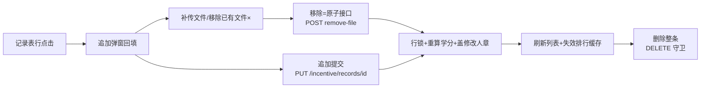

文字链：记录表行点击 → 追加弹窗（回填+审计信息）→ 补传/移除已有文件（POST /incentive/records/{id}/remove-file，行锁重算学分盖修改人章）或追加提交（PUT /incentive/records/{id}）→ 刷新列表并失效排行缓存；整条删除走 DELETE（admin∨can_delete∨本人守卫）。

#### 链 C：阅读闭环链（对应 #10「阅读闭环链」）

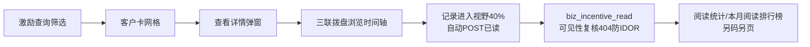

文字链：激励查询筛选 → 客户卡「查看详情」→ 三联拨盘浏览 → 视野即读（POST /incentive/records/{id}/read，canViewRecord 复核）→ 喂给阅读统计（incentive:read-stats）与本月阅读排行榜（incentive:read-ranking:view，仅 admin，系统设置下页面）。

#### 链 D：授权管理链（对应权限中心子链）

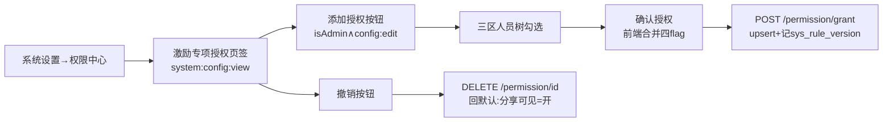

文字链：系统设置→权限中心→激励专项授权 → 「添加授权」（isAdmin∧system:config:edit）→ 三区勾选 → 「确认授权」（POST /incentive/permission/grant，upsert biz_incentive_grant + sys_rule_version 审计）→ 实时生效；「撤销」删行回默认语义。

### ⚠️ 疑点（9 条核查重点中与本章节相关者逐条展开；本次新发现同样标注）

#### 疑点 1｜行政能看本大区全部激励记录（view-all=region）——核查重点 #4
验收表 §8/§9 与「核查重点」第 4 条均记「行政 incentive view-all/view-shared=region（本大区全部，含未分享他人记录）」。代码侧核实：**后端判定根本不读这个 region 档位**——记录列表可见性=canSeeAllIncentive（admin∨can_view_all∨can_edit∨can_delete，IncentiveService.java:189-194）∨分享制（:202-210）；客户分组面走 (customer,view) 组织档位（:212-246）。`biz_incentive_grant` 是纯用户级布尔表（can_view_all=0/1，IncentivePermissionController.java:127-133），没有 region 维度。也就是说：**「行政 view-all=region」在激励代码路径里无处落地，实际语义只能是「行政若被勾 can_view_all=1 则看全公司，若 0 则走分享制/组织范围」**。验收表口径与代码机制不一致，待核（notes 已记）。

#### 疑点 2｜激励分享制现状：29 条授权 can_view_all 全=0——核查重点 #5
验收表核查重点第 5 条与 §9 记「29 条授权记录、can_view_all 全部=0——无人有全量授权，销售员确实只能看自己+被分享的」。代码机制吻合：无授权行=默认（分享可见开、其余关）（IncentiveService.java:165-171 grantFlag 默认值），can_view_all=0 时非 admin 走 applyShareVisibility（:202-210）。本次为只读代码审计、未连生产库，**「29 条」「全=0」的存量数据未能现场复核**，待核（notes 已记）。

#### 疑点 3｜阅读排行榜仅 admin——核查重点 #7
与本章相关的「本月激励查询阅读排行榜」路由/页面码 `incentive:read-ranking:view` 默认只绑系统管理员（router/index.js:288-300 注释；接口同码 IncentiveController.java:214-218；页面 views/system/incentive-read-ranking.vue:150 错误提示自带码名）。该页在系统设置组，属系统设置章节展开；此处核实：**后端 monthlyReadAggregate 非 admin 路径还叠加集团 fail-closed 边界**（IncentiveService.java:1490-1510），有码非 admin 也只见本集团。与验收表「仅 admin」口径一致。

#### 疑点 4｜销售员激励上传客户候选=全部客户——验收表 §8 记「06 档位 incentive add=all」
上传弹窗客户搜索走 GET /customer/list（useIncentiveUpload.js:529-539），数据范围由客户模块 (customer,view/add) 档位决定，激励侧不再叠加过滤；后端 addRecord 仅校验客户存在，不校验「该客户归我」（validateNewRecord，IncentiveService.java:705-737）。即销售员可为非本人名下客户上传激励记录（与小程序口径一致）。验收表把它列为 add=all 档位——机制吻合，但「销售员可给任意客户记激励」是否符合业务预期，验收表未标注疑义，**建议管理者确认**（notes 已记）。

#### 疑点 5（新发现）｜激励查询数据面 2026-11-05 改组织范围档位，与验收表「销售员=分享制」口径冲突
验收表 §9 写「销售员=分享制：本人记录+被点对点分享」；但代码 `getCustomerRecords` 已于 2026-11-05 用户拍板 B 改为组织范围：客户属 (customer,view) 档位 ∨ 本人上传恒可见，**can_view_shared/shared=1 在本面退役**（IncentiveService.java:212-217 注释明说）。两个口径的差异是实质性的：组织范围下销售员能看到「自己名下（或范围内负责人）客户」的**他人未分享**记录；分享制下看不到。案例库/小程序查询同受影响（注释自述三面统一）。验收表落笔在 11-07，晚于代码改动 11-05，疑为验收表未同步——待核（notes 已记）。

#### 疑点 6（新发现）｜统计/排行数据范围已从「全员看全公司」收口为独立档位 (incentive, stats_view)
验收表 §10 写「stats_view 三角色档位均=all → 全员看全公司统计」；代码 2026-11-04 用户令已收口：categoryStats 按可见客户基线（IncentiveService.java:912-917）、scoreboard 按可见人员基线且非 admin 按调用人分缓存键（:980-997,1012-1014），档位读取独立键 (incentive, stats_view)（:873-880，存量角色由迁移 V2026.11.05.7 回填）。PC 前端客户排行还叠加 06 销售只看自己名下客户行、名次保留公司级（useIncentiveStats.js:157-171）。**若线上仍按旧档位「均=all」则行为不变；若档位被改小则统计骤缩**——验收表与代码时序谁新待核（notes 已记）。

#### 疑点 7（新发现）｜「追加」按钮前端可见性用 `canEdit`（授权表 can_edit），但页面码是 incentive:add
RecordTable.vue:57 「追加」按钮显示条件=isAdmin∨canEdit∨本人（canEdit 来自 GET /incentive/permission/check，useIncentiveUpload.js:389-405）——与后端 PUT 归属守卫（admin∨can_edit∨本人，IncentiveController.java:111-118）对齐，这是对的。但**页面本身只要 incentive:add 就能进**（router/index.js:92），意味着无 incentive:view 的纯 add 角色理论上能进页（loadRecords 会 403 降级空态，useIncentiveUpload.js:370-377 catch 降级）。当前生产码分配下 incentive:add 与 view 全员同发，无实际差异；若未来单独勾选会出现「能进页但列表全 403」的半残页。备查非缺陷。

#### 疑点 8（新发现）｜`POST /incentive/records/recalculate` 是死接口（PC 端无调用方）
控制器保留批量重算端点（`incentive:edit`，IncentiveController.java:122-127），全前端 grep 无任何调用（本次 grep "records/recalculate" aigicrm-ui/src 零命中）。单个记录的重算已由 updateRecord/removeFile 内联完成，且 recalculateAllScores 无行锁外的进度保护（全表遍历+行锁重算，IncentiveService.java:644-670）。保留原因（运维兜底 vs 误触风险）待管理者确认（notes 已记）。

#### 疑点 9（新发现）｜个人排行按人聚合把「记录数」计入无分记录，客户排行/统计表只计有文件记录
scoreboard 聚合：score 只在 fileCountOf>0 时计（有文件才算分，IncentiveService.java:1019），但 recordCount 无条件 +1（:1025）——跟踪记录槽、0 分记录都计入「合计」列；而 categoryStats 的 fileCount 也按 fileCountOf（:923,930-934，同口径）。前端个人排行「合计」列读 recordCount（PersonRankTableView.vue:42），客户排行「上传数」读 recordCount||count（useIncentiveStats.js:162）。口径一致但**「合计=上传条数」≠「合计=得分条数」**，展示语义易被误读为工作量指标。备查。

#### 与本章节无关的核查重点（不展开，仅列编号）
#1 客户导入码、#2 客户删除码（客户管理章节）；#3 学分录入只读（学分管理章节）；#6 马吉亮客户范围特例（客户管理章节）；#8 总监回收站按钮（系统设置章节）；#9 六项指标口径（统计分析章节——但注意激励侧 stats_view 档位收口疑点 6 与其同源）。


---

## 第 05 章｜PC·四项服务与提醒

> 审计日期 2026-11-08 · 只读代码审计 · 全部结论落到 `文件路径:行号`，参考文档仅作骨架、口径以代码为准。

### 概述（侧栏位置/路由、权限码、谁能看到该菜单）

本章节覆盖三个页面域：

| 域 | 侧栏位置 | 路由 | 权限码（路由守卫） | 前端文件 |
|---|---|---|---|---|
| 案例库（PC 四项服务的全部内容） | 「四项服务」组（/service-case-group） | `/case-library` | `incentive:view` | `aigicrm-ui/src/views/incentive/case-library.vue` |
| 客户详情·四项服务页签 | 客户管理 → 客户详情第 4 个页签 | `/customer/detail/:id`（页签 `incentive`） | `incentive:view`（页签级门控） | `aigicrm-ui/src/views/customer/detail.vue:133-139`、`detail/IncentiveTab.vue` |
| 提醒管理 + 提醒详情 | 「流程协同」组 | `/reminder`、`/reminder/detail/:id` | `reminder:view` | `aigicrm-ui/src/views/reminder/index.vue`、`detail.vue` |

- 路由守卫证据：`aigicrm-ui/src/router/index.js:122-125`（案例库 `meta.permission: 'incentive:view'`，注释明确「PC 四项服务=案例库」）、`:143-146`（提醒管理 `reminder:view`）、`:150-153`（提醒详情 `reminder:view`，activeMenu 归 `/reminder`）。
- **谁能看到（引用验收表，不重新推导）**：`docs/菜单功能按钮数据范围验收表-20261107.md:41-42` —— 「案例库（四项服务组）✓✓✓✓」「提醒管理 ✓✓✓✓」，即 admin/总监/行政/销售员四角色全部有菜单授权。
- **数据范围（引用验收表）**：案例库「同激励查询」（验收表 §11，`:113-114`）；提醒管理「全部'与我相关'六段（我负责的/我分享的/分享我的/我名下开票/到期客户）；admin 全部」（验收表 §12，`:119-121`）。代码实际口径见下文各表「后端动作」列与 ⚠️ 疑点。
- 定位差异：案例库是对客展示面，**不显示激励分值**（`case-library.vue:3-6` 注释「展示面不显示激励分值(内部口径)」）；客户详情四项服务页签是内部视角，显示 `+N分`（`IncentiveTab.vue:6`）。

### 功能清单（每功能一行）

1. **案例库**：把我可见的四项服务记录打散成照片墙卡片（封面+客户+服务类别+日期），点卡片开灯箱翻看该案例全部照片/视频/文档。
2. **案例库筛选**：按客户名/关键字、服务大类、服务小类、日期范围四路过滤（小类为客户端过滤）。
3. **客户详情·四项服务页签**：看该客户名下全部激励记录（两级分类、学分、安装前中后附件缩略墙），图片点开放大、文档走阅读器。
4. **提醒列表**：六段固定序合并分享（3 类）/开票（2 类）/到期三路提醒，服务端分页，支持关键词/部门树/负责人筛选。
5. **提醒处理**：分享/开票行「已处理」、到期行「已跟进」（当日已跟进置灰）、行点击进详情。
6. **一键清空**：把当前页全部提醒批量标记已处理（循环逐条调用，无后端批量端点）。
7. **申请延期入口**：到期行一键发起保护期延期审批单（type=extend），走保护期延期链。
8. **提醒详情**：提醒本体 + 客户摘要下钻，待处理状态可标记已处理，可跳客户完整档案。
9. **（admin 专属，非按钮）**：admin 进入提醒页自动补生成今日到期提醒（普通用户跳过）。

### 按钮明细

#### 1. 案例库（`views/incentive/case-library.vue`，路由码 incentive:view）

| 按钮 | 在哪 | 前端行为 | 后端动作 | 谁能看到 |
|---|---|---|---|---|
| 关键字搜索框 | 顶部筛选栏 `case-library.vue:13-14` | `@keyup.enter`/`@clear` → `doSearch()`，同时带 `customerName`+`keyword` | 查按客户分组的服务记录（GET `/api/incentive/customer-records`，权限码 `incentive:view`，`IncentiveController.java:174-193`）。后端先过可见性闸 `applyOrgQueryVisibility`（客户属当前账号 `(customer,view)` 数据范围 ∨ 本人上传恒可见，`IncentiveService.java:232-246,1159-1160`），再按关键词命中强相关三路（客户名集合 ∨ 关联产品 ∨ 具体产品，`IncentiveService.java:1189-1206`） | 四角色均有（验收表 `:41`） |
| 服务大类下拉 | `case-library.vue:15-17` | `@change=onMainCatChange` 清小类并 `doSearch()`，带 `mainCategoryId` | 同上端点；大类 id 展开含子类+孙类 IN 过滤（`IncentiveService.java:1216-1227`） | 同上 |
| 服务小类下拉 | `case-library.vue:18-20` | `@change=doSearch`；后端只收大类，小类在客户端按记录 `categoryName` 过滤（`case-library.vue:117`） | 同上端点（小类不传后端） | 同上 |
| 日期范围选择器 | `case-library.vue:21-22` | `@change=doSearch` 带 `startDate/endDate` | 同上端点；`ge(createdAt, start 00:00:00)`/`le(...)` 区间过滤（`IncentiveService.java:1266-1267` 附近） | 同上 |
| 「查询」按钮 | `case-library.vue:23` | `@click=doSearch()`，请求序号守卫防旧响应覆盖（`case-library.vue:99-111`） | 同上端点 | 同上 |
| 案例卡片（点卡片） | 照片墙网格 `case-library.vue:30` | `openCase(c)` 打开 SearchLightbox，从封面进入、左右翻该案例全部文件（`:145-149`）；封面=首个图片或首文件（`:120`），无附件记录不进墙（`:119`） | 灯箱/缩略图走文件下载（GET `/api/file/download/{id}?token=…&thumbnail=1`，权限码 `file:view`，`FileController.java:146-152`）。后端先做单文件归属校验——仅上传者/被分享者/管理员可下载（`FileService.java:747-752` canDownloadFile），缩略图场景授权仍每次先执行再读字节缓存（`FileService.java:755-758`）。下载 token 由 GET `/api/file/download-token` 签发（1h 短时 token、携带主 token jti 联动失效，`FileController.java:36-49`） | 卡片=有 incentive:view 即渲染；附件能否打开另受 `file:view`+文件归属双闸（四角色均有 file:view，验收表 `:40`；归属校验可能拦非分享附件，见 ⚠️） |
| 分页器（sizes/翻页/跳页） | `case-library.vue:53-58` | `paginate` 前端切片（`:97`），`onSizeChange` 回第 1 页（`:96`） | 无后端请求（数据一次性拉全量后客户端分页） | 同页面 |

#### 2. 客户详情·四项服务页签（`views/customer/detail.vue` + `detail/IncentiveTab.vue`）

| 按钮 | 在哪 | 前端行为 | 后端动作 | 谁能看到 |
|---|---|---|---|---|
| 「四项服务」页签 | `detail.vue:133-139` | `v-if="canViewIncentive"`（`useCustomerDetail.js:41-43` `hasPermission('incentive:view')`）；无权限不发请求、不渲染误导性空态（`useCustomerDetail.js:205` 同口径守卫）；页签角标=记录数 | 进页自动拉该客户激励记录：GET `/api/incentive/records?customerId=`（权限码 `incentive:view`，`IncentiveController.java:52-64`）。后端按**分享制**过滤：admin/专项授权（can_view_all/can_edit/can_delete）→全量；否则本人 ∨ shared=1 且未被收窄 can_view_shared（`IncentiveService.java:196-211` applyShareVisibility、`:345-358`）；再按 customerId 等值过滤、createdAt 倒序（`:360-362`）。另拉激励学分 GET `/api/incentive/score/customer/{id}`（`incentive:view`，`IncentiveController.java:148-151`）与分类字典 GET `/api/incentive/categories`（`incentive:view`，`:24-27`） | 客户详情页本身四角色可见（验收表 `:31`）；此页签仅 `incentive:view` 持有者（验收表 `:128`「四项服务=incentive:view」） |
| 图片缩略图（点开放大） | `IncentiveTab.vue:21-38` | `el-image` 缩略墙（≤300px 缩略图），点开内建查看器看原图（`:preview-src-list`） | 文件下载 GET `/api/file/download/{id}?token=…`（原图）/`&thumbnail=1`（缩略）；同上 `file:view`+归属双闸（`FileController.java:146-152`、`FileService.java:747-752`） | 同页签 |
| 视频/文档文件条（点开预览） | `IncentiveTab.vue:39-45` | `previewIncentiveFile(f)`：刷下载 token 后开 FilePreview 阅读器，类型按文件名判定（`useCustomerDetail.js:236-245`） | 同上文件下载端点 | 同页签 |

#### 3. 提醒管理列表（`views/reminder/index.vue`，路由码 reminder:view）

列表数据结构：六段固定拼接序（分享 3 类 → 开票 2 类 → 到期），每段独立服务端分页、按段区间取块拼接，`loadData` 并发探测六段 total 后映射当前页（`index.vue:144-248`）。

| 按钮 | 在哪 | 前端行为 | 后端动作 | 谁能看到 |
|---|---|---|---|---|
| 关键词搜索框 | 工具栏 `index.vue:11` | `@change=search()` 回第 1 页重查 | 分享/开票段：GET `/api/reminder/list` 带 `keyword`，服务端真过滤——客户名/编码 LIKE 或提醒类型标签/类型码 IN，与范围条件 AND 叠加，total 同口径（`ReminderController.java:32-44`、`ReminderService.java:107-195,237-263`）。到期段：GET `/api/reminder/expiring-list`，keyword 仅匹配客户名 LIKE（`ReminderService.java:285-287`） | 四角色均有（验收表 `:42`）；数据范围见下 |
| 部门树筛选 | `index.vue:12-22` | `el-tree-select` 选办事处（含子部门）→ `search()` | 两端点均收 `deptId`：提醒段 `in(officeId, 子树展开集)`（`ReminderService.java:127-130`）；到期段客户查询 `in(officeId, 子树)`（`:288-293`）。子树展开 `DeptTreeUtils.expandSubtree` 递归（`:122-126` 并发段） | 下拉数据源 GET `/api/common/scope/depts`（登录即可，范围 service 内强制，`ScopeController.java:32-35`）——**下拉只列自己范围可见部门** |
| 负责人下拉 | `index.vue:23-25` | `el-select`（范围感知人员）→ `search()` | 两端点收 `ownerId`：`applyOwnerScope`——all 档不过滤；其余档恒含本人，显式 ownerId 须落在可见集合内否则置 `-1L` 返回空集（防手改参数越权，`ReminderService.java:73-90,298-309`）。范围解析走 OrgScopeResolver 六级档位（`(reminder,view)` 显式配置优先、回退角色档，`ReminderService.java:125,275`） | 下拉数据源 GET `/api/common/scope/users`（登录即可，范围强制，`ScopeController.java:26-29`） |
| 「一键清空」红钮 | `index.vue:28` | `handleClearAll()`：confirmAction 红色确认（文案如实标注「当前页 N 条 / 筛选共 M 条」，`:250-257`）→ 循环对当前页有 `reminderId` 的行逐条 `processReminder`（`:259-261`）→ 回第 1 页刷新 + 刷角标 | 每条走 POST `/api/reminder/{id}/process`（`reminder:view`，`ReminderController.java:71-76`）。后端单条处理：查提醒 → `assertVisible` 可见性校验（非 admin 时负责人必须在其 `(reminder,view)` 范围集合内，防按 ID 越权，`ReminderService.java:485-488,565-573`）→ 幂等守卫仅 `pending` 才置 `processed`+`processedAt`（`:490-493`，2026-11-02 P2 修复）。**无批量端点**，N 条=N 次请求；副作用=处理后侧边栏角标重算（前端 GET `/api/reminder/pending-count`，`store/user.js:81-85`） | 四角色均有按钮；能清掉哪些取决于本人 reminder 数据范围（assertVisible 拦越权） |
| 行点击（整行） | 表格 `index.vue:36` | `@row-click=openDetail` → `buildReminderDetailLocation` 跳提醒详情（`utils/reminder-detail.js:65-75`；无提醒实体的到期行以 `none` 占位降级） | 进详情页后 GET `/api/reminder/{id}`（`reminder:view`，`ReminderController.java:47-51`）。后端：提醒不存在报错；`assertVisible` 防按 ID 猜读他人提醒（客户名/开票日期属敏感信息，`ReminderService.java:501-506`）→ 返回提醒本体+客户摘要（customerBrief 只暴露白名单字段不整表返回，`:508-554`） | 同页面 |
| 「详情」按钮 | 行操作列 `index.vue:70` | 同行点击（`openDetail`） | 同上 | 同页面 |
| 分享行「已处理」 | 行操作列 `index.vue:71-74` | `handleProcessShare(row)` → 单条处理后回第 1 页刷新+刷角标（`:269-277`） | 同 POST `/api/reminder/{id}/process`（校验/幂等同上） | 同页面 |
| 开票行「已处理」 | 行操作列 `index.vue:75-77` | 同上（同一 handler） | 同上 | 同页面 |
| 到期行「已跟进」（当日已跟进置灰） | 行操作列 `index.vue:78-80` | 未跟进：`handleFollowUp` → 处理后 `row.todayFollowedUp=true`；已跟进：disabled。**提醒实体未物化（reminderId=null）时弹指引**：每日 2:00 自动补建或请管理员触发补生成，不静默失败（`:279-293`） | 同 POST `/api/reminder/{id}/process`。到期行的提醒实体来自 `ensureExpiring` 物化（存在 pending 或今日已处理则不重建，防生产 401 条 pending 积压的去重口径，`ReminderService.java:386-433`）；expiring-list 每行回传 `reminderId`（pending 优先、无则今日已处理行）与 `todayFollowedUp`（`ReminderService.java:370-376`） | 同页面；到期行本身按客户数据范围过滤（见下） |
| 到期行「申请延期」 | 行操作列 `index.vue:81` | `handleExtend`：确认弹窗（2026-10 修复加确认防误触）→ `submitApproval({type:'extend', customerId, actionAfterApprove:'保护期延长(天数以审批单为准)'})`（`:295-304`）。**前端无权限码门控**（仅路由级 reminder:view） | POST `/api/approval/submit`（权限码 `approval:view`，`ApprovalController.java:40-56`）。后端 extend 分支：类型白名单校验（`ApprovalService.java:216-220`）→ 公海守卫（池内客户禁止发起延期，`:283-289`）→ **发起人必须对该客户有查看权限**（非 admin 走 customerAccessService.canView，防任意有码者对无权客户 +360 天，`:290-299`）→ 同客户只允许一张在途延期单（客户行 FOR UPDATE 串行化+数 reviewing/pending，`:300-309`）→ 天数快照进 extraData（默认取 sys_config `customer.extend.days`=360，审批人通过时可调整覆盖，`:353-359`）→ 取号插入（集团行锁+唯一键重试防并发同号，`:366-372`）→ 节点实例化（配置流程串行阶段/兜底旧版角色+直属领导，`:374-430`） | 四角色均有（验收表 `:43` 审批按钮行 ✓✓✓✓，approval:view 四角色放开）；现状四角色均有 approval:view 故不炸，但见 ⚠️ 解耦疑点 |
| 分页器 | `index.vue:88-102` | `loadData` / `handleSizeChange`，六段 total 求和为真实总数（`:242-243`） | 见上两端点（每页并发探测六段+按段取块，`index.vue:213-248`） | 同页面 |
| （非按钮·admin 自动动作） | `onMounted` `index.vue:323-328` | 仅 `userStore.isAdmin()` 才发 `ensureExpiring()` 补生成，普通用户跳过（2026-09-23 修复：此前人人触发、后端 403 弹窗） | POST `/api/reminder/ensure-expiring`（`reminder:view` @PreAuthorize + 方法内 `SecurityUtils.isAdmin()` 手工校验双重收紧，非 admin 返回 403「仅管理员可批量生成到期提醒」，`ReminderController.java:59-69`）。后端物化今日到期提醒：扫 warningDays（配置 `customer.warning.days`，缺省 30 天）内到期客户（排 sea/archived），按本人 reminder 范围过滤，幂等去重（`:386-433`）。另有每晚 2:00 `CustomerExpireTask` 定时兜底（`index.vue:282-284` 注释引述） | 仅 admin 触发 |

#### 4. 提醒详情（`views/reminder/detail.vue`）

| 按钮 | 在哪 | 前端行为 | 后端动作 | 谁能看到 |
|---|---|---|---|---|
| 「← 返回提醒管理」 | 页头 `detail.vue:4` | `goBack()` → `router.push({name:'Reminder'})` | 无请求 | 同页面（reminder:view） |
| 「查看客户完整档案 ›」 | 客户信息卡片头 `detail.vue:52` | 有 customerId 才渲染；`goCustomer()` 跳客户详情路由。**前端无权限码门控** | 跳转后由客户详情页自身按 `customer:view` 门控加载；本页已先行用客户接口降级兜底——提醒详情无客户块时调 GET `/api/customer/{id}` 补齐，403/无权时显示「无客户查看权限，仅显示提醒信息」，不阻断页面（`detail.vue:158-165`） | 有 customerId 即渲染；能否真看档案取决于客户详情路由码与后端客户可见性 |
| 「标记已处理」 | 底部操作区 `detail.vue:72-78` | 仅 `hasReminder && statusText==='待处理'` 时渲染；`markProcessed` → 成功后刷角标并重载详情（`:186-198`） | POST `/api/reminder/{id}/process`（同列表行处理：assertVisible+幂等，`ReminderService.java:485-494`） | 同页面（仅待处理状态可见按钮） |
| 「返回列表」 | 底部操作区 `detail.vue:79` | 同「← 返回」 | 无请求 | 同页面 |

### 业务链条

#### 链 A：提醒闭环链（对应 23 条业务链之 **第 21 条 提醒闭环链** + **第 5 条 保护期延期链**）

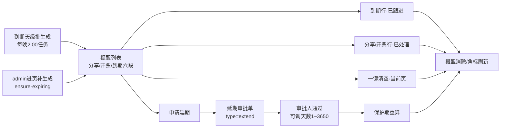

文字链：到期天级批生成（或 admin 进页补生成）→ 提醒列表（六段合并）→ 已跟进 / 已处理 / 一键清空（当前页循环标记）→ 提醒消除；或 申请延期 → 审批单(type=extend) → 审批人通过（可调整天数 1~3650，服务端校验）→ 保护期重算 → 提醒消除（第 21 条 + 第 5 条）。

#### 链 B：案例库展示链（上游为 **第 8 条 激励上传链**，本链支撑 **第 19 条 排行激励链** 的「四项服务」数据面；案例库本身未在 22 条主链中独立成链，为对客案例展示面）

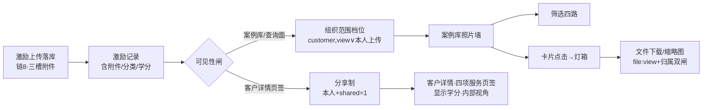

文字链：激励上传落库（链 8）→ 激励记录 → 可见性闸（案例库/查询=组织范围档位；客户详情页签=分享制）→ 案例库照片墙（筛选 → 卡片 → 灯箱 → 文件下载）。

### ⚠️ 疑点

#### 与 9 条核查重点相关者

**重点 5「激励分享制 29 条授权 can_view_all 全=0」——与本章节强相关，且代码已发生口径翻转：**
- 生产授权现状：`biz_incentive_permission` 29 条、`can_view_all` 全 0（验收表 `:108,183`，生产库实拉）；建列迁移默认 0（`sql/migration/20260808/incentive-permission-can-view-all.sql:11`），RBAC 收敛迁移注明「存量直绑 can_view_all=1 为 0 人」(`sql/migration/20260814/rbac-convergence-m1.sql:39`)。
- 代码「全量旁路」不只看 can_view_all：`canSeeAllIncentive() = admin ∨ can_view_all ∨ can_edit ∨ can_delete`（`IncentiveService.java:189-194`）——**任何被授 can_edit/can_delete 的人也走全量旁路**，与「29 条全 0=无人全量」的字面结论不完全等价；29 条授权中是否存在 can_edit/can_delete=1 者未在本章核实（属权限中心域，待核）。
- 更关键：**2026-11-05 用户拍板后，案例库/激励查询数据面（`/incentive/customer-records`）已不再走分享制**，改走组织范围档位——客户属当前账号 `(customer,view)` 数据范围 ∨ 本人上传恒可见（`IncentiveService.java:211-231` applyOrgQueryVisibility、`:1159-1160` 调用点；「can_view_shared/shared=1 在本面退役」注释 `:216-217`）。验收表 §11「数据范围：同激励查询（销售员=分享制口径）」（`:113-114`）的括注**与当前代码不同步**——销售员在案例库实际看到的是其 `(customer,view)` 档位（self 档=名下客户的服务记录+本人上传），不是「本人+被分享」。

**重点 4「行政能看本大区全部激励记录(view-all=region)」——本章映射：**
- 案例库面：行政的可见集=其 `(customer,view)` 档位（region）内的客户服务记录+本人上传（`IncentiveService.java:232-246`）。验收表 §11 的「同激励查询」口径在此档位下对行政仍然成立（region 客户集）。
- 提醒面：行政看提醒的范围由 `(reminder,view)` 档位决定（`ReminderService.java:125` resolveModuleUsers(user,"reminder")），非 customer 档位——两模块档位独立配置，行政在 reminder 模块的档位验收表未单列明细（§12 仅写「与我相关六段」），**待核**。

**重点 6「马吉亮全公司客户范围特例」——本章映射：**
- 验收表 `:19,171`：马吉亮（USER 11，销售员角色）customer 增/删/改/导出/导入/查看/分享 **全=all**（用户级高于角色档）。
- 案例库走 `(customer,view)`：orgScopeVisibleCustomerIds 用 **customer 模块**范围解析（`IncentiveService.java:218-231`）→ 若其 customer:view=all，则马吉亮的案例库=全公司案例（含其他销售上传的记录）。
- 提醒面走 `(reminder,view)` 模块档位——马吉亮是否有 reminder 模块用户级 override，验收表与代码注释均未载明，**待核**（若仅 customer=all 而 reminder=self，则他案例库全公司可见但提醒列表仅本人相关，两页口径不一致属设计使然）。

**重点 1/2/3/7/8/9**：客户导入/删除码、行政学分录入只读、阅读排行榜仅 admin、总监回收站、六项指标口径——均不落在本章节页面（分别属客户管理、学分、激励查询/系统、回收站、核心指标章节），本章不展开。

#### 本次审计新发现

**新发现 1：案例库附件「双闸」耦合，激励可见 ≠ 附件可看。** 案例库/客户详情页签的图片与文档走 `/api/file/download/{id}`，该端点 `@PreAuthorize("hasAuthority('file:view')")`（`FileController.java:146-152`）且每次请求先做单文件归属校验——仅上传者、被分享者、管理员可下载（`FileService.java:747-752`）。即持 `incentive:view` 但无 `file:view` 的角色页面全灰；更值得注意的是**激励附件的可见性并不跟随激励记录的可见性**，而跟随文件管理域的分享/ACL 归属——案例库里能看到的案例卡片，其附件仍可能被归属校验 403（前端仅表现为缩略图 error 占位 `case-library.vue:32-40`）。现状四角色均有 file:view+五码（验收表 `:40`）故不炸，属隐性耦合，建议管理者知悉。

**新发现 2：同一「四项服务」域两套可见性并存。** 案例库（`customer-records`）已改组织范围档位（2026-11-05），而客户详情·四项服务页签（`GET /incentive/records`，`useCustomerDetail.js:205-210`）仍走分享制 `applyShareVisibility`（本人+shared=1，`IncentiveService.java:196-211,345-358`）。后果：某条他人上传、`shared=0` 但客户在本人大区/名下的记录，行政/总监在案例库可见（客户在范围内）、在客户详情页签却不可见（非本人且未分享）——两入口对同一客户同一记录呈现不一致。是否属拍板 B 的预期遗留（注释称「记录列表面仍用分享制」`IncentiveService.java:216-217`），**待与需求方确认**。

**新发现 3：「申请延期」「查看客户完整档案」两按钮前端无权限码门控。** `reminder/index.vue:81` 申请延期按钮对任何 reminder:view 持有者渲染（后端 submit 需 `approval:view`，`ApprovalController.java:40-41`）；`reminder/detail.vue:52` 查看档案按钮仅以 customerId 是否存在为条件（后端走客户可见性）。现状四角色均有 approval:view（验收表 `:43`）不产生实际越权，但前端按钮可见性与后端权限码解耦，若未来收窄 approval:view 会出现「按钮可见、点了 403」。

**新发现 4：「一键清空」的实际能力边界。** 仅清当前页（前端循环逐条 POST，无后端批量端点，`reminder/index.vue:250-267`）；`reminderId=null` 的到期行被 `filter(r => r.reminderId)` 静默跳过（`:253`）——弹窗文案已如实标注「当前页 N 条…其余页需翻页逐页处理」（`:256`），口径无欺骗性，但「一键清空」按钮名与实际作用域（当前页）存在语义落差，管理者验收时勿以「清空全部」预期。每条处理后端幂等（重复点不覆盖 processedAt，`ReminderService.java:489-493`）且有 assertVisible 越权防线（`:565-573`），安全面无恙。

**新发现 5：同页两数据源 keyword 口径不一致。** 分享/开票段 keyword 命中客户名/编码/类型标签三路（`ReminderService.java:237-263` applyKeywordScope），到期段仅客户名 LIKE（`:285-287`）——在提醒页搜索「开票」等类型词时，分享/开票段命中、到期段不命中，六段 total 求和后筛选口径在段间不等价。属体验级不一致，非越权问题。


---

## 第 06 章｜PC·公海与审批

> 审计日期 2026-11-08 · 只读代码审计，全部结论以源码为准；三份参考文档仅作骨架引用。
> 覆盖：公海管理（公海池 /sea、捞取记录 /sea/records、公海池名单配置）+ 审批管理（/approval 四类单据、通过驳回、admin 转交、轨迹、审批流程配置）。

### 概述（侧栏位置/路由、权限码、谁能看到该菜单）

| 页面 | 路由 | 组件 | 路由权限码（router/index.js） |
|---|---|---|---|
| 公海池 | /sea | views/sea/index.vue | sea:view（router/index.js:157-161） |
| 捞取记录 | /sea/records | views/sea/records.vue | sea:view（router/index.js:163-167） |
| 审批管理 | /approval | views/approval/index.vue | approval:view（router/index.js:169-174） |
| 公海池名单配置 | /system/config（系统设置→权限中心→专项权限→「公海池名单」） | views/system/SeaConfigManager.vue | 页面门槛 system:config:view（router/index.js:247-252）；按钮门槛 sea:config:edit（SeaConfigManager.vue:178） |
| 审批流程配置 | /system/config（系统设置→「审批流程配置」页签） | views/system/approvalConfig.vue | 页面门槛 system:config:view；按钮门槛 system:config:edit（approvalConfig.vue:95） |

- 路由守卫：无权限直达 URL 会被 layout 守卫弹「没有访问权限」并跳回首个可达页（layout/index.vue:345-349）。
- 侧栏菜单树来自后端 sys_role_menu 下发（layout/index.vue:211-241 按菜单树渲染），「谁能看到」一律引用《菜单功能按钮数据范围验收表-20261107.md》§二角色×菜单矩阵（下称验收表）：
  - 公海池/捞取记录/公海捞取：admin✓ 总监✓ 行政✓ 销售员✗——四角色全 ✓（验收表 line 43）。
  - 公海配置查看/编辑/公海导入：admin✓ 总监✓ 行政✓，销售员 ✗（验收表 line 44）。
  - 审批通过/驳回按钮：四角色全有码 ✓（验收表 line 45）；「实际可审=该流程配置的审批人」（验收表 line 131）。
  - 数据范围档位：sea.view 档 admin/总监=all、行政/销售员=office（验收表 line 127）；审批「待审批=我是审批人的；我发起=我提的；admin=全部」（验收表 line 132）。
  - 审批配置（system:config:edit）与公海池名单配置（sea:config:edit=admin/总监/行政）见验收表 line 160-161。
- 公海池本身=三个大区池（山西/内蒙古/河北），逐池「可见/编辑/删除/导入/捞取」五类名单，由 SeaConfigManager 配置，支持部门+人员+角色引用三种授权载体（验收表 line 127；代码 SeaConfigService.java:142-155）。

### 功能清单（每功能一行，说人话）

- 公海池：看自己可见的池里「待捞取/审批中」的客户，可按池/部门/行业/入池原因/关键词筛选，点捞取发起审批、按池级名单编辑或删除。
- 批量导入到公海：下载模板、传 Excel，每行新建客户并直接进公海待捞取（入池原因固定「保护期满」）。
- 捞取记录：本人历史捞取申请与审批结果的对账页（KPI 按数据范围统计，见疑点③）。
- 公海池名单配置：管理员逐池配置「谁能看、谁能编、谁能删、谁能导、谁能捞」，支持部门递归/人员直命/角色引用。
- 审批管理：四类单据（捞取 claim / 转移 transfer / 延期 extend / 存储空间 storage）的六页签裁决台，通过/驳回带必填意见、看轨迹、admin 可转交卡单节点、延期单审批人可调天数。
- 审批流程配置：管理员为四类流程配审批人（指定人员/指定角色）+ 或签(ANY)/会签(ALL) + 多阶段串行排序。
- 后台支撑：客户释放四入口（手动释放/到期任务/导入/离职交接）统一走 SeaService.addToSea；捞取锁超时由 CustomerExpireTask.releaseStaleClaimLocks 定时解锁（CustomerExpireTask.java:45,254）。

### 按钮明细

> 统计口径：每行=一个可交互控件（按钮/筛选器/弹窗表单控件/分页器），同类控件组（如 6 个状态页签、4 个权限区块的同款树）合并 1 行。合计 **63** 个交互项；端点 **22** 个（SeaController 11 + ApprovalController 7 + ApprovalConfigController 4），另列间接依赖 6 个。

#### 功能块① 公海池页·顶部（sea/index.vue）

| 按钮 | 在哪 | 前端行为 | 后端动作 | 谁能看到 |
|---|---|---|---|---|
| 公海池下拉选择器 | sea/index.vue:12-14 | 选中后重查列表（@change=search），选项=可见池+区域名 | 拉取 GET /sea/configs/visible（SeaController:96-100，sea:view）；列表查询时 poolId 必须在可见池集合内，否则返回空页（SeaService.java:83-88） | 有 sea:view 的四角色；池下拉内容=逐池「可见名单」命中者（SeaConfigService.listVisible，:50-56，view 档 all 全可见） |
| 捞取记录 | sea/index.vue:15 | 路由跳 /sea/records | —（纯导航） | 有 sea:view 者 |
| 批量导入 | sea/index.vue:16 | 打开导入弹窗；按钮显隐=hasPermission('sea:import')（:163） | 无（打开弹窗不请求） | 有 sea:import 码者（验收表：admin/总监/行政；销售员✗）。⚠️按钮可见门槛只有 sea:import，后端还叠池级 import 名单二闸（见疑点④） |
| 下载导入模板 | sea/index.vue:119 | 下载「客户导入模板.xlsx」，成功/失败 toast | GET /api/customer/import/template（api/customer.js:183-190；token 统一走 getToken） | 打开弹窗者（弹窗本身受 sea:import 门控） |
| 选择/拖拽上传 Excel | sea/index.vue:121-125 | el-upload 手动模式限 1 个文件，超限提示「只能上传一个文件」（:175） | 无 | 同上 |
| 开始导入 | sea/index.vue:134 | FormData 上传，成功后展示成功/失败计数与逐行失败原因，并刷新列表+指标（:184-200） | POST /sea/import（SeaController:76-83，sea:import + ImportGuard 校验非空/扩展名/5MB）；SeaService.importToSea（:343-367）先按导入人办事处路由目标池并校验池级 import 名单（hasPoolPerm PERM_IMPORT，:348-354），再 EasyExcel 逐行解析（SeaImportListener.java:35-71：客户名必填、重名校验、无启用池整行失败不建客户、建客户后 addToSea(…,"保护期满")） | 有 sea:import 且在其办事处路由池 import 名单内者；admin 恒有（SeaConfigService.java:144） |
| 取消/关闭（导入弹窗） | sea/index.vue:134 | 关闭弹窗并清空文件/结果（:201-205） | 无 | 同上 |

#### 功能块② 公海池页·筛选栏（sea/index.vue）

| 按钮 | 在哪 | 前端行为 | 后端动作 | 谁能看到 |
|---|---|---|---|---|
| 状态页签组（全部/待捞取/审批中/已捞取） | sea/index.vue:29-32 | setStatus 切换并回第 1 页重查 | GET /sea/list 带 status；不传 status 时后端默认排除已捞取（SeaService.java:71-76） | 有 sea:view 者 |
| 部门树筛选 | sea/index.vue:35-45 | 树选部门（含子部门）后重查；树数据来自 getScopeDepts（:328-332） | GET /sea/list 带 deptId；后端 DeptTreeUtils.expandSubtree 展开子树→按客户 officeId 反查客户 id 集过滤（SeaService.java:89-97） | 有 sea:view 者 |
| 行业筛选 | sea/index.vue:46-48 | 选中重查；字典拉取失败回退共享兜底常量（:333-336） | GET /sea/list 带 industry；后端以客户表子查询下沉 SQL 保证分页正确（SeaService.java:99-105） | 有 sea:view 者 |
| 进入原因筛选 | sea/index.vue:49-53 | 选中重查（保护期满/放弃客户/离职交接） | GET /sea/list 带 enterReason，DB 层等值过滤（SeaService.java:78-80） | 有 sea:view 者 |
| 关键词搜索 | sea/index.vue:54 | 回车触发，按客户名称模糊 | GET /sea/list 带 keyword；后端 like 客户名子查询（SeaService.java:99-105） | 有 sea:view 者 |
| 重置 | sea/index.vue:55 | 清空全部筛选回第 1 页（:230-239） | 重新 GET /sea/list | 有 sea:view 者 |

#### 功能块③ 公海池页·表格行（sea/index.vue）

| 按钮 | 在哪 | 前端行为 | 后端动作 | 谁能看到 |
|---|---|---|---|---|
| 客户名称链接 | sea/index.vue:75 | 跳客户详情 /customer/detail/:id?from=sea | —（导航） | 行渲染者 |
| 捞取 | sea/index.vue:99-105 | 仅 row.status==='available'&&row.canClaim 显示；confirmAction 普通确认（:275）后提交 submitApproval({type:'claim',customerId,…})（:277），成功自动切「审批中」页签+刷新指标+刷新角标（:278-282）；取消与后端失败区分提示（:284-287） | POST /approval/submit（ApprovalController:40-55，approval:view）；ApprovalService.submit（:241-279）：客户必须在池→池级 claim 名单校验（hasPoolPerm PERM_CLAIM，兼容存量 sea:claim 角色码，:252-256）→非 all 范围者须可见该池（:257-262）→已被他人申请拦截（:263-265）→**原子条件更新锁池行** available→pending_approval 并写 claim_user_id/claim_date（:266-278），锁失败即报「已被他人申请」；零审批人/自审自批的流程配置会让提交整体回滚（含解锁，:437-453） | 行级 canClaim 由后端按池 claim 名单下发（SeaService.java:128），admin 恒有 |
| 编辑 | sea/index.vue:106 | row.canEdit 时跳客户编辑 /customer/edit/:id?from=sea | —（导航到客户模块编辑页） | 行级 canEdit=池 edit 名单下发（SeaService.java:126） |
| 删除 | sea/index.vue:107 | row.canDelete&&status==='available' 显示；confirmAction 红色确认（:296）后 deleteSeaPool(row.id)（:297），成功刷新列表+指标 | DELETE /sea/pool/{id}（SeaController:66-73，sea:view 门禁）；SeaService.deletePool（:302-338）：仅 available 可删、池级 delete 名单校验（hasPoolPerm PERM_DELETE，:313-315）+可见性防横向越权（:316-319）、三处统一 404 文案防存在性探测、复用客户删除业务保护 assertDeletable（有票款/在途审批不可删，:325-328）、池行带 status='available' 条件删除与并发捞取互斥（:329-334）、最后走客户删除统一内核 deleteFromSeaPool（含分享/提醒清理，:335-337），全程 @Transactional | 行级 canDelete=池 delete 名单下发（SeaService.java:127），admin 恒有 |
| 分页器 | sea/index.vue:112-115 | 页码/每页条数变更重查 | GET /sea/list 分页参数 | 有 sea:view 者 |

#### 功能块④ 捞取记录页（sea/records.vue）

| 按钮 | 在哪 | 前端行为 | 后端动作 | 谁能看到 |
|---|---|---|---|---|
| 返回公海池 | sea/records.vue:8 | 跳 /sea | —（导航） | 有 sea:view 者 |
| 开始/结束日期 | sea/records.vue:62-63 | 选日期重查 | GET /sea/claim-records dateFrom/dateTo（SeaController:136-157） | 有 sea:view 者 |
| 状态筛选（已通过/已驳回/待审批） | sea/records.vue:64-68 | 选中重查 | 同上 status 等值过滤（SeaController:149-151） | 有 sea:view 者 |
| 关键词搜索 | sea/records.vue:69 | 客户/捞取人/审批人模糊 | 同上 keyword；后端因关联字段无法下推 SQL，有 keyword 时全量构建→内存过滤→手工分页保证 total 一致（SeaController:160-219，S7 注释） | 有 sea:view 者 |
| 分页器 | sea/records.vue:105-108 | 变更重查 | 同上 | 有 sea:view 者 |

- 页面 KPI 四卡（总记录/已通过/已驳回/待审批，sea/records.vue:12-57）与列表同一接口返回；列表固定「仅本人申请」（SeaController:146 applicantId=当前用户），KPI 统计则按数据范围可见申请人（scopeResolver.resolveModuleUsers("sea")，SeaController:225-236）——口径差异见疑点③。

#### 功能块⑤ 审批管理页·列表（approval/index.vue）

| 按钮 | 在哪 | 前端行为 | 后端动作 | 谁能看到 |
|---|---|---|---|---|
| 指标条点击直达（待审批/我发起的/本月通过/本月驳回） | approval/index.vue:14-19,352-359 | interactive MetricStrip，点击切对应页签并重查 | 页面加载 GET /approval/statistics（ApprovalController:100-104，approval:view） | 有 approval:view 者 |
| 状态页签×6（待审批/我发起的/审批中/已通过/已驳回/全部） | approval/index.vue:22-59 | 切页签重查（@tab-change=search） | GET /approval/list 带 tab（ApprovalController:22-32，approval:view）；ApprovalService.page（:79-135）：pending=我是 pending 节点审批人（:82-93）；mine=本人申请（:94-95）；reviewing/approved/rejected/all 非 admin 套数据范围（本人申请∨本人参与∨权限矩阵 approval.view 可见用户，all 档全量，:96-113 + applyDataScope:790-807）；**未知 tab 按最窄口径处理**（:107-113，堵 tab 越权）；deptId=申请人部门子树过滤（:119-127） | 有 approval:view 者；页签角标数字=statistics（approvedTotal/rejectedTotal 全量键，ApprovalService:842-845） |
| 部门树筛选 | approval/index.vue:64-73 | 选部门重查；树=GET /common/scope/depts（:382-387） | GET /approval/list deptId（同上展开子树→申请人过滤） | 有 approval:view 者 |
| 类型筛选（捞取/转移/延期/存储空间） | approval/index.vue:74-79 | 选中重查 | GET /approval/list type 等值过滤（ApprovalService:115-117） | 有 approval:view 者 |
| 关键词搜索 | approval/index.vue:80-88 | 编号/客户名/申请人模糊 | GET /approval/list keyword；后端并行查客户表/用户表再 OR 组合（applyKeywordFilter，ApprovalService:137-165） | 有 approval:view 者 |
| 编号链接→详情 | approval/index.vue:107 | openDetail 打开右侧抽屉并拉详情（:410-424） | GET /approval/{id}（ApprovalController:34-38，approval:view）；ApprovalService.detail（:167-200）：admin 或 canViewApproval（申请人∨节点审批人∨权限矩阵，:202-210）否则统一 404 文案；返回单据+全部节点（轨迹） | 有 approval:view 且在单据可见范围者 |
| 行内通过 | approval/index.vue:138-140 | 仅 pending 页签且 canApprove 显示；prompt 审批意见（必填校验，:437-443）后 approve(id,{comment})；extend 单改走专用弹窗（:429-435） | POST /approval/{id}/approve（ApprovalController:75-90，approval:approve + @AigicrmLog(module=审批,action=审批通过) 审计日志）；ApprovalService.approve（:552-613）：主行 FOR UPDATE 锁单（:557）→终态守卫（approved/rejected 统一 404，:563-565）→节点必须=本人+pending（:567-573）→**自审自批封禁**（申请人不能审自己，:578-580）→extendDays 仅 extend 单可调、1~3650 校验并写进意见留痕（:584-592）→条件流转 pending→approved 防并发重复（:596-605）→advanceApproval 阶段推进（:624-695）→整单通过 finalizeApproval 条件更新只回写一次（:698-707）→executeApprovalAction 按类型执行业务（:857-969） | 有 approval:approve 且为该单 pending 节点审批人（四角色都有码，实际可审=流程配置审批人，验收表 line 131） |
| 行内驳回 | approval/index.vue:141-143 | 同上，prompt 驳回原因（必填，:458-462）后 reject(id,{comment}) | POST /approval/{id}/reject（ApprovalController:92-98，approval:reject + @AigicrmLog(module=审批,action=审批驳回)）；ApprovalService.reject（:709-781）：同款主行锁+终态守卫+条件流转；整单 rejected 后 **claim 单释放公海锁**（池行回 available、清 claim_user_id/claim_date，:751-765）；级联作废其余 pending/waiting 节点（:770-780） | 有 approval:reject 且为该单 pending 节点审批人 |
| 空态：去公海池发起捞取 | approval/index.vue:100 | 跳 /sea | —（导航） | pending 页签空表时 |
| 空态：查看我发起的 N 条 | approval/index.vue:101 | 切 mine 页签 | —（前端切换） | pending 页签且 stats.mine>0 时 |
| 分页器 | approval/index.vue:149-161 | 变更重查 | GET /approval/list 分页参数 | 有 approval:view 者 |

#### 功能块⑥ 审批详情抽屉（approval/index.vue:164-249）

只读展示区（不计按钮数）：申请天数（extend 单读 extraData.extendDays 快照，:188-190 + :489-497）、配额变更/申请理由（storage 单解析 extraData，:192-197 + :510-517）、审批轨迹时间线（节点状态/操作时间/意见，:207-228）、**「审批人已停用」卡单警示标签**（:218，后端 approverInvalid 标记停用/删除审批人，ApprovalService:183-193）。

| 按钮 | 在哪 | 前端行为 | 后端动作 | 谁能看到 |
|---|---|---|---|---|
| 转交（轨迹节点内） | approval/index.vue:220-221 | 仅 isAdmin 且节点 pending/waiting 显示；openTransfer 拉候选人（:319-327） | 无（打开弹窗） | 仅 admin（isAdmin=userStore.isAdmin() 调用取值，:310-311，注释注明修复过「非 admin 也见按钮」的 P4 缺陷）；后端二次校验 isAdmin（见下） |
| 抽屉驳回 | approval/index.vue:235-240 | pending 页签且 canReject 时显示，同行内驳回 | 同 POST /approval/{id}/reject | 同行内驳回 |
| 抽屉通过 | approval/index.vue:241-246 | pending 页签且 canApprove 时显示，同行内通过 | 同 POST /approval/{id}/approve | 同行内通过 |
| 关闭 | approval/index.vue:234 | 关抽屉 | — | 打开抽屉者 |

#### 功能块⑦ 转交弹窗（approval/index.vue:252-266）

| 按钮 | 在哪 | 前端行为 | 后端动作 | 谁能看到 |
|---|---|---|---|---|
| 候选人单选列表 | approval/index.vue:256-260 | getUserList({current:1,size:200}) 后前端过滤 status===1（:324-326）；空列表显示空态（:261） | GET /system/user 列表接口（system 模块） | 仅 admin 打开弹窗时；⚠️>200 人时第一页可能不含目标人（见疑点⑤） |
| 取消 | approval/index.vue:263 | 关弹窗 | — | 同上 |
| 确认转交 | approval/index.vue:264 | transferApprovalNode(单id,节点id,新审批人id)（:329-342），成功刷新列表+重开详情轨迹 | PUT /approval/{id}/nodes/{nodeId}/transfer（ApprovalController:66-73，approval:view 门禁）；ApprovalService.transferNode（:510-539）：**服务层二次校验 isAdmin**（:512-514）、单据未终态、节点须 pending/waiting、新审批人须存在启用未删、换审批人后 securityAudit.userAdminEvent("approval_transfer",…) 审计留痕 + 日志（:535-538），@Transactional | 仅 admin（前端按钮+后端双层把关） |

#### 功能块⑧ 延期审批弹窗（approval/index.vue:269-284）

| 按钮 | 在哪 | 前端行为 | 后端动作 | 谁能看到 |
|---|---|---|---|---|
| 延期天数输入 | approval/index.vue:273 | input-number 1~3650，默认预填申请快照天数（:431） | 无（随通过提交） | 对 extend 单点「通过」的审批人 |
| 审批意见输入 | approval/index.vue:277 | textarea，默认「同意」（:432） | 无 | 同上 |
| 取消 | approval/index.vue:281 | 关弹窗 | — | 同上 |
| 通过并延期 | approval/index.vue:282 | confirmExtendApprove 校验 1~3650 与意见非空（:519-528）后 approve(id,{comment,extendDays})（:531），成功关弹窗刷新列表/指标/角标 | 同 POST /approval/{id}/approve；服务端把调整值合并进 extraData.extendDays（执行侧单源读取，ApprovalService:607-611），执行侧客户行悲观锁内 applyExtendApproval 统一公式累加+重算到期日、写延期事件（:869-895）；客户在途入海则拒绝执行（公海守卫，:877-879） | 同上（1~3650 前后端双校验） |

#### 功能块⑨ 公海池名单配置（SeaConfigManager.vue，挂载于 系统设置→权限中心→专项权限→「公海池名单」，PermCenter.vue:19-22 + config.vue:33,50）

| 按钮 | 在哪 | 前端行为 | 后端动作 | 谁能看到 |
|---|---|---|---|---|
| 新增公海池 | SeaConfigManager.vue:6 | 打开新建弹窗（权限区块全展开，:297-304） | 无（提交时落库） | hasPermission('sea:config:edit')（:178）；验收表：admin/总监/行政 |
| 编辑（池卡片） | SeaConfigManager.vue:21 | 回填表单+双保险回填树勾选防误清空（:309-353） | 无 | 同上 |
| 删除（池卡片） | SeaConfigManager.vue:22 | confirmAction 红色确认（:358）后 deleteSeaConfig(id)（:359-361） | DELETE /sea/configs/{id}（SeaController:125-130，sea:config:edit）；SeaConfigService.delete（:113-123）：@Transactional 内校验池内客户记录数>0 则拒绝（防孤儿，B9+TOCTOU 修复），否则删配置 | 同上 |
| 可见范围组织树 | SeaConfigManager.vue:47-57 | check-strictly 勾选部门/人员（总部灰显），同步 visibleKeys（:246-249） | 树数据 GET /sea/org-tree（SeaController:102-108，sea:config:view——注释注明修复过 sea:view 门槛会向普通销售员泄露全组织全人员的问题） | 弹窗打开者（按钮层已限 sea:config:edit） |
| 可见范围已选标签/清空 | SeaConfigManager.vue:65-80 | 标签可删、一键清空（:250-257） | 无 | 同上 |
| 四权限区块·按角色引用下拉 | SeaConfigManager.vue:99-102 | edit/delete/import/claim 各自勾选角色（「勾角色=成员自动获得」），提交时未改动不传字段防误清空（:389-405） | POST/PUT /sea/configs；后端 *_role_ids CSV 存储，判定时用户启用角色与授权角色交集命中（SeaConfigService.isInScope，:169-174；2026-11-03 权限中心 P3） | 同上 |
| 四权限区块·组织树 | SeaConfigManager.vue:110-120 | 同款树勾选同步各区块 keys（:271-273） | 无（提交时拆分为 *_dept_ids/*_user_ids） | 同上 |
| 四权限区块·已选标签/清空 | SeaConfigManager.vue:128-144 | 同款标签管理（:275-284） | 无 | 同上 |
| 启用状态开关 | SeaConfigManager.vue:153-155 | 启用/禁用池，附「禁用池内已有记录不可见不可删」警示文案 | POST/PUT /sea/configs status 字段；create 缺省默认启用（SeaConfigService:59-62）；listVisible 只吐启用+可见池（:50-56），禁用池存量客户从公海页消失 | 同上 |
| 排序 | SeaConfigManager.vue:156-158 | input-number | 写 sortOrder；多池命中释放路由按 sortOrder 升序取首个（SeaService.matchSeaConfig，:227-244） | 同上 |
| 取消 | SeaConfigManager.vue:161 | 关弹窗 | — | 同上 |
| 确定 | SeaConfigManager.vue:162 | 校验名称/可见范围非空（:371-372）后 create/update（:409-413）；错误显式提示（:417-420） | POST /sea/configs（SeaController:110-115）与 PUT /sea/configs/{id}（:117-123）；SeaConfigService.create（:58-75）：新池四操作权限默认=可见范围回填、deriveRegionIds 由可见部门/人员派生办事处集合、checkOfficeOverlap 拒绝办事处跨池重叠（:94-111）；update（:77-87）：可见范围未传时不重算 regionIds 防清空路由 | 同上 |

#### 功能块⑩ 审批流程配置（system/approvalConfig.vue，挂载于 系统设置→「审批流程配置」，config.vue:25,48）

| 按钮 | 在哪 | 前端行为 | 后端动作 | 谁能看到 |
|---|---|---|---|---|
| 新增流程 | approvalConfig.vue:6 | 打开新建弹窗 | 无（提交时落库） | hasPermission('system:config:edit')（:95）；验收表 line 160 |
| 编辑 | approvalConfig.vue:28 | 回填表单（approverIds JSON 兜底解析，:115-118） | 无 | 同上 |
| 删除（popconfirm） | approvalConfig.vue:29-31 | 二次确认后 doDelete | DELETE /approval/config/{id}（ApprovalConfigController:42-48，system:config:edit）；**逻辑停用**（status=0，ApprovalConfigService:59-65），非物理删 | 同上 |
| 流程表单（名称/类型/审批人类型/人员或角色多选/签署方式/排序） | approvalConfig.vue:38-80 | 流程类型四选一（claim/transfer/extend/storage，编辑时锁定，:44）；审批人类型 USER/ROLE（:53-56）；签署方式 ANY/ALL（:66-71） | 保存走 POST/PUT /approval/config；后端 validateFlowType 白名单=提交侧四类同源，白名单外拒绝（ApprovalConfigService:36-44） | 同上 |
| 取消 | approvalConfig.vue:77 | 关弹窗 | — | 同上 |
| 保存 | approvalConfig.vue:78 | 校验名称/类型/审批人非空（:132-133）后保存 | POST /approval/config（ApprovalConfigController:27-31）与 PUT /{id}（:34-40）；@Transactional。配置在提交审批时由 createNodes 实例化节点（唯一入口，:78-106：首阶段 pending、后续 waiting、空阶段跳过），审批人解析过滤停用/删除用户与停用角色（:109-160） | 同上 |

**间接依赖端点**（本章节页面直接调用，不属于三个目标 Controller）：GET /common/scope/depts（sea/index.vue:328、approval/index.vue:384）、GET /api/customer/import/template（api/customer.js:183）、GET /system/user（转交候选人 approval/index.vue:324）、GET 字典 industry（sea/index.vue:334）、GET 角色列表 getRoleList（SeaConfigManager.vue:217、approvalConfig.vue:111）、GET 简化用户列表 getSimpleUserList（approvalConfig.vue:112）。

### 业务链条

#### 链条A：公海捞取链（对应《页面按钮全量对照-20261107》§0 业务链 **#7 公海捞取链 + #4 客户处置链**的公海段）

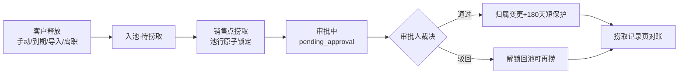

文字链：客户释放（四入口统一 SeaService.addToSea，:161-220，幂等防重+无启用池拒绝入池+清理分享/死提醒+写释放事件）→ 入池 available → 公海池页「捞取」submit(type=claim) 原子锁池行 → 审批管理页通过 → SeaService.completeClaim（:246-295：判主校验防错配、ownerId 变更、normal/active 状态、applyClaimReset 统一公式、清理分享、清 pending 提醒、写捞取事件）→ 客户进名下/捞取记录页可对账；驳回则 ApprovalService.reject 释放公海锁（:751-765），锁超时由 CustomerExpireTask.releaseStaleClaimLocks 定时兜底（CustomerExpireTask.java:45,254）。

#### 链条B：审批中枢链（对应业务链 **#14 审批中枢链**，并覆盖 **#5 保护期延期链 / #12 文件扩容链 / #13 客户转移链** 的裁决与执行段）

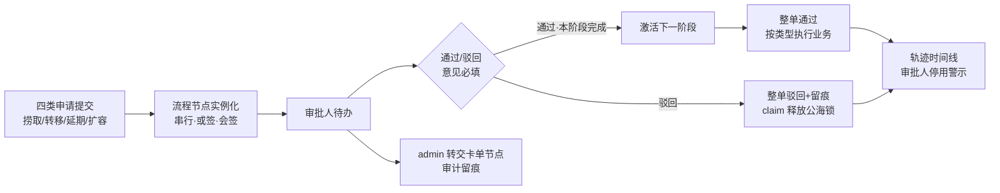

文字链：四类申请（submit 白名单校验→claim 锁池行→extend/transfer 提交侧归属与在途单防重→storage 锁用户行防并发重复单）→ ApprovalConfigService.createNodes 实例化串行/或签(ANY)/会签(ALL)节点 → 待办审批人通过/驳回（意见必填、自审自批双闸、条件流转防并发）→ 阶段推进直至整单通过 → executeApprovalAction 按类型执行：捞取=归属变更（链条A）、延期=锁客户行累加天数重算到期日、转移=接收人有效性+集团边界+属主与部门同步、扩容=锁行复核只升不降调配额；驳回=意见留痕+claim 单释放公海锁+级联作废其余节点；admin 可对 pending/waiting 节点转交（securityAudit 审计）；全过程轨迹可在详情抽屉回看。

### ⚠️ 疑点

#### 一、9 条核查重点中与本章节相关者

**重点①（销售员有客户导入码 customer:import）——与本章节的交叉口径，已核：公海导入与客户导入是两套独立码。**
公海页「批量导入」门槛是 `sea:import`（sea/index.vue:163），不是 `customer:import`；后端 POST /sea/import 只认 sea:import（SeaController:78），并额外叠池级 import 名单（SeaService.java:352-354）。验收表 line 44：销售员 sea:import=✗（admin/总监/行政=✓），故销售员的 customer:import 码**不会**让它能进公海导入。销售员能否批量建档本身属客户管理章节，此处不重复裁决，仅澄清两码互不影响。

**重点②（销售员有客户删除码 customer:delete）——与本章节的交叉口径，已核：公海删除不走 customer:delete。**
公海删除按钮显隐由后端行级 `canDelete` 下发（SeaService.java:127=hasPoolPerm(PERM_DELETE)），后端 DELETE /sea/pool/{id} 校验链=sea:view 门禁+池级 delete 名单+可见性防越权+available 状态+assertDeletable 业务保护（SeaService.java:302-338），全程与 customer:delete 无关。含义：**销售员若被配进某池的 delete 名单，也能物理走通公海删除**（前端按钮随 canDelete 出现）——这是池名单配置问题而非码泄漏；是否给销售员配池级删除名单属业务预期确认项（验收表 line 126 口径「删除（canDelete）」与此一致）。

其余 7 条重点（行政学分只读/激励 view-all/分享制 can_view_all/马吉亮特例/阅读排行榜/总监回收站/六项指标口径）分属学分、激励、回收站、统计章节，与本章节无代码交叉，不在此展开。

#### 二、本次审计新发现

**新发现①（P3·死参数）GET /sea/list 的 officeId 参数被接收但后端从未使用。**
SeaController.page 声明 `@RequestParam officeId` 并传入 service（SeaController.java:51,57），但 SeaService.page 签名中的 officeId 在函数体（SeaService.java:64-132）中无任何引用（deptId 才是实际消费的部门筛选）。前端公海页 query 也只传 deptId（sea/index.vue:218,244），当前无实际影响，属死参数，建议清理避免误导后续调用方。**待核**：是否有其他外部调用方在用 officeId（本次仅审计 PC 前端views/sea、views/approval，未全库检索调用方）。

**新发现②（P3·展示缺陷）审批列表「客户」列的行业行恒为空。**
前端渲染 `row.customerIndustry`（approval/index.vue:120），但后端 fillApprovalNames 只填充 applicantName 与 customerName（ApprovalService.java:1152-1161），全后端 grep `customerIndustry` 无填充点（本次执行：`grep -rn "setCustomerIndustry\|customerIndustry" aigicrm-backend/src/main/java`，零命中）。列表「客户」列第二行行业文字永远不出现，属后端漏填充或前端多余渲染，二者取一修复。

**新发现③（口径提示）捞取记录页 KPI 与列表数据口径不同。**
列表固定「仅本人申请」（SeaController.java:146 `eq(ApplicantId, 当前用户)`）；KPI 四卡统计按权限矩阵 sea.view 档可见申请人（scopeResolver.resolveModuleUsers("sea")，SeaController.java:225-236，注释明确「上级/负责人可见下级捞取统计」）。对销售员（self 档）两者一致；对上级/负责人，KPI 含下级而列表只有自己——页面标题「捞取审批记录/查看客户捞取申请与审批结果」（sea/records.vue:5-6）未说明该口径，管理者易误读 KPI≠列表之和是 bug。属有意设计（统计泄漏修复 2026-08-08），建议页面文案标注。

**新发现④（P3·按钮与权限不对齐）公海导入按钮可见门槛只有 sea:import，池级 import 二闸延迟到提交才报错。**
有 sea:import 但其办事处路由池的 import 名单不含此人时，按钮可见、弹窗可开，点「开始导入」才收到 403「没有该公海池的导入权限」（SeaService.java:352-354）。与公海删除/捞取（按钮显隐直接由行级 canDelete/canClaim 下发，SeaService.java:126-128）的精细口径不一致，体验层轻微；数据安全无缺口（后端双闸完整）。

**新发现⑤（P3·可用性）admin 转交候选人列表最多取 200 人。**
openTransfer 用 `getUserList({current:1,size:200})` 取第一页再前端过滤 status===1（approval/index.vue:324-326）。用户总数超 200 时目标审批人可能不在候选列表（无搜索框）。安全无缺口——服务端校验新审批人必须存在且启用（ApprovalService.java:527-531），不会转给无效人；但大组织下「想转的人选不到」只能等 404 防线报错或改配置。建议候选人接口改专用启用用户列表或加搜索。

**待核汇总（写入 notes）**：①officeId 死参数的外部调用方未全库检索；②业务链编号引用自《页面按钮全量对照-20261107》§0（该文档 §0 标题写「22 条主链」但实际列 23 项、文末又称 23 条，编号以列表顺序为准，文档自身口径略不一致）；③捞取记录页 keyword 内存过滤分支在数据量大时有性能隐患（代码注释 S7 已自知，SeaController.java:160-161，本次未做压测，仅记录）。


---

## 第 07 章｜PC·学分与统计

> 审计日期 2026-11-08 · 只读代码审计 · 所有按钮/接口均以源码为准，路径相对仓库根 `02-迭代源代码/`。
> 涉及前端：`aigicrm-ui/src/views/score/{entry,ranking}.vue`、`views/statistics/index.vue`、关联页 `views/indicator/index.vue`、`views/ranking/customer.vue`；后端：`ScoreController`、`ScoreService`、`StatisticsController`、`StatisticsQueryService`。

### 概述（侧栏位置/路由、权限码、谁能看到该菜单）

2026-11-05 起菜单分组定格（迁移 `aigicrm-backend/src/main/resources/db/migration/V2026.11.05.4__customer_score_stats_module_split.sql:31-44`）：撤销「考核与分析」组，**学分录入+学分排行 → 新「学分管理」组**；**统计分析独立成「统计分析」组**；**核心客户六项指标(/indicator)+客户排行(/ranking/customer) → 客户管理组**。权限码零变化。

| 页面 | 路由 | 权限码（路由守卫 `aigicrm-ui/src/router/index.js`） | 谁能看到（引自验收表） |
|---|---|---|---|
| 学分录入 | `/score/entry`（router/index.js:184-188） | `score:entry` | 验收表 §15：admin ✓ 总监 ✓ 行政 ✓ 销售员 ✗（菜单矩阵行「学分录入（score:entry）」；页面可写另需 `score:manage`=admin/总监，行政打开=只读） |
| 学分排行 | `/score/ranking`（router/index.js:190-194）；旧路径 `/incentive/ranking` 复用同一组件自愈（router/index.js:127-132） | `score:view` | 验收表 §16 + 菜单矩阵行「学分排行」：**四角色全 ✓（全员）** |
| 统计分析 | `/statistics`（router/index.js:176-182） | `statistics:view` | 验收表 §17 + 菜单矩阵行「统计分析组（顶层）」：**仅 admin/总监**（行政 ✗、销售员 ✗） |
| 核心客户六项指标 | `/indicator`（router/index.js:206-211，挂客户管理组） | `statistics:view` | 验收表 §5 + 矩阵行「核心客户六项指标/客户排行」：admin ✓ 总监 ✓ **行政 ✗** 销售员 ✓ |
| 客户排行 | `/ranking/customer`（router/index.js:195-202，挂客户管理组；菜单节点由 `V30__score_menu_and_customer_ranking_menu.sql:23-35` 创建） | `statistics:view` | 同上（admin/总监/销售员 ✓，行政 ✗） |

路由守卫统一在 `router/index.js:345-349`：无码访问回退到首个可访问路径或 /403。

### 功能清单（说人话）

- **学分录入**：管理员/总监在一张「学分项 × 同事」网格里打分；学分项（大类/产品/分值区间）可增删改；保存后整期分数落库并直达排行。
- **学分排行**：全员可看的公司级排行榜——个人榜（总学分/文件数/趋势）、部门榜（总学分/人数/人均），行点击可看个人学分明细、部门成员明细。
- **统计分析**：admin/总监的经营看板——客户/文件月度趋势、行业分布环图、办事处对比表、保护期状态与业务总览，行业/办事处可点击跳客户列表。
- **核心客户六项指标**：真核心/争核心客户榜单（五项评分+年度开票回款双门槛），挂客户管理组。
- **客户排行**：客户维度三体系排行（四项服务激励 / 客情商务关系深度 / 核心六项指标）同页对比。

### 按钮明细

#### ① 学分录入（`views/score/entry.vue`）

前端可写门控：`isAdmin = hasPermission('score:manage')`（entry.vue:130）；无码者所有输入控件 `disabled` 并显示「只读」tag（entry.vue:23、70、75、81、90）。

| 按钮 | 在哪 | 前端行为 | 后端动作 | 谁能看到 |
|---|---|---|---|---|
| 年度下拉 | entry.vue:8-10 | 切年份触发 `watch(period, loadGrid)`（entry.vue:190）重拉网格 | GET `/api/score/grid?period=`（`score:view`，ScoreController.java:46-50）；Service 返回学分项+大类中文名回填（score_category 字典，ScoreService.java:90-98）、候选同事池按 `resolveModuleUsersWithinGroup(user,"score")` 收口（ScoreService.java:44-47,102-106）、已存参与名单与分数矩阵同范围过滤（ScoreService.java:117-121,145-148） | 页面进入者（score:entry）；无 manage 码时只读查看 |
| 保存 | entry.vue:18,167 | 收集全部已填分数批量提交，成功后跳排行（`goRanking` entry.vue:170 带当前周期） | POST `/api/score/entries/batch`（`score:entry`，ScoreController.java:52-67）；Service **@Transactional 增量 upsert**（ScoreService.java:155-262）：服务端逐一校验①参与名单人员与目标人员均在可管理范围（ScoreService.java:184-196）、②学分项存在、③分数落在本项 min~max 区间（ScoreService.java:198-207）；只清空名单内被显式置空的记录，名单外历史分数不删（修复数据丢失 FEAT-20260804，ScoreService.java:159-164,238-245）；重写本周期参与名单（仅集团范围内物理删，ScoreService.java:248-261）。无发提醒/审计副作用 | 有 `score:manage` 码者=**admin/总监**（验收表 §15；前端按钮仅 isAdmin 渲染，entry.vue:15-18） |
| 查看排行 | entry.vue:20,170 | 携当前录入周期跳 `/score/ranking?period=` | 无后端调用（页面跳转） | 同上（isAdmin 门控，entry.vue:15-22） |
| 导出 | entry.vue:21,183-188 | 先 `refreshDownloadToken` 确保下载 token 就绪（不拼空 token），再 fetch blob 强制下载 `学分统计-<周期>.xlsx` | GET `/api/score/export/grid?period=&token=`（**`score:manage`**，ScoreController.java:101-107——2026-10-08 修复：原挂 score:view 使只读者可直连导出全量）；Service 按数据范围导出：同事列与分数均经 `visibleUserIds()` 过滤（ScoreService.java:434-449），大类转中文名、0 分导出为 0 而非空白（ScoreService.java:474-483 注释），末行合计 | admin/总监（同保存） |
| 行内大类下拉 | entry.vue:70-72,156 | 改大类后即时落库并清空产品（2026-11-01 修复：原仅区间落库，改大类刷新即回退） | PUT `/api/score/items/{id}`（`score:manage`，ScoreController.java:29-35）；Service 直接 updateById（ScoreService.java:67-69），无范围/参数再校验 | admin/总监；无码者控件 disabled |
| 行内产品下拉 | entry.vue:75-78,157 | 按大类联动过滤后即时落库（D14 修复：字典未按大类维护时回退全量，entry.vue:148-152） | 同上 PUT `/api/score/items/{id}` | 同上 |
| 行内区间下拉 | entry.vue:81-83,158 | 选 `min-max` 区间即时落库 scoreMin/scoreMax | 同上 PUT `/api/score/items/{id}` | 同上 |
| 行删除（垃圾桶） | entry.vue:86,173-178 | 红色确认框（confirmAction）后删除该行 | DELETE `/api/score/items/{id}`（`score:manage`，ScoreController.java:37-42）；Service **级联删除该学分项全部周期评分明细**再删项——否则孤儿 entry 继续进排行（幽灵分数，体检 P1 2026-10-12，ScoreService.java:71-78）。无审计日志副作用 | admin/总监（确认框文案即承诺"所有周期数据一并删除"） |
| 得分输入框 | entry.vue:89-91,163 | 前端按行区间钳制暂存（0 分合法，`??` 区分未评与 0，entry.vue:161-163），随「保存」批量提交 | 无独立调用（随批量保存落库，服务端再验区间） | admin/总监可写；无码 disabled 只读 |
| 添加行 | entry.vue:97,171 | 建 0-5 区间空学分项并追加到网格 | POST `/api/score/items`（`score:manage`，ScoreController.java:23-27）；Service 默认 sortOrder 排到最后（ScoreService.java:57-65） | admin/总监 |
| 列头「×」移除同事 | entry.vue:52,179 | 仅从本次可见列移除（本地），保存时以 participantIds 提交 | 无独立调用；效果经批量保存的参与名单持久化（ScoreService.java:251-261），且名单外同事**历史分数保留不删**（ScoreService.java:238-245） | admin/总监 |
| 「+」添加同事 | entry.vue:55-63,180 | popover 从候选池（`hiddenUsers`）选人加列 | 无独立调用（同上随保存持久化；候选池来自 grid 接口的范围收口名单） | admin/总监 |

#### ② 学分排行（`views/score/ranking.vue`，全员 `score:view`）

| 按钮 | 在哪 | 前端行为 | 后端动作 | 谁能看到 |
|---|---|---|---|---|
| 评分周期下拉 | ranking.vue:13-16,176-177 | 切周期重拉三路数据；周期仅「XXXX全年」（半年已退役） | GET `/api/score/ranking?type=personal|dept`、GET `/api/score/ranking/stats`（均 `score:view`，ScoreController.java:71-87）；**个人/部门榜无数据范围过滤=公司级全员榜**（设计规则注释 ScoreService.java:274-279）；排序=总分降序→文件数→姓名，趋势=上一期（上年全年）名次对比（ScoreService.java:291-328,534-547）；stats 汇总参与人数/部门数/最高学分/文件总数（ScoreService.java:402-430） | 全员（admin/总监/行政/销售员） |
| 「学分规则」 | ranking.vue:17,155-160 | 打开静态规则弹窗（4 条文案，纯前端） | 无后端 | 全员 |
| 页签 个人排行/部门排行 | ranking.vue:23-27,217 | 切 tab 重查 | 同上两接口（dept 走 `deptRanking` 按部门聚合总分/人数/人均，ScoreService.java:373-400） | 全员 |
| 个人榜行点击 | ranking.vue:57,247-271 | 打开「学分明细」弹窗，行结构对齐录入网格（#/大类/产品/区间/得分，得分>0 蓝字、0 显"—"） | GET `/api/score/grid?period=`（`score:view`）；⚠️该端点分数矩阵按 **score 模块数据范围**收口（ScoreService.java:145-148），与公司级排行不同口径，见⚠️疑点 N4 | 全员（但他人分数受范围过滤） |
| 部门榜行点击 | ranking.vue:87,226-239 | 打开「部门明细」弹窗（成员总分降序+公司名次） | GET `/api/score/ranking/dept-members?period=&deptName=`（`score:view`，ScoreController.java:91-97）；Service 复用个人排行结果按 officeName 过滤聚合（部门名空校验，零新查询面，ScoreService.java:343-371）；MP/PC 双端共用 | 全员 |
| 部门明细内成员行点击 | ranking.vue:111 | 复用个人明细弹窗下钻 | GET `/api/score/grid`（同上） | 全员（同范围限制） |
| 分页器（两榜） | ranking.vue:75,102 | 前端切片分页，切每页条数回第 1 页（ranking.vue:184-186） | 无后端 | 全员 |

#### ③ 统计分析（`views/statistics/index.vue`，`statistics:view`，仅 admin/总监）

| 按钮 | 在哪 | 前端行为 | 后端动作 | 谁能看到 |
|---|---|---|---|---|
| 年份下拉 | index.vue:10-12 | 切年份 `loadAll` 全量重查 | GET `/api/statistics/analysis?year=&deptId=`（`statistics:view`，StatisticsController.java:56-62）；Service 逐月 COUNT 客户/文件（文件按上传者范围、客户按负责人范围），客户口径统一排 sea+archived（StatisticsQueryService.java:816-839 及各段 B5 注释）；数据范围守卫 `applyCustomerScope/applyFileScope`：null=全量、空集显式 `1=0` 防 IN() 500（StatisticsQueryService.java:1095-1114），口径源 `CustomerService.getCurrentScopeUserIds()`（CustomerService.java:1423-1440，statistics 模块 view 锚点解析） | admin/总监（两者档位均 all=全公司，验收表 §17） |
| 部门树选择 | index.vue:14-25 | 选部门（含子部门）重查；下拉数据来自 GET `/api/common/scope/depts`（`api/system.js:51-53`） | analysis 同上，`deptId` 经 `DeptTreeUtils.expandSubtree` 展开子树过滤（StatisticsQueryService.java:823,897） | admin/总监 |
| 刷新 | index.vue:26 | 手动 `loadAll`（另有聚焦重拉+30s 轮询，index.vue:416） | 同 analysis；并发拉 Top5（见下行） | admin/总监 |
| 行业分布图例行点击 | index.vue:143,278-283 | 跳客户列表带 `?tab=all&industry=<行业>`；合成段（其他/未填行业）不可点（index.vue:321-322） | 无统计后端调用（前端路由跳转）；行业数据来自 analysis 的 `industryStats`（服务端仅统计非空行业，StatisticsQueryService.java:958-964；前端补「未填行业」段并统一分母，index.vue:298-323） | admin/总监；下钻落客户列表后继承其客户范围 |
| 办事处对比行点击 | index.vue:167,178 | 跳客户列表带 `?office=<办事处>` | 无独立调用（行数据来自 analysis 的 `officeComparison`：按 dept_type=3 逐办事处算客户数/本月新增/活跃率/近5月，活跃率分子已排归档防 >100%，StatisticsQueryService.java:841-892） | admin/总监 |
| 人员学分 Top5（只读卡） | index.vue:242-249,407 | 仅当有 `score:view` 才发请求（2026-11-01 修复：原无门控 403 被吞成假"暂无数据"，index.vue:267-269）；**不带周期参数** | GET `/api/score/ranking?type=personal`（`score:view`）；⚠️空周期=全周期合计而非所选年份（ScoreService.java:276-278 空周期不过滤），与页面"截至 filterYear 年"文案口径不符，见⚠️疑点 N3 | admin/总监（均有 score:view） |

#### ④ 核心客户六项指标（`views/indicator/index.vue`，`statistics:view`，挂客户管理组）

| 按钮 | 在哪 | 前端行为 | 后端动作 | 谁能看到 |
|---|---|---|---|---|
| 核心类型筛选下拉 | indicator/index.vue:36-40,110-112 | 真/争核心本地过滤，筛选后排名仍按原榜次、翻页回第 1 页（indicator:114-120） | 无独立调用（榜单来自页面加载） | admin/总监/销售员（行政无菜单） |
| 分页器 | indicator/index.vue:90-92 | 前端切片分页，排名=绝对榜次跨页连续（indicator:114-118） | 无后端 | 同上 |
| 页面加载（无按钮） | indicator:123-128 | 拉 `GET /api/statistics/indicator-stats`（`statistics:view`，StatisticsController.java:44-48）；Service：指标行随**客户可见范围**同步收口（StatisticsQueryService.java:431-454），核心三态=阶段总额年度口径纯金额双门槛（真核心=开票回款双≥大门槛、争核心=双≥小门槛，门槛读 sys_config 可配，StatisticsQueryService.java:57-98,458-461），个人/部门/大区三榜内存聚合（StatisticsQueryService.java:496-654） | admin/总监/销售员；**销售员实际口径见⚠️疑点 N2（待核）** |

#### ⑤ 客户排行三体系（`views/ranking/customer.vue`，`statistics:view`，挂客户管理组）

| 按钮 | 在哪 | 前端行为 | 后端动作 | 谁能看到 |
|---|---|---|---|---|
| 周期下拉 | customer.vue:8-10,147 | 切周期重查；默认空=全部（原默认上半年导致 0 条已修，customer.vue:146 注释） | GET `/api/statistics/customer-rankings?period=`（`statistics:view`，StatisticsController.java:50-54）；Service 三榜同页组装（StatisticsQueryService.java:665-743）：**四项服务榜=客户可见范围基线**（2026-11-02 用户裁决选项一：你能看到哪些客户就按哪些客户算，StatisticsQueryService.java:685-695），激励记录按 customerId 过滤后按大类聚合（0 分客户不展示，StatisticsQueryService.java:696-717）；客情榜/指标榜复用 indicatorStats 的 customerRanking 再过滤排序（StatisticsQueryService.java:719-730）；门槛文案随接口回传（StatisticsQueryService.java:739-741） | admin/总监/销售员（销售员=仅本人客户口径，见⚠️疑点 N2） |
| 三页签切换 | customer.vue:43-45 | 四项服务/客情关系/核心指标本地切换 | 无后端 | 同上 |
| 核心类型筛选（仅指标页签） | customer.vue:47-51,164-166 | 真/争核心本地过滤 | 无后端 | 同上 |

> 注：客户排行页**无导出按钮**；验收表矩阵行「客户排行导出（incentive:rank:export）admin ✓ 总监 ✓ 行政 ✗ 销售员 ✗」的导出入口在激励统计页（属四项激励章节，非本片）。

### 业务链条

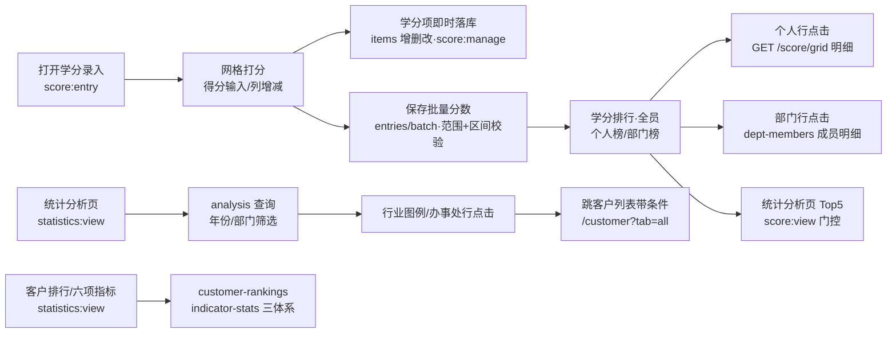

文字链：打开学分录入(score:entry) → 网格打分 → 学分项即时落库(PUT/POST/DELETE /score/items) → 保存批量分数(POST /score/entries/batch，服务端范围+区间双校验) → 学分排行(全公司，个人/部门) → 行点击个人/部门明细钻取 → 统计分析(GET /statistics/analysis) → 行业/办事处点击下钻跳客户列表闭环；客户排行三体系走 GET /statistics/customer-rankings 与 /indicator-stats。——对应 23 条业务链中的 **19.排行激励链** 与 **20.统计下钻链**。

### ⚠️ 疑点

**N1【9条重点之3】行政打开学分录入=只读——已核实，非故障。**
前端可写门控唯一依据 `score:manage`（entry.vue:130 `isAdmin` computed），行政有菜单（score:entry）无 manage 码 → 输入控件全部 `disabled`（entry.vue:70、75、81、90）、头部显示「只读」tag（entry.vue:23）、保存/导出/增删按钮整块不渲染（entry.vue:15-22）。后端与前端同门：items 增删改与导出挂 `score:manage`（ScoreController.java:24,30,38,104），批量保存挂 `score:entry` 但另有服务端范围+区间校验（ScoreService.java:184-207）。验收表 §15 口径一致（score:manage=admin/总监）。历史注：entry.vue:128-129 注释提及 2026-08-10 时字典曾授销售员 score:manage，现验收表（2026-11-07）已收口为 admin/总监，以验收表为准。

**N2【9条重点之9】六项指标/客户排行对销售员的实际数据口径——待线上预览核对。**
代码事实：`indicatorStats` 与 `customerRankings` 的客户集合均经 `visibleCustomers()` 过滤（StatisticsQueryService.java:431-440：admin=全量；其余按 `resolveModuleUsers(user,"statistics")` 解析，null=全量、非空=按 ownerId 过滤；691 行、447 行两处消费）。⚠️ 该方法上方注释仍写「核心客户六项指标全员可见、不做数据范围过滤」（StatisticsQueryService.java:446）——**注释与代码矛盾**，以代码为准（G2 2026-09-21 已收口）。销售员无 statistics 显式范围行时回退角色 dataScope 默认 `self`（`V1__baseline.sql:1149` 列默认 'self'；迁移目录未见 statistics 档位 seed），即销售员榜单应只含本人客户——但这与验收表 §5/§6「榜单允许暴露」的历史裁决相悖，且 2026-11-02 用户裁决已把三类排行统一为「客户可见范围基线」（StatisticsQueryService.java:685-689 注释原文）。三方（验收表待核项 / 方法注释 / 最新裁决注释）并存，**最终线上行为取决于生产库 role_perm_scope 是否有 statistics 行，代码审计无法定论，待核**。台账另注：客户排行接口 2026-11-02 前曾按分享制口径（2026-09-23），现按客户范围，分值聚合不含范围外客户。

**N3（本次新发现）统计分析页「人员学分 Top5」不按所选年份过滤。**
index.vue:407 调 `getScoreRanking({ type: 'personal' })` 未传 period；后端 `ranking()` 空周期时不过滤周期（ScoreService.java:276-278 `if (period != null && !period.isEmpty() ...)`），即 Top5=**全部周期累计总分**，而同卡所在「业务总览」区块文案写「截至 filterYear 年 X 月」（index.vue:189）。切换年份下拉时 Top5 数字不变（仅 analysis 重查带 year）。属展示口径不一致，非越权；是否要改成带年份过滤待产品定。

**N4（本次新发现）学分排行「个人明细」弹窗看得到榜、未必看得到分。**
个人行点击复用录入页端点 GET /score/grid（ranking.vue:253），该端点分数矩阵按 **score 模块数据范围**收口：`visible != null && !visible.contains(e.getUserId())` 的分数直接跳过（ScoreService.java:145-148）。销售员（score 模块回退 self）点开任意同事的明细行，所有得分格显示「—」、底部与公司级排行总分对不上；排行榜本身则是无范围过滤的全公司口径（ScoreService.java:274-279）。同一页面两个口径并存（榜=公司级、明细=个人范围），行政同理（score 模块范围通常窄于全公司）。是否预期"明细对全员开放"待核——若开放应给 /score/grid 明细读走公司级口径或另设端点。

**N5（本次新发现，低危）导出链与遗留路由备忘。**
①学分导出与前端按钮同门 `score:manage`（ScoreController.java:101-107 注释：2026-10-08 修复原 score:view 使只读者可直连 API 导出全量学分），前端先刷下载 token 再拼参（entry.vue:183-188），后端导出内容另按 score 数据范围收口（ScoreService.java:434-449）——链路闭合，无越权残留。②旧路径 `/incentive/ranking` 仍复用学分排行组件作书签自愈（router/index.js:127-132），侧栏高亮归位 `/score/ranking`，非独立功能。③本片五页面均只读统计/写学分，无提醒、审计日志、通知类副作用；删除学分项的级联删（ScoreService.java:71-78）是唯一不可逆副作用，已有确认框（entry.vue:175）。

> 9条重点中与本章节无关者（1、2、4、5、6、7、8）分属客户/激励/系统章节，本片未展开。


---

## 第 08 章｜PC·系统管理

> 审计日期 2026-11-08 · 只读代码审计（PC前端 aigicrm-ui/src + 后端 aigicrm-backend/src/main/java）
> 所有「后端动作」均读 Controller+Service 源码后撰写；「谁能看到」列引自《菜单功能按钮数据范围验收表-20261107》（行 51-58、149-160、185-186），未重新推导。

### 概述

- **侧栏位置/路由**：PC 侧栏「系统管理」组，共 7 个真实路由（`aigicrm-ui/src/router/index.js:216-311`）：
  - 人员管理 `/system/user`（码 `system:user:view`，index.js:216-221）
  - 组织架构 `/system/org`（码 `system:dept:view`，index.js:222-225）；旧路径 `/system/dept` 自愈同页（index.js:229-234）
  - 角色管理 `/system/role`（码 `system:role:view`，index.js:236-240）
  - 岗位管理 `/system/position`（码 `system:position:view`，index.js:242-246）
  - 系统设置 `/system/config`（码 `system:config:view`，index.js:248-252）；旧路由 `/system/perm-center`、`/system/log` 均重定向到此（index.js:258-274，权限中心/日志已收敛为系统设置内页签）
  - 回收站 `/system/recycle`（码 `system:recycle:view`，index.js:276-282）
  - 权限规则 `/system/rule`（码 `system:rule:view`，index.js:283-287）
  - 本月激励查询阅读排行榜 `/system/incentive-read-ranking`（码 `incentive:read-ranking:view`，index.js:289-299）
  - 集团管理 `/system/group`（码 `system:group:view`，index.js:301-307）
- **谁能看到**（验收表实拉 sys_role_menu，行 51-58、149-160、185-186）：组织架构/人员管理/部门管理 = admin✓ 总监✓ 行政✓ 销售员✗；角色/岗位/集团管理、权限规则 = admin✓ 总监✓ 行政✗ 销售员✗；回收站 = admin✓ 总监✓ 行政✗；**恢复/清空回收站按钮 = 仅 admin✓（总监✗）**；系统设置/系统配置编辑/部门编辑/菜单查看/组织管理员 = admin✓ 行政✓（总监✗——即总监可看大部分系统管理但无系统设置组）；日志查看（system:log:view）与本月激励查询阅读排行榜 = **仅 admin**（验收表行 185「总监也看不到」）。
- **页面骨架**：`views/system/` 22 个文件；人员管理由 user.vue 组合 UserFilterBar/UserTable/UserPager/UserFormDialog 四子组件（user.vue:20-23）+ 共享 composable `useUserList.js`；系统设置由 config.vue 左导航挂 6 个内页签（config.vue:17-52）；退役组件 PermMatrixManager.vue 全库无引用（按钮全量对照 F4，本次 grep 复核仅自身文件命中）。

### 功能清单

| 功能 | 说人话 |
|---|---|
| 人员管理 | 建号/改号/停号/删号/重置密码，选角色+数据范围七档+岗位多选；删人自动把名下客户释放公海 |
| 组织架构 | 维护总部→大区→办事处→部门四级树，可给每个组织任命「组织管理员」 |
| 角色管理 | 角色主档+数据范围七档+自定义组织矩阵；功能勾选已收口权限中心（此处只读） |
| 岗位管理 | 岗位 CRUD + 给岗位绑定权限规则；人员编辑弹窗里给用户挂岗位（第一个为主岗位） |
| 集团管理 | 多集团主档维护；「删除」实为软禁用可恢复 |
| 系统设置·基本设置 | 系统名/Logo、保护期四口径、核心客户双门槛（保存即全量重算核心标签）、存储配额与扩容申请、客户编号规则、新客户自动共享、上级看下属/组织负责人开关 |
| 系统设置·字典管理 | 字典类型/数据的增删改（业务下拉的源头） |
| 系统设置·审批配置 | 捞取/转移/延期/扩容四类流程的审批人+会签规则 |
| 系统设置·激励类别 | 激励一/二级分类与分值维护（三级小类已撤下管理页，走 SQL） |
| 系统设置·权限中心 | 四页签：功能与范围（给谁→码→范围档→锚点）/ 专项权限（公海池名单+激励四开关授权）/ 生效预览（实时算某人真实权限）/ 变更审计（sys_rule_version 只读时间线） |
| 系统设置·日志管理 | 全模块操作日志/登录日志 7 页签 + 安全审计 append-only 只读 |
| 权限规则 | 列过滤/组织过滤/时间范围三类 SQL 模板规则，供岗位绑定消费 |
| 回收站 | 已删客户/人员/文件三页签：查看详情、恢复、彻底删除、文件批量清空 |
| 阅读排行榜 | 本月激励发布记录为分母、个人已读为分子的全员排行（仅 admin） |
| 定时任务（无页面） | 客户保护期检查每日 02:00 自动跑（CustomerExpireTask.java:91 cron `0 0 2 * * ?`）；`POST /api/system/task/check-expire` 手动触发仅系统管理员（ScheduledTaskController.java:19-27），前端全库 grep 无入口按钮 |

### 按钮明细

#### 人员管理（/system/user）

| 按钮 | 在哪 | 前端行为 | 后端动作 | 谁能看到 |
|---|---|---|---|---|
| 新增用户 | UserFilterBar.vue:8（码 `system:user:add`） | 开弹窗，账号按办事处最大流水号提示（useUserList.js:66-84） | 建账号：必填五项兜底校验、用户名唯一、随机初始密码+首登强制改密（明文只弹一次「复制并转交」useUserList.js:280-286）；防提权双闸——不可授 admin 角色且所授角色/数据范围不得宽于自身（SysUserService.validateGrantableRoleAndScope:290-314，权限子集校验:315-338）；非 admin 目标组织须在可见范围（assertTargetOrgVisible:339-371）；写审计 securityAudit.userAdminEvent("user_create")（SysUserController.java:41-50、SysUserService.java:373-438） | admin✓ 行政✓（新增按钮码 system:user:add） |
| 搜索框（回车） | UserFilterBar.vue:11 | keyword 回到第 1 页重查 | 分页查人员；服务端可见范围收口：admin 不限，非 admin 按数据范围解析可见部门并与请求 deptIds 交集，越权请求直接返回空页不下发记录（SysUserService.page/applyVisibleDeptScope:136-197） | 登录+`system:user:view`/`system:org:admin`（SysUserController.java:24-25） |
| 部门树筛选 | UserFilterBar.vue:12 | 选部门自动带上全部子部门 ID（useUserList.js:88-98） | 同上，deptIds 与可见集交集 | 同上 |
| 状态筛选 | UserFilterBar.vue:13-14 | 正常/禁用筛选重查 | 同上 status 参数 | 同上 |
| 列表失败「重试」 | UserTable.vue:7 | 重新 loadData | 同列表接口 | 同上 |
| 行「编辑」 | UserTable.vue:69（码 `system:user:edit`） | 回显详情（custom 拉授权组织 useUserList.js:239-244；岗位回显 getUserPositions useUserList.js:246-253） | 改资料/换角色：非 admin 一律过 canManageUser 守卫（防行政越权改 admin，SysUserController.java:52-63 注释 P0-1）；数据范围必选、防提权同 create；单角色替换保留激励载体角色防静默提权（SysUserService.update:443-512）；custom 组织保存/清空（:496-503）；改后 Redis 权限缓存 evict+版本递增（:505-511）；另调 PUT /system/positions/users/{id} 分配岗位（useUserList.js:276-278，后端 SysPositionController.java:80-93：非 admin 指派「携带权限规则的岗位」直接拒绝 :86-89，目标用户可见性+岗位集团/组织校验 SysPositionService.assignUserPositions:169-199） | admin✓ 行政✓ |
| 行「重置密码」 | UserTable.vue:70（码 `system:user:edit`） | 红色确认框后生成随机临时密码弹窗展示一次（useUserList.js:298-310） | 重置口令：非 admin 禁止重置 admin 角色账号（服务层 H1 兜底 SysUserService.resetPassword:514-535）；置 pwdResetRequired=1 + DB 改密时刻（旧 token 立即失效 jwtTokenProvider.markPasswordChanged）；写审计 user_reset_password | admin✓ 行政✓（对 admin 目标必 403） |
| 行「删除」 | UserTable.vue:71（码 `system:user:delete`） | 确认框明示「名下客户将释放到公海池」（useUserList.js:312-324） | 软删用户的事务级联：先校验后落审计（拒绝路径零副作用 P2-2）；非 admin 禁删 admin 账号；名下客户逐个入公海「离职交接」（无启用公海池的客户跳过入池但清分享）；清该用户作为分享接收方的记录；清角色/岗位/用户组织/组织管理员关联；软删后权限缓存 evict（SysUserService.deleteUser:738-790） | admin✓ 行政✓（对 admin 目标必 403） |
| 弹窗「保存」 | UserFormDialog.vue:104 | 字段级校验（姓名/账号/角色/手机号必填、邮箱格式、数据范围必选 useUserList.js:46-57），失败自动滚到首个错误字段（:264-268） | → 即上面的 create/update 链 | 同编辑/新增 |
| 弹窗「取消」 | UserFormDialog.vue:103 | 关弹窗 | 无 | 同上 |
| 分页器 | UserPager.vue（page-sizes 30/50/100） | 换页重查 | 同列表 | 同上 |

#### 组织架构/部门（/system/org，dept.vue）

| 按钮 | 在哪 | 前端行为 | 后端动作 | 谁能看到 |
|---|---|---|---|---|
| 新增部门 | dept.vue:5（canEditDept=`system:dept:edit`，dept.vue:120） | 弹窗预选父级下级类型（dept.vue:164-169） | 建组织节点：集团边界守卫——未传 groupId 兜底当前集团（无集团 fail-closed 拒绝），显式越权集团拒绝（SysDeptService.create:90-102，SysDeptController.java:39-44 码 `system:dept:edit`） | admin✓ 行政✓（验收表「部门编辑」行 56） |
| 树行「管理(N)」 | dept.vue:35 | 打开组织管理员弹窗，计数并发拉取（dept.vue:151-156） | 列出该组织管理员（GET /system/depts/{deptId}/admins，SysDeptController.java:63-67，码 `system:dept:view`） | admin✓ 行政✓ |
| 树行「编辑」 | dept.vue:36 | 弹窗回显，前端层级校验「根=总部/大区挂总部/办事处挂大区/部门挂办事处」（dept.vue:184-193） | 改组织：三向集团边界（目标/新归属/新父节点任一跨集团拒）；改 groupId/层级后全量失效权限缓存+版本递增（SysDeptService.update:104-128） | 同上 |
| 树行「添加子部门」 | dept.vue:37 | 弹窗带 parentId | 同 create | 同上 |
| 树行「删除」 | dept.vue:38 | 前端先拦「有子部门」（dept.vue:216-219），confirmAction 红钮 | 删组织：集团边界先拒；有子部门拒；部门下有在职用户拒（SysDeptService.delete:130-149） | 同上 |
| 弹窗「保存」 | dept.vue:80 | → create/update | 同上 | 同上 |
| 管理员弹窗「添加」 | dept.vue:92 | 远程搜用户（size=50，dept.vue:255-260）后选人 | 任命组织管理员：仅能在调用者管辖组织内任命（canManageOrg，OrgAdminService.addOrgAdmin:57-77）；幂等去重；写 sys_org_admin 后失效该用户权限缓存+版本递增 | admin✓ 行政✓（须是本组织管理员/超管才过 canManageOrg） |
| 管理员弹窗「移除」 | dept.vue:99-103（popconfirm） | 确认后移除 | 移除前校验被移除记录的组织在管辖范围（OrgAdminService.removeOrgAdmin:81-93）；同步失效缓存 | 同上 |

#### 角色管理（/system/role，role.vue）

| 按钮 | 在哪 | 前端行为 | 后端动作 | 谁能看到 |
|---|---|---|---|---|
| 新增角色 | role.vue:5（码 `system:role:add`，role.vue:133） | 弹窗含数据范围七档下拉（role.vue:55-63） | 建角色：防提权（非 admin 不可建 admin 码角色/范围超自身拒，SysRoleService.validateGrantableRole:81-104）；集团边界 fail-closed；编码唯一；同事务落菜单勾选（menuIds 超集校验 :311）与 custom 组织矩阵（SysRoleService.create:106-130）；写审计 permission_change("role_create") | admin✓ 总监✓ |
| 行「编辑」 | role.vue:30（码 `system:role:edit`） | custom 时拉组织矩阵回显（GET /system/roles/{id}/orgs，role.vue:215-224） | 改角色：存在性+集团越权拒；role_code 改名同步迁移 role_perm_scope 防孤儿配置（:157-163）；menuIds 清空重建（含权限子集校验）；dataScope 变更同步组织关联；缓存 evictByRole+受影响用户版本递增（SysRoleService.update:133-188）；写审计 role_update | admin✓ 总监✓ |
| 行「权限」 | role.vue:31（canEditRole 显隐） | **只读弹窗**：树形回显该角色已勾菜单，顶部提示「功能勾选已收口至权限中心」（role.vue:100-114、276-287） | GET /system/roles/{id}（码 view）+ GET /system/menus/tree（码 `system:menu:view`，SysMenuController.java:19-23） | admin✓ 总监✓ |
| 「去权限中心配置」 | role.vue:113 | 置 activeTab='permCenter' 并跳 /system/config（role.vue:292-296） | 无（纯导航） | 同上 |
| 行「删除」 | role.vue:32（码 `system:role:delete`） | confirmAction | 删角色：集团越权拒；先捕获受影响用户再删绑定（缓存自愈 G2 修复）；连带清 role_menu/role_org/role_perm_scope/sys_user_role/biz_folder_acl（按集团限定防跨集团误删）；逐用户 evict（SysRoleService.delete:216-260）；写审计 role_delete | admin✓ 总监✓ |
| 组织矩阵勾选（custom） | role.vue:73-80 | 勾选即含下级（后端固定 include_children=1，契约注释 role.vue:147-151） | 随 POST/PUT /system/roles 请求体 orgIds 一次落库（role.vue:241-253；SysRoleService.saveRoleOrgs:327+）；独立入口 PUT /system/roles/{id}/orgs 有集团守卫（SysRoleService.updateOrgs:191-214） | 同编辑 |
| 弹窗「保存」 | role.vue:95 | → create/update | 同上 | 同上 |

#### 岗位管理（/system/position，position.vue）

| 按钮 | 在哪 | 前端行为 | 后端动作 | 谁能看到 |
|---|---|---|---|---|
| 新增岗位 | position.vue:5（码 `system:position:add`） | 弹窗（编码字母开头正则） | 建岗位：集团边界 fail-closed+越权拒；编码唯一（SysPositionService.create:75-92，SysPositionController.java:29-34） | admin✓ 总监✓ |
| 行「编辑」 | position.vue:33（码 `system:position:edit`） | 弹窗回显 | 改岗位：三向集团边界（SysPositionService.update:94-115） | admin✓ 总监✓ |
| 行「规则」 | position.vue:34（canEditPosition 显隐） | checkbox 勾选规则列表（先 GET /system/positions/{id}/rules 回显，position.vue:219-228） | 读规则（码 `system:position:view`）；**保存规则 admin-only**：非 admin 直接 403「仅系统管理员可修改岗位权限规则」（SysPositionController.java:59-70，P1 复审修复——岗位规则=权限定义本身）；保存=清空重建，且缓存失效/版本递增在 early-return 之前（SysPositionService.saveRules:141-156） | admin✓ 总监✓（按钮可见，但非 admin 保存必 403 ⚠️见疑点） |
| 规则弹窗「保存规则」 | position.vue:100 | → PUT …/rules | 同上 | 同上 |
| 行「删除」 | position.vue:35（码 `system:position:delete`） | confirmAction | 删岗位：集团越权拒（SysPositionService.delete:116-134） | admin✓ 总监✓ |
| 弹窗「保存」 | position.vue:74 | → create/update | 同上 | 同上 |

#### 集团管理（/system/group，group.vue）

| 按钮 | 在哪 | 前端行为 | 后端动作 | 谁能看到 |
|---|---|---|---|---|
| 新增集团 | group.vue:5（码 `system:group:add`） | 弹窗（编码禁改规则同岗位） | 建集团：编码唯一（SysGroupService.create:28-35，SysGroupController.java:25-30）。**无集团边界校验（本表 CRUD 全无）⚠️见疑点** | admin✓ 总监✓ |
| 行「编辑」 | group.vue:23（码 `system:group:edit`） | 弹窗回显 | 改集团（SysGroupService.update:36-40） | admin✓ 总监✓ |
| 行「禁用」 | group.vue:25（码 `system:group:delete`；2026-11-02 文案已改「禁用」，group.vue:24 注释 P2） | confirmAction「可随时重新启用」 | 软禁用=置 status=0（SysGroupService.delete:41-47），非物理删除 | admin✓ 总监✓ |
| 弹窗「保存」 | group.vue:53 | → create/update | 同上 | 同上 |

#### 系统设置骨架（/system/config，config.vue）

| 按钮 | 在哪 | 前端行为 | 后端动作 | 谁能看到 |
|---|---|---|---|---|
| 左导航页签×6 | config.vue:19-39（基本设置/字典管理/审批配置/激励类别管理/权限中心/日志管理） | 自定义按钮切换，重组件首访才挂载（visited-once，config.vue:76-79）；**日志管理页签显隐=码 `system:log:view`**（config.vue:71） | 页签为纯前端切换；数据加载见下列各块 | 系统设置菜单= admin✓ 行政✓（验收表行 56）；日志页签仅 admin（行 57） |

#### 系统设置·基本设置（BasicSettings.vue）

| 按钮 | 在哪 | 前端行为 | 后端动作 | 谁能看到 |
|---|---|---|---|---|
| 上传Logo | BasicSettings.vue:20-29（el-upload→POST /api/file/upload 带 Bearer，:207） | 上传成功即触发保存，失败回滚预览（:320-335） | Logo 值变更仅平台 admin 可改：校验必须以 `/api/file/download/public/` 开头、禁 `..` 穿越、归一后首段必须 public（SysConfigController.validateLogoConfigs/validateLogoValue:124-156）；PUT /system/configs 码 `system:config:edit`（:51-52） | admin✓（行政点保存其它项可以、改 Logo 会 403） |
| 清除Logo | BasicSettings.vue:30 | 置空后走保存 | 空值=清除 Logo（validateLogoValue:143） | 同上 |
| 真核心/争核心双门槛 | BasicSettings.vue:66-81（万元输入） | 前端兜底：1–1000000 整数且 minor≤major（:372-386） | 服务端同款校验双保险（SysConfigController.validateCoreThresholdConfigs:84-99）；**保存后门槛真实变化才全量重算客户核心标签**（customerService.recalculateAllCoreStatuses，:57-65） | 编辑需 `system:config:edit`（BasicSettings.vue:203、174 保存钮+只读提示 :173） |
| 文件回收站保留天数 | BasicSettings.vue:93-100 | 0–3650 整数，0=不自动清理（:215-228） | 随整表 PUT upsert | 同上 |
| 允许申请扩容/可申请人员/单用户配额上限 | BasicSettings.vue:101-123 | 开关+多选人员（JSON 数组）+1–1024GB 上限 | 随保存写入 file.storage.apply.* 三键；后端消费见 SysUserService 常量 :46-58（上限 1GB–1TB 边界） | 同上 |
| 默认存储空间 | BasicSettings.vue:88-92 | GB 编辑、字节落库（:337-345） | 写 user.default.storage；create 用户时读取赋默认配额（SysUserService.create:411-419） | 同上 |
| 编号规则 | BasicSettings.vue:130-135 | 大区-年月-顺序号 / 大区-顺序号 | 写 customer.code.rule | 同上 |
| 新客户默认共享（上级/管理员/指定角色/指定人员） | BasicSettings.vue:136-154 | autoShare 对象序列化回 customer.auto_share JSON（:393-399） | 随整表保存 | 同上 |
| 上级看下属/组织负责人开关 | BasicSettings.vue:155-167 | 归一 true/false 字符串，DB 无行默认开（:290-292） | 写 perm.superior.see.subordinate / perm.org.leader.see.org（系统级数据范围推导开关） | 同上 |
| 「保存设置」 | BasicSettings.vue:174 | 防程序化绕过：无码直接 warning 返回（:346-351）；整表按 configKey upsert（:400-409） | PUT /system/configs（批量 upsert）；Logo 变更 admin 校验+门槛重算副作用见上 | admin✓ 行政✓（码 `system:config:edit`） |
| 公开配置/Logo 读取（无按钮） | — | 登录页品牌与保护期口径回显 | GET /system/configs/public 匿名白名单 7 键（SysConfigController.publicConfig:158-175）；GET /system/configs/logo 只读 public 目录防穿越（:177-222） | 匿名 |

#### 系统设置·字典管理（DictManager.vue）

| 按钮 | 在哪 | 前端行为 | 后端动作 | 谁能看到 |
|---|---|---|---|---|
| 类型「新增/编辑/删除」 | DictManager.vue:7、24-25（canEditConfig=`system:config:edit`，:119；删除仅非内置 :25） | 字段级校验+confirmAction | 类型 CRUD：读 `system:config:view`，写 `system:config:edit`（SysDictController.java:22-48） | admin✓ 行政✓ |
| 类型行选中 | DictManager.vue:10-15 | 右侧载入数据列表 | GET /system/dict/data/type/{id}（**登录即可**，SysDictController.java:65-69——业务表单下拉依赖） | 全员 |
| 数据「新增/编辑/删除」 | DictManager.vue:40、53-54 | 弹窗保存 | 数据 CRUD 码 `system:config:edit`（SysDictController.java:71-91）；按 code 读数据亦登录即可（:59-63） | admin✓ 行政✓（写） |

#### 系统设置·审批配置（approvalConfig.vue）

| 按钮 | 在哪 | 前端行为 | 后端动作 | 谁能看到 |
|---|---|---|---|---|
| 「新增流程」 | approvalConfig.vue:6（canEditConfig=`system:config:edit`，:95） | 弹窗：流程类型四选一（捞取/转移/延期/存储扩容，类型禁改 :44）、审批人按人/按角色多选、会签开关 | POST /api/approval/config（码 `system:config:edit`，ApprovalConfigController.java:27-31；读列表 :20-24 码 view） | admin✓ 行政✓ |
| 行「编辑」 | approvalConfig.vue:28 | 弹窗回显（approverIds JSON 兜底解析 :115-118） | PUT /api/approval/config/{id}（:34-40） | 同上 |
| 行「删除」 | approvalConfig.vue:29-31（popconfirm） | 确认删除 | DELETE /api/approval/config/{id}（:42-48） | 同上 |
| 弹窗「保存」 | approvalConfig.vue:78 | → create/update | 同上 | 同上 |

#### 系统设置·激励类别管理（CategoryManager.vue）

| 按钮 | 在哪 | 前端行为 | 后端动作 | 谁能看到 |
|---|---|---|---|---|
| 「新增类别」 | CategoryManager.vue:13（码 `incentive:edit`） | 弹窗上级只列顶级（三级小类撤下，:144-148） | POST /incentive/categories（码 `incentive:edit`，IncentiveController.java:30-36） | admin✓ 总监✓ 行政✓（全员有 incentive:edit 者可写；验收表行 46 四项激励组三角色✓） |
| 组头「编辑/子项/删除」 | CategoryManager.vue:27-29 | 子项=以该顶级为父新建；删除前拦有子项（:187-192） | PUT/POST/DELETE 同上族 | 同上 |
| 子项行「编辑/删除」 | CategoryManager.vue:63-64 | 弹窗/confirm | 同上族 | 同上 |
| 弹窗「保存」 | CategoryManager.vue:109 | 名称必填前端兜底（:174） | 同上族；树读 GET /incentive/categories（码 `incentive:view`，IncentiveController.java:24-29） | 同上 |

#### 系统设置·权限中心（PermCenter.vue 四页签）

| 按钮 | 在哪 | 前端行为 | 后端动作 | 谁能看到 |
|---|---|---|---|---|
| 页签 chips×4（功能与范围/专项权限/生效预览/变更审计） | PermCenter.vue:9-12 | chip 切换+惰性挂载（:154-156） | 无（纯前端） | 系统设置可见者（admin/行政）；**可写门槛另加 isAdmin** |
| 主体切换 radio（按角色/岗位/用户） | PermScopeManager.vue:7-11 | 切换拉岗位/用户选项（:352-368） | GET /system/positions、GET /system/users | 权限矩阵读需 `system:menu:view`/`system:role:view`（PermScopeManager.vue:32-35 空态文案） |
| 「刷新」 | PermScopeManager.vue:18 | 重拉角色/菜单树/各角色 menuIds（:386-397） | GET /system/roles、/system/menus/tree、/system/roles/{id}×N（usePermissionData.loadPermData:147-157） | 同上 |
| 权限项勾选（单点） | PermScopeManager.vue:65-66（禁用条件 `!isRoleMode \|\| !canEditScope`；canEditScope=`isAdmin ∧ system:config:edit`，:223） | 本地翻转→PUT 整角色 menuIds，失败回滚勾选（usePermissionData.togglePerm:127-145） | PUT /system/roles/{roleId}（saveRoleMenus 权限子集校验防横向提权 SysRoleService.java:311） | admin✓（行政可见但禁用） |
| 范围下拉/锚点下拉/「荐」标 | PermScopeManager.vue:72-83 | 仅对后端真实消费的 13 个码显示控件（PERMISSION_SCOPE_TARGETS:165-185），其余灰字标注真实控制面（:189-211） | PUT /system/perm-scopes/{roleCode} 或 /assignee/{type}/{key}：写门槛=码 `system:config:edit` **+ requireAdmin()**（非超管 403 防自提权，RolePermScopeController.java:31-38、50-61、63-69）；读=码 `system:config:view`（:25-27、43-47） | admin✓（读写）；行政可读 |
| 「全不勾/全勾」 | PermScopeManager.vue:57-58（仅角色模式+可写） | 单次 PUT 整角色 menuIds（:238-254） | 同单点勾选 | admin✓ |
| 「恢复默认范围」 | PermScopeManager.vue:59 | 空数组覆盖（:308-323） | PUT perm-scopes …=[]（同上 requireAdmin） | admin✓ |
| 高危组合二次确认（删除/财务×全部） | PermScopeManager.vue:288-295 | ElMessageBox 确认后才保存 | 同范围保存 | admin✓ |
| 专项权限·「添加授权」（激励） | PermCenter.vue:27（canEdit=`isAdmin ∧ system:config:edit`，PermCenter.vue:151） | PermGrantDialog 弹窗：可见性区（角色批量+组织人员树+两查看开关）/编辑区/删除区各自独立名单，提交时按终态合组逐人 upsert（PermGrantDialog.vue:13-111、usePermissionData.grantPerm:249-313） | POST /incentive/permission/grant：仅超管（码 `system:config:edit`+isAdmin 硬校验，IncentivePermissionController.java:76-80）；roleIds 展开为启用角色启用成员（:99-113）；四 flag 全量覆盖 upsert biz_incentive_grant；**每次授权写审计 sys_rule_version("incentive_grant:{uid}", 旧4flag→新4flag)**（:116-137、143-145）；canViewShared 缺省 1、canViewAll 缺省 0（:82-83） | admin✓ |
| 专项权限·「撤销」 | PermCenter.vue:47 | 确认「回到基础可见范围」 | DELETE /incentive/permission/{userId}：仅超管；删授权行=回到默认（分享可见=开）；无行幂等；审计写「默认(分享可见=开,其余=关)」（IncentivePermissionController.java:163-180） | admin✓ |
| 专项权限·公海池「新增/编辑/删除」 | SeaConfigManager.vue:6、21-22（canEditSeaConfig=`sea:config:edit`，:178） | 池级名单勾选（部门/人员/角色，勾角色=成员自动获得） | POST/PUT/DELETE /api/sea/configs（码 `sea:config:edit`，SeaController.java:110-127）；名单查看 GET /api/sea/configs（码 view，:87-89） | admin✓ 行政✓（验收表行 49 公海配置三角色✓；销售员只读 visible 口径 :94-97） |
| 生效预览·搜索/选人 | PermCenter.vue:58-61 | 远程搜人→实时算真实权限（:168-190） | GET /system/users + GET /system/perm-center/preview（码 `system:config:view`；复用每请求鉴权同链路只读重建目标用户，PermCenterController.java:30-37） | admin✓ 行政✓（只读） |
| 变更审计·分页 | PermCenter.vue:130-131 | 翻页读时间线 | GET /system/rule-versions（码 `system:config:view`；append-only 表触发器拒改删，SysRuleVersionController.java:23-32） | admin✓ 行政✓（只读） |

#### 系统设置·日志管理（log.vue 内嵌页签）

| 按钮 | 在哪 | 前端行为 | 后端动作 | 谁能看到 |
|---|---|---|---|---|
| 页签×7（全部/操作/登录/文件/人员/系统/安全审计） | log.vue:126-135 | 切页签重查；审计页签走独立接口+事件类型筛选（:151-160） | 操作日志 GET /system/logs（码 `system:log:view`，SysLogController.java:20-31）；安全审计 GET /system/audit-logs（同码；append-only 表库层触发器拒改删，SysAuditLogController.java:27-35） | **仅 admin**（验收表行 57；config.vue:71 页签显隐同码） |
| 日期范围/关键字/事件类型筛选 | log.vue:26-33 | 审计页签隐藏日期框（后端不支持日期参数，:25 注释） | 同上列表参数 | 同上 |
| 行「查看」 | log.vue:72 | 详情弹窗（:87-96、205-208） | 同列表数据，无额外请求 | 同上 |
| 页签计数/分页 | log.vue:79-83、175-185 | 计数条+每页条数切换 | GET /system/logs/counts（码 `system:log:view`，SysLogController.java:33-39） | 同上 |

#### 权限规则（/system/rule，rule.vue）

| 按钮 | 在哪 | 前端行为 | 后端动作 | 谁能看到 |
|---|---|---|---|---|
| 「新增规则」 | rule.vue:5（码 `system:rule:add`，:108） | 弹窗：列过滤/组织过滤/时间范围三型，规则值支持 `${user.userId}` 等变量模板（:71-79） | POST /system/rules（码 `system:rule:add`，SysPermissionRuleController.java:25-30）；规则供岗位「规则」绑定后在登录时并入 RuleResult 生效（SysPositionController.java:83-84 注释） | admin✓ 总监✓ |
| 行「编辑」 | rule.vue:31（码 `system:rule:edit`） | 编码禁改 | PUT /system/rules/{id}（:32-38） | admin✓ 总监✓ |
| 行「删除」 | rule.vue:32（码 `system:rule:delete`） | confirmAction | DELETE /system/rules/{id}（:40-45） | admin✓ 总监✓ |
| 弹窗「保存」 | rule.vue:93 | 必填四项前端兜底（:150-154） | 同上族 | 同上 |

#### 回收站（/system/recycle，recycle.vue）

| 按钮 | 在哪 | 前端行为 | 后端动作 | 谁能看到 |
|---|---|---|---|---|
| 统计卡×3 / 页签 seg×3 | recycle.vue:11-24、31-39 | 点卡片/页签切换客户/人员/文件列表；计数全量口径与搜索隔离（:377、454-470） | GET /system/recycle/customers｜users｜files（码 `system:recycle:view` **+ 全端点 requireAdmin()**，RecycleController.java:38-46、69-77、100-108） | admin✓（总监菜单可见但接口 403 ⚠️见疑点；验收表行 54-55） |
| 搜索框 | recycle.vue:42-46 | 回车/清空触发重查 | 同上列表 keyword | 同上 |
| 「清空回收站」（仅文件页签） | recycle.vue:48-50（canPurge=`system:recycle:purge`，:351） | 先重拉全量计数再确认（数量不一致不进流程，:558-574） | POST /system/recycle/files/purge（码 `system:recycle:purge`+requireAdmin）；逐文件行锁复核 deleted=1 后物理删内容+台账，返回清理/跳过/失败计数（RecycleController.java:140-152、RecycleService.purgeAllDeletedFiles） | **仅 admin** |
| 「刷新」 | recycle.vue:52 | 列表+计数一起刷新 | 同列表 | 同上 |
| 行点击/「详情」 | recycle.vue:79-89、110、159、217 | 抽屉展示全字段+关联数据计数+不可删原因提示；请求带序号防旧响应覆盖（:586-603） | GET /system/recycle/…/{id}（view 码+requireAdmin；详情含 related 计数，RecycleService.deletedCustomerDetail:166-174 等） | admin✓ |
| 「恢复」（行内/抽屉，三实体） | recycle.vue:111、160、218、324（canRestore=`system:recycle:restore`，:350） | 确认框列明恢复校验项 | 客户恢复：同名活跃客户拒/原负责人已删拒/公海残留拒/行级条件更新（RecycleService.restoreCustomer:98-122）；人员恢复：账号被占拒/原部门已删拒，恢复后**角色岗位组织已清空需重新分配**，权限缓存 evict+版本递增（restoreUser:141-162）；文件恢复：行锁防并发清理（TOCTOU 注释 :340-348），内容已物理清除则 fail-closed 拒，私有文件校验上传人（restoreFile:340+）；各写审计 writeAuditLog | **仅 admin** |
| 「彻底删除」（行内/抽屉，三实体） | recycle.vue:112、161、219、325（canPurge） | 确认「不可恢复；有业务关联会拒绝」 | 客户：发票/回款/激励/指标/日志/阶段金额/审批存在即拒，通过后连带删分享/提醒/公海/联系人（hardDeleteCustomer:212-239）；人员：业务关联拒，随删阅读记录/角色/岗位/组织/管理员关联+缓存 evict（hardDeleteUser:242-271）；文件：激励引用拒，行锁复核后物理删内容+分享+台账（hardDeleteFile:274-301）；各写审计 | **仅 admin** |
| 抽屉「下载文件」 | recycle.vue:314 | downloadFile 带 Bearer（:665-670） | GET /system/recycle/files/{id}/content（view 码+requireAdmin，按 deleted=1 行读存储内容，RecycleController.java:118-123） | admin✓ |
| 分页 | recycle.vue:226-230 | 换页/换每页条数 | 同列表 | 同上 |

#### 本月激励查询阅读排行榜（/system/incentive-read-ranking）

| 按钮 | 在哪 | 前端行为 | 后端动作 | 谁能看到 |
|---|---|---|---|---|
| 月份选择 | incentive-read-ranking.vue:9-18 | 换月重查 | GET /incentive/read-ranking（码 `incentive:read-ranking:view`，IncentiveController.java:213-219） | **仅 admin**（验收表行 58/185；路由与接口同码，默认只绑系统管理员角色，index.js:290 注释） |
| 「刷新」 | incentive-read-ranking.vue:19 | 重新 load | 同上 | 同上 |
| 分页 | incentive-read-ranking.vue:100-109 | 前端分页（rows 已全量拉回，:137） | 同上 | 同上 |

#### 自服务/公共支撑（本章节后端范围内、无页面按钮）

| 端点 | 说明 |
|---|---|
| GET /api/auth/permission-explain（PermissionExplainController.java:24-29） | 登录即可查「我的有效权限怎么来的」自检（PR-21） |
| GET /api/common/scope/users、/depts（ScopeController.java:26-35） | 所有模块人员/部门下拉统一入口：登录即可，数据范围在 service 内强制 |
| POST /api/system/task/check-expire（ScheduledTaskController.java:19-27） | 手动触发保护期检查，**仅系统管理员**（原 config:view 销售员/行政可触发已收口）；日常走每日 02:00 cron（CustomerExpireTask.java:91）；前端无入口按钮（grep 全库无命中） |

### 业务链条

**对应 23 条业务链中的第 18 条「系统管理」**（验收表 `### 18. 系统管理`，行 149-160）。

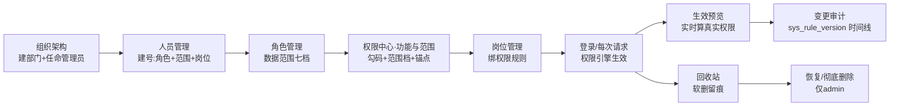

文字链：建组织→建人（角色+数据范围+岗位）→角色/权限中心配码配范围→岗位绑规则→登录生效→生效预览核验→变更审计追溯；删除侧人员/客户软删进回收站→admin 恢复或彻底删除。激励专项授权（看分享/看全部/编辑/删除）不走此链，走 `biz_incentive_grant` 授权表按人实时判定（IncentivePermissionController.java:15-19），授权变更同样落 sys_rule_version 审计。

### ⚠️ 疑点

**核查重点 7（相关）：阅读排行榜/日志查看仅 admin——代码与验收表一致**
路由码 `incentive:read-ranking:view`（index.js:293-295）、接口同码（IncentiveController.java:214）；日志页签显隐 `system:log:view`（config.vue:71）、日志/审计接口同码（SysLogController.java:21、SysAuditLogController.java:28）。「仅 admin」是 sys_role_menu 绑定事实，引自验收表行 57-58/185（未重新推导，代码层面码可经角色管理勾给其它角色——是否仍只绑 admin 为 DB 现状，代码无法核实）。

**核查重点 8（相关）：总监无回收站恢复/清空按钮——且后端比「无按钮」更强**
前端 `canRestore/canPurge` 按 `system:recycle:restore/purge` 显隐（recycle.vue:350-351）；**RecycleController 全部 13 个端点在权限码之上再加 `requireAdmin()` 硬闸**（RecycleController.java:31-36 每个方法先调）——总监即使被补授两个码，恢复/清空也会 403「仅平台管理员可访问回收站」。结论与验收表行 55/186 一致且更强；同时解释了「回收站菜单可见但按钮无码」的总监视角。

**核查重点 5（相关）：权限中心「添加授权」的 can_view_all 默认=0**
后端 grant 的 canViewAll 缺省 0（IncentivePermissionController.java:83）、撤销即回默认（:154-180）；前端「查看全部」复选框默认未勾（PermGrantDialog.vue:43-49）、授权合并底座对无记录用户 va=0（usePermissionData.grantPerm:268-274）。与验收表行 108「29 条授权 can_view_all 全 0」机制吻合；29 条为 DB 实拉数（引自验收表，代码不可核实现值）。

**【新发现】岗位「规则」与用户岗位分配：前端按钮显隐码 ≠ 后端 admin 闸**
岗位行「规则」按钮按 `system:position:edit` 显隐（position.vue:34），但保存接口 admin-only（SysPositionController.java:64-67）；人员编辑弹窗里的岗位分配按 `system:user:edit` 显隐（UserTable.vue:69 触发 useUserList.js:278），但指派「携带权限规则的岗位」时非 admin 403（SysPositionController.java:86-89）。行政若持这两码会看到按钮、点了必失败——建议前端同步 isAdmin 显隐或在按钮旁标注。

**【新发现】集团管理 CRUD 无集团边界守卫**
部门（SysDeptService:90-149）、角色（SysRoleService:106-260）、岗位（SysPositionService:75-134）的增删改都有 GroupScopeUtil 三向集团校验，**集团主档本身（SysGroupService.create/update/delete:28-47）完全没有**：持 `system:group:edit/delete` 的非 admin 可改/禁用任意集团。当前生产仅 1 集团在用（SysUserService.java:110 注释「当前测试/生产库仅 1 个集团在用」），风险暂未暴露，接第二集团前建议补齐。

**【新发现】权限规则（rule.vue）定义本身未收口 admin**
岗位绑定规则是 admin-only（上文），但规则的**定义**（SysPermissionRuleController:25-45）只按 `system:rule:add/edit/delete` 三码放行、无 isAdmin 闸、无集团边界——总监✓行政✗（验收表行 53），而总监非超管；改规则值即可改写绑定该规则岗位的全员数据/字段权限。与岗位规则的 admin-only 口径不对称，建议对齐评估。

**【新发现】删除人员的级联副作用面大且「无池客户」不入公海**
SysUserService.deleteUser（:738-790）：名下客户逐个「离职交接」入公海，**所属办事处无启用公海池的客户不入池只清分享**（:754-765，复核注释标注 Low）；同时清其作为分享接收方的全部记录、角色/岗位/组织管理员关联并软删。恢复人员后角色岗位为空需重新分配（RecycleService.restoreUser:161 返回文案明示）。管理者知悉即可：删号≠可完整还原权限。

**【新发现】「清空回收站」只清文件页签，客户/人员无批量清空**
「清空回收站」按钮仅文件页签渲染（recycle.vue:48 `v-if="activeTab === 'files' && canPurge"`），对应端点仅 `POST /files/purge`（RecycleController.java:140-152）；客户/人员只有逐条「彻底删除」。验收表行 70「清空（system:recycle:purge）」未区分页签，实际口径如上——以代码为准。

**待核：六项指标口径（核查重点 9）、激励授权/马吉亮特例（核查重点 4/6）**
属其它章节主责（统计/激励），本章节不重复展开；权限中心「生效预览」即用于核该口径的管理侧工具（PermCenter.vue:62「预览=与真实请求同一套引擎判定」）。


---

## 第 09 章｜MP·应用壳（小程序 tabBar 5 页 + 应用中心 + 登录/切换集团/我的 + 全局转发注入）

> 审计日期 2026-11-08。以下路径约定：`MP/`=aigicrm-miniprogram/，`BE/`=aigicrm-backend/src/main/java/com/aigicrm/。所有行号均为本次审计实读。

### 概述（侧栏位置/路由、权限码、谁能看到该菜单）

- **路由与壳结构**：小程序共 43 页（`MP/app.json:5-48`），底部 tabBar 为 custom 模式（`app.json:57` `custom: true`），5 个 tab 页注册于 `app.json:59-84`：首页 `pages/home/index`、四项服务 `pages/incentive/home/index`、文件 `pages/files/index`、应用 `pages/app/index`、我的 `pages/profile/index`。自定义 tabBar 组件 `MP/custom-tab-bar/index.js:20-31`（TABS/PATHS 五项，点击统一 `wx.switchTab`；每个 tab 页 onShow 里 `getTabBar().setData({selected:N})` 同步选中态，见 `pages/app/index.js:135-137` 等）。
- **权限模型**：无独立「应用壳」权限码。登录后 `GET /api/auth/info` 把权限码集合写进 globalData（`MP/api/auth.js:10-19`），应用中心 13 卡按注册码过滤：单码 `permission` 或多码并集 `permissions`（`MP/pages/app/index.js:104-130`），码值全部来自权限中心注册表，不在前端发明（`pages/app/index.js:125-126` 注释）。验收表明确「MP 端同码同源（应用中心 13 卡/tabBar 5 页按同一注册码过滤，与上表一致）」（《菜单功能按钮数据范围验收表-20261107.md》§二表尾）。
- **谁能看到**：登录用户全员可见 tabBar 5 页（验收表 §二「首页/工作台」一行 admin/总监/行政/销售员 全 ✓）；应用中心各卡随卡上权限码显隐，空模块整组隐藏（`pages/app/index.js:82` `filter(module => module.entries.length > 0)`），无任何卡时整页显示「暂无可用应用」（`pages/app/index.wxml:41`）。演示模式（develop 默认档无接口地址）下全部 13 卡无条件放行（`pages/app/index.js:127`）。
- **谁不能进**：未登录访问任一业务页被 `requireLogin()` 弹回登录页（`MP/utils/auth.js:53-58`）；401 由 `utils/request.js:89-91` 统一清令牌跳登录（403 不踢登录，`request.js:87-88` 注释钉明）。

### 功能清单（每功能一行，说人话）

| # | 功能 | 一句话 |
|---|---|---|
| 1 | 登录 | 账号密码登录，记住账号/密码，协议勾选前置，首登强制改密引导 |
| 2 | 忘记密码 | 三步向导：账号核验→短信验证码→重置新密码 |
| 3 | 首页工作台 | 问候+三态预警格+客户结构图（看板码门禁）+常用功能 6 入口+到期预警 5 条 |
| 4 | 四项服务轻量页 | 按时间/按客户双视图记录流，搜索+行业/产品平铺筛选+两级分类/人员/排序 |
| 5 | 文件管理 | 四页签文件库：上传三入口（先选夹）、预览/下载/重命名/分享/删除、文件夹管理、申请扩容 |
| 6 | 应用中心 | 六模块 13 卡宫格，按权限码过滤显隐 |
| 7 | 我的 | 账号信息/当前集团切换/数据范围展示、改密码、意见反馈、清除缓存、退出登录等 |
| 8 | 切换集团 | 多集团用户 picker 切换，后端校验归属后重签 JWT |
| 9 | 全局转发注入 | app.js 包一层 Page，给未自定义转发的页面注入默认转发（落地页=登录页） |

### 按钮明细

#### 1. 底部 tabBar（custom-tab-bar，5 个）

| 按钮 | 在哪 | 前端行为 | 后端动作 | 谁能看到 |
|---|---|---|---|---|
| 首页 | 底栏 1（`custom-tab-bar/index.js:12,22,28-30`） | `wx.switchTab('/pages/home/index')`，同选中位不重复跳 | —（页面 onLoad 后自拉数据，见下） | 登录用户全员 |
| 四项服务 | 底栏 2（同上:13） | switchTab `pages/incentive/home/index` | — | 登录用户全员（页内 onLoad 再拦 `incentive:view`，`pages/incentive/home/index.js:248-251`，无码被弹回首页） |
| 文件 | 底栏 3（同上:14） | switchTab `pages/files/index` | — | 登录用户全员（页内 onLoad 拦 `file:view`，`pages/files/index.js:453-454`） |
| 应用 | 底栏 4（同上:15） | switchTab `pages/app/index` | — | 登录用户全员 |
| 我的 | 底栏 5（同上:16） | switchTab `pages/profile/index` | — | 登录用户全员 |

#### 2. 登录页（pages/login/index）

| 按钮 | 在哪 | 前端行为 | 后端动作 | 谁能看到 |
|---|---|---|---|---|
| 用户名/密码输入 | 表单（`pages/login/index.wxml:9-16`） | onUsernameInput/onPasswordInput 落 data（`index.js:137-143`） | — | 所有人（demo 档隐藏字段，`index.js:36`） |
| 记住账号 | 勾选行（`index.wxml:18-22`） | toggleRememberAccount；取消时连带取消密码勾选并清已存值（`index.js:83-87`） | —（纯本地 Storage：`REMEMBER_KEYS`，`index.js:11-16`） | 所有人 |
| 记住密码 | 勾选行（`index.wxml:23-26`） | toggleRememberPassword；未勾账号先勾则 toast 拒绝（级联依赖，`index.js:89-95`） | —（密码经 base64 混淆落本地，`encodeSaved`，`index.js:18-20`；注释自认「非强加密」，`index.js:9`） | 所有人 |
| 登录/进入原型 | 主按钮（`index.wxml:28`） | submit：未勾协议先拒（`index.js:147-150`）；demo 档直接注入演示用户+权限含 `'*'` 进首页（`index.js:151-156`）；真档 `login({username,password,rememberMe:true})`→setToken→若 `pwdResetRequired===1` 引导改密页（`index.js:171-175`）→`loadCurrentUser()`→记录协议版本→进首页（`index.js:162-183`） | **POST /api/auth/login**（AuthController:24-43）：IP+用户名双层 Redis 失败限流（5 次/15min、IP 20 次，AuthService.java:76-89）；账号不存在/停用/密码错统一报「账号或密码错误」并计数+`securityAudit.loginFailed` 留痕告警（AuthService:97-113）；成功清用户名维计数、`loginSuccess` 审计（:117-120）；按岗位→组织→集团推导 groupIds、默认当前集团=最小 id（:124-125,156-173）；签 JWT 并回 `pwdResetRequired` 首登标记（:140-141）。控制器层再写 sys_log 登录审计（IP/UA 解析，AuthController:29-41） | 所有人 |
| 协议勾选框 | 协议行（`index.wxml:31-33`） | toggleAgreed（`index.js:191-193`）；未勾不允许登录 | — | 所有人 |
| 《用户服务协议》 | 协议行链接（`index.wxml:36`） | openAgreement → navigateTo 协议页（`index.js:194`） | — | 所有人 |
| 《隐私政策》 | 协议行链接（`index.wxml:37`） | openPrivacyDoc → navigateTo 隐私页（`index.js:195`） | — | 所有人 |
| 忘记密码？ | 文本按钮（`index.wxml:40`） | openForgot → navigateTo 三步向导（`index.js:196`） | — | 所有人（demo 档隐藏，`index.js:37`） |
| 陕ICP备2024024412号 | 页脚（`index.wxml:43`） | copyBeianUrl：复制备案系统网址到剪贴板（`index.js:198-203`） | — | 所有人 |
| （自动）会话续登 | onLoad（`index.js:60-64,129-135`） | 已有有效令牌则静默 `loadCurrentUser()` 成功后自动 switchTab 回首页（修冷启竞态；失败留在登录页） | **GET /api/auth/info**（AuthController:61-64→AuthService:209-262）：按当前登录态取用户/角色/有效 dataScope（`SecurityUtils.getCurrentDataScope()`，:247-248）/岗位/集团集合与集团名/菜单树（页面级 path 去重+过滤按钮点与隐藏节点+空容器不下发，:275-306）/权限码全集（:218,259） | 持有效令牌者 |

#### 3. 忘记密码页（pages/login/forgot/index）

| 按钮 | 在哪 | 前端行为 | 后端动作 | 谁能看到 |
|---|---|---|---|---|
| 下一步（步骤1） | 主按钮（`forgot/index.wxml:28`） | next→lookup：账号非空校验后 `forgotPasswordLookup`，成功带脱敏手机进步骤2（`forgot/index.js:34-46`） | **POST /api/auth/forgot-password/lookup**（AuthController:89-100）：`securityAudit.anonymousProbe` 探测留痕；IP 60s 限流（AuthService:47-52）；账号不存在/停用返回**中性响应**（不暴露存在性，AuthService:310-329），有手机/邮箱回掩码（maskPhone/maskEmail，:453-462） | 匿名可访问 |
| 获取验证码 | 步骤2（`forgot/index.wxml:18`） | sendCode：60s 倒计时锁重发（`forgot/index.js:47-55,58-74`；离页清定时器 :75-76） | **POST /api/auth/forgot-password/send-code**（AuthController:102-108）：匿名探测留痕（AuthService:333）；email 方式显式拒绝（:334-337）；用户名级 60s+IP 级 1h/10 次双重限流（:338-352）；用户不存在/停用/未绑手机一律对外中性「已受理」（:354-367）；生成 6 位码存 Redis 5 分钟、阿里云短信下发（:369-385） | 匿名可访问 |
| 下一步（步骤2） | 主按钮 | next→verifyCode：本地非空校验后仅翻到步骤3（`forgot/index.js:77`） | —（真正校验在重置时） | — |
| 确认重置（步骤3） | 主按钮 | next→reset：前端校验 ≥8 位且两次一致（`forgot/index.js:78-82`，与 PC 同口径） | **POST /api/auth/forgot-password/reset**（AuthController:110-115）：探测留痕；验证码三态文案归一「验证码错误或已过期」（防枚举，AuthService:394-424）；错 5 次锁 15 分钟（:406-412）；改密落库并写 DB 级 `pwd_changed_at`（旧 token 撤销依据）+`markPasswordChanged` 立即失效旧 token（:426-435） | 匿名可访问 |
| 返回登录/上一步 | 文本按钮（`forgot/index.wxml:29`） | back：步骤>1 回退一步，否则 navigateBack（`forgot/index.js:84`） | — | — |

#### 4. 首页（pages/home/index，tab1）

| 按钮 | 在哪 | 前端行为 | 后端动作 | 谁能看到 |
|---|---|---|---|---|
| 铃铛（提醒入口） | 头部左（`pages/home/index.wxml:6-9`） | openReminder：无码 toast「没有提醒权限」，有码 navigateTo 提醒页；角标=待办提醒数（`index.js:206-212`） | 角标数据 **GET /api/reminder/pending-count**（ReminderController:53-57，`reminder:view`）：`pendingCount()` 按 OrgScopeResolver 数据范围过滤——非 all 范围恒含「本人」且显式参数越界返空（ReminderService:67-83 注释钉明修复） | `reminder:view` 持有者 |
| 全部应用 › | 常用功能头（`index.wxml:53`） | openAppCenter：switchTab 到应用中心（`index.js:243-245`） | — | 登录用户全员 |
| 新增客户 | 常用功能格（`index.wxml:56-58`） | openNewCustomer：拦 `customer:add` 后 navigateTo 客户表单（`index.js:227-233`） | —（表单页动作属客户章节） | `customer:add` |
| 四项服务 | 常用功能格（`index.wxml:59-61`） | openIncentive：拦 `incentive:view` 后 switchTab 四项服务 tab（`index.js:182-188`） | — | `incentive:view` |
| 激励上传 | 常用功能格（`index.wxml:62-64`） | openIncentiveUpload：拦 `incentive:add` 后 navigateTo 上传页（`index.js:190-196`） | — | `incentive:add` |
| 审批管理 | 常用功能格（`index.wxml:65-67`） | openApproval：拦 `approval:view`（`index.js:198-204`） | — | `approval:view` |
| 提醒管理 | 常用功能格（`index.wxml:68-70`） | openReminder（同铃铛）（`index.js:206-212`） | — | `reminder:view` |
| 统计分析 | 常用功能格（`index.wxml:71-73`） | openStatistics：拦 `statistics:view`（`index.js:235-241`） | — | `statistics:view` |
| 客户结构卡 | `wx:if showDashboardCards`（`index.wxml:33-48`） | 纯展示：在保护期/即将到期/已超期占比条+保护率（`index.js:37-63`） | **GET /api/statistics/dashboard**（StatisticsController:26-29，码=`statistics:view` 或 `dashboard:view`；前端同码门禁 `index.js:132`）：StatisticsQueryService.dashboard() 按数据范围计数（`countByScope` 等，StatisticsQueryService:330-334→CustomerService:1029-1034 `applyDataScope`，排 sea/archived），共享段走范围签名缓存+TTL 抖动，审批/公海卡按 userId 独立缓存防互串（:221-246） | `statistics:view`/`dashboard:view`（验收表：销售员无统计分析顶层码 → 此卡对销售员隐藏，结构三格 hero 也随之空） |
| 待办条 | `wx:if taskSummary`（`index.wxml:31`） | 纯展示「待办 N 件(逾期 M)」（`index.js:152-163`） | **GET /api/task/statistics**（TaskController:38-43，码=`task:view`）：`taskService.statistics(userId)` 按当前用户算 pending/overdue | `task:view`（验收表：admin/总监/销售员 ✓，行政 ✗） |
| 到期预警行 | 列表行（`index.wxml:86-95`） | openCustomer：带 customerId 跳客户详情（`index.js:222-225`） | 列表数据 **GET /api/reminder/expiring-list**（ReminderController:21-34，码=`reminder:view`，size 取 5）：`expiringPage` 数据范围过滤+部门子树并行解析+孤儿行剔除（ReminderService:265-276,184-193） | `reminder:view` |
| 全部提醒 › | 到期预警头（`index.wxml:82`） | openReminder（同上） | — | `reminder:view` |
| 下拉刷新 | 页面手势（`index.js:121-129`） | onPullDownRefresh：`_lastShowTs=0` 绕过 onShow 30s 节流重拉 4 个接口（`index.js:109-116,131-180`） | 同上四个 GET | 同上 |

#### 5. 四项服务轻量页（pages/incentive/home/index，tab2）

| 按钮 | 在哪 | 前端行为 | 后端动作 | 谁能看到 |
|---|---|---|---|---|
| ↻ 刷新 | 顶栏（`pages/incentive/home/index.wxml:11`） | refresh：loadRecords+loadUsers 重拉（`index.js:708-710`） | 同搜索（见下） | 页面门禁 `incentive:view`（`index.js:248-251`，无码 switchTab 弹回首页） |
| ＋ 上传 | 顶栏，`wx:if canUploadEvidence`（`index.wxml:12`） | goUpload：拦 `incentive:add` 后 navigateTo 上传页（`index.js:647-650`；canUploadEvidence 判定 :253） | —（上传动作属激励章节） | `incentive:add` |
| 搜索输入+搜索 | 检索卡（`index.wxml:17-20`） | searchRecords→loadRecords（`index.js:597-603`） | **GET /api/incentive/customer-records**（IncentiveController:174-192，码=`incentive:view`）：`getCustomerRecords` 走组织范围可见性 `applyOrgQueryVisibility`（客户属 customer:view 档位 ∨ 本人上传恒可见，IncentiveService:1156-1170；recordId 种子不可见返空集） | `incentive:view`（验收表：分享制销售员仅可见本人+已分享口径，由该可见性函数落） |
| 清空 | 检索卡（`index.wxml:20`） | resetRecordFilters：关键字/行业/产品/人员/排序/分类全归零后重拉（`index.js:624-639`） | 同上 | 同上 |
| 行业平铺 chips | 筛选区（`index.wxml:25-31`） | chooseIndustry：点哪个筛哪个，命中后 loadRecords（`index.js:607-612`） | 选项数据 **GET /api/system/dict/data/industry**（`index.js:329-341`；SysDictController 字典读，status≠0 过滤，失败 fail-open 兜底常量） | `incentive:view`（字典读登录即可） |
| 产品平铺 chips | 筛选区（`index.wxml:34-40`） | chooseProduct：同上（`index.js:614-619`） | 选项数据=分类树「产品试点」分支派生：**GET /api/incentive/categories**（IncentiveController:25-28，登录即可读；`index.js:315-326` 树拉不到时降级单层） | 同上 |
| 按时间/按客户 | 模式切换（`index.wxml:48-51`） | switchListMode：time=打散记录流（默认）/customer=封面卡归集，切页归 1（`index.js:652-663`，纯前端视图） | — | 同上 |
| 分类两级 picker | 筛选行（`index.wxml:54-56`） | chooseCategory：双列滚轮大类→子类，联动+取消回退（`index.js:411-455`） | 选项同分类树接口 | 同上 |
| 人员 picker | 筛选行（`index.wxml:57-59`） | chooseUser：选中后 loadRecords（`index.js:592-595`） | 选项数据 **GET /api/incentive/users**（IncentiveController:230-233）：`getUserList` 口径=本人+有 shared 记录的作者；admin/专项授权全量（IncentiveService:84-100 注释钉明与查看语义同口径） | 同上 |
| 排序 picker | 筛选行（`index.wxml:60-62`） | chooseOrder：四档排序纯前端 sort（`index.js:641-645,514`） | — | 同上 |
| 记录行（时间视图） | 记录流行（`index.wxml:70-90`） | openFlatRecord：直达 `/pages/incentive/detail?id=记录id` 拨盘详情（`index.js:665-671`） | —（详情属激励章节） | 同上 |
| 客户封面卡（客户视图） | 封面卡（`index.wxml:94-115`） | openCustomer：取该客户首条记录跳拨盘详情，无记录 toast（`index.js:676-684`） | — | 同上 |
| 分页器 | 底部 pager（`index.wxml:116-118`） | onPagerChange：双视图各自分页（`index.js:587-590,569-585`，纯前端切片） | — | 同上 |
| （回流契约）onShow 节流 | 生命周期（`index.js:265-281`） | forceRefresh.incentive 命中即强刷；30s 内回流不重拉；缩略图走 **GET /api/file/download-token** 短时下载令牌（`index.js:686-706`→FileController:38-48 按 jti 派生下载 token） | 同上 | 同上 |

#### 6. 文件管理（pages/files/index，tab3）

| 按钮 | 在哪 | 前端行为 | 后端动作 | 谁能看到 |
|---|---|---|---|---|
| ＋ 上传 | 顶栏，`wx:if showUploadAction`（`pages/files/index.wxml:8`） | uploadFile：拦 `file:upload`；showUploadAction=canUpload ∧ 当前夹有 upload ACL ∧ 仅公共/私人页签（`index.js:336,947-963`）；弹三入口 ActionSheet（手机文件/从相册/从聊天） | —（见选夹后的上传） | `file:upload` + 夹 ACL upload |
| 上传·手机文件 | 上传面板项1（`index.js:954-960`） | 先选文件夹（openFolderSelect，仅列有 upload ACL 的夹，`index.js:970-980`）→ confirmFolderSelect 后带 folderId 进 H5 选传页（`index.js:993-1000`） | 选夹选项数据 **GET /api/file/folders?scope=**（FileController:50-55，码=`file:view`）：`getFolderTree(scope,userId)` 按夹 ACL 一次性过滤（FileService:1142 注释） | 同上 |
| 上传·从相册选择 | 上传面板项2 | 选夹后 wx.chooseMedia（含拍摄）→ doUploadFile（`index.js:1006-1016`） | 上传 **POST /api/file/upload**（FileController:68-75，码=`file:upload`）：scope 白名单 public/private/incentive（FileService:255-259）；无夹 public 上传仅管理员（:264-267）；夹内上传过 `FolderPermissionService.check(P_UPLOAD)`（:267-269）；private 走 DB 原子配额扣减 `tryConsumeQuota`（:272-279） | 同上 |
| 上传·从聊天选择 | 上传面板项3 | 选夹后 wx.chooseMessageFile → doUploadFile（`index.js:1018-1025,1030-1036`） | 同上 | 同上 |
| 申请扩容 › | 顶栏容量条，`wx:if canApply`（`index.wxml:13`） | openStorageApply：不可申请时透出后端短原因（未授权/在途/已上限，`index.js:130-160,831-837`）；弹窗内填总配额(GB)+理由（≤200 字） | 弹窗数据 **GET /api/file/storage/apply-info**（FileController:131-144，码=`file:view`）：`storageApplyInfo` 资格=管理员或开关∧授权名单；在途单置 canApply=false（hasPendingStorageApply）；容量 **GET /api/file/storage**（FileController:120-127） | `file:view` 且后端资格判定通过（D1=A 规则：管理员恒可，非管理员须 enabled+名单，SysUserService:566+ 注释） |
| 弹窗·提交申请 | 扩容弹窗（`index.wxml:106-109`） | submitStorageApply：本地校验配额/理由（`index.js:848-871`），成功后刷容量 | **POST /api/approval/submit**（type=storage，ApprovalController:41-52，码=`approval:view`）：类型白名单 400 拦截（ApprovalService:216-219）；storage 分支忽略客户端 oldQuota、库内重取当前配额规范化 extraData `{quota,oldQuota,reason}`（:225-239）；理由校验+配额校验（validateStorageApplyReason/Quota）；`SELECT ... FOR UPDATE` 锁用户行串行化并发提交，在途单存在即拒绝（:232-238）→ 落审批单待批（对应业务链12「禁自审自批」） | 同上 |
| 弹窗·关闭/取消 | 扩容弹窗（`index.wxml:89,107`） | closeStorageApply（提交中禁关，`index.js:838-841`） | — | 同上 |
| 本地上传自测 | 开发按钮，`wx:if canDevUploadSmoke`（`index.wxml:17`） | runDevUploadSmoke：仅本地 develop + apiBaseUrl 指向本地时显示（`index.js:471`），写临时文件走上传管线（`index.js:1037+`） | 同上传 | 仅本地开发者（生产不可见） |
| 搜索输入+搜索 | 检索框（`index.wxml:18`） | searchFiles→loadFiles 带 keyword（`index.js:769-793`） | **GET /api/file/list**（FileController:57-66，码=`file:view`）：`pageFiles(current,size,folderId,scope,keyword,userId)` 按夹 ACL 批量过滤+admin/授权 can_view_all 旁路同口径（FileService:185 注释） | `file:view` |
| 四页签（公共/私人/四项服务/分享给我） | 页签条（`index.wxml:19-21`） | onTabTap：切 scope 重新拉列表/计数（`index.js:795-807`；四项服务页签另走激励文件缓存 `index.js:521,598+`） | 同上（分享给我另走 GET /api/file/shared-to-me，`api/file.js:61`——本章只列不展开） | `file:view` |
| 文件夹卡 | 横滑夹列表（`index.wxml:22-30`） | openFolder：带夹 id/名过滤列表回第 1 页（`index.js:820-827`） | 同列表接口带 folderId | `file:view` |
| 返回全部 | 夹卡头部，进夹后显示（`index.wxml:23`） | clearFolder：清夹上下文重拉（`index.js:828`） | — | 同上 |
| 客户文档/团队共享（兜底夹） | demo 档兜底（`index.wxml:27-28`） | openFolder（按名过滤，demo 本地数据） | — | 仅演示模式 |
| 文件行点击 | 列表行（`index.wxml:43`） | openFile→previewFile：先过下载门（夹 downloadable/perms.download），图片=全视图可下载图组签名直链原生左右滑预览，其余走下载缓存管线按类型分派（`index.js:1069-1099,1152-1203`；缓存命中秒开 `file-cache`） | 预览下载 **GET /api/file/download/{id}**（FileController:207+，码=`file:view`）：服务端按 `checkFile(P_DOWNLOAD)` 判定（admin/本人/上级链/ACL，FileService:1305-1308），dlToken 短时令牌换签名直链 | `file:view` + 夹 download ACL |
| 行内···/长按 | 行尾（`index.wxml:43,51`） | openActionSheet：自绘半屏面板，动作按权限预构（`index.js:1238-1244`；sheetActions 构造 :258-287：打开恒有；下载=file+夹 download；重命名=夹 edit；分享=canShare∧私人/四项服务外∧夹 share；删除=canDelete∧非分享给我/四项服务∧夹 delete） | — | 见各动作行 |
| 面板·打开 | 操作面板（`index.wxml:60-71`） | 同文件行点击（`index.js:1251`） | 同预览 | 同文件行 |
| 面板·下载 | 操作面板 | downloadFile：同下载门，落盘保存（`index.js:1109-1113,1204-1213`） | 同下载接口 | file:view + download ACL |
| 面板·重命名 | 操作面板 | openRenameModal→confirmRename：≤200 字校验后 `renameFile(id,name)`（`index.js:1131-1149`） | **PUT /api/file/{id}/rename**（FileController:113-118，码=`file:edit`）：`checkFile(P_EDIT)` 夹级判定（FileService:459-465）；只改展示名 file_name，oss_key/版本不动；空名/超长 400（:466-468） | file:edit + 夹 edit ACL |
| 面板·分享 | 操作面板 | shareFile：拉用户列表 ActionSheet 单选→`shareFileApi(id,[uid])`（`index.js:1214-1235`） | 选人 **GET /api/customer/users/simple**（api/customer.js:40）；分享 **POST /api/file/{id}/share**（FileController:266-271，码=`file:share`）：`checkFile(P_SHARE)`（FileService:1421-1437）；**集团边界守卫**——目标用户不在当前集团即拒（:1439-1451）；按 (fileId,uid) 幂等插入 biz_file_share（:1452-1461） | file:share + 夹 share ACL；公共/分享给我/四项服务页签前端不给分享（`index.js:1215`） |
| 面板·删除 | 操作面板（danger） | removeFile：确认弹窗→`deleteFile(id)`（`index.js:1115-1130`） | **DELETE /api/file/{id}**（FileController:98-104，码=`file:delete`）：白名单放行默认拒绝——夹内走 `checkFile(P_DELETE)`，无夹 public 仅管理员，private/incentive 须上传者本人（FileService:405-431）；**逻辑删除进文件回收站**（不物理清字节，保留期任务清理）；私有文件 DB 原子归还配额；幂等防重复归还（:432-447） | file:delete + 夹 delete ACL |
| 面板·取消 | 操作面板（`index.wxml:69`） | closeActionSheet（`index.js:1245`） | — | — |
| 分页器 | 底部 pager（`index.wxml:57`） | onPagerChange（`index.js:669-678`，显式分页 10/30 条） | 同列表接口翻页 | `file:view` |
| ＋ 新建（文件夹） | 文件夹管理卡，`wx:if canManageFolder`（`index.wxml:72-73`） | openFolderForm：仅公共/私人页签；showModal editable 输名→`createFolder({folderName,folderType,parentId})`（`index.js:880-907`） | **POST /api/file/folders**（FileController:77-82，码=`file:folder:manage`）：父夹 P_UPLOAD 判定（含「根级公共夹仅管理员可建」归一化规则，FileService:318-347） | `file:folder:manage`（+父夹 ACL） |
| 文件夹行··· | 管理卡夹行（`index.wxml:78`） | openFolderActions：菜单只留 重命名/删除（2026-11-05 用户令撤除 MP 权限设置入口，`index.js:908-924`） | — | `file:folder:manage` |
| 文件夹·重命名 | 夹动作 | openFolderEdit：带真实名（rawName 去「· 」视图前缀）进 folder-form 页（`index.js:925-930`） | 该页提交 **PUT /api/file/folders/{id}**（FileController:84-89，码=`file:folder:manage`）：夹 P_EDIT 判定（FileService:348-363） | 同上 |
| 文件夹·删除 | 夹动作 | removeFolder：`canManageFolder` 拦截+确认弹窗→`deleteFolder(id)`（`index.js:931-945`） | **DELETE /api/file/folders/{id}**（FileController:91-96，码=`file:folder:manage`）：夹 P_DELETE 判定（FileService:365-372+） | 同上 |
| 选夹弹窗·上传到这里 | 上传选夹面板（`index.wxml:114-124`） | selectFolderItem/cancelFolderSelect/confirmFolderSelect：定死目标夹后才进选文件（`index.js:982-1004`） | —（选定夹 id 随上传提交） | 同上传 |
| 重命名弹窗·确认/取消 | 重命名面板（`index.wxml:127-133`） | confirmRename/cancelRenameModal（`index.js:1137-1149`） | 同 PUT rename | 同上 |

#### 7. 应用中心（pages/app/index，tab4）——13 卡

分组骨架 `APP_MODULES`（`pages/app/index.js:36-52`）：客户经营/文件管理/四项激励/学分管理/统计分析/流程协同 六模块；卡定义 `onLoad` 内（`index.js:102-130`），空模块整组隐藏（`buildAppView` :75-95）。

| 按钮（卡） | 在哪 | 前端行为 | 后端动作 | 谁能看到（卡权限码） |
|---|---|---|---|---|
| 客户列表 | 客户经营组（`index.js:104`） | openApp→routes[key]：navigateTo `/pages/customer/index`（`index.js:139-153`） | —（业务页属客户章节） | `customer:view` |
| 新增客户 | 客户经营组（`index.js:106`） | navigateTo `/pages/customer/form/index` | — | `customer:add` |
| 客户排行 | 客户经营组（`index.js:108`） | navigateTo `/pages/ranking/index?tab=customer`（带 tab 直达） | — | `statistics:view` |
| 核心客户六项指标 | 客户经营组（`index.js:119`） | navigateTo `/pages/indicator/index` | — | `statistics:view`（验收表：行政 ✗ → 行政看不到此卡） |
| 文件管理 | 文件管理组（`index.js:109`） | routes 命中 tab 页路径→`wx.switchTab`（`index.js:146-153`，navigateTo 跳 tabBar 页会被微信静默拒绝，注释 #11 钉明） | — | `file:view` |
| 激励上传 | 四项激励组（`index.js:110`） | navigateTo `/pages/incentive/upload/index` | — | `incentive:add` |
| 激励查询 | 四项激励组（`index.js:111`） | navigateTo `/pages/incentive/index?mode=query`（mode 锁页签集） | — | `incentive:view` |
| 激励统计 | 四项激励组（`index.js:113`） | navigateTo `/pages/incentive/index?mode=stats` | — | `incentive:stats:view` ∨ `incentive:rank:view`（并集门禁 `permissions` 数组，`index.js:128`） |
| 学分排行 | 学分管理组（`index.js:118`） | navigateTo `/pages/ranking/index?tab=score` | — | `score:view` |
| 统计分析 | 统计分析组（`index.js:120`） | navigateTo `/pages/statistics/index` | — | `statistics:view`（验收表：统计顶层 admin/总监 ✓、行政/销售员 ✗） |
| 审批管理 | 流程协同组（`index.js:121`） | navigateTo `/pages/approval/index` | — | `approval:view` |
| 提醒管理 | 流程协同组（`index.js:122`） | navigateTo `/pages/reminder/index` | — | `reminder:view` |
| 公海池 | 流程协同组（`index.js:123`） | navigateTo `/pages/sea/index` | — | `sea:view` |

#### 8. 我的（pages/profile/index，tab5）

| 按钮 | 在哪 | 前端行为 | 后端动作 | 谁能看到 |
|---|---|---|---|---|
| 当前集团 picker | 合并卡（`pages/profile/index.wxml:17-21`） | changeGroup：同集团/切换中不重复提交；`switchSessionGroup(groupId)`→成功重拉 `loadCurrentUser()` 刷新权限，失败回滚 picker 选中（`index.js:81-93`） | **POST /api/auth/switch-group**（AuthController:77-85）：`switchGroup(token,groupId)`——**归属校验**（groupId 必须在岗位→组织推导的 groupIds 内，否则「无权切换到该集团」，AuthService:176-181）；`securityAudit.groupSwitch` 审计留痕（:183-184）；保留原 token 的保持登录档重签 JWT（:185-189）；MP 侧换存新 token 并刷新 globalData 集团集合（`api/auth.js:21-29`）；随后 **GET /api/auth/info** 全量刷新权限码 | `groupIds.length>0` 的多集团用户才显示该行（`index.js:19` showGroupCard） |
| 数据范围（展示） | 合并卡（`index.wxml:22-26`） | 纯展示 `dataScopeLabel(user.dataScope)`（`index.js:66`；`utils/label-maps.js`） | 数据来自 GET /api/auth/info（有效 dataScope，AuthService:247-248） | 登录用户全员 |
| 我的客户 | 菜单卡（`index.wxml:29`） | openCustomers→navigateTo 客户列表（`index.js:95`） | — | 登录用户全员 |
| 我的四项服务 | 菜单卡（`index.wxml:30`） | openIncentive→switchTab 四项服务 tab（tabBar 页必须 switchTab，`index.js:96` 注释钉明 navigateTo 会被拒成死按钮） | — | 登录用户全员 |
| 我的捞取记录 | 菜单卡（`index.wxml:31`） | openClaims→navigateTo `/pages/sea/index`（`index.js:97`） | — | 登录用户全员 |
| 修改密码 | 菜单卡（`index.wxml:34`） | openPassword→navigateTo 改密页（`index.js:98`） | 见子页行 | 登录用户全员 |
| 数据权限说明 | 菜单卡（`index.wxml:35`） | openScope→navigateTo 说明页（纯文案，读 globalData 用户 dataScope 显示范围名，`pages/profile/scope/index.js:6-10`） | — | 登录用户全员 |
| 微信绑定 | 菜单卡（`index.wxml:38`） | openWechat→子页（见下） | — | 登录用户全员 |
| 清除缓存 | 菜单卡（`index.wxml:39`） | clearCache：确认弹窗→`wx.clearStorageSync()`+清 globalData 四项（ currentUser/permissions/groupIds/currentGroupId，对齐 logout 完整清理）→700ms 后 redirect 登录页（`index.js:105-120`） | —（纯本地） | 登录用户全员 |
| 关于我们 | 菜单卡（`index.wxml:40`） | openAbout→navigateTo 关于页（纯文案+版本号，`pages/profile/about/index.wxml`） | — | 登录用户全员 |
| 用户协议 | 菜单卡（`index.wxml:41`） | openAgreement→navigateTo（静态文案页） | — | 登录用户全员 |
| 隐私政策 | 菜单卡（`index.wxml:42`） | openPrivacy→navigateTo（静态文案页） | — | 登录用户全员 |
| 意见反馈 | 底部按钮（`index.wxml:45`） | openFeedback→navigateTo 反馈页（见下） | — | 登录用户全员 |
| 退出登录 | 底部按钮（`index.wxml:46`） | logout（`utils/auth.js:60-75`）：先尽力调服务端注销→清文件预览缓存→清 token+globalData 四项→redirect 登录页 | **POST /api/auth/logout**（AuthController:66-74）：取 Bearer token，`jwtTokenProvider.blacklistToken` 按 jti **拉黑当前令牌立即失效**（AuthService:202-207），防被盗 token 复用 | 登录用户全员 |

#### 9. 我的子页（改密/反馈/微信绑定）

| 按钮 | 在哪 | 前端行为 | 后端动作 | 谁能看到 |
|---|---|---|---|---|
| 确认修改（改密码页） | `pages/profile/password/index.wxml:11` | submit：前端 8-30 位+两次一致校验→`POST /api/system/users/change-password`→成功清 token+globalData→900ms 后回登录页（`password/index.js:35-64`） | **POST /api/system/users/change-password**（SysUserController:75-80）：`changePassword`——原密码 BCrypt 校验（SysUserService:540-542）；后端补 8-30 位校验（:543-547，修三入口口径分裂）；落库写 DB 级 `pwd_changed_at`（截断到秒防 DATETIME 进位误杀同秒 token）+清 `pwdResetRequired` 标记（:548-554）；`markPasswordChanged` 旧 token 立即失效（:555-556） | 登录用户全员 |
| 保存草稿（反馈页） | `pages/profile/feedback/index.wxml:19` | saveDraft：trim 非空后存本机 Storage 草稿（`feedback/index.js:31-37`）；页头明示「当前版本尚未接入服务端反馈提交」（`feedback/index.wxml:12`） | **无后端动作（纯本地草稿）** | 登录用户全员 |
| 清空（反馈页） | `feedback/index.wxml:18` | clearDraft：删本机草稿（`feedback/index.js:38-41`） | — | 登录用户全员 |
| 返回（反馈页） | `feedback/index.wxml:8` | goBack：navigateBack（`feedback/index.js:42`） | — | 登录用户全员 |
| 查看接入说明（微信绑定页） | `pages/profile/wechat/index.wxml:9` | bindWechat：仅弹 modal「微信绑定暂未接入…待后端微信 OAuth、openid/unionid 绑定接口接入后再开放绑定」（`wechat/index.js:4-8`）；状态文案硬编码「待后端接入」（:3） | **无后端动作（占位）** | 登录用户全员 |

#### 10. 全局转发注入（app.js，机制非按钮）

- **机制**：`MP/app.js:10-25` 在 App 之前包一层 `Page`：页面未自定义 `onShareAppMessage` 时注入默认转发——title=`config.appName`（`MP/config/env.js:60` 'AIGICRM'），path=`/pages/login/index`（落地页=登录页，已登录者由登录页 onShow resumeSessionIfPossible 自动 switchTab 回首页，`pages/login/index.js:129-135`）。注释钉明动机：微信规则下页面未定义 onShareAppMessage 则右上角「…」菜单不出现，1.0.26 前全项目零定义无从转发（`app.js:3-6`）。
- **有意不注入 onShareTimeline**：朋友圈单页模式无登录态，CRM 页面不可用（`app.js:6-7`）。
- **实证**：`grep -rn "onShareAppMessage" pages/` 零命中——全部页面均走注入路径，无页面自定义转发。对应业务链23「移动办公链」的「转发分享」环节。

### 业务链条

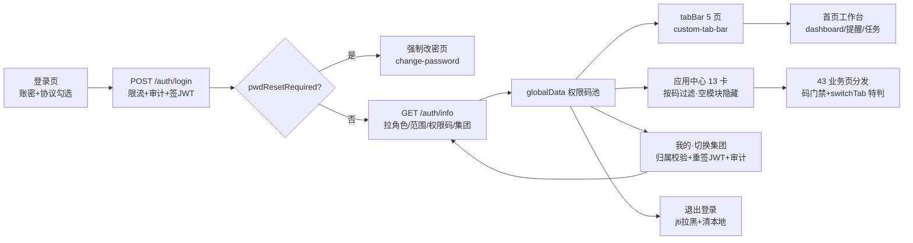

文字链：登录（限流/审计/首登改密）→ auth/info 拉权限码与集团 → 权限码池驱动 tabBar 页内门禁与应用中心 13 卡显隐 → 各业务页（对应 43 页章节）→ 多集团用户经 switch-group 归属校验+重签 JWT 后刷新权限 → 退出时 jti 拉黑。**对应业务链：链1「登录链」（登录/忘记密码三步/首登强制改密）与链23「移动办公链」（tabBar/应用中心分发+转发分享）；文件 tab 的上传/分享/扩容分别挂链11「文件协作链」与链12「文件扩容链」（细节在文件管理章节展开）。**

### ⚠️ 疑点

**（本次审计新发现，与 9 条核查重点分开列）**

1. **「应用中心 12 卡」与代码不符——实际 13 卡**：`pages/app/index.js:104-123` 定义 13 张卡（客户列表/新增客户/客户排行/文件管理/激励上传/激励查询/激励统计/学分排行/六项指标/统计分析/审批/提醒/公海池），六模块；验收表 §二表尾也写「应用中心 13 卡」。任务书与《菜单功能对照-20261107.md》§二标题写「12 卡（六模块）」但其正文列了 13 项——对照文档标题口径漂移，**以代码为准：13 卡**。
2. **意见反馈无服务端落点**：反馈页自我声明「当前版本尚未接入服务端反馈提交」（`pages/profile/feedback/index.wxml:12`），保存/清空均为本机 Storage（`feedback/index.js:31-41`），无任何 api 调用。管理侧永远收不到反馈，功能名实不符。
3. **微信绑定为纯占位**：绑定按钮只弹 modal「暂未接入」（`pages/profile/wechat/index.js:4-8`），状态硬编码「待后端接入」（:3）。建议在菜单上做「即将上线」角标或移除，避免误导。
4. **切集团后旧 token 不拉黑**：`switchGroup` 只重签新 token，注释明示「旧 token 继续有效至过期」（`AuthService.java:175` 注释、:186-189）。持有旧 token 的会话在过期前仍以**旧集团**身份可用，与「切换后刷新权限」的用户预期存在窗口差（注销链已有 jti 拉黑能力但此处未复用）。
5. **记住密码=本地 base64 混淆**：`pages/login/index.js:9-20` 注释自认「设备沙箱内、非强加密」。base64 可逆，Root/越狱设备上可提取；与 PC「记住密码」口径一致属产品决策，但审计角度应知悉强度边界。
6. **演示档权限全放行**：`pages/app/index.js:127` demo 模式 `return true` 跳过全部码过滤；登录页 demo 分支注入权限数组含 `'*'`（`pages/login/index.js:153`）。默认 develop 档=demoMode（`config/env.js:57-59,64`），release/trial 恒指生产（:27-33）——风险受控，但若误将带本地覆盖档的包发体验版会全量可见。
7. **首页 `logout` 注册但无绑定（死代码）**：`pages/home/index.js:247` 把 logout 挂进 Page，但 `pages/home/index.wxml` 无任何 `bindtap="logout"`——不构成可用按钮，建议清理；另 `pages/incentive/home/index.js:5` 导入的 `getGrantCheck` 全文件未使用（死导入）。
8. **文件 tab 删除=逻辑删除进回收站**：MP 删除文件后端进文件回收站（FileService:431-433），但 MP 无回收站恢复/清空入口（对应核查重点 8 在 MP 侧无对应 UI，仅 PC 有）；用户在 MP 删文件后无自助恢复通道。

**9 条核查重点与本章节的交集**

- 重点 1/2（销售员客户导入/删除码）、3（行政学分录入只读）、4（行政 view-all=region）、5（分享制 can_view_all=0）、6（马吉亮特例）、7（阅读排行榜/日志仅 admin）、9（六项指标口径）：均**不在应用壳范围**——应用中心无上述任何入口卡（客户导入入口在 PC 客户列表顶栏、学分录入在 PC 学分管理，MP 无对应卡与页），本章节不展开、不重复推导；「谁能看到」一律引用验收表。
- 重点 8（总监无回收站恢复/清空按钮）：MP 应用壳**无回收站入口**（43 页清单无 recycle 页），重点 8 在 MP 侧天然满足；唯文件删除走回收站（见新发现 8）。
- 应用壳内唯一涉及「范围/特判」的点：文件分享的集团边界守卫（FileService:1439-1451，跨集团分享拒绝）与激励人员下拉的「本人+有 shared 记录作者」口径（IncentiveService:84-100）——均无用户级特例。


---

## 第 10 章｜MP·激励链路（小程序四项激励）

> 审计日期 2026-11-08。只读审计，全部结论以代码为准；参考文档仅作骨架（`docs/菜单功能对照-20261107.md`、`docs/页面按钮全量对照-20261107.md`、`docs/菜单功能按钮数据范围验收表-20261107.md`）。前端证据=小程序源码，后端证据=`aigicrm-backend/src/main/java`。

### 概述（侧栏位置/路由、权限码、谁能看到该菜单——引用验收表）

- **位置**：小程序端，非 PC 侧栏。tabBar 第 2 项「四项服务」=`pages/incentive/home/index`（`aigicrm-miniprogram/app.json` tabBar.list[1]；自定义 tabBar 选中态在 `pages/incentive/home/index.js:267` 同步）。注意与 PC 同名菜单「四项服务（案例库组）」是两回事。
- **完整版入口**：应用中心「四项激励」分组 3 卡（`pages/app/index.js:48`），卡片按码过滤（`pages/app/index.js:110-113`）：
  - 激励上传（`incentive:add`）→ `/pages/incentive/upload/index`
  - 激励查询（`incentive:view`）→ `/pages/incentive/index?mode=query`
  - 激励统计（`incentive:stats:view` ∨ `incentive:rank:view`）→ `/pages/incentive/index?mode=stats`
  - 路由表见 `pages/app/index.js:144`（`incentiveQuery/incentiveStats` 带 `?mode=`）。
- **权限码**（前端门禁落点）：
  - `incentive:view`：轻量页/完整页/详情页 onLoad 守卫（`pages/incentive/home/index.js:248`、`pages/incentive/index.js:619`、`pages/incentive/detail/index.js:357`）。
  - `incentive:add`：上传按钮显隐与 goUpload 守卫（`pages/incentive/home/index.js:253,648`、`pages/incentive/index.js:627,1500`、`pages/incentive/upload/index.js:536`）。
  - `incentive:stats:view` / `incentive:rank:view`：stats 模式双 pane 注册码，`utils/incentive-panes.js:8-11`（`computeStatsPanes`），无权 pane 不渲染不发请求（`pages/incentive/index.js:600-616`）。
  - `incentive:read-stats`（∨admin）、`incentive:read-ranking:view`（∨admin）：阅读两面板（`pages/incentive/index.js:625-626`，`isAdmin` 口径见 `utils/auth.js`）。
- **谁能看到**（引用验收表，不重新推导）：「四项激励组（上传/查询/统计+查看/排行/编辑/阅读统计）」admin/总监/行政/销售员 四角色全 ✓（`菜单功能按钮数据范围验收表-20261107.md:39`）；「本月激励查询阅读排行榜」仅 admin ✓（同文档 ：58）。
- **后端总入口**：`IncentiveController`（`/api/incentive/**`，`com/aigicrm/module/incentive/controller/IncentiveController.java`）、`IncentivePermissionController`（`/api/incentive/permission/**`）、配套 `FileController`（附件/下载凭证）、`FormDraftController`（草稿，经 `api/draft.js`）。

### 功能清单（每功能一行）

| 功能 | 一句话 |
|---|---|
| tabBar 轻量记录页 | 打散记录流（按时间）/客户封面卡（按客户）双视图，搜索+行业/产品 chip+两级分类+排序，点行直达拨盘详情 |
| 激励查询（完整版 query） | 客户记录横向表格+分类树+阅读面板；筛选/排序/分页，行直达拨盘详情 |
| 激励统计（完整版 stats） | 分类统计两级分组可下钻明细半屏（附件可开可下），排行三页签（客户/个人积分榜/部门）+阅读统计/阅读排行 |
| 激励上传/追加 | 纯表单页：大类→子类→客户半屏→产品→五槽位佐证（拍照/手机H5/聊天三通道）→提交落库计分；带草稿恢复与逐文件失败续办 |
| 拨盘详情页 | 年/月/日三联拨盘按日期看记录卡，附件预览/下载，编辑追加（进上传页）、删除记录，打开即自动阅读上报 |
| 客户激励档案页 | 一客一册（封面/时间轴/翻页/未读管理/全部已读）——⚠️当前无任何 UI 入口可达（死页） |
| 排行页·激励个人榜 | pages/ranking 的「激励排行」页签，调激励 scoreboard（无独立入口卡，见 ⚠️7） |
| 阅读上报 | 详情页打开未读记录 / 档案页逐条与全部标已读 → `POST /api/incentive/records/{id}/read` |

### 按钮明细

#### 功能块 1：tabBar「四项服务」轻量记录页（pages/incentive/home；incentive:view）

| 按钮 | 在哪 | 前端行为 | 后端动作 | 谁能看到 |
|---|---|---|---|---|
| ↻ 刷新 | home/index.wxml:11 → `refresh()`（home/index.js:708） | 重拉记录+人员 | `GET /api/incentive/customer-records`：按 (customer,view) 组织范围档位过滤客户 ∨ 本人上传恒可见（IncentiveService.java:1156-1160 `applyOrgQueryVisibility`），多维筛选+按客户分组+未读标记（:1262-1302）；`GET /api/incentive/users`（Controller:229-233）：非专项授权者=本人+有已分享记录的作者集合（IncentiveService.java:84-116） | 持 incentive:view 者（四角色全有，验收表:39） |
| ＋ 上传 | home/index.wxml:12（wx:if canUploadEvidence）→ `goUpload()`（js:647-650） | 二次 toast 校验 incentive:add 后 navigateTo 上传页 | —（页面跳转） | incentive:add |
| 搜索框（confirm=查询） | home/index.wxml:18 → `inputKeyword/searchRecords`（js:597-603） | 发参重查 | 同 customer-records，keyword 走强相关三路（客户名集合∨关联产品∨具体产品，IncentiveService.java:1195-1213） | 同上 |
| 查询 | home/index.wxml:19 → `searchRecords`（js:601） | 同上 | 同上 | 同上 |
| 清空 | home/index.wxml:20 → `resetRecordFilters`（js:624-639） | 复位筛选并重查 | 同 customer-records | 同上 |
| 行业 chip | home/index.wxml:29 → `chooseIndustry`（js:607-612） | 选中重查 | industry 参数等值过滤（IncentiveService.java:1174）；选项=字典 `GET /api/system/dict/data/industry`（home/index.js:329-341） | 同上 |
| 产品 chip | home/index.wxml:38 → `chooseProduct`（js:614-619） | 同上 | product 参数 like 相关产品（IncentiveService.java:1186-1188）；选项由分类树「产品试点」分支派生（home/index.js:364-377，选项源 `GET /api/incentive/categories`） | 同上 |
| 分类两级拨盘 | home/index.wxml:54 → `onCategoryColumnChange/chooseCategory/onCategoryCancel`（js:411-454） | 大类联动子类、确认后本地过滤 | 数据源 `GET /api/incentive/categories`（Controller:24-28）：启用分类建树+按分享制口径角标计数（IncentiveService.java:173-182,252-274） | 同上 |
| 人员 picker | home/index.wxml:57 → `chooseUser`（js:592-595） | salesperson 参数重查 | 后端按 realName like 展开为 userId IN（IncentiveService.java:1214-1221）；候选= incentive users 接口（见「刷新」行） | 同上 |
| 排序 picker | home/index.wxml:60 → `chooseOrder`（js:641-645） | 本地四档排序（时间两档/分值两档），不发请求 | — | 同上 |
| 按时间 / 按客户 chips | home/index.wxml:49-50 → `switchListMode`（js:653-663） | 本地切视图（打散记录流/封面卡） | — | 同上 |
| 打散记录流行 | home/index.wxml:71 → `openFlatRecord`（js:666-671） | navigateTo `detail?id=记录id` | 详情页拉数（见功能块 6） | 同上 |
| 客户封面卡 | home/index.wxml:96 → `openCustomer`（js:676-684） | 取该客户首条记录 navigateTo `detail?id=` | 同上 | 同上 |
| pager | home/index.wxml:117 → `onPagerChange`（js:587-590） | 本地切片 | — | 同上 |

#### 功能块 2：激励查询·完整版（pages/incentive/index?mode=query；incentive:view）

| 按钮 | 在哪 | 前端行为 | 后端动作 | 谁能看到 |
|---|---|---|---|---|
| ↻ 刷新 | index.wxml:9 → `refresh()`（index.js:1640-1649） | 七路数据源全重拉（records/categories/users/orgs/scoreboard/readStats/readRanking） | 各数据源接口见本块各行 | incentive:view |
| ＋ 上传 | index.wxml:10（wx:if canUploadEvidence）→ `goUpload()`（index.js:1499-1502） | 同轻量页 | — | incentive:add |
| 页签组（客户记录/分类树/阅读） | index.wxml:26 → `switchTab`（index.js:1376-1383） | 本地切 tab；stats 模式无权 pane 拒切（:1379） | — | incentive:view（stats 模式页签另受 pane 注册码过滤） |
| 搜索框 + 查询 | index.wxml:32-33 → `inputKeyword/searchRecords`（index.js:1433-1439） | 发参重查 | customer-records（同上口径）；服务端已收紧关键词语义（仅客户名/关联/具体产品，IncentiveService.java:1191-1213） | incentive:view |
| 清空 | index.wxml:34 → `resetRecordFilters`（index.js:1471-1488） | 复位（含分类 I3 修复）并重查 | 同上 | 同上 |
| 行业 / 类型 / 产品 / 组织 / 起始 / 截止 pickers | index.wxml:37-53 → `chooseIndustry/chooseDevType/chooseProduct/chooseOrg/chooseStartDate/chooseEndDate`（index.js:1441-1469） | 发参重查 | industry/devType 等值与客户展开、product like、orgIds 展开子部门→人员 IN、日期区间（IncentiveService.java:1174,1235-1261）；组织选项 `GET /api/system/depts`（index.js:833-851），行业/类型=字典 dict/data（index.js:854-881） | 同上 |
| 分类 / 人员 / 排序 pickers | index.wxml:60-66 → `chooseCategory/chooseUser/chooseOrder`（index.js:1392-1394,1428-1431,1492-1496） | 分类=名字集合本地过滤（含子类命中），人员/排序见块 1 | 分类选项源 categories 接口 | 同上 |
| 记录表格行 | index.wxml:85 → `openRecordDetail`（index.js:1232-1236） | navigateTo `detail?id=` | 拨盘页拉数（块 6） | 同上 |
| 「全部分类」行 | index.wxml:110 → `onCategoryAllTap`（index.js:1403-1406） | 清分类筛选并跳记录页签 | — | 同上 |
| 分类树节点行 | index.wxml:117 → `onCategoryRowTap`（index.js:1410-1426） | 选中分类（父含子名集合）筛记录，再点取消 | — | 同上 |
| pager | index.wxml:96 → `onPagerChange`（index.js:1257-1260） | 本地切片 | — | 同上 |

#### 功能块 3：激励统计·完整版（pages/incentive/index?mode=stats；stats 页签=统计，rank 页签=排行，逐 pane 注册码）

| 按钮 | 在哪 | 前端行为 | 后端动作 | 谁能看到 |
|---|---|---|---|---|
| 页签（统计/排行） | index.wxml:26 → `switchTab`（index.js:600-616,1376-1383） | 无权 pane 不渲染不拒切；入口无权即 toast 弹回首页 | — | 统计=incentive:stats:view；排行=incentive:rank:view（utils/incentive-panes.js:8-11） |
| 一级统计分组头 | index.wxml:143 → `openGroupStatDetail`（index.js:1125-1171） | 半屏明细=组内全部子类合并 | `GET /api/incentive/records?parentCategoryId=`（Controller:52-64→IncentiveService.java:344-373）：**分享制可见性**（本人∨已分享，:202-210）+父类含子 IN 过滤；⚠️与统计聚合口径不同（见疑点②） | 统计 pane 有权者 |
| 二级统计行 | index.wxml:147 → `openStatDetail`（index.js:1040-1088） | 半屏明细=单子类（请求序号守卫防旧响应覆盖，:1097-1121） | 同上（无 parentCategoryId 时客户端按 categoryId/名称双通道过滤） | 同上 |
| 明细弹层遮罩 / 收起 | index.wxml:155,163 → `closeStatDetail`（index.js:1090-1093） | 关半屏清附件 | — | 同上 |
| 明细搜索框 / 清空 | index.wxml:167-168 → `onStatDetailKeywordInput/clearStatDetailKeyword`（index.js:1174-1183） | 本地过滤（2026-11-06 收紧为强字段） | — | 同上 |
| 明细附件瓦片（图/视频/文档） | index.wxml:190-195 → `previewStatDetailAttachment`（index.js:1556-1570） | 图片=整组签名直链连滑预览；其余走下载通道 | `GET /api/file/download/{id}`（api/file.js:14-23；FileController:146-147 `file:view`）+下载凭证 `GET /api/file/download-token`（api/file.js:45，FileController:38） | 同上 |
| 明细「打开 / 下载」 | index.wxml:201-202 → 同上 / `downloadStatDetailAttachment`（index.js:1589-1594） | 打开预览/保存到盘 | 同上 | 同上 |
| 明细 pager | index.wxml:210 → `onStatDetailPagerChange`（index.js:1186-1193） | 本地切片 | — | 同上 |
| ↻（积分榜区） | index.wxml:287 → `loadScoreboard`（index.js:1006-1038） | 重拉两榜 | `GET /api/incentive/scoreboard`：30s TTL 缓存+按集团/身份/调用人分键（IncentiveService.java:980-1007），个人榜按 **(incentive,stats_view) 档位可见人员**收口（:873-880,1014）；`GET /api/incentive/ranking?type=dept`（Controller:162-171）：由个人榜按办事处聚合（IncentiveService.java:1071-1109）。前端守卫：两码皆无不发请求（index.js:1009） | stats:view ∨ rank:view（Controller:155,162 `hasAnyAuthority`） |
| 客户排行页签 | index.wxml:221 → `switchRankTab`（index.js:1386-1390） | 本地切页签 | 数据=记录页客户聚合（index.js:1294-1328），并用 `GET /api/customer/list` 拉可见客户 id 集收口（60s 缓存，index.js:1272-1292；后端 customer/list 按数据范围过滤） | 排行 pane 有权者 |
| 个人积分榜页签 | index.wxml:222 → 同上 | 同上 | scoreboard（见↻行） | 同上 |
| 部门排行页签 | index.wxml:223 → 同上 | 同上 | ranking?type=dept（见↻行） | 同上 |
| 排行 pager ×3 | index.wxml:280,347,369 → `onCustomerRankPagerChange/onScoreboardPagerChange/onDeptPagerChange`（index.js:1329-1354） | 本地切片 | — | 同上 |

#### 功能块 4：阅读面板（完整版「阅读」页签；阅读统计+阅读排行）

| 按钮 | 在哪 | 前端行为 | 后端动作 | 谁能看到 |
|---|---|---|---|---|
| 统计月份 picker | index.wxml:377 → `chooseReadPeriod`（index.js:998-1004） | 换月重拉两面板 | — | 见下行 |
| ↻（阅读统计） | index.wxml:384 → `loadReadStats`（index.js:964-978） | 重拉已读/未读 | `GET /api/incentive/read-stats`（Controller:201-205 `incentive:read-stats`）：月度聚合 SQL（IncentiveService.java:1406-1408,1476-1511）——admin 全量、非 admin 限本集团成员+集团租户记录（fail-closed） | incentive:read-stats ∨ admin（前端 index.js:625） |
| 阅读统计 pager | index.wxml:389 → `onReadStatsPagerChange`（index.js:1359-1364） | 本地切片 | — | 同上 |
| 阅读排行 pager | index.wxml:397 → `onReadRankingPagerChange`（index.js:1369-1374） | 本地切片 | — | 见下行 |
| 「点击重试」 | index.wxml:399 → `loadReadRanking`（index.js:980-996） | 失败态重试（I5：失败≠空数据） | `GET /api/incentive/read-ranking`（Controller:214-218 `incentive:read-ranking:view`）：readRanking 补部门/已读率/名次（IncentiveService.java:1421-1471）；排序=已读数 desc→未读少者优先 | incentive:read-ranking:view ∨ admin（前端 index.js:626；验收表:58 仅 admin 有码） |

#### 功能块 5：激励上传/追加纯表单页（pages/incentive/upload；新增需 incentive:add）

| 按钮 | 在哪 | 前端行为 | 后端动作 | 谁能看到 |
|---|---|---|---|---|
| 大类 / 子类 picker | upload/index.wxml:16,25 → `chooseCategoryParent/chooseCategoryChild`（upload/index.js:757-773） | 两级选分类；编辑态分类锁定（js:369-370） | 选项 `GET /api/incentive/categories` | incentive:add（新增；编辑态入口另见块 6） |
| 客户选择卡 | upload/index.wxml:39 → `openCustomerSheet`（upload/index.js:681-683） | 打开半屏 | `GET /api/customer/list`（服务端搜索+分页，js:700-728，页大小 20） | 同上 |
| 半屏搜索框 / 清空 | upload/index.wxml:234-235 → `inputCustomerKeyword/clearCustomerKeyword`（js:690-698,687-689） | 防抖 300ms 服务端搜索、请求序号守卫 | 同上 | 同上 |
| 半屏客户行 / ✕ | upload/index.wxml:239,231 → `pickCustomer/closeCustomerSheet`（js:743-749,684-686） | 选中回填（对象快照，跨页不错位）+行业联动 | — | 同上 |
| 行业 picker | upload/index.wxml:50 → `chooseIndustry`（js:774） | 表单态 | 字典 `GET /api/system/dict/data/industry`（js:546-560） | 同上 |
| 相关产品大类/小类 | upload/index.wxml:60,66 → `chooseRelatedCat/chooseRelatedSub`（js:775-795） | 二级联动；选项由分类树三级派生（js:31-44,576-578） | — | 同上 |
| 具体产品 / 详情 / 备注 input·textarea | upload/index.wxml:76,85,89 → `inputSpecificProduct/inputPreInstallQuestion/inputRemark`（js:796-798） | 表单态 | 随提交落库 | 同上 |
| 槽位翻页 swiper | upload/index.wxml:112,154 → `onSlotPageChange`（js:520-531） | 每槽独立区块翻页（新增跳最新页/删减钳回末位 js:504-516） | — | 同上 |
| 已选文件缩略图/类型面 | upload/index.wxml:115-116,157-158 → `previewSelectedFile`（js:941-966） | 图片预览/视频 previewMedia/文本查看页/openDocument | 已有附件走 `GET /api/file/download/{id}`（js:980-995 fetchExistingFile） | 同上 |
| 预览 / 下载 / 移除（每文件） | upload/index.wxml:124-126,166-168 → `previewSelectedFile/downloadSelectedFile/removeSelectedFile`（js:941-1025） | 移除分三路：编辑态已有文件→确认后**真删**；URL 防御分支→拦截提示去 PC 处理；新建态→本地剔除 | 真删=`POST /api/incentive/records/{id}/remove-file`（Controller:95-101）：行锁读→槽位白名单校验（file/pre/mid/post/track）→五槽合计≥1 守卫→重算学分→盖修改人章（IncentiveService.java:580-640）；权限=admin∨can_edit∨本人（Controller:111-118） | 编辑者=canEdit∨admin∨本人 |
| 拍照/相册 | upload/index.wxml:132,174 → `chooseImage`（js:835-857） | chooseMedia（image+video，camera）逐个入槽；满员拒绝提示（js:817-819） | 文件随提交上传 | incentive:add |
| 手机文件 | upload/index.wxml:133,175 → `pickFromDevice`（js:878-882） | 跳 H5 picker（scope=incentive），返回 onShow 轮询回挂（15×2s，js:884-902） | 轮询 `GET /api/file/list?scope=incentive`（js:894）；回挂条目提交免二次上传（js:906-930） | 同上 |
| 从聊天选择 | upload/index.wxml:134,176 → `chooseFile`（js:859-873） | wx.chooseMessageFile 入槽 | 同上 | 同上 |
| 团队共享 switch | upload/index.wxml:204 → `toggleShared`（js:799-805） | 编辑态非上传人 toast 拒改 | 随提交：shared 仅本人可改，admin 改他人记录时后端忽略该字段（IncentiveService.java:493-499） | 上传人（编辑态）；新建态任意有 add 者 |
| 取消 | upload/index.wxml:218 → `cancelUpload`（js:1072-1080） | navigateBack/switchTab 兜底 | — | 同上 |
| 提交（上传并提交/追加提交） | upload/index.wxml:219 → `submit`（js:1082-1109） | 逐项校验 toast→逐文件串行上传（失败续办+重试弹窗 js:1117-1189）→组装 payload 落库→清草稿→置 forceRefresh→回列表 | 新建=`POST /api/incentive/records`（Controller:67-72 `incentive:add`）：校验分类/客户存在、至少一文件、槽位 JSON 合法、**文件必须本人上传**（IncentiveService.java:705-737）→按分类规则计分（plan/visit/exchange 任一槽=base，trial 三槽齐全=base，:766-783）→强制 userId=当前人→事务落库→失效排行缓存（:683-692）；追加=`PUT /api/incentive/records/{id}`（Controller:82-88）：`incentive:view` 底线+方法内归属守卫（admin∨can_edit∨本人，:111-118）→行锁合并（非 null 才合并，customerId 变更需 canEdit，shared 仅本人）→新引入文件归属核对→重算学分→updatedBy 落章（IncentiveService.java:439-515）；文件本体=`POST /api/file/upload`（FileController:68-69 `file:upload`） | 新增=incentive:add；追加=canEdit∨admin∨本人 |
| 草稿恢复弹窗（恢复/放弃） | 自动触发 → `tryRestoreDraft/applyDraft`（js:1302-1391） | 进入询问恢复、离开自动保存、提交成功清除、乐观锁版本 | `GET/PUT/DELETE /api/draft/incentive_upload`（api/draft.js:6-9）；草稿客户按 id 补拉 `GET /api/customer/{id}`（api/customer.js:7-9），404/403 才清草稿（js:1338-1345） | 新建态有 incentive:add 者 |
| 编辑态审计面板（纯展示） | upload/index.js:416-421（uploadView.auditRows） | 展示上传人/时间/最后修改人 | 数据源编辑回填 `GET /api/incentive/records`（js:595-613） | 同上 |

#### 功能块 6：拨盘详情页（pages/incentive/detail；incentive:view）【含阅读上报】

| 按钮 | 在哪 | 前端行为 | 后端动作 | 谁能看到 |
|---|---|---|---|---|
| 返回 | detail/index.wxml:8 → `goBack`（detail/index.js:639） | navigateBack | — | incentive:view |
| 回到今天 | detail/index.wxml:42 → `goToday`（js:521-524） | 拨盘对位今天 | — | 同上 |
| 年/月/日三联拨盘 | detail/index.wxml:48 → `onDialChange`（js:510-520） | 本地按日期过滤记录卡（局部更新防掉帧 js:528-555） | 数据源：`GET /api/incentive/customer-records?recordId=` 定位该记录所属客户一组数据（js:433；后端种子可见性校验 IncentiveService.java:1163-1170）；客户累计学分 `GET /api/incentive/score/customer/{id}`（js:488-493；后端按分享制口径求和 :1114-1121） | incentive:view（页面守卫 js:357；数据本身经可见性过滤） |
| 附件图片/视频/文档瓦片 | detail/index.wxml:132-149 → `previewAttachment`（js:561-566） | 预览（演示态拦截） | `GET /api/file/download/{id}`+download-token（js:495-508） | 同上 |
| 打开 / 下载 | detail/index.wxml:156-157 → `previewAttachment/downloadAttachment`（js:561-572） | 同上 | 同上 | 同上 |
| 编辑 / 追加文件 | detail/index.wxml:164（wx:if showEditAction）→ `editRecord`（js:604-609） | 二次校验 canEdit 后 navigateTo `upload?id=`（追加态） | 权限=grant.canEdit∨admin∨本人（js:405-410 `GET /api/incentive/permission/check` + js:223-230 本人兜底；后端同口径 Controller:111-118） | canEdit∨admin∨本人 |
| 删除记录 | detail/index.wxml:165（wx:if showDeleteAction）→ `removeRecord`（js:610-638） | 确认弹窗→删除→本地收缩拨盘 | `DELETE /api/incentive/records/{id}`（Controller:131-146）：admin∨can_delete∨本人（否则 403）→事务先清 biz_incentive_read 再删记录→失效排行缓存（IncentiveService.java:420-425） | canDelete∨admin∨本人 |
| 关闭视频 | detail/index.wxml:175 → `closeVideoPreview`（js:586-588） | 关浮层 | — | 同上 |
| （自动）未读标已读【阅读上报】 | 打开未读记录即触发 → `markFocusedRead`（js:443,477-487） | 乐观置已读，失败回滚 | `POST /api/incentive/records/{id}/read`（Controller:194-199 `incentive:view`）：写前可见性判定（不存在/跨集团/无权统一 404 防越权，IncentiveService.java:1364-1373,1380-1404）→biz_incentive_read upsert | incentive:view（且对该记录可见） |

#### 功能块 7：客户激励档案页（pages/incentive/customer-detail）⚠️ 当前无 UI 入口可达（死页）

> 完整版表格化后 `openCustomerDetail`（pages/incentive/index.js:1506-1538）在 index.wxml 已无 bindtap 绑定（本审计 grep index.wxml 全文无该绑定），全仓无其他 JS 跳 `/pages/incentive/customer-detail/index`。以下按钮均有代码但不可达。

| 按钮 | 在哪 | 前端行为 | 后端动作 | 谁能看到 |
|---|---|---|---|---|
| 打开档案 / 合上档案 | customer-detail/index.wxml:57,63 → `openArchive/closeArchive`（js:280-286） | 封面↔册内切换 | — | （无入口，理论上有 incentive:view 者） |
| 客户档案 › | wxml:69 → `onOpenCustomer`（js:439-443） | 跳客户详情（from=incentive） | — | 同上 |
| 未读 N › | wxml:70 → `openUnread`（js:445-462） | 打开未读列表 | — | 同上 |
| 最新 / 月份时间轴项 | wxml:77,81 → `latestMonth/selectMonth`（js:292-309） | 定位月份组 | — | 同上 |
| 照片瓦片 / 视频面 / 附件 | wxml:112,121,129 → `previewPhoto/previewVideo/previewAttachment`（js:341-386） | 签名 URL 直连预览/下载通道 | `GET /api/file/download/{id}`+download-token（js:322-339） | 同上 |
| 「···」actionSheet（详情/追加/删除） | wxml:135 → `onRecordMore`（js:388-404） | 按 canEdit/canDelete 组装菜单→跳详情/上传?id=/删除确认 | 删除=`DELETE /api/incentive/records/{id}`（js:416-431，后端同块 6） | 详情/追加=canEdit∨admin∨本人；删除=canDelete∨admin∨本人 |
| 上一条 / 下一条 | wxml:143,145 → `prevRecord/nextRecord`（js:311-320） | 组内翻页 | — | 同上 |
| 未读弹层遮罩 / × / 未读行 | wxml:149-157 → `closeUnread/jumpUnread`（js:464-474） | 跳转并标已读 | 跳转带 `POST /api/incentive/records/{id}/read`（js:476-493）【阅读上报】 | 同上 |
| 全部标为已读 | wxml:163 → `markAllRead`（js:495-514） | 全量置已读逐条上报 | 同上（逐条 POST read） | 同上 |

#### 功能块 8：排行页·激励个人榜（pages/ranking 「激励排行」页签）

| 按钮 | 在哪 | 前端行为 | 后端动作 | 谁能看到 |
|---|---|---|---|---|
| 激励排行页签 | pages/ranking/index.js:206,241,305（页签机制；注册码映射 utils/ranking-tabs.js:12-14） | 按码放行（incentive:view）后本地切榜 | `GET /api/incentive/scoreboard`（pages/ranking/index.js:474-476；api/incentive.js:35-37）：后端要求 stats:view∨rank:view（Controller:155）；⚠️ 前端码= `incentive:view` 与后端数据码不一致（见疑点⑦） | 前端=incentive:view；后端=stats:view∨rank:view |
| 激励榜 pager | pages/ranking/index.js:229-231（incentivePage 分页） | 本地切片 | — | 同上 |

### 业务链条

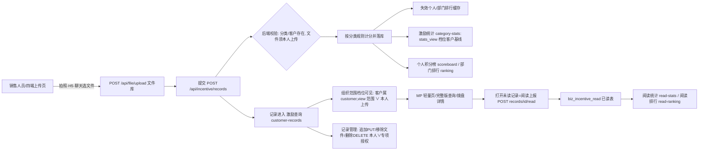

文字链：上传（文件库→激励记录落库计分→失效排行缓存）→ 查询（组织范围可见性→MP 轻量页/完整版/拨盘详情）→ 阅读上报（打开即读→已读表→阅读统计/排行）→ 统计排行（category-stats 按 stats_view 档位；scoreboard/ranking 按 stats_view 档位人员基线+30s 缓存写穿失效）→ 记录管理（追加/移除文件/删除，本人∨can_edit/can_delete 授权）。对应 23 条业务链中的「四项激励上传佐证→计分→查询→阅读→统计排行」链（本链）。

### ⚠️ 疑点（9 条核查重点中与本章节相关者 + 本次新发现）

**①（重点4+5）行政"view-all=region"与代码实现脱节，且 29 条授权 can_view_all 全=0。**
验收表写"行政 incentive view-all=view-shared=region，能看本大区全部激励记录含未分享"（验收表:182，区域行 :108）；但代码中"看全部"只来自 `biz_incentive_grant.can_view_all`（IncentiveService.java:49-52、189-194），而验收表 ：183 记录 29 条授权 can_view_all 全=0——即行政**并没有**"看全部"资格，除非是 admin。行政在 MP 激励查询（customer-records 面）实际能看到的范围=2026-11-05 B 拍板的组织范围档位：客户属 (customer,view) 档位 ∨ 本人上传（IncentiveService.java:212-246）；在 `/api/incentive/records` 面仍是分享制（本人∨已分享，:202-210）。**待核**：(customer,view) 档位对 05行政 是否确实配置为"本大区"，否则验收表该行描述与实际可见范围不符。

**②（本次新发现）统计聚合与统计明细口径不一致，聚合数与明细行可能对不上。**
激励统计 pane 的聚合 `GET /api/incentive/category-stats` 按 **(incentive,stats_view) 档位的可见客户基线**收口（IncentiveService.java:873-893,911-917）；而点统计行下钻的明细 `GET /api/incentive/records` 按**分享制**（本人∨已分享）过滤（:202-210,344-357）。对销售员：聚合可能计入其客户范围内他人记录（若 stats_view 档位覆盖），明细却看不到 → 弹层明细数 < 统计行数。验收表 ：110-117 记 stats_view 三角色档位均=all，若如此 admin/总监/行政两端一致，仅销售员存在该差值——**待线上预览核对销售员实感**（同重点9性质）。

**③（重点7）阅读排行/阅读统计的 MP 门禁与"仅 admin"基本吻合，但依赖码而非 admin 硬码。**
MP 前端 `canViewReadStats = hasPermission('incentive:read-stats') || isAdmin()`、`canViewReadRanking = hasPermission('incentive:read-ranking:view') || isAdmin()`（index.js:625-626）；后端 read-stats=@PreAuthorize('incentive:read-stats')（Controller:201）、read-ranking=@PreAuthorize('incentive:read-ranking:view')（:214）。验收表 ：58 阅读排行榜仅 admin 有码 → 当前形态=仅 admin 可见，成立；但若日后把 read-stats 码授给非 admin 角色（验收表 ：39 行把"阅读统计"列入四角色全 ✓ 组），非 admin 也会看到"阅读统计"面板——两行验收表口径本身存在张力，**待权限中心确认 read-stats 实际授了谁**。

**④（重点6）马吉亮全公司客户范围特例会直接放大 MP 激励查询可见面。**
MP 轻量页/完整版查询的 customer-records 可见性=scopeResolver.resolveModuleUsers(user, "customer") 的客户集合 ∨ 本人上传（IncentiveService.java:218-246）。若马吉亮的用户级"全公司客户范围"特例仍生效（验收表 ：185 重点6），则他在 MP 上同样可见全公司客户名下的激励记录（该接口无额外收口）。**待核**：该特例是否仍保留。

**⑤（重点5 的衍生）授权四开关直接决定 MP 编辑/删除按钮显隐，前端有 admin 兜底与本人兜底双通道。**
`GET /api/incentive/permission/check`（IncentivePermissionController.java:192-200）返回 canViewAll/canViewShared/canEdit/canDelete（admin 恒 true）；MP 详情页用它置 canEditRecords/canDeleteRecords（detail/index.js:362,405-410），再叠加"本人记录"兜底（:214-230）。29 条授权 can_edit/can_delete 的实际值**待核库表**——若全 0，则 MP 上除 admin 外只有本人能编辑/删除自己的记录，验收表"编辑/管理他人记录 admin/总监/行政 ✓"（:40）将不成立于 MP 实感。

**⑥（本次新发现，对应按钮全量对照 F1）客户激励档案页是死页。**
`openCustomerDetail`（index.js:1506-1538）在 pages/incentive/index.wxml 无任何 bindtap 绑定（2026-11-02 表格化改造遗留），全仓无其他入口跳 `/pages/incentive/customer-detail/index`（本审计 grep 证实）。该页 16 个交互元素（含"全部标为已读"这一批量阅读上报入口）当前不可达；阅读上报在可达路径上只剩详情页"打开未读即上报"单条通道。

**⑦（本次新发现）排行页激励榜的前端码与后端数据码不一致（当前被角色配置掩盖）。**
前端页签放行码=`incentive:view`（utils/ranking-tabs.js:12-14），数据请求 scoreboard 的后端门槛=`stats:view ∨ rank:view`（Controller:155）。ranking-tabs.js 注释自述"已核迁移链基线不存在 incentive:view 独占角色"（:17-19，行政已随 V2026.11.04.1 回填双码）——即当前四角色不踩坑，但权限中心一旦造出"仅持 incentive:view"的角色，该用户会看到页签却 403。建议三方同步（页签码改 rank:view 或入口卡补码）。

**⑧（本次新发现）MP 上传页编辑态绕过 incentive:add 门禁是设计使然，但依赖后端归属守卫兜底。**
upload 页 onLoad 仅对"新增"校验 incentive:add（upload/index.js:536 `!editId && !hasPermission('incentive:add')`）；追加入口来自详情页编辑按钮（canEdit∨admin∨本人，detail/index.js:604-609），后端 PUT 亦为 `incentive:view` 底线+方法内归属守卫（Controller:80-88,111-118）。两端口径一致，无越权路径；仅提示：把"编辑"理解成"有 add 就能改"是错的，改他人记录必须 grant.can_edit 或 admin。

**⑨（重点9 关联，本章节不展开）六项指标页（pages/indicator）属客户经营域（`GET /api/statistics/...`），不在激励链路范围。** 其对销售员的实际数据口径待核事项归客户/统计章节（验收表 ：187 重点9）。


---

## 第 11 章｜MP·客户经营与其余模块

> 审计日期 2026-11-08 · 方法：逐文件通读小程序源码（aigicrm-miniprogram/pages）+ 对照后端 Controller/Service 源码（aigicrm-backend/src/main/java）。每个按钮给前端 handler 与 wxml 绑定行号证据，「后端动作」均读过后端源码后以业务语言描述。骨架参考 docs/ 三册，一律以代码为准。
> 统计口径：按钮 165 个（按明细表内交互元素逐个计，含 picker/pager/入口卡；演示模式专属入口与纯展示卡不计），覆盖后端端点 65 个（另有 H5 上传落地页 /mp-file-picker 1 个非 REST 端点单独记录）。

### 概述（侧栏位置/路由、权限码、谁能看到该菜单）

- **端**：微信小程序（aigicrm-miniprogram）。MP 无侧栏，入口两处：① 底部 tabBar 第 3 项「文件管理」直接 `switchTab` 进 `pages/files/index`（`custom-tab-bar`）；② tabBar 第 4 项「应用」→ `pages/app/index` 宫格 13 卡按权限码过滤后展示，点卡 `switchTab`/`navigateTo` 进入本章节各页（`pages/app/index.js:104-120` 各卡 `permission` 字段、`:128-129` 按码过滤、`:139` openApp）。
- **本章节覆盖页面**：客户经营 = `pages/customer/index`（客户列表）、`pages/customer/form`（新增/编辑）、`pages/customer/detail`（详情）及子页 finance/contact/share/log/filter/indicator、`pages/indicator/index`（核心客户六项指标）、`pages/ranking`（客户排行 tab，学分 tab 见「考核分析」）；文件管理 = `pages/files`（index/folder-form/textview/picker）；流程协同 = `pages/approval`（index/detail）；考核分析 = `pages/ranking` 学分 tab + `pages/ranking/detail`；经营分析 = `pages/statistics`（index/detail）。
- **不覆盖**（归其他 MP 章节）：四项激励（incentive 系 5 页）、首页/登录/我的、提醒 reminder、公海 sea、应用中心除入口外的激励/提醒/公海卡业务。
- **权限码与谁能看到**（引自《菜单功能按钮数据范围验收表-20261107》§二角色矩阵，MP 同码同源，见该表末行说明「MP 端同码同源」）：
  - 客户列表/详情/新增：customer:view / add / edit / delete——四角色（admin/总监/行政/销售员）全部有授权；
  - 六项指标页与客户排行：statistics:view——admin/总监/销售员（**行政无**，应用中心对应卡对行政隐藏）；
  - 学分排行：score:view——四角色全部有；
  - 文件管理五码（view/upload/delete/edit/share+folder:manage）：四角色全部有；
  - 审批（view/approve/reject）：四角色全部有码（实际可审=该流程配置的审批人）；
  - 统计分析：statistics:view——仅 admin/总监（行政/销售员卡隐藏）。
- **数据范围**（role_perm_scope，引自验收表 §四）：客户域 admin=全部、总监=全部、行政=本办事处(office)、销售员=本人+团队(team)+分享给我（只读）；用户级特例**马吉亮 customer 全组=all**（全公司客户）；文件域行政 view=region/upload=all、销售员=本人+ACL 授权夹。

### 功能清单（每功能一行）

- **客户列表**：按数据范围拉客户台账，关键词/开发类型/保护状态/高级筛选+显式分页，卡片点进详情，浮动「＋」新增。
- **新增/编辑客户**：主数据表单（集团可选可输、大区→办事处联动、负责人、省市区、注册日/开票日权限门）+ 客情六项评分（编辑态）+ 查重拦截 + 幂等组合提交 + 草稿自动保存/恢复。
- **客户详情**：档案头（含保护到期行内「申请延期」）+ 备注/联系人/跟进日志/开票回款摘要/核心判定卡/客情直存/六项指标卡 + 释放/归档/删除危险区 + 联系人/分享/跟进入口。
- **开票回款**：阶段总额制查看+录入（三通道权限门），录入开票额>0 自动前移保护期基准并重算核心三态。
- **联系人**：列表/拨打电话（脱敏拦截）/新增/编辑/删除。
- **分享管理**：勾选用户分享客户、撤回共享。
- **跟进日志**：纯文本跟进记录落库。
- **高级筛选**：省市/六类条件面板，草稿交接回列表页。
- **核心客户六项指标**（公司级指标总览页）：四指标卡+客户排行前 30，只读。
- **客户排行 / 学分排行 / 激励排行**（pages/ranking 三榜同页，按码显隐）：周期切换、榜内子页签、行钻取明细。
- **排行明细**：个人=逐项得分表格（#/大类/产品/得分）；部门=摘要+成员行下钻到个人。
- **统计分析**：九区块总览（年度/部门筛选）+「查看统计明细」进 detail 五页签（客户/审批/公海/团队动态/趋势）。
- **文件管理**：四页签文件库（公共/私人/四项服务/分享给我）、三入口上传（先选夹后选文件）、预览（图片组滑/文档/文本）、下载/重命名/分享/删除、文件夹新建/改名/删除、存储配额+申请扩容（走审批）。
- **审批管理**：六页签单据列表（待审批/我发起/审批中/已通过/已驳回/全部）+ 类型/部门/关键词筛选 + 通过/驳回（意见留痕）+ 详情轨迹 + 延期/扩容单字段成行展示。

### 按钮明细

#### 1. 客户列表 pages/customer/index（码 customer:view；index.js:114-118 页门）

| 按钮 | 在哪 | 前端行为 | 后端动作 | 谁能看到 |
|---|---|---|---|---|
| 「海」公海入口 | index.wxml:8 | openSea（index.js:284，sea:view 门控 :121）→ 跳公海页 | 无（纯导航） | 持 sea:view 者（四角色均持） |
| 「↺」重置筛选 | index.wxml:9 | resetFilters（index.js:150）清关键词/页签/高级筛选并重拉 | 重发 GET /api/customer/list（CustomerController.java:41-70，@PreAuthorize customer:view；Service pageList 按数据范围过滤） | 全员 |
| 搜索框+「搜索」 | index.wxml:14-15 | search（index.js:144）→ loadCustomers 请求序号守卫（:228） | GET /api/customer/list（keyword=名称/编号模糊，服务端分页 current/size） | 全员（数据范围裁剪结果） |
| 开发类型 picker | index.wxml:18 | chooseFilter（index.js:155）本页过滤（含 2026-10-08 补的第 4 类「新建改建扩建大修」:91-93） | 不发新请求（本地过滤当前页） | 全员 |
| 保护状态 picker | index.wxml:19 | chooseStatusFilter（index.js:160）→ protectionStatus 参数 | 同 /api/customer/list 服务端过滤 active/expiring/expired | 全员 |
| 「高级」 | index.wxml:20 | openAdvancedFilter（index.js:148）→ 筛选面板页 | — | 全员 |
| 「清空」 | index.wxml:21 | resetFilters | 同搜索重拉 | 有筛选条件时显示 |
| 客户卡行 | index.wxml:26 | openDetail（index.js:274）带 id 跳详情 | 详情页另发 GET /api/customer/{id}（:161-166，accessService.assertCanView 数据范围断言 CustomerAccessService.java:168-173） | 能看到该卡=该客户在你范围内（负责人/被分享/范围层 canView，CustomerAccessService.java:48-72） |
| 分页 pager | index.wxml:43 | onPagerChange（index.js:261）10/30 条切页 | 同 /api/customer/list | 全员 |
| 「＋」新增客户 | index.wxml:47 | addCustomer（index.js:279，customer:add 门控 :120）→ 表单页 | 表单页另发下拉字典 | 持 customer:add 者（四角色均持） |

计数卡（全部/我的/共享/公海）纯展示：loadCounts（index.js:172-187）→ GET /api/customer/list/counts（CustomerController.java:138-142）；注释明确共享取 sharedToMe、公海显 0。

#### 2. 新增/编辑客户 pages/customer/form（customer:add / customer:edit；index.js:149 页门）

| 按钮 | 在哪 | 前端行为 | 后端动作 | 谁能看到 |
|---|---|---|---|---|
| 「返回」 | form/index.wxml:8 | cancel（index.js:588）navigateBackWithFallback | — | 有权进页者 |
| 集团 picker | wxml:27 | chooseGroup（index.js:370），末项弹手动输入框 | 候选 GET /api/customer/group-names（CustomerController.java:149-153，需 add/edit 码，按数据范围去重） | 全员 |
| 行业 picker | wxml:46 | chooseIndustry（:346） | 字典 GET /api/system/dict/data/industry（失败报错+空选项，不回退演示数据 :205-208） | 全员 |
| 开发类型 picker | wxml:51 | chooseDevType（:347） | 字典 dev_type（兜底四类 :61-63） | 全员 |
| 终端 picker | wxml:56 | chooseTerminal（:348） | — | 全员 |
| 大区 picker | wxml:67 | chooseRegion（:351），换大区强制重选办事处 | 候选 GET /api/system/depts 按 deptType=2 过滤（:223-232） | 全员 |
| 办事处 picker | wxml:72 | chooseOffice（:362），仅列所选大区子级 | 同上 deptType=3 | 全员 |
| 负责人 picker | wxml:77 | chooseOwner（:363），公海客户禁改并提示走捞取 | 候选 GET /api/customer/users/simple | 全员 |
| 管理上级 picker | wxml:83 | chooseManager（:367） | 同 users/simple | 全员 |
| 省市区 picker | wxml:98 | chooseArea（:387）微信原生 region | — | 全员 |
| 注册日 picker | wxml:106 | chooseDate（:396）；编辑态 disabled=!canEditDates（index.js:156=admin∨customer:date:edit） | 后端 protectCustomerDateFields：非授权人改注册日直接报「注册日录入后仅总监或行政可修改」并强制回填库内值（CustomerService.java:709-725） | 编辑态：admin/总监/行政（customer:date:edit 绑定总监0/行政05/admin，验收表 §四） |
| 最近开票日 picker | wxml:113 | wx:if=canEditInvoiceDate（index.js:159=admin∨customer:invoice-date:edit，仅编辑态渲染） | 后端同函数：改开票日须 customer:invoice-date:edit，人工设定=新基准（CustomerService.java:711-717） | 名单=毛颖娜/肖赟/李艳梅/马吉亮/admin（2026-11-02 用户名单，代码注释 :711） |
| 联系人入口行 | wxml:127 | openContacts（index.js:407），无 id 提示先保存 | — | 全员 |
| 六项指标评分格 | wxml:153 | selectIndicatorScore（index.js:398）；指标未加载禁改（:400「指标未加载，请重试后再编辑」） | 随保存走组合提交；未加载/零分不提交 indicator 防覆盖（shouldSaveIndicator :444-451） | 全员 |
| 「取消」 | wxml:170 | cancel | — | 全员 |
| 「保存/新增客户」 | wxml:171 | submit（index.js:426）：必填校验→查重→saveCustomer | 新建 POST /api/customer/full 带 Idempotency-Key（api/customer.js:20-22；后端 Redis 幂等：命中回放同一客户 id 并置 Idempotent-Replay 头，CustomerController.java:195-241）；组合事务=建档+指标，任一失败整体回滚（CustomerService.java:1862-1870 @Transactional）。建档副作用：服务端强制 approvedExtendDays=0、注册日兜底当天、最近开票日一律清空、仅 admin 可代建指定负责人、编号=集团行 FOR UPDATE 取号+唯一键冲突重试、写「客户建档」生命线事件（CustomerService.java:397-440）。编辑 PUT /api/customer/{id}/full 先 assertCanEdit（CustomerController.java:243-252） | 持 add/edit 码者（四角色均持） |
| 草稿恢复弹窗（恢复/放弃） | tryRestoreDraft | wx.showModal（index.js:546-586）；onHide/onUnload 自动存草稿（:511-534） | GET/POST/DELETE /api/draft/customer_form（api/draft.js，乐观锁版本号回写） | 新建态真实环境 |

#### 3. 客户详情 pages/customer/detail（customer:view；index.js:295-301 页门）

| 按钮 | 在哪 | 前端行为 | 后端动作 | 谁能看到 |
|---|---|---|---|---|
| 「返回」 | detail/index.wxml:8 | goBack（index.js:527），from=sea 时兜底跳公海 | — | 有权进页者 |
| 「编辑信息」 | wxml:19 | editCustomer（index.js:461，canEdit=customer:edit :306） | 详情页数据 GET /api/customer/{id} + 四路并发（contacts/logs/stage-amounts/indicator，各自 settle 降级 :408-458）；编辑跳表单 | 持 customer:edit 且在编辑范围内（canEdit 后端=customer:edit 码∧范围层 canAccess("edit")；公海池内客户=码∧池 PERM_EDIT，CustomerAccessService.java:80-99） |
| 「申请延期」（保护到期行内） | wxml:30 | submitExtendApproval（index.js:467，approval:view 门控 :469；公海客户整行隐藏 :182 mp-2 纵深守卫） | POST /api/approval/submit type=extend（ApprovalController.java:40-55）。后端：类型白名单→池内客户禁发延期→发起人必须 canView 该客户（P0-2 修复，ApprovalService.java:291-300）→节点解析全为本人则拒单（自审自批封堵 :445-453） | 页面显隐=非公海；实际提交仅需 approval:view（四角色均持） |
| 「查看明细」（开票回款卡） | wxml:66 | openFinance（index.js:536，finance:view 门控）→ 财务页 | 财务卡摘要来自 GET /api/customer/{id}/stage-amounts（无 finance:view 返回空骨架不外露金额，CustomerController.java:394-403） | 持 finance:view 者（四角色均持） |
| 「维护指标」/「编辑六项指标」 | wxml:86, wxml:147 | openIndicatorForm（index.js:552，canEdit 门控）→ 指标维护页 | 维护页另发 GET/POST indicator | 同「编辑信息」 |
| 客情评分格（0-3 直存） | wxml:110 | selectRelationship（index.js:556）立即保存并回拉指标 | PUT /api/customer/{id}/relationship（CustomerController.java:437-443，customer:edit+assertCanEdit）→ saveRelationshipScore | 同「编辑信息」 |
| 「释放到公海」 | wxml:151 | releaseToSea（index.js:476，customer:edit 门控+确认框，原因固定「移动端释放」） | POST /api/customer/{id}/release（CustomerController.java:473-498）：assertCanEdit→**仅客户负责人**（非 all 范围者）→办事处必须命中公海池配置→在途审批守卫 assertNoActiveApprovals→入池→删全部分享 | 负责人本人或 all 范围者 |
| 「归档（停止跟进）」 | wxml:156 | archiveCurrentCustomer（index.js:493，customer:edit；已归档隐藏 :190） | POST /api/customer/{id}/archive（:255-260）→默认隐藏/不参与统计与到期提醒 | 同编辑口径 |
| 「删除客户」 | wxml:162 | deleteCurrentCustomer（index.js:509，canDelete=customer:delete :307；公海客户隐藏按钮并给指引文案 :193-196） | DELETE /api/customer/{id}（:270-276，@PreAuthorize customer:delete）：assertCanDelete（池内=池 PERM_DELETE，非池=删除范围层判定，CustomerAccessService.java:116-135）→池行守卫（available/pending_approval 拒删并指引公海管理）→assertDeletable（有开票/回款拒删并提示「归档」；有在途审批拒删，CustomerService.java:805-832）→软删+清分享+清 pending 提醒+完整快照落 sys_log（:747-783） | 持 customer:delete 且在删除范围内（⚠️核查点 2：销售员有此码，可删自己范围内客户——软删进回收站，恢复仅 admin） |
| 「联系人」（动作卡） | wxml:167 | openContacts（index.js:540，contact:view 门控） | — | 持 contact:view 者 |
| 「分享」（动作卡） | wxml:168 | openShares（index.js:544）；admin 隐藏（:203，防「无有效集团归属，禁止共享」403 误导） | 分享页另发 GET shares+users/simple | 非 admin 且有权进详情者 |
| 「新增跟进记录」 | wxml:170 | openLogForm（index.js:548，canEdit 门控）→ 日志页 | — | 持 customer:edit 者 |

#### 4. 开票回款 pages/customer/finance（+form）（finance:view；finance/index.js:106-112）

| 按钮 | 在哪 | 前端行为 | 后端动作 | 谁能看到 |
|---|---|---|---|---|
| 「返回」 | finance/index.wxml:9 | goBack | — | 有权进页者 |
| 「录入阶段数据」 | finance/index.wxml:50 | openForm（:180，canEdit 门控）→ 表单页 | canEdit 三通道=finance:manage ∨ customer:finance:edit ∨ (customer:edit∧finance:view)（finance/index.js:112，对齐后端 @PreAuthorize 三通道 CustomerController.java:406） | 持三通道任一者（销售员无 finance:manage/finance:edit 类码，只可查看——验收表 §二） |
| 阶段行「编辑」 | finance/index.wxml:29 | openForm 带行参回填 | 同上 | 同上 |
| 「录入与保护期规则」折叠 | finance/index.wxml:53 | toggleNote（规则文案含配置化门槛 50/100 万，finance/index.js:88-92） | — | 全员 |
| 「历史逐笔明细」折叠 | finance/index.wxml:63 | toggleHistory 懒加载 | GET /api/customer/{id}/invoices、/payments（先 assertCanView，再二道 finance:view 门，无码返回空数组，CustomerController.java:312-318, 546-552） | 持 finance:view 者 |
| 「返回」 | finance/form/index.wxml:8 | goBack | — | — |
| 年份 picker | finance/form/index.wxml:16 | chooseYear | — | 可录入者 |
| 周期 picker | finance/form/index.wxml:21 | choosePeriodType（上半年/下半年/全年） | — | 可录入者 |
| 「取消」 | finance/form/index.wxml:34 | goBack | — | — |
| 「保存」 | finance/form/index.wxml:35 | submit（至少一项>0，finance/form/index.js） | POST /api/customer/{id}/stage-amounts（:406-418 三通道码+assertCanManageFinance；Service saveStageAmount @Transactional：周期/年份/金额校验（非负、≤999999999999.99、至少一项>0）→FOR UPDATE 锁行更新→写 sys_log 留痕（旧值→新值）→开票额>0 时按阶段末日期前移保护期基准（只前进不缩短，提前录入按当天封顶）+清治愈类 pending 提醒→**重算核心三态** recalculateCoreStatus（CustomerService.java:2142-2209） | 同「录入阶段数据」 |

#### 5. 联系人 pages/customer/contact（3 页）（contact:view；contact/index.js:46-50）

| 按钮 | 在哪 | 前端行为 | 后端动作 | 谁能看到 |
|---|---|---|---|---|
| 「返回」 | contact/index.wxml:8 | goBack | — | — |
| 联系人卡行 | contact/index.wxml:13 | openDetail → 联系人详情页（URL 传参） | 列表 GET /api/customer/{id}/contacts（无 contact:view 返回空数组，CustomerController.java:511-517） | 持 contact:view 者 |
| 「拨打电话」 | contact/index.wxml:16（catchtap call） | wx.makePhoneCall；含 * 号提示「手机号已脱敏」（contact/index.js:70-74） | — | 全员 |
| 「编辑」 | contact/index.wxml:17（canEdit=customer:edit，contact/index.js:51） | editContact（:80）带参跳表单 | 保存走 PUT contacts | 持 customer:edit 者 |
| 「删除」 | contact/index.wxml:18（canEdit） | deleteContact（:94）确认后删 | DELETE /api/customer/{id}/contacts/{contactId}（CustomerController.java:536-542，customer:edit∨contact:manage+assertCanEdit） | 持 customer:edit 者 |
| 「新增联系人」 | contact/index.wxml:25（showAddAction=canEdit :28） | openForm（:114） | 保存走 POST contacts | 持 customer:edit 者 |
| 「返回」 | contact/form/index.wxml:8 | goBack | — | — |
| 「取消」 | contact/form/index.wxml:21 | goBack | — | — |
| 「保存」 | contact/form/index.wxml:22 | submit | POST /api/customer/{id}/contacts 或 PUT …/contacts/{contactId}（ CustomerController.java:519-534；空串=清空字段语义由 api 层 keepEmpty 保留，api/customer.js:28-31） | 页门=customer:view+customer:edit（contact/form/index.js:42） |
| 「返回」 | contact/detail/index.wxml:8 | goBack | — | — |
| 「拨打电话」 | contact/detail/index.wxml:17 | call（脱敏拦截同上，contact/detail/index.js:49-53） | — | 全员 |

#### 6. 分享管理 pages/customer/share（customer:view 页门；share/index.js:57-62）

| 按钮 | 在哪 | 前端行为 | 后端动作 | 谁能看到 |
|---|---|---|---|---|
| 「返回」 | share/index.wxml:8 | goBack | — | — |
| 「撤回共享」 | share/index.wxml:16（canEdit=customer:edit，share/index.js:62） | removeShare（:92）确认后撤 | DELETE /api/customer/{id}/shares/{userId}（CustomerController.java:462-468，customer:edit+assertCanEdit；被分享者随即失去只读可见） | 持 customer:edit 且在编辑范围内 |
| 分享对象勾选 | share/index.wxml:23 | selectUsers（:75）checkbox-group | 候选 GET /api/customer/users/simple（仅 canEdit 才拉，:69） | 同上 |
| 「取消」 | share/index.wxml:27 | goBack | — | — |
| 「确认分享」 | share/index.wxml:28 | addShares（:81） | POST /api/customer/{id}/shares（CustomerController.java:454-460，customer:edit+assertCanEdit）→被分享人获只读可见（数据范围 isSharedWith 分支，CustomerAccessService.java:60） | 同上 |

#### 7. 跟进日志 pages/customer/log（customer:view+customer:edit 双码页门；log/index.js:32-36）

| 按钮 | 在哪 | 前端行为 | 后端动作 | 谁能看到 |
|---|---|---|---|---|
| 「返回」 | log/index.wxml:8 | goBack 回详情 | — | — |
| 「取消」 | log/index.wxml:15 | goBack | — | — |
| 「保存记录」 | log/index.wxml:16 | submit（:44，内容必填） | POST /api/customer/{id}/logs（CustomerController.java:294-301，customer:edit+assertCanEdit→addLog 落库） | 持 customer:edit 且在编辑范围内 |

#### 8. 高级筛选 pages/customer/filter（customer:view；filter/index.js:75-77）

| 按钮 | 在哪 | 前端行为 | 后端动作 | 谁能看到 |
|---|---|---|---|---|
| 「返回」 | filter/index.wxml:8 | goBack | — | — |
| 开发类型/行业/状态/保护 picker | wxml:15/19/23/27 | choose*（行业走字典接口） | 字典 GET /api/system/dict/data/industry | 全员 |
| 部门/负责人 picker | wxml:35/39 | chooseDept/chooseOwner | 候选 GET /api/system/depts、/api/customer/users/simple | 全员 |
| 「重置」 | filter/index.wxml:43 | reset 清条件 | — | — |
| 「应用筛选」 | filter/index.wxml:44 | apply → saveFilterDraft 草稿交接列表页（onShow 恢复，customer/index.js:126-138） | 列表页按 draft 拼服务端参数（buildCustomerFilterParams，shared.js 单一出处）重拉 /api/customer/list | 全员 |

#### 9. 核心客户六项指标 pages/indicator（statistics:view 页门；indicator/index.js:75-80）

| 按钮 | 在哪 | 前端行为 | 后端动作 | 谁能看到 |
|---|---|---|---|---|
| 下拉刷新 | indicator/index.js:90-93 | onPullDownRefresh → loadStats | GET /api/statistics/indicator-stats（StatisticsController.java:44-48，@PreAuthorize statistics:view）→ indicatorStats()：指标随**客户可见性**收口（visibleCustomers 按 statistics 模块范围解析，StatisticsQueryService.java:425-437, 442-452），卡片四数与排行同口径 | 持 statistics:view（admin/总监/销售员；行政无卡） |
| 排行 pager | indicator/index.wxml | onIndicatorPagerChange（index.js:68-73）本地切片前 30 名 | 同上（ranking 取 slice(0,30) :102，客户端分页） | 同上 |

无行点击、无导出——纯只读总览页（⚠️核查点 9 详后）。

#### 10. 排行页（客户排行/学分排行/激励排行）pages/ranking（码并集；ranking/index.js:275-300）

| 按钮 | 在哪 | 前端行为 | 后端动作 | 谁能看到 |
|---|---|---|---|---|
| 「刷新」 | ranking/index.wxml:5 | refresh（index.js:525）→ loadRanking 按码懒加载 | 客户榜 GET /api/statistics/customer-rankings（statistics:view，StatisticsController.java:50-54）；学分榜 GET /api/score/ranking personal+dept（score:view，ScoreController.java:71-80）；激励榜 GET /api/incentive/scoreboard | 持对应码的页签才发请求（index.js:436-448 wantCustomer/wantScore/wantIncentive 门控） |
| 主页签（学分/客户/激励） | wxml:20 | switchMainTab（index.js:303），无权页签不渲染且拒切（:307） | 本地切（数据已加载） | 页签=权限码映射 score:view / statistics:view / incentive:view（utils/ranking-tabs.js:10-14，三方同源） |
| 学分周期 picker | wxml:34 | onPeriodChange（:343） | GET /api/score/ranking?period= | 持 score:view 者 |
| 学分子页签（个人/部门） | wxml:40 | switchScoreTab（:327）本地切 | — | 同上 |
| 学分卡行 | wxml:44 | openScoreDetail（:585）→ ranking/detail | 明细页另发 grid/dept-members | 同上 |
| 客户周期 picker | wxml:68 | onCustomerPeriodChange（:348） | GET /api/statistics/customer-rankings?period= | 持 statistics:view 者 |
| 客户子页签（四项服务/客情/核心指标） | wxml:74 | switchTab（:311）本地切 | — | 同上 |
| 客户卡行 | wxml:79 | openDetail（:580）→ 客户详情 | — | 同上（点开的客户仍受详情 assertCanView 保护） |
| pager×3（学分/客户/激励） | — | onScorePagerChange/onCustomerPagerChange/onIncentivePagerChange 本地切片 | — | 同上 |

#### 11. 排行明细 pages/ranking/detail（score:view 页门；detail/index.js:39-44）

| 按钮 | 在哪 | 前端行为 | 后端动作 | 谁能看到 |
|---|---|---|---|---|
| 「返回」 | detail/index.wxml:8 | goBack | — | — |
| 部门成员行 | detail/index.wxml:33 | onMemberTap（detail/index.js:123-135）→ 带 userId 钻到个人模式 | 部门模式 GET /api/score/ranking/dept-members（ScoreController.java:91-97，score:view；返回成员人数/合计/人均/公司名次）；个人模式 GET /api/score/grid（:46-50，全学分项+scores 键值，前端拼 #/大类/产品/得分 表格） | 持 score:view 者（四角色均持，06 档位 score ranking=all=全公司榜，验收表 §16） |

#### 12. 统计分析 pages/statistics（+detail）（statistics:view 页门；statistics/index.js:260-268）

| 按钮 | 在哪 | 前端行为 | 谁能看到 |
|---|---|---|---|
| 「刷新」 | statistics/index.wxml:6 | refresh（index.js:380）→ GET /api/statistics/analysis（year/deptId，StatisticsController.java:56-62） | admin/总监（行政/销售员无 statistics:view，入口卡隐藏） |
| 年度 picker | wxml:20 | chooseYear（index.js:368） | 同上 |
| 部门 picker | wxml:26 | chooseDept（:373）；候选按 scope 派生（loadDepts :344） | 同上 |
| 业务总览「↻」 | wxml:72 | refresh | 同上（GET /api/statistics/dashboard） |
| 雷达「展开」 | wxml:65 | openDetail | 同上 |
| 六区「明细/客户/分布/趋势/排行/全部」按钮 | wxml:79/116/129/148/162/174/179 | openDetail → statistics/detail | 同上（人员学分 Top5 区另受 score:view 门控 :311，GET /api/score/ranking） |
| 「查看统计明细」（吸底） | wxml:190 | openDetail | 同上 |
| 「返回」 | statistics/detail/index.wxml:9 | goBack | — |
| 「刷新」 | detail wxml:10/58 | refresh（detail/index.js:224） | 同上 |
| 五页签（客户/审批/公海/团队动态/趋势） | detail wxml:14 | switchSection（:223）本地切 | 同上 |

detail 数据：GET /api/statistics/dashboard、/team-activities、/daily-stats、/weekly-stats（StatisticsController.java:26-42, 64-68；均 statistics:view∨dashboard:view）。

#### 13. 文件管理 pages/files（tabBar 直达；file:view 页门，等 /auth/info 回填后判定 files/index.js:445-457）

| 按钮 | 在哪 | 前端行为 | 后端动作 | 谁能看到 |
|---|---|---|---|---|
| 「＋上传」 | files/index.wxml:8 | uploadFile（index.js:947，canUpload=file:upload :472）；显隐再叠当前夹 upload 权（:336 mp-4） | 三入口 ActionSheet（手机文件/相册/聊天 :954-960）→ **先选文件夹**（面板 :114-124，逐夹按 upload 权过滤 openFolderSelect :970-979）→ 相册 wx.chooseMedia / 聊天 wx.chooseMessageFile → POST /api/file/upload（multipart，FormData 带 scope+folderId，api/file.js:67-87）。后端：scope 白名单→**公共根目录仅管理员可传**→夹 P_UPLOAD 校验→private 配额原子扣减（WHERE used+size<=quota，并发安全，FileService.java:249-296） | 持 file:upload 且当前夹可传者 |
| 「申请扩容 ›」 | files/index.wxml:13 | openStorageApply（index.js:831，canApply 门控；不可申请透出后端短原因 :14） | 资格 GET /api/file/storage/apply-info（FileController.java:131-144，复用 file:view；在途单即置不可申请） | 持 file:view 且配置允许申请者 |
| 扩容弹窗「关闭/取消」 | files/index.wxml:89/107 | closeStorageApply | — | 同上 |
| 扩容弹窗「提交申请」 | files/index.wxml:108 | submitStorageApply（index.js:848，配额/理由校验） | POST /api/approval/submit type=storage（extraData={quota,reason}）；后端：锁用户行串行化→校验配额上限→在途单拒重→忽略客户端 oldQuota 从库重取→customerId 置空（ApprovalService.java:226-240）→审批通过后配额上调 | 同上 |
| 「本地上传自测」 | files/index.wxml:17 | runDevUploadSmoke（index.js:1037）；仅 develop 版+本地 API 白名单显示（:465-472 fail-closed） | 同上传接口（临时文件） | 仅本地开发 |
| 搜索框+「搜索」 | files/index.wxml:18 | searchFiles | GET /api/file/list keyword（FileController.java:57-66，scope 白名单缺省返回空页 FileService.java:168-177） | 持 file:view 者 |
| 四页签（公共/私人/四项服务/分享给我） | files/index.wxml:20 | onTabTap（:795）重拉 | 公共/私人：GET /api/file/list?scope=public|private（夹内文件仅返回可见夹中的，封堵枚举他人夹，FileService.java:215-240）；四项服务：GET /api/incentive/customer-records 摊平文件（分享制+view-all 旁路与下载同口径，FileService.java:190-196）；分享给我：GET /api/file/shared-to-me（:273-280） | 四页签全员可见；四项服务行内激励文件按激励可见性（销售员=分享制） |
| 「返回全部」 | files/index.wxml:23 | clearFolder（:828） | — | — |
| 文件夹卡 | files/index.wxml:26 | openFolder（:820）进夹 | 夹树 GET /api/file/folders?scope=（:50-55；逐夹回填 perms/downloadable 供行按钮收敛 mp-4） | 树已按权限过滤 |
| 文件行（点行） | files/index.wxml:43 | openFile → previewFile 一步预览（index.js:1069-1099）：先过下载权限（:1082「该文件夹已关闭下载」），图片=当前视图内可下载图片签名直链整组 wx.previewImage 左右滑 | 预览/下载共用 GET /api/file/download/{id}（wx.downloadFile 带 Bearer；后端 downloadById 内 canDownloadFile=管理员/公开/上传者/被分享者/夹 download 权+downloadable 开关，FileService.java:1302-1310, 749） | 有下载权限者（缓存命中同样受前置拦截） |
| 「···」/长按 | files/index.wxml:51/43 | openActionSheet（index.js:1238）按 sheetActions 显隐（:270-281） | — | 按权限动态 |
| 面板「打开」 | files/index.wxml:64 | 同点行 | 同上 | — |
| 面板「下载」 | 同上 | downloadFile（index.js:1109）→ saveDownloadedFile 落本机 | 同下载通道 | 夹 download 权+downloadable=1 |
| 面板「重命名」 | 同上（2026-11-06 新增） | openRenameModal → 弹层「确认重命名」confirmRename（:1139） | PUT /api/file/{id}/rename（FileController.java:113-118，@PreAuthorize file:edit）→service checkFile(P_EDIT)（FileService.java:455-465） | 面板显隐=当前夹 edit 权限位（:279）；后端再查 file:edit 码+夹 edit 权 |
| 面板「分享」 | 同上 | shareFile（index.js:1214）：非公共/四项服务/分享给我 tab，选人 ActionSheet（GET /api/customer/users/simple） | POST /api/file/{id}/share（FileController.java:266-271，file:share）→service checkFile(P_SHARE)（FileService.java:1421-1431）；对方「分享给我」页签可见 | 持 file:share 且夹 share 权 |
| 面板「删除」 | 同上（danger） | removeFile（index.js:1115）：canDelete=file:delete+夹 delete 双门（:1116） | DELETE /api/file/{id}（FileController.java:98-103，file:delete）→service checkFile(P_DELETE) | 持 file:delete 且夹 delete 权 |
| 面板「取消」 | files/index.wxml:69 | closeActionSheet | — | — |
| 重命名弹层「取消」 | files/index.wxml:129 | cancelRenameModal | — | — |
| 重命名弹层「确认重命名」 | files/index.wxml:131 | confirmRename（非空/≤200 校验） | 同「重命名」 | 同上 |
| pager | files/index.wxml:57 | onPagerChange | 服务端分页 | — |
| 「＋新建」（文件夹管理卡，canManageFolder=file:folder:manage 显卡 :72-73） | files/index.wxml:73 | openFolderForm（index.js:880）：仅公共/私人页签；editable modal 输名，带当前夹 parentId（子夹建在夹内，根级传 0 归一化） | POST /api/file/folders（FileController.java:77-82，file:folder:manage）→根级夹仅 admin（非 admin 建根夹恒败 P_UPLOAD 校验，FileService.java:327-336） | 持 file:folder:manage 者 |
| 夹行「···」 | files/index.wxml:78 | openFolderActions（index.js:908）：2026-11-05 起仅「重命名/删除」，MP 无 ACL 设置实操作（:909 注释，权限只读弹窗退役） | 改名 GET 夹树后跳 folder-form | 持 file:folder:manage 者 |
| 「保存名称」（folder-form） | files/folder-form/index.wxml | 保存（缺 id 拒绝）→置 forceRefresh.files | PUT /api/file/folders/{id}（FileController.java:84-89）→service P_EDIT 校验（FileService.java:358） | 同上 |
| 「删除」（夹） | openFolderActions 第二项 | removeFolder（index.js:931）确认后删 | DELETE /api/file/folders/{id}（FileController.java:91-96）→service P_DELETE 校验（FileService.java:372） | 同上 |
| 上传夹面板「根目录/夹行」 | files/index.wxml:118-120 | selectFolderItem | — | — |
| 上传夹面板「取消」 | files/index.wxml:116 | cancelFolderSelect | — | — |
| 上传夹面板「上传到这里」 | files/index.wxml:122 | confirmFolderSelect（index.js:993）：定夹后再进选文件；手机文件入口把 folderId/scope 带进 H5 页 | H5 页 /mp-file-picker 直传 POST /api/file/upload（token 走 URL，picker/index.js:24-32；onUnload 置 forceRefresh 刷新列表） | 同上传 |

files/textview 纯文本阅读页（utf8→GBK 兜底，无按钮）；files/picker 为 web-view 容器（无按钮）。

#### 14. 审批管理 pages/approval（approval:view 页门；approval/index.js:178-184）

| 按钮 | 在哪 | 前端行为 | 后端动作 | 谁能看到 |
|---|---|---|---|---|
| 「刷新」 | approval/index.wxml:8 | refresh（index.js:386）重拉列表+统计 | GET /api/approval/list、/statistics（ApprovalController.java:22-32, 100-104） | 持 approval:view 者（四角色均持） |
| 六页签（待审批/我发起/审批中/已通过/已驳回/全部） | approval/index.wxml:16 | changeTab（index.js:292）重拉 | GET /api/approval/list tab=：pending=我是节点审批人的单（ApprovalService.java:83-93）；mine=我发起（:94-95）；reviewing/approved/rejected/all=非 admin 限本人申请或本人参与审批（applyDataScope :96-113；未知 tab 白名单外按最窄口径 :114-118） | 全员（数据范围如上） |
| 搜索框+「查询」 | approval/index.wxml:21-22 | search（index.js:301） | keyword=审批编号/客户名/申请人模糊（applyKeywordFilter，ApprovalService.java:150-166） | 全员 |
| 类型 picker | approval/index.wxml:25 | chooseType（:305）：捞取/转移/延期/存储空间 | type=白名单过滤 | 全员 |
| 部门 picker | approval/index.wxml:28 | chooseDept（:310） | deptId=申请人部门子树过滤（ApprovalService.java:128-136） | 全员 |
| 「查看详情」 | approval/index.wxml:48 | openDetail（index.js:329）→ 详情页 | 详情 GET /api/approval/{id}（ApprovalController.java:34-38） | 全员 |
| 「客户档案」 | approval/index.wxml:49（有关联客户才显） | openCustomer（index.js:335）跳客户详情（from=approval） | — | — |
| 「驳回」 | approval/index.wxml:50 | reject（index.js:323）：showRejectAction=canReject(approval:reject)∧pending（:46）；editable modal **必填原因**（:352-369） | POST /api/approval/{id}/reject（ApprovalController.java:92-98，@PreAuthorize approval:reject+@AigicrmLog 审计）→Service：终态守卫（approved/rejected 不可再操作，统一 404 文案）→仅当前节点 pending 审批人可操作（查不到本人 pending 节点即拒）→意见留痕+剩余待办取消（ApprovalService.java:552-620, 710+） | 按钮=持码+单据待审；**实际可审=该单当前节点审批人**（见疑点 N1） |
| 「通过」 | approval/index.wxml:51 | approve（index.js:317）：意见默认「同意」（:352-353） | POST /api/approval/{id}/approve（:75-90，approval:approve+审计日志）→Service：先锁主行（并发串行化 :556）→自审自批闸门（申请人≠审批人 :575-579）→条件流转防重复点击（affected=0 拒绝 :596-606）→阶段感知推进（或签/会签/串行 :616-643）→整单通过后 executeApprovalAction：claim=池行归属转移；extend=客户行悲观锁内累加延期天数+重算到期日+公海守卫+生命线事件；transfer=新负责人有效性/集团边界/部门同步校验后换主+生命线事件（:857-960） | 同上 |
| pager | approval/index.wxml:57 | onPagerChange 服务端分页 | 同列表 | — |

统计卡四张（待审批/我发起/本月通过/本月驳回）纯展示 GET /api/approval/statistics。

#### 15. 审批详情 pages/approval/detail（approval:view；detail/index.js:222-228）

| 按钮 | 在哪 | 前端行为 | 后端动作 | 谁能看到 |
|---|---|---|---|---|
| 「返回」 | detail/index.wxml:8 | goBack | — | — |
| 「查看客户完整档案」 | detail/index.wxml:30（有关联客户显） | openCustomer（detail/index.js:261） | — | — |
| 驳回原因输入 | detail/index.wxml:54 | onCommentInput（:241） | — | 待审且持码者 |
| 「驳回」 | detail/index.wxml:58 | reject（detail/index.js:259）原因必填（:245） | 同列表驳回 | 同列表 |
| 「通过」 | detail/index.wxml:59 | approve（:259）空意见传空串（:253 P2 修复） | 同列表通过 | 同上 |

延期单只读展示申请天数+「如需调整天数请在电脑端审批」（detail/index.js:181-185）——MP 无 extendDays 调整入口；扩容单展示「当前配额 → 申请配额」+理由（:93-100）。审批轨迹节点含审批人失效提示（:139-141 approverInvalid）。

#### 16. 应用中心 pages/app（13 卡入口组，openApp 按码过滤）

| 卡片 | 权限码（pages/app/index.js:104-120） | 行为 |
|---|---|---|
| 客户列表/新增客户/客户排行/核心六项指标 | customer:view / customer:add / statistics:view / statistics:view | openApp → switchTab 或 navigateTo（客户排行带 ?tab=customer、学分排行带 ?tab=score 直达，ranking/index.js:290-297 入口范围=所带页签） |
| 文件管理 | file:view | switchTab |
| 激励上传/查询/统计 | incentive:add / incentive:view / stats∨rank | （归四项激励章节） |
| 学分排行 | score:view | navigateTo ?tab=score |
| 统计分析 | statistics:view | navigateTo |
| 审批管理/提醒管理/公海池 | approval:view / reminder:view / sea:view | （提醒/公海归流程协同其余章节） |

空态「暂无可用应用」。行政（无 statistics:view）看不到：客户排行/六项指标/统计分析卡；销售员看不到：统计分析卡。全员看得到：客户列表/新增/文件/激励系/学分排行/审批/提醒/公海。

### 业务链条

```mermaid
flowchart LR
  A[应用中心/入口卡] --> B[客户列表<br/>范围过滤+搜索筛选]
  B --> C[新增客户表单<br/>查重+幂等组合提交]
  C --> D[客户详情 360°]
  D --> E[申请延期<br/>type=extend 审批]
  E --> F[审批管理<br/>通过/驳回]
  F --> G[保护期重算<br/>提醒消除]
  D --> H[录入阶段开票回款]
  H --> I[核心三态重算<br/>50/100万门槛]
  D --> J[释放/归档/删除]
  J --> K[公海池/回收站]
  L[文件管理四页签] --> M[上传三入口<br/>先选夹后选文件]
  M --> N[预览/下载/分享/重命名/删除]
  L --> O[申请扩容<br/>type=storage 审批]
  O --> F
  P[学分排行/客户排行] --> Q[明细钻取<br/>个人逐项/部门成员]
  R[统计分析] --> S[统计明细五页签]
```

文字链：**客户建档链（链2）** 列表「＋」→表单查重→幂等 POST /full→详情；**客户跟进链（链3）** 详情「新增跟进记录」→POST logs；**客户处置链（链4）** 释放→公海池（他人捞取审批）/归档/软删→（PC 回收站恢复，MP 无回收站入口）；**保护期延期链（链5）** 详情「申请延期」→type=extend 审批→审批人通过（MP 不调天数，PC 可调 1~3650）→保护期重算；**财务·核心判定链（链6）** 财务页录阶段总额→saveStageAmount 前移保护期+重算核心三态→六项指标页/工作台反映；**文件协作链（链11）** 上传（先选夹）→分享选人→对方「分享给我」→预览/下载；**文件扩容链（链12）** 配额满→申请扩容（type=storage，禁自审：提交侧「审批人全为本人」拒单 ApprovalService.java:445-453+审批侧闸门 :575-579）→通过→配额上调；**审批中枢链（链14）** 四类单据→六页签→通过/驳回（意见留痕、@AigicrmLog 审计）→轨迹；**排行激励链（链19）** （MP 侧只读段）学分/客户榜→明细钻取；**统计下钻链（链20）** 统计分析→detail 页签；**移动办公链（链23）** 应用中心 13 卡按码过滤→转发/H5 直传回挂→表单草稿续办。

### ⚠️ 疑点

**核查点 1：销售员有「客户导入」码（customer:import）——MP 无导入入口，码在小程序零消费。**
后端 POST /api/customer/import、GET /import/template 均挂 customer:import（CustomerController.java:585, 593），但小程序 api/customer.js 无 import 函数、pages/customer/index.wxml 仅搜索/筛选/新客户 fab（逐行核对），全 MP grep `customer/import` 零命中。若产品预期「一线在手机上批量建档」，此为功能缺口；若导入仅限 PC，则销售员该码在 MP 场景无落地，风险与验收表 §五-1 一致（是否预期保留待管理层裁）。

**核查点 2：销售员有「客户删除」码（customer:delete）——MP 详情页确有「删除客户」按钮且销售员可见。**
前端 canDelete=customer:delete（detail/index.js:307），按钮显隐（wxml:162）；公海客户已隐藏并给指引文案（index.js:193-196）。后端 DELETE /api/customer/{id} 三重守卫：customer:delete 码+范围层 canDelete（销售员兜底 self→只能删自己范围内）→池行守卫→assertDeletable（有开票/回款/在途审批拒删）→软删+快照留痕（CustomerService.java:747-832）。疑点照录：销售员可软删自己范围内客户；恢复/清空在 PC 回收站且**恢复/清空码仅 admin**（验收表 §五-8），MP 无回收站入口，删除在手机上不可逆感知强。

**核查点 3：行政打开学分录入=只读——MP 不涉及。**
MP 无学分录入页（app.json 页面清单无 score/entry；学分域只有 ranking 只读排行+detail 钻取，ScoreController 的写端点 /items、/entries/batch、/export/grid 均挂 score:manage/score:entry，MP 全端零调用）。该核查点归 PC 章节核实，MP 侧无风险面。

**核查点 9：六项指标/客户排行对销售员的实际数据口径——代码已收口为「客户可见范围」，非全公司。**
`indicatorStats()` 与 `customerRankings()` 的可见客户集都经 `visibleCustomers()`：admin 全量；其余按 statistics 模块范围解析可见人员（resolveModuleUsers → OrgScopeResolver.resolveScope，销售员无 statistics 档位时兜底 self → 仅本人名下+未分配负责人客户），方法注释明言「原『核心指标全员可见不过滤』注释口径作废——统计范围必须 ≤ 明细可见范围(审计裁决)」（StatisticsQueryService.java:425-437, 442-452, 665-707）。客户排行另经 2026-11-02 用户裁决「三类排行统一客户可见范围基线」（:684-690 注释）。即：**销售员在手机上看六项指标卡片和客户排行=自己（team 内负责人）的客户，不是全公司榜**；与验收表「待线上预览核对」相比，代码证据已可核实，建议线上按销售员账号抽验一遍后销项。

**核查点 6（关联）：马吉亮用户级 customer 全组=all 在 MP 全链生效。**
范围解析单一链路（CustomerAccessService→OrgScopeResolver，CustomerAccessService.java:146-160），用户级 USER 行覆盖角色档（验收表 §四），其 MP 列表/详情/编辑/删除/分享/导出（PC）范围=全公司客户。MP 侧无额外特判，属范围层自然放大，记录备查（是否仍需保留该特例见验收表 §五-6）。

**新发现 N1（P3·UX/权限一致）：审批列表「通过/驳回」按钮不判「我是否当前节点审批人」。**
showApproveAction/showRejectAction 仅= 权限码∧单据 pending（approval/index.js:46-47），列表行不含节点数据无法判断审批人；在「审批中/已通过…/全部」页签看到他人 pending 单时按钮仍显示，点击后端因查不到本人 pending 节点统一报「资源不存在或无权访问」（ApprovalService.java:566-571）。建议列表接口回填 isCurrentApprover 位或前端隐藏，与 PC 口径对齐。

**新发现 N2（P3·一致性）：文件「重命名」入口缺 file:edit 权限码前置。**
面板显隐仅看当前夹 edit 权限位（files/index.js:279），未像删除/分享那样叠 canDelete/canShare 码检查；后端有 @PreAuthorize file:edit+checkFile(P_EDIT)（FileController.java:113, FileService.java:459-465）兜底，生产四角色均持 file:edit 故无实际越权，属前端判定口径不一致（私人夹 perms=全量 ：424-426 使所有持 file:view 者都能看到该入口）。

**新发现 N3（P3·体验）：公共页签选「根目录」上传，普通用户必被后端拒。**
MP 上传选夹面板提供「根目录」选项（files/index.wxml:118），公共页签 scope=public+folderId=null 时后端抛「公共根目录文件仅管理员可上传」（FileService.java:262-265），前端未按「公共+根目录+非管理员」预禁用该选项，用户会选完文件才收到 403 文案。私人页签根目录无此限制。

**记录备查（非缺陷）：**
- MP 客户详情「申请延期」不传 extendDays，天数以审批单/系统配置为准；调整天数入口在 PC 审批页（approval/detail/index.js:181-185 明示「如需调整天数请在电脑端审批」），与后端 extendDays 可选参数（ApprovalController.java:79-88）匹配。
- MP 无客户导出/回收站/审批配置/公海配置/日志/阅读排行 UI——customer:export、recycle:*、system:log:view、incentive:read-ranking:view 等码在 MP 零消费（grep 全端零命中），属「MP=移动办公子集」现状；核查点 7（日志/阅读排行仅 admin）与核查点 8（总监无回收站按钮）均在 PC 侧，MP 不涉及。
- 文件域四项服务页签对 admin/持 incentive:view-all 者走全量旁路，与激励查询可见性同口径（FileService.java:190-196），避免「MP 可见 PC 下载 403」双端分叉。


---

## 第 12 章｜后端公共机制（横切章节 · 文档末章）

> 仓库：`/Users/dongjun/东来/项目/02-已上线/01-AIGICRM/02-迭代源代码`（后端 `aigicrm-backend/src/main/java/com/aigicrm`，PC 前端 `aigicrm-ui/src`，小程序 `aigicrm-miniprogram`）。本章节不入菜单树，按**机制**横向审计，为前面各菜单章节提供公共底座的可核查索引。全部结论以本次通读的源码为准（引用格式 `路径:行号`），参考文档仅作骨架。

### 概述

本章节覆盖 8 组横切机制及其后端落点：

| # | 机制 | 后端落点（Controller/Service/切面/定时类） | 双端触发 |
|---|---|---|---|
| 1 | 认证会话与 token 续期 | `security/JwtTokenProvider`、`security/JwtAuthFilter`、`module/auth/controller/AuthController`、`module/auth/service/AuthService`、`config/SecurityConfig` | PC 登录页/小程序登录页；两端请求封装静默换发 |
| 2 | 权限四层（菜单/功能/按钮/数据范围） | `security/UserDetailsServiceImpl`、`security/PermissionCacheService`、`common/engine/PermissionRuleEngine`、`common/engine/ActionGuardAspect`、`common/engine/FieldFilterAdvice`、`module/system/controller/{SysMenuController,PermCenterController,RolePermScopeController}`、`module/auth/controller/PermissionExplainController` | 登录后 `/auth/info` 下发菜单树+权限串；页面按钮 `hasPermission` 门控 |
| 3 | 数据范围（Resolver+守卫） | `common/scope/OrgScopeResolver`、`common/scope/{ScopeRequest,ScopeDecision,ScopeConfig,GroupScopeUtil}`、`common/scope/DataScopeGuard`、`module/common/{controller/ScopeController,service/ScopeService}` | 各列表/统计/下拉的「人员/部门筛选」统一走 `/api/common/scope/*` |
| 4 | 操作审计日志落库 | `config/LogAspect`（AOP）、`module/system/service/SysLogService`、`security/SecurityAuditService`、`module/system/controller/{SysLogController,SysAuditLogController}` | PC「系统管理→日志」页签页；MP 无日志页（仅 admin 有码） |
| 5 | 定时任务 | `task/CustomerExpireTask`（02:00）、`task/FileRecycleCleanupTask`（03:30）、`task/ScheduledTaskController`（手动触发入口） | 无界面按钮；仅后端 admin 可手动触发 |
| 6 | 字典与配置读取 | `module/system/{controller/SysDictController,service/SysDictService}`、`module/system/{controller/SysConfigController,service/SysConfigService}`、`module/system/controller/SysRuleVersionController` | PC「系统设置/字典管理」；MP 端经 `isAuthenticated()` 字典读接口消费 |
| 7 | 审批中枢引擎（四类单据与转交） | `module/approval/controller/{ApprovalController,ApprovalConfigController}`、`module/approval/service/{ApprovalService,ApprovalConfigService}` | PC 审批管理页 + 小程序审批页（同码同源） |
| 8 | 核心三态重算（50/100 万门槛可配置） | `module/customer/service/CustomerService`（`recalculateCoreStatus`/`recalculateAllCoreStatuses`）、`module/statistics/service/StatisticsQueryService`（读侧同口径）、`module/customer/entity/BizCustomerIndicator` | 系统设置双门槛保存触发；工作台/六项指标/客户排行只读消费 |

「谁能看到」类结论一律引自《菜单功能按钮数据范围验收表-20261107.md》（生产库实拉：sys_menu 97 行、role_perm_scope 90 行、biz_incentive_permission 29 条等），本章节不重新推导。

### 功能清单（说人话）

1. **登录与会话**：账号密码登录换 JWT（24h 档 / 勾「记住密码」升 7d 档）；活跃请求剩余寿命过半即静默换新 token（滑动续期）；注销/改密/被禁用即刻失效（jti 黑名单 + 改密时刻戳双保险，Redis 挂了回查 DB，查不动一律按「已失效」拒绝）。
2. **权限四层**：菜单层（登录后按角色勾选下发侧栏树）、功能层（`@PreAuthorize` 权限码）、按钮层（前端 `hasPermission` 显隐 + 后端同码兜底）、数据范围层（`role_perm_scope` 按 (模块,动作) 配档，未配回退角色 data_scope，多角色并集）。
3. **数据范围**：六级档位（all/region/office/dept/custom/team/self）解析成「可见用户集合」，外加两个系统开关（上级看下属链、组织负责人看子树，30s 缓存，缺省 false 收窄）；全局表（sys_user/sys_log）用「集团收口版」防 all 放大成全平台。
4. **操作审计**：所有写操作（POST/PUT/DELETE）自动落 `sys_log`，成功失败都记（失败带异常摘要+IP）；登录、爆破、越权 403、转交、改权限等安全事件另落 append-only 的 `sys_audit_log` 并有阈值告警。
5. **定时任务**：每晚 2 点客户保护期批（到期入公海/临期提醒/开票超期/悬挂提醒回收/公海捞取锁超时释放），以 admin 系统身份跨集团执行；凌晨 3:30 文件回收站按保留期清理。**全库仅这两个 `@Scheduled`**——「缓存刷新」不是定时任务，而是 TTL+写时失效（详见⚠️）。
6. **字典与配置**：字典类型/数据 CRUD（内置字典禁删、改值自动同步客户表字段）；系统配置按 key upsert，规则类键变更自动记版本；双门槛保存后全量重算核心三态；Logo/保护期天数等白名单键匿名可读。
7. **审批引擎**：四类单据（claim 捞取 / transfer 转移 / extend 延期 / storage 扩容）统一提交口；支持管理员配置的串行多阶段（阶段内或签/会签）与旧版「直属领导/角色」兜底流程；自审自批双侧封堵、公海锁原子化、编号取号行锁重试；admin 可把卡单节点转交。
8. **核心三态重算**：真核心（年度开票、回款双 ≥ 100 万档）/ 争核心（双 ≥ 50 万档）/ 非核心；门槛是 `sys_config` 可改（`customer.core.minor.wan`/`customer.core.major.wan`），财务写路径（发票确认/作废/删除、回款、阶段总额、五项评分）每次自动重算落 `biz_customer_indicator`，门槛变更后全量刷新。

### 按钮明细

#### 块 A · 认证会话（登录/续期/注销/忘记密码）

| 按钮 | 在哪 | 前端行为 | 后端动作 | 谁能看到 |
|---|---|---|---|---|
| 登录（PC） | `aigicrm-ui/src/views/login/index.vue:155-156`（`login({...form, rememberMe})`） | 表单校验后 POST `/api/auth/login`，落盘 token | `AuthService.login`（`AuthService.java:72-143`）：IP+用户名双重限流（5 次/15 分钟、IP 20 次，`AuthService.java:43-44`）→ BCrypt 校验（账号不存在/停用/密码错统一「账号或密码错误」防枚举 :97-113）→ 失败计数与 `SecurityAuditService.loginFailed` 告警 → 成功清用户名维计数（IP 计数不清，防穿插洗计数 :116-120）→ 岗位→组织→集团推导 groupIds（:124-125）→ 签发 JWT（含 jti/username/currentGroupId/rm 声明，`JwtTokenProvider.java:66-86`）；登录成功另内联写一条「登录」审计日志（`AuthController.java:29-41`，UA 解析成浏览器/OS） | 匿名（SecurityConfig 白名单 `SecurityConfig.java:57-60`） |
| 记住账号（PC 勾选） | `login/index.vue:32` | 仅记住用户名（口令另走 WebCrypto 设备密钥加密 7 天档，`login/index.vue:33-35,76-87`） | 勾「记住密码」时 `rememberMe=true` → 签 7d 档 token（`jwt.remember-expiration`，`JwtTokenProvider.java:67`，rm 声明 :82-84） | 登录页所有人 |
| 记住密码（PC 勾选） | `login/index.vue:35` | 7 天档令牌联动 | 同上（rememberMe 分支） | 登录页所有人 |
| 登录（MP） | `aigicrm-miniprogram/pages/login/index.js:1,57`（`login` 来自 `api/auth.js`） | `wx.request` POST `/api/auth/login`，`setToken` 按分环境组合键落盘 | 同 PC 后端；401 在登录页只清令牌不跳转（`utils/request.js:13-24`） | 匿名 |
| 退出登录（PC） | `store/user.js:112-119` | 先调 `POST /api/auth/logout` 再本地清 token/store | `AuthService.logout` → `JwtTokenProvider.blacklistToken`（`JwtTokenProvider.java:183-210`）：jti 落 `sys_token_blacklist`（落库失败=撤销失败直接抛错不可静默 :196-199）+ Redis 黑名单 TTL=剩余寿命；`JwtAuthFilter.java:42-45` 每请求查黑名单（Redis miss/故障回查 DB :156-179，DB 也挂按「已拉黑」拒绝 fail-closed :173-178） | 已登录（四角色） |
| 退出登录（MP） | `aigicrm-miniprogram/pages/profile/index.js:121`（API `api/auth.js:33-34`） | POST `/api/auth/logout` + 本地完整会话清理 | 同上 | 已登录（四角色） |
| 切换集团（PC） | `store/user.js:102-104`（API `api/auth.js:16-17`） | POST `/api/auth/switch-group {groupId}`，用新 token 替换 | `AuthService.switchGroup`（`AuthService.java:176-200`）：校验集团 ∈ 用户归属集合（越界 403）→ 写集团切换安全审计（:183-184）→ **保留原 rm 档重签 JWT**（:186-189）；`JwtAuthFilter.java:93-102` 另做活体校验：token 内嵌 currentGroupId 已不在当前归属集合时降级最小集团/置 null（fail-closed） | 多集团用户（验收表：集团管理仅 admin/总监） |
| 忘记密码-查询账号 | `login/index.vue`（三步向导第一步；API `api/auth.js`） | POST `/api/auth/forgot-password/lookup` | `AuthController.java:89-100`：先 `securityAudit.anonymousProbe` 留痕（被限流的探测也是信号）→ IP 60s 限流 → `AuthService.lookupUser`（:310-329）账号不存在返回**中性响应**（全 false 无掩码，消存在性 oracle）；有手机/邮箱只回掩码 | 匿名 |
| 发送验证码 | 同上第二步 | POST `/api/auth/forgot-password/send-code` | `AuthService.sendResetCode`（:331-392）：邮箱通道显式拒绝（未开通 :334-337）→ 用户名 60s + IP 1h/10 次双限流（发码前置、每次请求都计 IP，封短信轰炸 :338-352）→ 用户不可用/未绑手机对外中性返回 → 6 位码 5 分钟 TTL 入 Redis → 阿里云短信发送 | 匿名 |
| 重置密码 | 同上第三步 | POST `/api/auth/forgot-password/reset` | `AuthService.resetPassword`（:394-436）：验证码三态文案归一（无码/错码/无账号同文案 :416-424）→ 错 5 次锁 15 分钟 → 改密落库并**截断到秒写 `pwd_changed_at`**（:426-431）→ `markPasswordChanged` 双撤销（Redis 标记 + DB 时刻戳）→ 删码 | 匿名 |

#### 块 B · 权限治理（权限中心 = 权限四层的配置面）

| 按钮 | 在哪 | 前端行为 | 后端动作 | 谁能看到 |
|---|---|---|---|---|
| 生效预览（页签） | `aigicrm-ui/src/views/system/PermCenter.vue:11` | 切到预览面板，选人后 GET `/api/system/perm-center/preview` | `PermCenterController.java:30-31`（`system:config:view`）→ 组装该用户「四层最终生效结果」（角色/岗位/用户级覆盖叠加解释）；登录用户还可自助 GET `/api/auth/permission-explain`（`PermissionExplainController.java:24-28`，登录即可查自己） | 权限中心入口 canEdit=isAdmin∧system:config:edit（验收表 §三.18） |
| 添加授权 | `PermCenter.vue:27`（`v-if="canEdit"`） | 弹窗选主体（USER/POSITION/ROLE）+模块.动作+范围档+锚点，PUT 保存 | `RolePermScopeController.java:31-32,50-51`（写需 `system:config:edit`）→ `RolePermScopeService` 落 `role_perm_scope` 并 evict 权限缓存 + bump permVersion（装载点见 `UserDetailsServiceImpl.java:165-168`，版本号比对自愈 `:67-75`） | 同上 |
| 撤销授权 | `PermCenter.vue:47`（`v-if="canEdit"`） | 删除一条授权行 | 同上写链路（evict 全部受影响用户，`PermissionCacheService.java:67-127`：用户级/角色级反查/全量三类失效，事务内 afterCommit 防 evict-commit 窗口旧缓存回填 :70-81） | 同上 |

权限四层运行时读法（代码实证）：菜单层=`/auth/info` 下发（`AuthService.getUserInfo` :209-262，按 path 去重 + 过滤按钮/隐藏节点建树 :275-306）；功能层=`@PreAuthorize`（Spring 方法级安全，`SecurityConfig.java:34` `@EnableMethodSecurity`）；按钮层=前端 `userStore.hasPermission`（`store/user.js:91-92`，权限串来自 `menuMapper.selectPermissionsByUserId`）；数据范围层=`OrgScopeResolver.resolveScope`（`OrgScopeResolver.java:151-182`）优先 `scopeConfigs`（USER>POSITION>ROLE，主体内精确>通配 :227-260），未配回退角色 data_scope 并集（多角色并集 :384-394，任一 all 短路）。另有第四把刀：`PermissionRuleEngine` 五类规则（列过滤/组织过滤/时间窗/字段可见/操作控制）预求值进 `SecurityUser.ruleResult`（`UserDetailsServiceImpl.java:192-216`），由 `ActionGuardAspect.java:28-54`（按 Controller 类名→实体、方法名→动作拦截显式禁止项，403）与 `FieldFilterAdvice.java`（序列化期字段脱敏）消费。

#### 块 C · 数据范围（无独立按钮，全部内嵌消费）

范围感知筛选器两端统一走 `GET /api/common/scope/users`、`GET /api/common/scope/depts`（`ScopeController.java:26-35`，无 `@PreAuthorize`，范围在 service 强制：`ScopeService.visibleUsers` :37-69 非 admin 的 all 收口为「当前集团成员集」、`visibleDeptTree` :78-92 非 admin 仅本人部门+祖先链）。列表/统计/单条判定共用 `OrgScopeResolver.resolveScope/canAccess`（`OrgScopeResolver.java:151-198`）；全局表专用收口版 `resolveModuleUsersWithinGroup`（:130-138，防 all 在无 tenant_id 表上放大为全平台）。**`DataScopeGuard` 组件本身当前无运行时消费者**（见⚠️N1）。

#### 块 D · 操作审计日志（PC 日志页，仅 admin）

| 按钮 | 在哪 | 前端行为 | 后端动作 | 谁能看到 |
|---|---|---|---|---|
| 日志页签切换 | `aigicrm-ui/src/views/system/log.vue:14-17` | 按模块（客户/登录/文件/人员/系统）切页签并刷新 | GET `/api/system/logs`（`SysLogController.java:20-31`，`system:log:view`）；`SysLogService.page`（:20-32）按模块/用户名/关键词 like + 日期范围过滤；**数据范围**：非 admin 用 `resolveModuleUsersWithinGroup(user,"system")` 过滤 `user_id`（`SysLogService.java:48-59`，空集用 `LONG_MIN` 占位防 `IN ()` 语法错）；模块计数另有 `/counts`（`SysLogController.java:33-39`） | 验收表：`system:log:view` 仅 admin（总监也看不到，核查重点 7 一致） |
| 日期/关键词筛选 | `log.vue:26-28` | 日期区间 + 操作人/对象关键词 | 同上查询参数 | 仅 admin |
| 安全审计页签（`__audit__`）+事件类型筛选 | `log.vue:30-32`、API `api/system.js:211-212` | GET `/api/system/audit-logs` | `SysAuditLogController.java:27-35`（同码 `system:log:view`）；表 append-only（库层触发器拒改删），只读转 Map 输出 | 仅 admin |

落库侧（无按钮，自动）：`LogAspect.java:34-38` 切点=controller 包内所有 `@PostMapping/@PutMapping/@DeleteMapping`；成功 `@AfterReturning`（:40-65）与失败 `@AfterThrowing`（:68-95，detail=异常类名+消息截断 200 字）都写 `sys_log`；`@AigicrmLog` 注解可覆盖 module/action（如审批通过/驳回）；URL 模块/动作推断（:106-139）；detail 尽力提取业务字段或 path id（:142-177）；**刻意跳过 /auth/login、/auth/logout**（:50,76）——这两条由 AuthController 内联登录日志 + SecurityAuditService 结构化事件覆盖，不漏审。安全事件侧：`SecurityAuditService`（`SecurityAuditService.java:33-60`）结构化 `SECURITY_AUDIT` 日志 + 15 分钟窗口阈值告警（登录失败 5 次/IP 15 次/匿名探测 10 次/越权 30 次 :41-44），越权 403 由 `SecurityConfig.java:78-81` 的 `accessDeniedHandler` 统一汇入。

#### 块 E · 定时任务（无界面按钮）

`@Scheduled` 全库仅两处（grep 实证）：

1. **客户保护期批** `CustomerExpireTask.checkCustomerExpire`（`CustomerExpireTask.java:91-99`，cron `0 0 2 * * ?`）：以 **admin(id=1) 系统身份**执行（定时线程无 SecurityContext，prod 租户拦截器会把无会话查询改写恒空 → `runWithSystemIdentity` :111-126 装载系统身份、finally 还原防线程池身份泄漏；admin 加载失败降级无身份执行并留痕 :128-144）。任务体 `doCheckCustomerExpire`（:146-256）：①已到期客户置 expired 并入公海（无池配置的办事处不自动入池防孤儿 :176-187，逐客户 try-catch 隔离脏数据 :161-231）；②30 天窗口内置 expiring/warning 并建「即将到期」提醒（`customer.warning.days` 可配，去重判据=无 pending 且今日未处理 :188-224）；③开票超期（`invoice.overdue.days` 默认 365）与从未开票（`invoice.never.grace.days` 默认 365，按注册日起算）两类提醒（:276-315）；④**悬挂 expiring 提醒回收**（到期日被推远/客户已删的旧 pending 提醒置 processed :325-353）；⑤**公海捞取锁超时释放**（`sea.claim.lock.days` 默认 3 天，锁行回 available + 对应 claim 审批连节点置 rejected :45-89）；⑥Micrometer 指标（run/entered_sea/failed/last_success，:239-247）。
2. **文件回收站清理** `FileRecycleCleanupTask.purgeExpiredFiles`（`FileRecycleCleanupTask.java:32-46`，cron `0 30 3 * * ?` 错峰）：按 `file.recycle.retention.days`（默认 30，0=不清理）走 `RecycleService.purgeExpiredFiles`；JdbcTemplate 直连 SQL 不受会话租户拦截器影响（类注释 :14-17）。

手动触发入口 `POST /api/system/task/check-expire`（`ScheduledTaskController.java:19-27`）：`SecurityUtils.isAdmin()` 硬校验（原 `system:config:view` 销售员/行政可触发属滥用风险，M9 收紧）；**双端前端均未发现调用点**（PC/MP grep `check-expire` 无命中）——供运维直调的保留入口。

手动触发端点计入端点数但不计入按钮数（无界面元素）。

#### 块 F · 字典与配置读取

| 按钮 | 在哪 | 前端行为 | 后端动作 | 谁能看到 |
|---|---|---|---|---|
| 字典类型-新增 | `views/system/DictManager.vue:7`（`v-if="canEditConfig"`=`system:config:edit`，:117-118） | POST `/api/system/dict/types` | `SysDictController.java:28-29` → `SysDictService.createType`（:55-62，dictCode 查重） | 验收表：system:config:edit=admin/总监 |
| 字典类型-编辑 | `DictManager.vue:24` | PUT `/api/system/dict/types/{id}` | `SysDictController.java:35-36` → `updateType`（:64-66） | 同上 |
| 字典类型-删除 | `DictManager.vue:25`（内置字典不显删除钮） | DELETE `/api/system/dict/types/{id}` | `SysDictController.java:43-44` → `deleteType`（:68-77，`builtIn=1` 拒删 + 级联删字典数据，事务） | 同上 |
| 字典数据-新增 | `DictManager.vue:40` | POST `/api/system/dict/data` | `SysDictController.java:71-72` → `createData`（:99-104，同类型内 label/value 唯一查重 :27-40） | 同上 |
| 字典数据-编辑 | `DictManager.vue:53` | PUT `/api/system/dict/data/{id}` | `SysDictController.java:78-79` → `updateData`（:106-132）：查重 + **dictValue 变更时联动同步客户表字段**（industry/dev_type 白名单映射 `DICT_COLUMN_MAP` :42-46，全表 UPDATE 旧值→新值） | 同上 |
| 字典数据-删除 | `DictManager.vue:54` | DELETE `/api/system/dict/data/{id}` | `SysDictController.java:86-87` → `deleteData`（:134-136，无引用检查，联动只做值同步不做删除回收） | 同上 |
| 类型/数据弹窗-确定 | `DictManager.vue:80,102` | 提交上述增改 | 同上 | 同上 |
| 保存全部配置（含双门槛） | `views/system/BasicSettings.vue:409`（`updateConfigs`） | PUT `/api/system/configs`（整表回传） | `SysConfigController.batchUpdate`（:51-67）：Logo 变更仅 admin 且必须指向 `/api/file/download/public/`（:118-156，防穿越）→ **双门槛校验**（正数、争≤真，非法 400 :84-116）→ `SysConfigService.batchUpdate` 按 key upsert（`SysConfigService.java:44-65`，`customer.*`/`score.*` 规则键变更自动记 `sys_rule_version` 版本 :51-56,72-93）→ **门槛真实变化才触发 `recalculateAllCoreStatuses` 全量刷新**（:60-65，未动门槛的常规保存不重算） | system:config:edit（验收表：admin/总监；行政有系统设置菜单部分只读项） |
| 真核心/争核心门槛输入 | `BasicSettings.vue:66-79`（el-input-number，aria 标注万元） | 双门槛录入，前端预校验「争≤真」（:382） | 见上行；门槛键 `customer.core.major.wan`（默认 100 万）/`customer.core.minor.wan`（默认 50 万）（`CustomerService.java:1908-1913`） | 同上 |

**读侧**：配置读取 `GET /api/system/configs`（`system:config:view`，`SysConfigController.java:45-49`）；白名单公开键匿名可读 `GET /api/system/configs/public`（:158-175：品牌 + 保护期/提醒/调整/开票超期天数，登录页与列表页状态判断依赖）；Logo `GET /api/system/configs/logo`（:177-222，路径穿越双重校验）。字典读接口 `GET /api/system/dict/data/{dictCode}` 与 `/type/{typeId}` 仅要求登录（`SysDictController.java:59-66` `isAuthenticated()`）——**双端所有下拉（行业/开发类型等）即此消费**，对应业务链 #16。

#### 块 G · 审批中枢引擎（PC + MP 同码同源）

| 按钮 | 在哪 | 前端行为 | 后端动作 | 谁能看到 |
|---|---|---|---|---|
| 页签切换/统计角标 | `views/approval/index.vue:100-101`；MP `pages/approval/index.js:75-76,84,134-135` | GET `/api/approval/list?tab=...` + `/statistics` | `ApprovalController.java:22-32,100-104`（均 `approval:view`）；`ApprovalService.page`（:79-135）：pending=我是当前审批人的节点；mine=我发起；reviewing/approved/rejected/all=非 admin 套「数据范围 ∪ 本人参与」过滤（`applyDataScope` :790-807，(approval,view) 显式配置优先）；**未知/空 tab 白名单外按最窄口径**（:107-113 防越权看全集团）；统计键含全量口径 approvedTotal/rejectedTotal（:840-845，修角标与分页 total 对不上） | 有 approval:view 者全员（验收表 §三.14） |
| 通过（PC） | `approval/index.vue:138,242`（`v-if="canApprove"`=`approval:approve`，:312） | POST `/api/approval/{id}/approve`（extend 单先弹天数弹窗） | `ApprovalController.java:75-90` + `@AigicrmLog(审批通过)`；`ApprovalService.approve`（:551-613）：**主行锁** `selectByIdForUpdate` 串行化同单并发（:557）→ 终态守卫（approved/rejected 不可再操作，404 统一文案防存在性探测 :559-565）→ 必须存在本人 pending 节点（:567-573）→ **自审自批闸门**（申请人≠审批人 :578-580）→ 条件流转仅 pending 可被审批（affected=1 否则「已处理」:596-605）→ `advanceApproval` 阶段推进（:624-695）：存量扁平单=全 pending 清零即过；新式单按 nodeOrder 分阶段，ANY 或签一人过即取消同阶段其余（:648-659）、ALL 会签清零才过，激活下一 waiting 阶段并回写 currentNode → `finalizeApproval`（:698-707）reviewing→approved 条件更新，**won==1 的事务才执行业务回写**（并发下只回写一次） | approval:approve 四角色都有码；实际可审=该流程配置的审批人（验收表 §三.14） |
| 驳回（PC） | `approval/index.vue:141,236`（`canReject`=`approval:reject`，:343） | POST `/api/approval/{id}/reject` | `ApprovalService.reject`（:709-781）：同款主行锁/终态守卫/条件流转 → 整单驳回条件更新（:743-746）→ claim 单释放公海锁（回 available、清申请人、清 claim_date :750-765）→ **级联作废其余 pending/waiting 节点**（:770-780 防终态残留脏数据） | 同上 |
| 通过并延期（延期弹窗） | `approval/index.vue:268-283`（天数 el-input-number 1~3650，预填申请快照） | approve 带 `extendDays` 参数 | `ApprovalController.java:79-88` 解析（非整数报错）→ `approve(id, comment, extendDaysOverride)`：仅 extend 单可调（:586-588）、1~3650 校验（:1058-1064）、调整值合并进 `extraData.extendDays` 并在意见留痕（:584-592,607-611） | 同上 |
| 转交（节点行） | `approval/index.vue:220-221`（`v-if="isAdmin && 节点 pending/waiting"`；`isAdmin` 为 Pinia action 调用 :311） | 打开转交弹窗（候选人=用户列表） | `PUT /api/approval/{id}/nodes/{nodeId}/transfer`（`ApprovalController.java:67-73`）→ `ApprovalService.transferNode`（:510-539）：**服务端二次校验 isAdmin**（:512-514）→ 主行锁 → 仅未终波单、仅 pending/waiting 节点可转 → 新审批人须存在且启用（:527-531）→ 换人 + `securityAudit.userAdminEvent("approval_transfer")` 审计留痕（:535） | 仅平台 admin（验收表 §三.14 一致） |
| 确认转交 | `approval/index.vue:252-264` | 提交 newApproverId | 同上 | 仅 admin |
| 通过/驳回（MP） | `aigicrm-miniprogram/pages/approval/index.js:317-329`（`canApprove/canReject` 同码 `hasPermission('approval:approve'/'approval:reject')` :187-188） | 同 PC 端点；detail 页跳转客户档案 | 同 PC 后端 | 同码同源 |

**提交侧引擎**（`POST /api/approval/submit`，`ApprovalController.java:40-55` → `ApprovalService.submit` :212-456，业务回写入口在各业务章节按钮，本节审引擎规则）：

- **类型白名单**：仅 claim/transfer/extend/storage 四类，未知类型 400（:75-77,216-220），防落「永远无法执行」的脏单。
- **claim 捞取**：池行原子锁（仅 `status=available` 条件更新，affected=1 才成 :266-278），锁定即写 `claim_date`（超时释放任务按它筛 :267-275）；池级权限（`seaConfigService.hasPoolPerm`，兼容存量 `sea:claim` 码 :252-256）+ 可见范围校验（:257-262）。
- **extend 延期**：池内客户禁发起（防审批通过拉回私海造成双归属 :284-289）；发起人须对该客户可查看（`customerAccessService.canView` :294-300）；**同一客户只允许一张在途延期单**（客户行 FOR UPDATE + 数 reviewing/pending :302-313）；天数快照进 `extraData.extendDays`（默认 `customer.extend.days`=360，申请人显式传 1~3650 校验后采用 :355-359）。
- **transfer 转移**：接收人有效性（存在/启用/未删）+ 集团边界（非 admin 接收人须同集团）+ 归属校验**前移到提交时 fail-fast**（:322-349），审批执行侧保留同口径校验作最终防线（:914-931）。
- **storage 扩容**：与客户无关，忽略客户端 oldQuota，库内锁用户行串行化并发提交（:226-238），规范化 `extraData={quota,oldQuota,reason}`（:1043-1053）；在途单唯一（:233-235）。
- **取号**：`P2026-` 前缀 MAX+1，集团行 FOR UPDATE 取号锁 + 唯一键冲突有限重试 3 次，死锁刻意不捕获防部分提交（:458-503）。
- **节点实例化**：优先管理员配置 `BizApprovalConfig`（多行=串行阶段，收敛到 `ApprovalConfigService.createNodes` :383-399）；无配置回退旧版 `BizApprovalFlow`（直属领导沿部门树上溯 5 层，否则按角色全员 :400-444）；**零审批人拒绝提交并回滚**（含公海锁释放 :387-391,437-443）；**唯一审批人=申请人本人直接拒单**（:449-454）。
- **审批配置管理**：`ApprovalConfigController.java:20-48` 四端点（读 `system:config:view`、写 `system:config:edit`）。

#### 块 H · 核心三态重算（触发点全在这里，榜单消费见 07 章）

| 按钮 | 在哪 | 前端行为 | 后端动作 | 谁能看到 |
|---|---|---|---|---|
| 保存阶段开票/回款（触发） | 客户详情财务页签（按钮明细见 `02-PC-客户管理.md`） | `POST /customers/{id}/stage-amount` | `CustomerService.saveStageAmount`（:2143-2180）→ 保存审计（:2180）→ 触发 `recalculateCoreStatus`（同链） | finance:manage/customer:finance:edit 持有者（验收表 §三.4） |
| 发票确认/作废/删除、回款确认/作废（触发） | 同上财务页签 | 各财务按钮 | `CustomerService.addInvoice:1615-1636`、`confirmInvoice:1640-1653`、`voidInvoice:1657-1673`、`confirmPayment:1677-1690`、`voidPayment:1693-1709`、`deleteInvoice:1712-1730`——每条财务写路径末尾**都调用 `recalculateCoreStatus(customerId)`**（删除必填原因 + sys_log 完整快照审计 :1724-1730,1732-1756） | 同上 |
| 保存五项评分（触发） | 客户详情核心指标页签 | 保存指标行 | `CustomerService` 指标保存路径（:1900-1905）——只改客情分跨门槛同样触发重算（PR-17 口径收敛注释 :1900-1903）；`saveIndicator` 显式置空 coreType 防域外输入（`BizCustomerIndicator.java:25-26`） | statistics/customer 编辑持有者 |
| 保存双门槛（触发全量刷新） | `BasicSettings.vue:409`（见块 F） | PUT `/api/system/configs` | `SysConfigController.java:60-65` → `CustomerService.recalculateAllCoreStatuses`（:2017 起）：全量阶段行按新门槛 `computeCoreTypeFromRows` 重算并 upsert `biz_customer_indicator`（纯函数核 :1965-2005，单户与全量共用） | system:config:edit（admin/总监） |

**判定口径**（三处同源，改动须同步：`CustomerService`/`StatisticsQueryService`/迁移 V2026.11.03.1）：年度=最近有数据年，全年行(FY)有数据优先，否则 H1+H2 合计（`CustomerService.java:1965-2003`、`StatisticsQueryService.annualAmountsByCustomer:108-142`）；core=双 ≥ major（默认 100 万），quasi=双 ≥ minor（默认 50 万）且未双达 major，否则空（`StatisticsQueryService.coreTypeOf:64-72`）；门槛每请求读一次配置、脏值/非正数回退默认（:74-92）；「有数据」=开票或回款任一>0（:94-98）。重算落库含 `is_core` 兼容列同步，无指标行客户自动建行（`recalculateCoreStatus`，`CustomerService.java` 私有方法）。只读消费侧：工作台/六项指标/客户排行/经营分析直接读 `core_type` 落库标记（`StatisticsQueryService.java:442-544,627-737`），不重复计算。

### 业务链条

```mermaid
flowchart LR
    A[双端登录 PC/MP] --> B[签发 JWT<br/>jti+集团+rm 档]
    B --> C[JwtAuthFilter<br/>黑名单/改密/首登改密]
    C --> D[权限装载<br/>Redis 缓存 10min]
    D --> E[菜单树+权限串下发]
    E --> F[按钮层<br/>@PreAuthorize+hasPermission]
    F --> G[数据范围层<br/>OrgScopeResolver]
    G --> H[Service 内联归属守卫]
    H --> I[LogAspect 审计落库]
    C --> J[剩余寿命过半<br/>X-New-Token 滑动续期]
    J --> A
```

文字链：双端登录（PC `login/index.vue:155`、MP `pages/login/index.js`）→ JWT 签发（`JwtTokenProvider.java:66-86`）→ 每请求五道闸（download scope 限路径、jti 黑名单、下载 token 随主 token 联动、改密撤销、首登强制改密，`JwtAuthFilter.java:34-85`）→ 权限上下文 Redis 缓存（`PermissionCacheService`，写时 evict + permVersion 自愈）→ `/auth/info` 下发菜单树与权限串 → 按钮层双保险 → 数据范围解析 → Service 内联守卫 → LogAspect 审计 → 剩余寿命过半回 `X-New-Token`（`JwtAuthFilter.java:116-130`），两端请求封装静默落盘（PC `utils/request.js:47-49`、MP `utils/request.js:78-81` 分环境组合键）。对应 23 条业务链中的 **#1 登录链（主链）、#15 权限治理链、#16 字典链**，并为其余各链提供公共底座。

```mermaid
flowchart LR
    A[双端提交审批<br/>四类白名单] --> B[类型/归属/在途校验]
    B --> C[claim: 原子锁池行]
    B --> D[取号: 集团行锁+重试]
    D --> E[节点实例化<br/>串行阶段/或签会签]
    E --> F{零审批人或<br/>自审自批?}
    F -- 是 --> G[拒绝提交并回滚]
    F -- 否 --> H[reviewing 待办]
    H --> I[通过: 主行锁+条件流转]
    I --> J[阶段推进<br/>或签取消/会签清零]
    J --> K[finalize 条件更新<br/>仅一事务回写业务]
    H --> L[驳回: 释放公海锁<br/>级联作废节点]
    K --> M[业务落库+事件+审计]
    H --> N[admin 转交卡单节点]
```

文字链：四类单据提交（白名单→专项校验→取号→节点实例化→双重封堵）→ 待办页签 → 通过走「主行锁+条件流转+阶段推进+finalize 条件更新」只回写一次业务（claim=捞取过户 / extend=累加延期重算保护期+事件 / transfer=负责人/部门/转移日+事件 / storage=配额只升不降复核），驳回=释放公海锁+级联作废，卡单=admin 转交（审计留痕）。对应业务链 **#14 审批中枢链（主链）**，其执行段分别落 **#5 保护期延期链、#7 公海捞取链、#12 文件扩容链、#13 客户转移链**；到期天级批=**#21 提醒闭环链**的生成段；文件回收站定时清理=**#18 回收站链**清理段；核心三态重算=**#6 财务·核心判定链**判定段。

### ⚠️ 疑点（9 条核查重点中与本章节相关者 + 本次新发现）

**关联核查重点（机制侧核实，「谁能看到」引验收表不重推）：**

1. **（核查重点 4）行政激励 view-all=view-shared=region**：机制侧已核实——`OrgScopeResolver.resolveModuleUsers(user,module,action)`（`OrgScopeResolver.java:110-119`）按 `(incentive, view_all/view_shared)` 读 `scopeConfigs`（USER>POSITION>ROLE，:227-260），行政档 region 即解析大区部门树用户集。档位本身为生产库实拉（验收表 §四：05 行政 incentive view-all/view-shared=region），**是否符合预期属业务裁决，不在代码侧**。
2. **（核查重点 6）马吉亮全公司客户范围特例**：机制侧通道已核实且是通用能力——`role_perm_scope` USER 行 `* * =all` 经 `configuredScopeCodes`（`OrgScopeResolver.java:227-260`）优先生效；另有用户级 `dataScopeOverride` 整体覆盖路径（`UserDetailsServiceImpl.java:135-159`）。**该特例是否仍需保留待核**（验收表标注 11-12 事件后的临时授权，业务决策项）。
3. **（核查重点 7）日志查看仅 admin**：`SysLogController.java:21,34` 与 `SysAuditLogController.java:28` 均 `system:log:view` 单码守卫；数据范围再经 `resolveModuleUsersWithinGroup` 收口（`SysLogService.java:48-59`）。验收表实拉该码仅 admin 有授权——**机制与授权一致，非缺陷**；阅读排行榜（incentive-read-ranking 页）在 08 章已审，同口径仅 admin。
4. **（核查重点 8）总监无回收站恢复/清空按钮**：三层守卫已核实——前端按钮 `hasPermission('system:recycle:restore'/'purge')`（`recycle.vue:350-351`）→ 端点 `@PreAuthorize` 双码（`RecycleController.java:55,62`）→ 服务端每个端点再 `SecurityUtils.isAdmin()` 硬校验（`RecycleController.java:21,33`）。验收表：总监有回收站菜单但无两码——**机制按码执行，总监确实无恢复/清空能力，属配置现状非代码漏洞**。
5. **（核查重点 9）六项指标对销售员的实际口径待核**：机制侧事实——三态判定纯金额与角色无关（`StatisticsQueryService.coreTypeOf:64-72`），但榜单行级数据范围走 `(statistics,view)` 档位解析，销售员无该范围行时兜底逻辑=回退角色 data_scope（`OrgScopeResolver.java:208-218`），兜底 self 与「排行允许暴露」历史裁决存在口径张力。**待线上预览核对**（与验收表 §三.5/§五.9 同一结论，本章节不重复推导）。

**本次审计新发现：**

- **N1 · DataScopeGuard 是「无消费者的设计落点」且 fail-open 家族**：`DataScopeGuard.java:17-21` 组件注释自认「当前无任何运行时消费者，实际归属守卫在各 Service 内联实现」，且 `checkOwner` 对 resolver 返回 null（all 档）直接放行（:35）。未来接新写路径若误以为它是统一守卫，会把 fail-open 语义当防线——**建议审计后续接线时逐点确认**（只读发现，未改代码）。
- **N2 · 「缓存刷新」没有定时任务**：全库 `@Scheduled` 仅 2 处（grep 实证：`CustomerExpireTask.java:91`、`FileRecycleCleanupTask.java:32`）。所谓缓存刷新全部是 TTL+写时失效：权限缓存 10min TTL + 写点 evict + permVersion 比对自愈（`PermissionCacheService.java:37`、`UserDetailsServiceImpl.java:66-75`）；看板 30s TTL + 0~50% 随机抖动 + 同范围共享键（`StatisticsQueryService.java:204-260`）；范围开关 30s TTL 且**缺失/置空默认 false 收窄**（`OrgScopeResolver.java:50-65`，G3 安全收敛）。任务书写的「定时任务（到期天级批/缓存刷新）」与代码现实不完全一致，如实记录。
- **N3 · 定时任务系统身份是全局维护语义**：2 点批以 admin(id=1) 身份跨集团执行（`CustomerExpireTask.java:39-40,91-126`），admin 加载失败**降级为无身份执行**——此时租户拦截器把查询改写恒空，任务会「静默跑空」，仅 error 日志留痕。若内置 admin(id=1) 被禁用/删除，到期入海/锁释放将整夜失效，**建议运维监控 `customer_expire_run_total` 指标**。
- **N4 · 手动触发到期检查端点双端无调用点**：`POST /api/system/task/check-expire`（`ScheduledTaskController.java:19-27`，仅 admin）在 PC/MP 前端 grep 均无命中——属运维直调保留入口还是死入口**待核**。
- **N5 · 核心三态口径三处同源承诺**：判定逻辑在 `CustomerService.computeCoreTypeFromRows`、`StatisticsQueryService.coreTypeOf`、迁移 V2026.11.03.1 三处需人工同步（代码注释自认「改动须三处同步」，`CustomerService.java:1940-1943`、`StatisticsQueryService.java:106`）——本次核对两处 Java 实现一致；**迁移 SQL 与代码的一致性本次未核对**（超出只读审计范围，待核）。


---

## 附录 A｜各章「⚠️ 疑点」汇总清单

> 本附录只做汇总索引，**每条的完整论证、代码行号与原文措辞以正文对应章节为准**。编号沿用各章原文编号。

### 第 01 章｜PC·首页与登录（共 8 条）

| 编号 | 疑点摘要（一行） |
|---|---|
| N1【新发现】 | 顶栏无全局搜索，「帮助」图标无点击 handler 纯占位（layout/index.vue:80-84）——功能缺失或文档预期过宽，待管理层定夺 |
| N2【文档漂移】 | 参考文档写的登录「协议勾选」在 PC 代码中不存在（login/index.vue 表单选项区仅记住账号/密码/7 天保持登录），以代码为准：PC 无协议勾选环节 |
| N3【核查重点7·已验证一致】 | 工作台「我的阅读完成」卡与「阅读排行榜仅 admin」口径同源，双重门控 incentive:read-stats，无越权路径 |
| N4【✅已修复 11-08】 | 待审批行内「通过/驳回」已补 approve/reject 码门控（原仅 approval:view 渲染属门控缺口；修复批 dashboard/index.vue:230-233/358-359 已闭） |
| N5【口径双轨·部分待核】 | 工作台各卡数据范围锚点不同源（customer×view / statistics×view / 激励榜 / 审批）；行政（region）/总监（all）在 statistics 锚点下实际可见集合未实测；30s 缓存致工作台数字可能落后列表页 |
| N6【风险知悉】 | 「记住密码」仍将口令驻留浏览器存储（HTTPS=WebCrypto AES-GCM+设备密钥强档；HTTP 降级 XOR 弱混淆）；联动「7 天保持登录」放大 JWT 掉线窗口 |
| N7【核查重点9 沾边】 | 销售员「我的激励学分」卡无 stats/rank 码时 403 被静默 catch、卡片恒 0 无提示（当前验收表销售员有全码，生产正常） |
| N8【小体验】 | hero「即将到期」卡跳 /reminder 对无 reminder:view 角色被路由守卫静默跳首个可访问页，功能不破但体验突兀 |

### 第 02 章｜PC·客户管理（共 10 条）

| 编号 | 疑点摘要（一行） |
|---|---|
| 核查重点 1 | 销售员有 customer:import 属实，且导入客户全部落在导入人自己名下、按本人办事处归属（CustomerImportListener.java:53-54）；技术面无越权放大点，是否预期由管理者裁决 |
| 核查重点 2 | 销售员有 customer:delete 属实，但为四道闸「范围内软删」（有开票/回款/在途审批即拒删）；实害有限，是否保留一线删除码待裁决 |
| 核查重点 6 | 马吉亮 USER 级 all 在客户列表/页签计数/导出全面生效（导出走同一 applyDataScope）；批量导入上限与 5 万行导出护栏是唯一规模约束，是否仍需保留不裁决 |
| 核查重点 8 | 删除确认文案承诺「保留期内可由管理员恢复」，但恢复/清空码仅 admin——总监删后无法自助恢复，属流程依赖点 |
| 核查重点 9 | 本章「核心指标页签」为单客户五项评分维护/展示（assertCanView/CanEdit 口径），与榜单口径解耦，不受该待核影响 |
| 新发现 A | 逐笔开票/回款前端按钮已整体下线，但 8 个前端 handler 与后端写端点原样保留（UI 不可达、直连接口仍可写），属"下线未摘除"休眠入口 |
| 新发现 B | 「申请延期」「转移客户」两个高危发起入口无独立权限码门控（仅 !readonly；后端 submit 仅 approval:view），发起宽/执行严的不对称值得管理者知悉 |
| 新发现 C | 详情页 readonly 判据三通道，PC 端 from=share 为死判据（仅小程序使用），低危一致性瑕疵 |
| 新发现 D | Excel 导入为逐行独立成败（非整体事务），"导入到一半崩进程"会留下部分数据——部分成功是设计行为，如实记录 |
| 新发现 E | 行政的 finance:manage 为休眠码（生产零绑定），开票回款写实际走 customer:finance:edit 三通道（2026-11-03 拆码） |

### 第 03 章｜PC·文件管理（共 8 条）

| 编号 | 疑点摘要（一行） |
|---|---|
| 疑点 1（核查重点 5） | PC 文件中心与激励分享制同源（can_view_all 布尔旁路+shared=1 并集），无缺陷 |
| 疑点 2（核查重点 8） | 总监删文件后依赖 admin 兜底恢复（保留期 30 天定时清理） |
| 疑点 3（核查重点 4） | 文件侧激励全量旁路无 region 维度、且无 can_edit/can_delete 旁路——行政若为「本大区」档位则激励查询与文件中心可见面不一致，待核生产授权行与产品预期 |
| 疑点 4【新发现】 | 公共 Tab 根目录「上传文件」对非管理员是必败按钮（前端硬编码含 upload，后端拒「公共根目录文件仅管理员可上传」）；2026-10-27 只修了「新建文件夹」同款问题，上传按钮未同步 |
| 疑点 5【新发现】 | PC 无「文件改名」入口——PUT /file/{id}/rename 已上线但仅小程序接入，若产品预期双端同功能 PC 需补按钮 |
| 疑点 6【新发现】 | 附件对账端点无任何前端入口，且仅 local 存储模式有效（切 OSS 后对账失真），需先补 OSS 探测 |
| 疑点 7【新发现】 | ACL「保存授权」多角色循环串行 POST，中途失败静默、无部分成功提示，建议改汇总名单 |
| 疑点 8【备查】 | 「下载」按钮实际行为=保存+自动打开阅读器（2026-10-17 客户口径刻意实现，非缺陷），培训口径需说明 |

### 第 04 章｜PC·四项激励（共 9 条）

| 编号 | 疑点摘要（一行） |
|---|---|
| 疑点 1（核查重点 4） | 「行政 view-all=region」在激励代码路径无处落地（授权表纯布尔无 region 维度），实际语义只能是「勾了 can_view_all=1 看全公司，否则走分享制/组织范围」——验收表口径与代码机制不一致待核 |
| 疑点 2（核查重点 5） | 29 条授权 can_view_all 全 0 与代码机制吻合；「29 条」「全=0」存量数据未连生产库现场复核待核 |
| 疑点 3（核查重点 7） | 阅读排行榜仅 admin 一致；后端非 admin 路径还叠集团 fail-closed 边界 |
| 疑点 4 | 销售员上传客户候选=全部客户（可给非本人名下客户记激励），验收表记 add=all 档位机制吻合，但是否符合业务预期建议管理者确认 |
| 疑点 5【新发现】 | 激励查询数据面 2026-11-05 改组织范围档位，与验收表「销售员=分享制」口径实质冲突（组织范围下可见范围内他人未分享记录），疑为验收表未同步待核 |
| 疑点 6【新发现】 | 统计/排行已从「全员看全公司」收口为独立档位 (incentive, stats_view)——若线上仍旧档位行为不变、档位被改小则统计骤缩，验收表与代码时序谁新待核 |
| 疑点 7【新发现·备查】 | 「追加」按钮 canEdit 与后端守卫对齐，但页面码 incentive:add 即可进页——未来若单独勾选会出现「能进页但列表全 403」半残页，当前同发无差异 |
| 疑点 8【新发现】 | POST /incentive/records/recalculate 为死接口（全前端无调用方，且无行锁外进度保护），保留原因（运维兜底 vs 误触风险）待确认 |
| 疑点 9【新发现·备查】 | 个人排行「合计」按 recordCount 无条件+1（含无分记录），与客户排行/统计表口径一致但「合计=上传条数≠得分条数」，展示语义易误读 |

### 第 05 章｜PC·四项服务与提醒（共 8 条）

| 编号 | 疑点摘要（一行） |
|---|---|
| 重点 5 | 分享制已发生口径翻转：案例库/激励查询面 2026-11-05 改走组织范围档位，验收表「销售员=分享制」括注与代码不同步；且 canSeeAllIncentive 含 can_edit/can_delete 旁路，29 条中是否存在 1 者未核 |
| 重点 4 | 案例库面行政走 (customer,view)=region 成立；提醒面走 (reminder,view) 独立档位，行政在 reminder 模块的档位验收表未单列，待核 |
| 重点 6 | 马吉亮案例库=全公司案例；其是否有 reminder 模块用户级 override 未载明待核（若仅 customer=all 而 reminder=self，两页口径不一致属设计使然） |
| 新发现 1 | 案例库附件「双闸」耦合：激励可见≠附件可看（附件走 file:view+归属校验，可能 403 灰图）；现状四角色均有 file:view 故不炸，属隐性耦合 |
| 新发现 2 | 同一「四项服务」域两套可见性并存：案例库=组织范围档位 vs 客户详情页签=分享制，两入口对同一记录呈现不一致，是否属拍板 B 预期遗留待确认 |
| 新发现 3 | 「申请延期」「查看客户完整档案」两按钮前端无权限码门控（现状四角色均有 approval:view 不炸）；若未来收窄会出现「按钮可见、点了 403」 |
| 新发现 4 | 「一键清空」仅清当前页（循环逐条 POST、无后端批量端点；reminderId=null 行静默跳过），按钮名与实际作用域有语义落差；后端单条幂等+assertVisible 防线无恙 |
| 新发现 5 | 同页两数据源 keyword 口径不一致：分享/开票段三路命中 vs 到期段仅客户名 LIKE，段间筛选结果不等价（体验级） |

### 第 06 章｜PC·公海与审批（共 7 条）

| 编号 | 疑点摘要（一行） |
|---|---|
| 重点① | 公海导入与客户导入是两套独立码（sea:import vs customer:import）：销售员 customer:import 不会让其进入公海导入，两码互不影响 |
| 重点② | 公海删除不走 customer:delete（池级 delete 名单下发 canDelete）——销售员若被配进某池 delete 名单也能走通公海删除，属池名单配置预期确认项 |
| 新发现① | GET /sea/list 的 officeId 参数被接收但后端从未使用（死参数）；是否有外部调用方未全库检索待核 |
| 新发现② | 审批列表「客户」列的行业行恒为空（后端 fillApprovalNames 不填 customerIndustry、前端却渲染），二者取一修复 |
| 新发现③ | 捞取记录页 KPI 与列表口径不同：列表固定仅本人申请，KPI 按数据范围可见申请人（含下级）——页面未说明该口径，管理者易误读 KPI≠列表之和是 bug |
| 新发现④ | 公海导入按钮可见门槛只有 sea:import，池级 import 二闸延迟到提交才报 403（与捞取/删除行级下发口径不一致，体验层轻微） |
| 新发现⑤ | admin 转交候选人列表最多取 200 人（第一页+前端过滤），大组织下「想转的人选不到」；服务端校验兜底无安全缺口 |
| 待核汇总 | ①officeId 外部调用方未全库检索；②业务链编号 22/23 口径漂移（源文档自身）；③捞取记录 keyword 内存过滤分支大数据量性能隐患（代码注释自知，未压测） |

### 第 07 章｜PC·学分与统计（共 5 条）

| 编号 | 疑点摘要（一行） |
|---|---|
| N1（核查重点 3） | 行政打开学分录入=只读——已核实前后端同门非故障（score:manage=admin/总监；历史曾授销售员已收口） |
| N2（核查重点 9） | 六项指标/客户排行销售员口径：代码已收口客户可见范围（visibleCustomers），但方法注释与代码矛盾、验收表待核项/注释/最新裁决三方并存——最终线上行为取决于生产库 role_perm_scope 是否有 statistics 行，代码审计无法定论待核 |
| N3【新发现】 | 统计分析页「人员学分 Top5」不带年份过滤（空周期=全周期累计），与「截至 filterYear 年」文案口径不符，是否要改成带年份待产品定 |
| N4【新发现】 | 学分排行「个人明细」弹窗按 score 模块数据范围收口——销售员看得到公司级榜、点开他人明细全是「—」，榜与明细两口径并存；是否预期"明细对全员开放"待核 |
| N5【备忘】 | 学分导出与前端按钮同门 score:manage、内容另按范围收口（无越权残留）；旧路由 /incentive/ranking 自愈复用；删除学分项的级联删是唯一不可逆副作用（已有确认框） |

### 第 08 章｜PC·系统管理（共 8 条）

| 编号 | 疑点摘要（一行） |
|---|---|
| 核查重点 7 | 阅读排行榜/日志查看仅 admin——路由与接口同码，与验收表一致；码可经角色管理勾给其它角色，「仅 admin」为 sys_role_menu 绑定现状（代码无法核实 DB） |
| 核查重点 8 | 总监无回收站恢复/清空——且后端比「无按钮」更强：RecycleController 全部 13 端点在权限码之上再加 requireAdmin()，总监补码也 403 |
| 核查重点 5 | 权限中心「添加授权」的 can_view_all 默认=0、撤销回默认——与 29 条全 0 机制吻合；29 条为 DB 实拉数（引自验收表，代码不可核实现值） |
| 【新发现】 | 岗位「规则」保存 admin-only、指派「携带权限规则的岗位」非 admin 403，但按钮显隐按 system:position:edit / system:user:edit——行政持码会看到按钮、点了必失败 |
| 【新发现】 | 集团管理 CRUD 无集团边界守卫（部门/角色/岗位都有，集团主档没有）；当前仅 1 集团在用风险未暴露，接第二集团前建议补齐 |
| 【新发现】 | 权限规则定义本身未收口 admin（无 isAdmin 闸/无集团边界），改规则值即可改写绑定岗位的全员数据/字段权限，与岗位规则 admin-only 口径不对称 |
| 【新发现】 | 删除人员级联副作用面大且「无池客户」不入公海只清分享；恢复人员后角色岗位组织已清空需重新分配——删号≠可完整还原权限 |
| 【新发现】 | 「清空回收站」仅文件页签渲染与生效，客户/人员只有逐条彻底删除；验收表未区分页签，以代码为准 |

### 第 09 章｜MP·应用壳（共 9 条）

| 编号 | 疑点摘要（一行） |
|---|---|
| 新发现 1 | 「应用中心 12 卡」文档口径与代码不符——实际 13 卡（六模块），《菜单功能对照》§二标题漂移，以代码为准 |
| 新发现 2 | 意见反馈无服务端落点（保存/清空均为本机 Storage，页面自我声明未接入），管理侧永远收不到反馈，功能名实不符 |
| 新发现 3 | 微信绑定为纯占位（弹「暂未接入」、状态硬编码），建议加「即将上线」角标或移除 |
| 新发现 4 | 切集团后旧 token 不拉黑（注释明示「旧 token 继续有效至过期」），过期前旧集团身份仍可用，与「切换后刷新权限」存在窗口差 |
| 新发现 5 | MP「记住密码」=本地 base64 可逆混淆（注释自认非强加密），Root/越狱设备可提取；与 PC 口径一致属产品决策 |
| 新发现 6 | 演示档权限全放行（demo 分支注入 '*'、应用中心 return true），误将带本地覆盖档的包发体验版会全量可见 |
| 新发现 7 | 首页 logout 死代码（注册无绑定）+ getGrantCheck 死导入，建议清理 |
| 新发现 8 | MP 删除文件=逻辑删进回收站，但 MP 无恢复/清空入口（仅 PC 有）——用户在 MP 删文件后无自助恢复通道 |
| 核查重点 8 | MP 应用壳无回收站入口，重点 8 在 MP 侧天然满足 |

### 第 10 章｜MP·激励链路（共 9 条）

| 编号 | 疑点摘要（一行） |
|---|---|
| ①（重点 4+5） | 行政 region 档位与代码脱节 + 29 条 can_view_all 全 0：MP 查询面走组织范围档位，(customer,view) 对 05 行政是否确实=本大区待核 |
| ②【新发现】 | 统计聚合（stats_view 可见客户基线）与统计明细下钻（分享制）口径不一致——销售员弹层明细数可能<统计行数，待线上预览核对 |
| ③（重点 7） | MP 阅读面板依赖码∨admin；若日后把 read-stats 授给非 admin 角色也会看到面板——验收表两行口径本身存在张力，待权限中心确认 read-stats 实际授了谁 |
| ④（重点 6） | 马吉亮特例直接放大 MP 激励查询可见面（接口无额外收口），特例是否保留待核 |
| ⑤（重点 5 衍生） | 授权 can_edit/can_delete 实际值待核库表——若全 0，则 MP 上除 admin 外只有本人能编辑/删除自己的记录 |
| ⑥【新发现·对应 F1】 | 客户激励档案页为死页（openCustomerDetail 无 bindtap 绑定，全仓无入口），16 个交互元素不可达；「全部标为已读」这一批量阅读上报入口随之不可达 |
| ⑦【新发现】 | 排行页激励榜前端码 incentive:view 与后端数据码 stats:view∨rank:view 不一致（当前被角色配置掩盖；造出「仅持 incentive:view」角色会看到页签却 403） |
| ⑧【新发现】 | MP 上传页编辑态绕过 incentive:add 门禁是设计使然，依赖后端归属守卫兜底——「有 add 就能改他人记录」是错误理解 |
| ⑨（重点 9 关联） | 六项指标页属客户经营域，销售员口径待核事项归客户/统计章节 |

### 第 11 章｜MP·客户经营与其余模块（共 10 条）

| 编号 | 疑点摘要（一行） |
|---|---|
| 核查点 1 | 销售员 customer:import 在 MP 零消费（无导入入口）——若产品预期「一线手机批量建档」为功能缺口，若仅限 PC 则与验收表一致 |
| 核查点 2 | MP 详情页「删除客户」按钮销售员可见（软删进回收站）；恢复/清空码仅 admin 且 MP 无回收站入口，删除在手机上不可逆感知强 |
| 核查点 3 | MP 无学分录入页（学分域只有只读排行+钻取），该核查点归 PC 章节，MP 无风险面 |
| 核查点 9 | 六项指标/客户排行代码已收口为「客户可见范围」（销售员=本人/团队客户，非全公司榜；注释明言旧口径作废）——建议线上按销售员账号抽验一遍后销项 |
| 核查点 6 | 马吉亮 USER 级 customer 全组=all 在 MP 全链生效（范围解析单一链路自然放大），记录备查 |
| 新发现 N1 | MP 审批列表「通过/驳回」按钮不判「我是否当前节点审批人」（他人 pending 单按钮仍显示，点击后端统一 404 文案）；建议回填 isCurrentApprover 位 |
| 新发现 N2 | 文件「重命名」入口缺 file:edit 权限码前置（仅看夹 edit 权位）；后端有码+夹权兜底无实际越权，属前端口径不一致 |
| 新发现 N3 | 公共页签选「根目录」上传普通用户必被后端拒（前端未按「公共+根目录+非管理员」预禁用） |
| 备查 | MP 无客户导出/回收站/审批配置/公海配置/日志/阅读排行 UI（相关码在 MP 零消费），属「MP=移动办公子集」现状 |
| 备查 | MP「申请延期」不传 extendDays（调整天数入口在 PC 审批页，页面文案已明示）；文件域四项服务页签与激励查询可见性同口径，避免双端分叉 |

### 第 12 章｜后端公共机制（共 10 条）

| 编号 | 疑点摘要（一行） |
|---|---|
| 关联重点 4 | 机制侧 region 档位经 OrgScopeResolver (incentive, view_all/view_shared) 解析成立（USER>POSITION>ROLE）；是否符合预期属业务裁决 |
| 关联重点 6 | 马吉亮特例是通用能力（USER 行 `* *=all` 优先 + dataScopeOverride 覆盖路径）；是否仍需保留待核 |
| 关联重点 7 | 日志/安全审计单码守卫+集团收口范围过滤，机制与授权一致，非缺陷 |
| 关联重点 8 | 回收站三层守卫（前端码→端点双码→requireAdmin），总监确实无恢复/清空能力，属配置现状非代码漏洞 |
| 关联重点 9 | 三态判定纯金额与角色无关；榜单行级走 (statistics,view) 档位、销售员兜底 self 与「排行允许暴露」历史裁决存在口径张力，待线上预览核对 |
| N1 | DataScopeGuard 组件无运行时消费者（归属守卫在各 Service 内联）且 checkOwner 对 null（all 档）直接放行——未来接线勿把 fail-open 语义当防线 |
| N2 | 「缓存刷新」没有定时任务（全库 @Scheduled 仅 2 处；缓存=TTL+写时失效+版本自愈），任务书口径与代码现实不一致，如实记录 |
| N3 | 定时任务以 admin(id=1) 系统身份跨集团执行；admin 加载失败降级无身份执行→租户拦截器改写恒空、任务静默跑空——建议运维监控 customer_expire_run_total 指标 |
| N4 | POST /system/task/check-expire（仅 admin）双端前端均无调用点——运维直调保留入口还是死入口待核 |
| N5 | 核心三态判定三处同源承诺（CustomerService / StatisticsQueryService / 迁移 V2026.11.03.1）：两处 Java 实现本次已核一致；迁移 SQL 与代码的一致性未核对待核 |

## 附录 B｜跨章节冲突「编辑注」

> 以下为 12 章拼接时发现的**章节间明显冲突或口径漂移**。按合成原则不做取舍，仅并列各方证据，留待管理层拍板。

1. **业务链条数口径**：《页面按钮全量对照-20261107》§0 标题写「22 条主链」，但列表实际列出 23 项、文末核对说明称「业务链 23 条」（第 06 章「待核汇总」亦指出）；本册按列表顺序取 **23 条**。
2. **登录链「协议勾选」双端不一致**：源链 1 含「协议勾选」并保留原样。第 01 章 N2 证明 **PC 登录无协议勾选**（表单仅记住账号/密码/保持登录，登录不校验协议）；第 09 章证明 **MP 登录有协议勾选前置**（未勾不允许登录）。双端以各自代码为准。
3. **行政激励 view-all=region 的落地机制**：第 04 章判「激励记录列表可见性代码路径不读 region 档位（授权表纯布尔）」；第 12 章机制侧确认 `OrgScopeResolver` 支持 (incentive, view_all/view_shared) 的 region 档位解析；第 03 章指出 PC 文件中心全量旁路**无 region 维度**。三处侧重不同（记录面 / 解析器能力 / 文件面），最终可见面取决于生产库授权行与档位实际值，本册不取舍。
4. **六项指标销售员口径的结论强度不一致**：第 07 章 N2 判「最终线上行为取决于生产库档位，代码审计无法定论（注释与代码矛盾）」；第 11 章核查点 9 判「代码证据已可核实（已收口客户可见范围），建议抽验销项」。两章引用同一段 `StatisticsQueryService.visibleCustomers` 代码，分歧在「注释矛盾能否被代码裁决」——留待线上按销售员账号抽验后拍板。
5. **应用中心卡数**：第 09 章以代码为准 **13 卡**；《菜单功能对照-20261107》§二标题写「12 卡（六模块）」但其正文列 13 项——属对照文档口径漂移。
6. **「一键清空」与「清空回收站」的语义边界**（非冲突，防误读提示）：第 05 章「一键清空」=提醒列表**当前页**循环标记（无批量端点）；第 08 章「清空回收站」=**仅文件页签**物理清空，客户/人员无批量清空。两处按钮名均宽于实际作用域，验收时勿按字面预期。

## 附录 C｜疑点排查结论（2026-11-08 生产库实拉 + 代码复核）

> 本附录为 101 条疑点的排查收口：A=生产库只读实拉（ycmn 库，2026-11-08）、B=代码/文件复核、其余沿用各章已实证事实。**结论分级**：✅ 定论（有实证）/ 🔥 翻案（与验收表口径相反）/ 👉 待拍板（事实已清，等管理者裁决）/ 🔧 建议修复。

### C0 重大翻案与最要紧发现（3 条）

| # | 发现 | 证据 |
|---|---|---|
| C0.1 🔥 | **激励"分享制"在生产已失效**：30 条授权 can_view_all **全部=1**（含全部在岗销售员/行政/总监/马吉亮），can_edit/can_delete 全=0——有授权者一律可看全公司激励记录，非"自己+被分享" | A：biz_incentive_grant 30 行实拉；updated_by=1(管理员)、updated_at 同为 2026-11-05 15:00:54（一次批量操作） |
| C0.2 🔥 | **验收表"29 条 view_all 全 0"与现库不符**（现 30 行全 1；11-05 拉取口径或转写有误）——引用该验收表下此结论的章节（04/05/10 章"分享制"表述）需按本附录更正 | A：同上；行数差 1（郑磊 NM008 也在授权表内） |
| C0.3 🔥 | **行政没有任何统计菜单**：statistics:view 码对行政零绑定（统计分析/六项指标/客户排行三菜单行政全看不到）——验收表"行政看本大区统计"的假设不成立，行政是**根本无入口** | A：sys_menu×sys_role_menu 绑定矩阵（statistics:view=admin/总监×3 菜单、销售员×2 菜单、行政 0） |

### C1 角色与档位定论矩阵（生产实拉，替代一切推测）

角色映射（sys_role）：**0=销售总监(data_scope=all)｜05=行政(office)｜06=销售员(team)｜admin(all)**

| 模块.动作 | 销售总监(0) | 行政(05) | 销售员(06) | 说明 |
|---|---|---|---|---|
| customer.view | all | **office** | （无行→回退 team） | 行政客户查看=办事处档 |
| customer.import / delete | all | （delete=office；import 无行） | （无行→回退） | 码绑定见 C2 |
| customer.finance_edit | — | region | — | 仅行政 |
| incentive.view / view-all / view-shared | all / all / all | all / **region** / region | **all / all / all** | 销售员激励档位=全公司；行政 view-all 档位行虽=region，但见 C0.1 全量旁路压倒一切 |
| incentive.stats_view | all | all | all | 全员看全公司激励统计（验收表该条成立） |
| statistics.view | all | **无码无行** | （有码；无行→回退 team） | 销售员六项指标/客户排行=**团队客户**口径（核查重点 9 定论） |
| reminder.view | （码有）无行→回退 all | （码有）无行→回退 **office** | （码有）无行→回退 team | 无任何 reminder 档位行，全靠角色默认 |
| score.manage / ranking | all / all | 无码 / 无行 | 无码 / **all** | 行政学分=只读菜单（无 manage 码）；销售员排行码+档位=全公司 |
| sea.view | all | office | office | — |
| 用户级 override | — | — | — | 马吉亮(11)=customer 七动作全 all + data_scope_override=all；另 11 人个人微调（team/office/custom/self），与验收表"11 特例"吻合 |

码绑定矩阵（关键码，sys_role_menu 实拉）：customer:import=总监+销售员+admin（**行政无**）；customer:delete=**四角色全有**（含行政）；customer:finance:edit=仅行政；score:manage=admin+总监；score:view=四角色；statistics:view=admin/总监/销售员（**行政零绑定**）；incentive:read-stats=四角色；incentive:read-ranking:view=**仅 admin**；system:log:view=零绑定（仅超管）；recycle:restore/purge=仅 admin；sea:import=admin+行政+总监；customer:finance:manage=**sys_menu 无此码行（休眠确证）**。

### C2 逐章疑点收口（101 条 → 每条一行结论）

**第 01 章**：N1 ✅定论：全局搜索不存在、帮助图标纯占位（代码无 handler）→👉要不要补；N2 ✅定论：协议勾选是 **MP 独有**（MP login/wxml:29 合规 10-09 加；PC 不收集手机号无需）——参考文档张冠李戴，销案；N3 ✅定论（附修正）：排行榜码=read-ranking:view 仅 admin、阅读统计卡码=read-stats 四角色——**两码两物**，验收表与代码都对；N4 🔧建议修：待审批行内按钮补 approve/reject 码门控（后端有硬校验，当前无害）；N5 ✅定论：行政无 statistics:view 码（见 C0.3），工作台统计锚点卡对行政=无码走默认/隐藏；总监=all；N6 ✅定论（风险知悉，11-05 已按产品决策恢复）；N7 ✅定论：销售员有全码，恒 0 场景当前不触发；N8 ✅定论（体验项，低优）。

**第 02 章**：核查重点 1/2 ✅定论+👉拍板：import=总监+销售员+admin（行政无）、delete=四角色全有——码与档位均已实拉，去留待裁决（删除有四道闸、导入落自己名下，实害有限）；核查重点 6 ✅定论+👉拍板：马吉亮 override 全面生效（C1 矩阵）；核查重点 8 ✅定论+👉：restore/purge 仅 admin 绑定+后端 requireAdmin（**总监补码也 403**，改权限救不了，须改代码或接受流程依赖）；核查重点 9 ✅定论：见 C1（销售员=团队口径）；新 A ✅定论+👉：8 个开票回款写端点+前端 handler 休眠（UI 不可达、直连可写）→拍板摘除或保留；新 B ✅定论（发起宽/执行严，知悉）；新 C ✅定论（低危瑕疵，随手修）；新 D ✅定论（逐行独立成败=设计行为，知悉）；新 E 🔥自我纠错：finance:manage **有码行且绑定行政+销售总监**（11-08 实拉），是财务代录第一通道（CustomerController:329 三通道 @PreAuthorize：finance:manage ∨ customer:finance:edit ∨ customer:edit+finance:view）——本章"休眠零绑定"结论有误；行政另持 customer:finance:edit（第二通道），详见附录 D。

**第 03 章**：疑点 1 🔥翻案：因 C0.1（view_all 全 1），文件中心四项服务 Tab 实际也是**全量**——"与激励分享制同源"的描述随分享制一起失效；疑点 2 ✅定论+👉（总监删文件靠 admin 兜底，30 天保留期）；疑点 3 🔥翻案：行政激励查询与文件中心当前**口径一致地都是全公司**（全走 view_all=1 旁路）——若日后收回 view_all，双端 region/office 差异才会显形；疑点 4 🔧建议修：公共根目录「上传文件」必败按钮（前端硬编码 vs 后端拒，10-27 漏修同款）；疑点 5 ✅定论+👉：PC 无改名入口（端点已上线仅 MP 接入）→拍板补 PC 按钮；疑点 6 ✅定论+👉：对账端点双端零调用且仅 local 模式有效→拍板补入口或删；疑点 7 🔧建议修：ACL 保存改批量接口（中途失败静默）；疑点 8 ✅定论（培训口径说明，非缺陷）。

**第 04 章**：疑点 1 ✅定论：region 档位行存在（C1）但记录面被 view_all=1 旁路压倒——**行政实际看全公司**（"view-all=region"口径在现库不成立）；疑点 2 🔥翻案见 C0.1/C0.2；疑点 3 ✅定论 ✓（排行榜/日志仅 admin，C1 矩阵）；疑点 4 ✅定论+👉：add=all 档+后端不校验客户归属（可给任意客户记激励）→拍板是否收紧为"本人客户"；疑点 5 ✅定论：11-05 组织范围档位=现行机制，验收表"分享制"括注作废（且被 C0.1 全量旁路整体绕开）→👉口径统一拍板；疑点 6 ✅定论：stats_view 四角色全=all，"全员看全公司统计"**成立**；疑点 7 ✅定论（备查，半残页仅未来单独勾选时显形）；疑点 8 ✅定论+👉：recalculate 死接口（双端零调用）→拍板留（运维兜底）或删；疑点 9 ✅定论（备查）。

**第 05 章**：重点 5 🔥翻案（同 C0.1）；重点 4 ✅定论：案例库行政=office 档、提醒行政=office 默认（无档位行）；重点 6 ✅定论：马吉亮案例库=全公司（旁路+override）；提醒无 override 回退其角色默认；新 1 ✅定论（附件双闸耦合，知悉）；新 2 ✅定论（两套可见性并存——当前被全量旁路掩盖成一致，收回 view_all 时需重新对齐）；新 3 ✅定论+👉（延期/档案按钮补码，同 01-N4 性质）；新 4 🔧建议修：一键清空文案改"清除本页"或做真批量端点；新 5 ✅定论（体验项，低优）。

**第 06 章**：重点①② ✅定论 ✓（两码独立，互不影响；池名单配置预期）；新① ✅定论：officeId 死参数**确证**（全库检索：sea 域外无消费方；StatisticsController 同名参数属另一接口真消费）→🔧可安全删除；新② ✅定论：customerIndustry 后端**零填充确证**（仅 PC 渲染+MP demo 数据）→🔧二选一：后端补填或前端删行；新③ ✅定论（页面补口径说明，防误读 KPI≠列表）；新④ ✅定论（体验，低优）；新⑤ ✅定论（200 人上限，知悉）；待核三条全部销案：①officeId 已解；②业务链 22/23=源文档标题笔误（附录 B-1 已录）；③keyword 内存过滤=代码注释自知，数据量未到阈值，低优挂起。

**第 07 章**：N1 ✅定论 ✓（行政只读=无 manage 码，码绑定实拉确认）；N2 ✅定论（核查重点 9 收口）：销售员有码无档位行→回退 team=**团队客户口径**；行政=无入口（C0.3）；"注释与代码矛盾"不影响运行行为，🔧顺手改注释；N3 ✅定论+👉：Top5 不带年份（空周期=全周期累计）与"截至 X 年"文案不符→拍板带不带年份；N4 ✅定论+👉：榜=全公司、明细=个人范围（他人行全"—"）→拍板明细是否对全员开放；N5 ✅定论 ✓。

**第 08 章**：核查重点 7 ✅定论 ✓（read-ranking:view 仅 admin+log:view 零绑定，双实拉确认）；核查重点 8 ✅定论 ✓（+requireAdmin 强于"无按钮"）；核查重点 5 🔥翻案（默认 0 机制✓但现值全 1，见 C0.1）；新（岗位按钮显隐不对称）🔧建议修；新（集团无边界）🔧接第二集团前必修；新（权限规则未收口 admin）🔧建议收口（改规则=改全员数据权限，与岗位规则 admin-only 不对称）；新（删人员级联）✅定论（操作规范知悉：删号≠可完整还原）；新（清空回收站仅文件页签）✅定论（文档口径修正，以代码为准）。

**第 09 章**：新 1 ✅定论：13 卡（对照文档标题漂移，附录 B-5 已录）；新 2 ✅定论+👉：意见反馈只存本机、管理侧永远收不到→拍板做服务端落点或下线入口；新 3 ✅定论+👉：微信绑定纯占位→拍板加角标或移除；新 4 ✅定论+👉：切集团旧 token 不拉黑（窗口期旧身份可用）→拍板是否收紧；新 5 ✅定论（知悉）；新 6 ✅定论（演示档风险——发布流程守卫，勿带本地覆盖档发体验版）；新 7 ✅定论（死代码，低优清理）；新 8 ✅定论+👉：MP 删文件后无自助恢复（MP 无回收站）→拍板补不补；重点 8 ✅定论 ✓。

**第 10 章**：① ✅定论：行政=office 档+全量旁路→实际全公司（同 04-1）；② ✅定论+👉：统计聚合（stats_view 全公司）vs 明细下钻（分享制/组织范围）口径不一致——当前旁路下两者都全量、不一致被掩盖，**收回 view_all 时此条会立刻显形**→与激励口径一并拍板；③ ✅定论：两码拆分（read-stats 四角色/排行榜仅 admin），张力消解 ✓；④ ✅定论（同马吉亮）；⑤ ✅定论：can_edit/can_delete 全 0 实拉确证——除 admin 外无人能改/删他人激励记录；⑥ ✅定论+🔧：死页 F1 确证（无 bindtap 入口）→修复或删页；⑦ ✅定论+🔧：排行页前端码(incentive:view)≠后端数据码(stats:view∨rank:view)→对齐；⑧ ✅定论（设计使然，知悉）；⑨ 归第 07 章（team 口径）。

**第 11 章**：核查点 1 ✅定论+👉：销售员 import 码在 MP **零消费**（无入口）→"一线手机批量建档"是缺口还是有意仅 PC，拍板；核查点 2 ✅定论（MP 删除不可逆感知强，恢复靠 PC+admin，知悉）；核查点 3 ✅定论 ✓（MP 无学分录入页）；核查点 9 ✅定论（team 口径+建议线上以销售员账号抽验一次后销项）；核查点 6 ✅定论（备查）；N1 🔧建议修：审批按钮回填 isCurrentApprover（他人单据按钮可见、点击 404）；N2 🔧建议修：MP 改名入口补 file:edit 码前置；N3 🔧建议修：公共根目录上传预禁用（同 03-4）；备查 2 条 ✅定论（MP=移动办公子集现状）。

**第 12 章**：重点 4 ✅定论（机制成立+现值翻案见 C0.1）；重点 6 ✅定论+👉（通用能力，保留与否同马吉亮拍板）；重点 7 ✅定论 ✓；重点 8 ✅定论 ✓；重点 9 ✅定论（team 兜底+抽验建议）；N1 ✅定论（DataScopeGuard 无运行时消费者+fail-open 语义——接线时勿当防线，知悉）；N2 ✅定论（**无缓存刷新定时任务**：全库 @Scheduled 仅 2 处，缓存=TTL+写时失效+版本自愈——任务书口径修正）；N3 ✅定论（admin(id=1) 系统身份跨集团+降级跑空风险→🔧建议监控 customer_expire_run_total）；N4 ✅定论+👉：check-expire 双端零调用确证（grep 复核）→拍板留作运维直调或删；N5 ✅定论：迁移 SQL 阈值**从 sys_config 读值不硬编码**、聚合口径（全年优先/上下半年合计）与 Java 同款+11-03 生产 38 户回填实证——三处一致 ✓。

### C3 本次排查新增发现（3 条）

| # | 发现 | 定性 |
|---|---|---|
| N+1 | **激励授权（grant）保存不写审计日志**：全库 sys_audit_log 无任何 grant 事件——11-05 批量改动 30 行无留痕，事后只能靠 updated_by/updated_at 倒推 | 🔧建议修（补审计切面），👉与 C0.1 一并拍板 |
| N+2 | 行政无统计菜单（=C0.3） | 👉是否预期 |
| N+3 | 11-05 15:00:54 批量改动**无对应审计事件、无迁移记录**（当日 14:38 迁移已完成、15:00 前后仅两条登录日志）——定性只能停在"管理员账号经某入口一次保存" | 与 N+1 合并考虑 |

### C4 待拍板总清单（8 项，按优先级）——11-08 晚更新：4/5/7 已修复完成（本地待部署）

1. **激励查看制**（最高优，牵动 C0.1/C0.2/04-1/04-5/05-新2/10-②/文件中心口径）：维持全量查看制（更正验收表+文档口径）？还是收回 view_all=0 恢复分享制（须先修 grant 前端逐人合并的坑+预演双端口径差异）？——**仍待拍板**
2. **销售员 customer:import/delete 去留**（+行政也有 delete 码是否预期）。——**仍待拍板**
3. **马吉亮全公司特例去留**（11-12 事件背景）。——**仍待拍板**
4. ✅ **修复批 A（已完成 2026-11-08）**：公共根目录必败上传×2（PC+MP 预禁用）/PC 文件改名按钮（FileTable+renameFile）/审批列表行业恒空行删除/MP 审批按钮按 currentApprover 显隐/排行页码对齐（stats:view∨rank:view）/待审批按钮补 approve/reject 码/岗位与人员页 admin-only 显隐对齐/ACL 保存改并行+成败汇总/一键清空改「清除本页」/统计注释矛盾修正。
5. ✅ **死代码批（已完成 2026-11-08）**：删 recalculate 死接口、删休眠开票回款 8 写端点+PC 8 handler（只读端点与阶段总额保留）、删 officeId 死参数、激活死页 F1（激励查询客户名点击进档案页）、删 MP logout 死代码与死导入、删 contact:manage 死码（迁移 V2026.11.08.1）；check-expire 保留+注明运维直调用途。
6. **功能补缺批（部分完成）**：✅ 意见反馈/微信绑定占位角标（「暂未接入服务端」/「即将上线」）；**仍待拍板**：全局搜索/MP 回收站/转交人搜索/PC 统计菜单是否给行政/意见反馈是否做真后端。
7. ✅ **治理批（已完成 2026-11-08）**：权限规则写操作收口 admin/集团管理补集团边界守卫（单集团下属防御）/grant 保存补 sys_audit_log 审计留痕（INCENTIVE_GRANT_SAVE）；演示档守卫由既有 dev-verify 契约承担。
8. **产品小项**：Top5 带年份？个人明细对全员开放？激励 add 收紧为本人客户？切集团旧 token 拉黑？——**仍待拍板**

> ✅项全部通过终审门禁：后端 mvn 927 测试 / PC build+310 测试 / dev-verify miniprogram+contracts（100+契约+七段纪律）全绿；**新增第四类门禁 check-endpoint-parity.sh**（前端调用↔后端端点双向比对，防"前端有后端没有/后端休眠端点"两类漂移复发）已注册进 dev-verify。
> 剩余拍板方式：逐项回复编号+决定即可；涉及权限/数据变更的将先出迁移/修复方案再动工。

## 附录 D｜权限码全量绑定矩阵（2026-11-08 生产库实拉）

> 来源：sys_menu(91 码行) × sys_role_menu(285 绑定行) × sys_role，合计 **79 种码**。✓=该角色持有；码行重复（同一码挂多个菜单）已合并。admin 列按实际绑定记录呈现（超管天然全通，未绑定也能用）。

### D1 四角色通持码（37 种，不再逐行列举）

approval:approve / approval:reject / approval:view / contact:view / customer:add / customer:date:edit / customer:delete / customer:edit / customer:export / customer:view / dashboard:view / file:acl:manage / file:delete / file:edit / file:folder:manage / file:share / file:upload / file:view / finance:view / incentive:add / incentive:edit / incentive:person-rank:export / incentive:rank:view / incentive:read-stats / incentive:stats:view / incentive:view / reminder:view / sea:claim / sea:view / score:view / statistics:view·客户排行 / statistics:view·六项指标 / task:manage / task:view / contact:manage（行政/总监/销售员持码但**前后端零消费=装饰死码**，admin 反而未绑）/ ranking:customer:view（**仅销售员**绑定的冗余第三通道，CustomerController:155 三码任一即可）

### D2 非全持码（42 种，逐行列出）

| 码 | 名称 | admin | 销售总监 | 行政 | 销售员 | 备注 |
|---|---|---|---|---|---|---|
| customer:finance:edit | 开票回款编辑 | — | — | ✓ | — | 财务代录第二通道 |
| customer:import | 客户导入 | ✓ | ✓ | — | ✓ | 行政无（核查重点1） |
| customer:invoice-date:edit | 最近开票日编辑 | ✓ | ✓ | ✓ | — | 11-02 拆码 |
| finance:manage | 客户财务管理 | — | ✓ | ✓ | — | 财务代录第一通道（附录C已纠错） |
| ~~incentive:manage~~ | 激励管理(他人记录) | ✓ | ✓ | ✓ | — | 🔥二轮复查定论：**死码**——代码零消费（canEdit/canDelete 走授权表），登记+绑定已由 V2026.11.08.2 删除 |
| incentive:rank:export | 客户排行导出 | ✓ | — | — | — | 仅 admin（11-05 裁决） |
| incentive:read-ranking:view | 阅读排行榜 | ✓ | — | — | — | 仅 admin（核查重点7） |
| score:entry | 学分录入 | ✓ | ✓ | ✓ | — | 行政有码无 manage=只读 |
| score:manage | 学分管理 | ✓ | ✓ | — | — | 核查重点3 |
| sea:config:edit | 公海配置编辑 | ✓ | ✓ | ✓ | — | — |
| sea:config:view | 公海配置查看 | ✓ | ✓ | ✓ | — | — |
| sea:import | 公海导入 | ✓ | ✓ | ✓ | — | 销售员无 |
| statistics:view·统计分析 | 统计分析 | ✓ | ✓ | — | — | **行政无任何统计菜单（C0.3）** |
| system:config:edit | 系统配置编辑 | ✓ | ✓ | — | — | — |
| system:config:view | 系统设置 | ✓ | ✓ | ✓ | — | — |
| system:dept:edit | 部门编辑 | ✓ | ✓ | — | — | — |
| system:dept:view | 部门管理 | ✓ | ✓ | ✓ | — | 行政只读 |
| system:group:add | 集团新增 | ✓ | ✓ | — | — | 无集团边界守卫（08章） |
| system:group:delete | 删除集团 | ✓ | ✓ | — | — | 同上 |
| system:group:edit | 集团编辑 | ✓ | ✓ | — | — | 同上 |
| system:group:view | 集团管理 | ✓ | ✓ | — | — | 同上 |
| system:menu:view | 菜单查看 | ✓ | ✓ | — | — | — |
| system:org:admin | 组织管理员 | ✓ | ✓ | — | — | — |
| system:position:add | 岗位新增 | ✓ | ✓ | — | — | — |
| system:position:delete | 删除岗位 | ✓ | ✓ | — | — | — |
| system:position:edit | 岗位编辑 | ✓ | ✓ | — | — | 行政持码但保存 admin-only（08章新发现） |
| system:position:view | 岗位管理 | ✓ | ✓ | — | — | — |
| system:recycle:purge | 清空文件回收站 | ✓ | — | — | — | 仅 admin（核查重点8） |
| system:recycle:restore | 恢复已删除数据 | ✓ | — | — | — | 仅 admin+requireAdmin |
| system:recycle:view | 回收站 | ✓ | — | — | — | 仅 admin |
| system:role:add | 角色新增 | ✓ | ✓ | — | — | — |
| system:role:delete | 删除角色 | ✓ | ✓ | — | — | — |
| system:role:edit | 角色编辑 | ✓ | ✓ | — | — | — |
| system:role:view | 角色管理 | ✓ | ✓ | — | — | — |
| system:rule:add | 规则新增 | ✓ | ✓ | — | — | 规则定义未收口 admin（08章） |
| system:rule:delete | 规则删除 | ✓ | ✓ | — | — | 同上 |
| system:rule:edit | 规则编辑 | ✓ | ✓ | — | — | 同上 |
| system:rule:view | 权限规则 | ✓ | ✓ | — | — | — |
| system:user:add | 用户新增 | ✓ | ✓ | ✓ | — | — |
| system:user:delete | 删除用户 | ✓ | ✓ | — | — | 行政可建不可删 |
| system:user:edit | 用户编辑 | ✓ | ✓ | ✓ | — | — |
| system:user:view | 人员管理 | ✓ | ✓ | ✓ | — | — |

### D3 零绑定码（3 种）

| 码 | 名称 | 定性 |
|---|---|---|
| system:log:view | 日志查看 | 活码（SysAuditLogController:28 @PreAuthorize 消费）但零角色绑定=仅超管可达，与验收表一致 |
| incentive:view-all | 激励查看(全部) | **官方废弃存档**（IncentivePermissionController:19 明示废弃，实际走 grant 表+档位） |
| incentive:view-shared | 激励查看(已分享) | 同上 |

### D4 角色码量速览

admin 76 种（超管另天然全通）｜销售总监 71 种｜行政 47 种（核心域只读+财务/公海配置/人员增改）｜销售员 37 种（纯业务操作码）。死码 2 种（contact:manage→V2026.11.08.1 删、incentive:manage→V2026.11.08.2 删，均为"绑定角色但代码零消费"型），废弃存档 2 种，冗余通道码 1 种（ranking:customer:view）。

> **11-08 二轮全面对齐检查（菜单↔功能↔前端↔后端）结论**：①菜单树 97 行↔PC 路由 39↔views 87↔MP 43 页全对齐（5 条无菜单路由均有代码注释背书：legacy 自愈×2/重定向×2/功能隐藏×1；-group 为分组容器）；②权限码三层（前端字面量 53+30/后端注解 69/DB 注册 79）零死门控、零死端点，仅有的死注册已出迁移清理；③25 项修复经三路独立复核全部实证落地，27 个抽样点全部与代码一致；④113 个写端点零裸奔（8 个无注解者均为设计内豁免：匿名/自服务/程序化守卫）。本轮新修 4 尾巴：api/customer.js 8 死导出删/MP 审批详情页补 currentApprover/incentive:manage 死码清理+4 处注释勘误/文档 2 处滞后更正。

