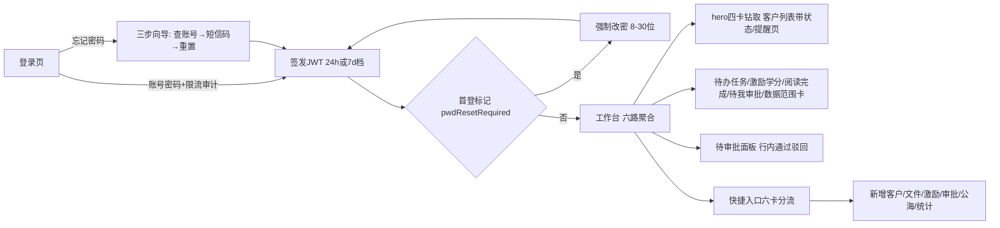

# PC·首页与登录

> 审计方式：逐文件通读前端 `aigicrm-ui/src`（login / dashboard / layout / router / store / api）与后端 `aigicrm-backend` 对应 Controller+Service 源码，每个按钮落到代码行号；「谁能看到」一律引用《菜单功能按钮数据范围验收表-20261107》。

## 概述（侧栏位置/路由、权限码、谁能看到该菜单）

- **工作台（首页）**：路由 `/dashboard`，挂 layout 子路由，`meta.permission='dashboard:view'`（`aigicrm-ui/src/router/index.js:39-44`）。侧栏位置=「首页」分组（组名与菜单项来自后端 `/auth/info` 下发的 menus 树，前端动态渲染，`layout/index.vue:25-53`）。直接输 URL 无权限时路由守卫跳首个有权限页面（`router/index.js:345-348` + `router/access.js:3-10`）。
- **登录页**：路由 `/login`，顶层路由不走 layout（`router/index.js:6-11`）；全局路由守卫对未登录访问一律踢回 `/login`（`router/index.js:320-328`）。
- **谁能看到**：验收表「角色×菜单可见矩阵」：`首页/工作台 | admin ✓ | 总监 ✓ | 行政 ✓ | 销售员 ✓`（四角色全员可见）。数据范围（验收表§三.1）：admin/总监=全公司（dashboard view=all）；行政=本大区（region）；销售员=仅本人（self）。
- **顶栏全局功能**（提醒铃铛/帮助/集团切换/用户菜单）挂在 layout 上，不属于菜单树，登录后全员渲染（`layout/index.vue:61-125`）。
- **权限码清单**（工作台页面内实际用到的门控码）：`dashboard:view`（页面）、`task:view`（待办/本月完成卡，`dashboard/index.vue:65,75`）、`approval:view`（待我审批卡，`:353`）、`reminder:view`（提醒数据，`:354`）、`incentive:stats:view|incentive:rank:view`（激励学分卡数据源，后端 `IncentiveController.java:155-157`）、`incentive:read-stats`（阅读完成卡，`dashboard/index.vue:351`）。

## 功能清单（每功能一行）

- 登录：账号+密码登录，失败限流（同 IP+账号 5 次/同 IP 20 次锁 15 分钟），成功签发 JWT（默认 24h 档，勾选保持登录=7 天档）。
- 记住账号：账号名明文存 localStorage，默认勾选；记住密码：口令加密（HTTPS=WebCrypto 设备密钥 AES-GCM，HTTP=XOR 弱混淆）存 7 天；7 天保持登录：登录请求带 rememberMe 换 7 天档 JWT 并滑动续期。
- 首登强制改密：后端标记 `pwdResetRequired=1` 时登录响应触发强制改密弹窗，改完 token 作废需重登。
- 忘记密码三步向导：①输账号查验证方式（手机掩码）→ ②发短信验证码（60s 倒计时）→ ③设置新密码（8-30 位）。
- 顶栏：折叠侧栏（持久化偏好）、面包屑、提醒铃铛（未读角标）、帮助（占位无功能）、多集团切换（仅多集团用户）、用户菜单（个人信息/修改密码/退出登录）。
- 30 分钟无操作自动退出：提前 2 分钟弹通知，到期登出跳登录页。
- 工作台看板：hero 四指标卡（客户总数/在保护期/即将到期/已超期，可点钻取）、运营指标卡（待办任务/本月完成/我的激励学分/我的阅读完成/待我审批/数据范围，按角色与权限码差异化）、统计口径条+立即刷新、六个快捷入口、本月新增客户/文件上传周条形图、待处理提醒列表、团队动态流、待审批面板（行内可直接通过/驳回）。
- 全局搜索：**当前 PC 顶栏不存在全局搜索功能**（见⚠️疑点 N1）。

## 按钮明细

### 块1：登录页（`views/login/index.vue`）

| 按钮 | 在哪 | 前端行为 | 后端动作 | 谁能看到 |
|---|---|---|---|---|
| 登 录 | 右栏表单底部（`login/index.vue:41`） | 表单校验→trim 账号→`login({...form, rememberMe})`，成功存 token、应用集团信息、跳 `/dashboard`（`:145-195`） | 登录限流校验（同 IP+账号 5 次、同 IP 20 次，锁 15 分钟，Redis 计数，`AuthService.java:76-89`）→BCrypt 验密、统一报「账号或密码错误」防枚举（`:97-114`）→成功清失败计数+写登录审计日志（`AuthController.java:29-41` SysLog 落库）+安全审计留痕（`AuthService.java:120`）→推导集团集合、签发 JWT（24h/7d 档，`:124-128`+`JwtTokenProvider.java:66-84`）→返回 pwdResetRequired 标记（`:141`） | 未登录访客（公开页） |
| 记住账号 ☑ | 表单选项区（`:32`） | 默认勾选；登录成功按勾选写/删 `aigicrm_remember_username`（`:88-94`）；挂载时回填（`:111-115`） | 无后端交互（纯 localStorage） | 未登录访客 |
| 记住密码 ☑ | 同上（`:35`） | 勾选联动勾上记住账号+保持登录；取消则清加密记忆并清空密码框（`:98-106`）；登录成功经 `saveRememberedAuth` 加密落盘 7 天（`:192`） | 无后端交互；口令以 WebCrypto AES-GCM+IndexedDB 设备密钥加密存 localStorage，HTTP 档降级 XOR 弱混淆（`remembered-auth.js:96-112`） | 未登录访客 |
| 7天内保持登录 ☑ | 同上（`:37`） | 勾选（或记住密码）→登录请求带 `rememberMe=true`（`:155-156`） | 签发 7 天档 JWT+写入 `rm` 声明，活跃后半周期滑动续期（`JwtTokenProvider.java:66-84,96-104`） | 未登录访客 |
| 忘记密码? | 表单选项区右侧（`:39`） | 打开找回密码弹窗（`forgotPwdVisible=true`） | 无 | 未登录访客 |
| ICP 备案链接 | 页脚（`:47-49`） | 新窗口跳工信部备案系统 | 无 | 未登录访客 |

### 块2：首登强制改密（登录成功流程内嵌弹窗，`login/index.vue:163-189`）

| 按钮 | 在哪 | 前端行为 | 后端动作 | 谁能看到 |
|---|---|---|---|---|
| 确认修改 | 强制改密弹窗确认键（`:165-173`，ElMessageBox.prompt） | 校验新密码≥8 位→`changePassword({oldPassword,newPassword})`→清加密口令记忆+只留记住账号→清 token→提示用新密码重登（`:172-181`） | 校验原密码→新密码 8-30 位后端兜底（`SysUserService.java:537-549`）→BCrypt 落新口令+DB 级 `pwd_changed_at`（旧 token 全失效）+清 `pwdResetRequired` 标记（`:550-558`）；端点 `POST /system/users/change-password`（`SysUserController.java:75-79`，登录态本人） | 仅 `pwdResetRequired=1` 的登录响应触发（初始/被重置口令用户） |
| 退出登录 | 同弹窗取消键（`:170,182-188`） | 清 token、提示未完成改密、留在登录页 | 无（本地清 token；带坏 token 的后续请求被 JwtAuthFilter 拒） | 同上 |

### 块3：忘记密码三步向导（`views/login/ForgotPasswordDialog.vue`）

| 按钮 | 在哪 | 前端行为 | 后端动作 | 谁能看到 |
|---|---|---|---|---|
| 下一步（步骤1 验证账号） | 弹窗底部主键（`:90-92`，文案随步骤切换） | 校验账号非空→`forgotPasswordLookup`；无手机号提示联系管理员（`:161-175`） | 匿名探测留痕+阈值告警（`AuthController.java:94` anonymousProbe）→IP 60s 限流（`:96-98`+`AuthService.java:47-52`）→查活跃用户，不存在返回全 false 中性响应防枚举（`AuthService.java:310-319`）→返回手机/邮箱掩码 | 未登录访客 |
| 手机验证卡 | 步骤2 验证方式区（`:44-56`） | 选中 `method='phone'`，展示掩码手机号 | 无（本地选择） | 步骤1 查到 hasPhone 者 |
| 获取验证码 | 步骤2 验证码行（`:61-64`） | `forgotPasswordSendCode`→60s 倒计时禁点（`:204-217`） | 匿名探测留痕→email 显式拒绝（`AuthService.java:334-337`）→用户名 60s+同 IP 1h/10 次双限流（`:340-352`）→用户不可用/无手机对外中性返回（`:354-367`）→6 位随机码 Redis 存 5 分钟→阿里云短信下发（`:369-385`） | 选定手机验证者 |
| 上一步 | 弹窗底部（`:88`） | 步骤号-1 | 无 | 步骤≥2 |
| 取消 | 弹窗底部（`:89`） | 关闭弹窗（closed 钩子重置全部状态，`:152-158`） | 无 | 全程 |
| 确认重置（步骤3） | 弹窗底部主键（`:90-92`） | 校验新密码 8-30 位+两次一致→`forgotPasswordReset`→成功清账号与口令记忆键、关弹窗（`:180-197`） | 匿名探测留痕（`AuthService.java:396`）→验码错误计数≤5（`:407-412`）→三态文案归一「验证码错误或已过期」防枚举（`:414-424`）→BCrypt 落新口令+`pwd_changed_at` 秒级截断+旧 token 立即拉黑+清验证码（`:426-435`） | 三步走通者 |

### 块4：顶栏全局（`layout/index.vue`）

| 按钮 | 在哪 | 前端行为 | 后端动作 | 谁能看到 |
|---|---|---|---|---|
| 折叠侧栏 | 顶栏左侧（`:63-66`） | 切换折叠态并持久化 localStorage（`:273-282`） | 无 | 登录全员 |
| 面包屑「首页」 | 面包屑首项（`:68`） | 跳 `/`（重定向 `/dashboard`） | 无（/dashboard 需 dashboard:view，无权限被守卫跳首个可访问页） | 登录全员 |
| 提醒铃铛 | 顶栏右侧（`:74-79`） | 跳 `/reminder`；角标=`badgeReminder`（99+ 封顶） | 角标来自 `GET /reminder/pending-count`（`store/user.js:81-85`）：`@PreAuthorize reminder:view`（`ReminderController.java:53-57`），Service 统计本人范围内 pending 提醒 | 登录全员（图标）；角标数据需 reminder:view |
| 帮助 ❓ | 顶栏右侧（`:80-84`） | **无任何点击 handler，纯占位图标** | 无 | 登录全员 |
| 集团切换下拉 | 顶栏（`:87-96`，`v-if canSwitchGroup`） | 选集团→`switchGroup`→存新 token→重拉用户信息+角标+成功提示（`:371-380`；`store/user.js:102-108`） | `POST /auth/switch-group`：校验目标集团在本人集团集合内（`AuthService.java:176-184`）→集团切换审计留痕（`:183-184`）→按原 token 的保持登录档重签 JWT（`:187-189`） | 仅多集团用户（groupIds>1，`store/user.js:44`） |
| 用户下拉（头像区） | 顶栏最右（`:97-108`） | 展开菜单（个人信息/修改密码/退出登录） | 无 | 登录全员 |
| 个人信息 | 用户菜单（`:118`） | 打开只读弹窗：用户名/部门/办事处/角色/数据范围/权限项数（`:128-156`） | 无（数据来自已加载的 `/auth/info`） | 登录全员 |
| 修改密码 | 用户菜单（`:119`） | 打开弹窗→校验非空/两次一致/8-30 位→`changePassword`→成功后本地登出跳登录页（`:159-175,296-317`） | 同块2 确认修改（`SysUserController.java:75-79`+`SysUserService.java:537-558`：原密码校验、8-30 兜底、pwd_changed_at 令旧 token 失效） | 登录全员 |
| 退出登录 | 用户菜单（`:120`） | `userStore.logout()`（先调后端注销再本地清理）→跳 `/login`（`:390-393`；`store/user.js:112-122`） | `POST /auth/logout`：按 jti 拉黑当前 token 即时失效（`AuthController.java:66-74`+`AuthService.java:202-207`）；本地清 token+遗留口令键 | 登录全员 |
| 侧栏菜单项×N | 侧栏（`:25-53`） | 点击跳对应路由（el-menu router 模式）；「提醒/审批」两项带未读角标（`:247-251`） | 菜单树来自 `GET /auth/info`（登录态）：角色勾选菜单按 path 去重、滤按钮码与隐藏路由后组树下发（`AuthService.java:209-262,275-306`） | 各自菜单授权角色（验收表二矩阵） |

另：layout 挂载时 `fetchUserInfo`（30s 缓存）+工作台权限兜底+路由级权限守卫+无操作 30 分钟自动登出（28 分钟先预警）（`layout/index.vue:319-359`）。

### 块5：工作台 hero 指标带（`views/dashboard/index.vue`，四卡均支持 Enter/Space 键盘等效 `:253-258`）

| 按钮 | 在哪 | 前端行为 | 后端动作 | 谁能看到 |
|---|---|---|---|---|
| hero·客户总数 | 深蓝指标带第1卡（`:9-15`） | 跳 `/customer?tab=all` | 数字来自 `GET /statistics/dashboard`：按 customer×view 数据范围统计未删非公海非归档客户数（`StatisticsController.java:26-30` 权限 `statistics:view` 或 `dashboard:view`；`CustomerService.java:1029-1034`，范围守卫 `applyDataScope` `:1370-1405`：admin 全量+规则引擎追加，非 admin 按 OrgScopeResolver OWNER/ORG 锚点，空集=不可见；结果带 30s 范围签名缓存，`StatisticsQueryService.java:216-248`） | dashboard:view 全员（验收表✓✓✓✓）；数字按各自范围 |
| hero·在保护期 | 第2卡（`:17-24`） | 跳 `/customer?status=normal&tab=all` | 同端点：`protection_status='active'` 计数+占比进度条（`CustomerService.java:1066-1074`，2026-11-01 起排公海/归档对齐统计页） | 同上 |
| hero·即将到期 | 第3卡（`:26-40`） | 跳 `/reminder` | 同端点：`expiring`（30 天内）计数+前 2 条明细（客户名/办事处/剩余天数，`StatisticsQueryService.java:335-350`，取 `getExpiringByScope(5)`）；todayExpiring 当日到期单列（`CustomerService.java:1085-1092`） | 同上；⚠️跳转目标 /reminder 需 reminder:view，无权限者被守卫跳首个可访问页（`router/index.js:345-348`） |
| hero·已超期 | 第4卡（`:44-52`） | 跳 `/customer?status=expired&tab=all` | 同端点：`expireDate<今日` 且排公海/归档（2026-10-09 用户裁决口径，`CustomerService.java:1094-1104`） | 同上 |

### 块6：工作台运营指标卡（`dashboard/index.vue:63-118`）

| 按钮 | 在哪 | 前端行为 | 后端动作 | 谁能看到 |
|---|---|---|---|---|
| 待办任务卡 | 运营卡区（`:65-73`，`v-if task:view`） | 跳 `/task`；数字=pending/todayDue/overdue | `GET /task/statistics`（`TaskController.java:38-42`，`@PreAuthorize task:view`）：按指派人统计 pending/当日到期/逾期/本月完成（`TaskService.java:230-251`；传他人 userId 时先过可见性校验 `assertAssigneeVisible`） | 有 task:view 者（验收表：任务查看 admin/总监/销售员 ✓，行政 ✗→卡片隐藏且不发请求 `dashboard/index.vue:502`） |
| 本月完成任务卡 | 同区（`:75-82`，`v-if task:view`） | 纯展示 | 同上端点 completedThisMonth | 同上 |
| 我的激励学分卡 | 同区（`:83-92`，`v-if dataScope==='self'`） | 跳 `/score/ranking`；数字=全年 scoreboard 本人 totalScore+上传次数 | `GET /incentive/scoreboard?period=<年>全年`（`IncentiveController.java:155-158`，权限 `incentive:stats:view` 或 `incentive:rank:view`）：非 admin 榜单按调用人数据范围收口+集团+身份分键缓存（`IncentiveService.java:980-1008,1010+`）；前端取本人行，找不到显示 0（`dashboard/index.vue:363-381`） | 数据范围=self 的角色（销售员；验收表：四项激励组四角色 ✓，故正常有码） |
| 我的阅读完成卡 | 同区（`:93-100`，`v-if isSalesRole && incentive:read-stats`） | 纯展示 已读/本月发布 | `GET /incentive/read-stats`（无参=本月，`IncentiveController.java:201-204`，`@PreAuthorize incentive:read-stats` 默认仅 admin）：月度聚合本月发布为分母、本人已读为分子；前端只取本人行（`dashboard/index.vue:366-379`） | self 范围且有 incentive:read-stats 者（默认 admin；对应核查重点7） |
| 待我审批卡 | 同区（`:101-109`，`v-if approval:view`） | 跳 `/approval`；数字=待我审批 pending/本月通过/驳回 | `GET /approval/list?tab=pending`（`ApprovalController.java:22-24`，`@PreAuthorize approval:view`）：按审批节点 approverId=本人 且 pending 的单（`ApprovalService.page` pending 分支）；卡片顶部数字来自 dashboard 端点 `approvalService.statistics(userId)`（本人 pending/月度通过驳回，非 admin 限本人相关，`ApprovalService.java:809-845`） | 有 approval:view 者（2026-11-01 起按权限码门控，`:353`） |
| 数据范围卡 | 同区（`:110-117`，`v-if !isSalesRole`） | 纯展示：范围文案+客户数+公海数 | 客户数同 hero；公海数=dashboard 端点 `seaService.statistics()`（按可见公海池过滤统计，`SeaService.java:134-152`） | 非 self 范围角色（管理岗） |

### 块7：工作台其他区块

| 按钮 | 在哪 | 前端行为 | 后端动作 | 谁能看到 |
|---|---|---|---|---|
| 立即刷新 | 统计口径条右侧（`:129`） | 重跑 loadData 五路并发（dashboard/提醒/动态/审批/日报），刷新时间戳更新（`:457-470`） | 同首屏五路端点（首路失败其余不受影响，各自 catch） | 登录全员（页面内） |
| 快捷入口×6（新增客户/上传文件/录入激励/待审批/公海捞取/数据统计） | 快捷区（`:133-139`，配置 `:265-272`） | 分别跳 `/customer/add` `/file` `/incentive` `/approval` `/sea` `/statistics` | 无（纯跳转；目标页各按其权限码守卫，无权限被路由守卫跳首个可访问页） | 登录全员可见入口；落地受各页权限码 |
| 待处理提醒·全部→ | 提醒面板头（`:182`） | 跳 `/reminder` | 列表数据：`GET /reminder/expiring-list?size=5`（`ReminderController.java:20-30`，`reminder:view`）：warningDays 配置+数据范围+部门子树并发预解析后按到期日升序分页，排公海/归档（`ReminderService.java:265-310`）；再并发拉三类分享提醒 `GET /reminder/list?type=share_to/by/owner&status=pending`（`dashboard/index.vue:416-435`，同码，按 reminder 模块范围过滤 owner） | reminder:view 门控（无码不发请求 `:354,398`） |
| 待审批·全部→ | 待审批面板头（`:222`） | 跳 `/approval` | 面板数据 `GET /approval/list?tab=pending&size=3`（同块6） | approval:view |
| 待审批行·通过 | 待审批面板行内（`:230`） | `apiApprove(id,{})`→成功提示+刷新数据+角标（`:473-475`） | `POST /approval/{id}/approve`（`ApprovalController.java:75-88`，`@PreAuthorize approval:approve`）：主行悲观锁串行化并发（`ApprovalService.java:552-557`）→终态守卫防复活（`:563-565`）→校验本人有 pending 节点（`:567-573`）→禁自审自批（`:578-580`）→节点条件流转（affected=1 才生效防重复点击 `:596-605`）→阶段推进（或签取消同组/会签清零/串行激活下一阶段 `:624-695`）→整单通过仅一个事务执行业务回写（捞取/转移/延期/扩容各副作用，`:698-707`） | 有 approval:approve 且是该单当前节点审批人（后端二次校验）；**前端按钮仅 approval:view 即渲染（门控缺口，见⚠️）** |
| 待审批行·驳回 | 同行（`:231`） | `apiReject(id,{})`→同上刷新 | `POST /approval/{id}/reject`（`ApprovalController.java:92-96`，`approval:reject`）：与通过同款锁/终态守卫/节点校验/条件流转，驳回即整单 rejected+业务回滚副作用（`ApprovalService.java:709-740+`） | 同上 |

### 块8：周统计/团队动态（只读区块）

| 按钮 | 在哪 | 前端行为 | 后端动作 | 谁能看到 |
|---|---|---|---|---|
| 本周条形高亮（非按钮，展示） | 周统计两卡（`:142-175`） | 本月按周聚合新增客户/文件上传横向条形 | `GET /statistics/daily-stats`（`StatisticsController.java:32-36`，dashboard:view 同码）：客户日增走 customer 范围口径；文件按天/周计数并套 `applyFileScope`（statistics 模块可见用户集，空集显式 1=0 防越权，`StatisticsQueryService.java:362-415,1106-1114`） | dashboard:view |
| 团队动态（只读流） | 双列面板（`:200-216`） | 最近 15 条动态（跟进/激励/文件/审批/新增客户/系统日志六源合并） | `GET /statistics/team-activities`（`:64-68`）：六路来源各 LIMIT 查询后按时间归并；按当前账号 statistics 模块数据范围过滤（admin 全量/其他按可见用户集，空集恒空守卫，`StatisticsQueryService.java:981-1085`） | dashboard:view；内容随范围 |

## 业务链条

文字链：登录（记住账号/密码/保持登录，限流+登录审计日志）→ 忘记密码三步向导（短信码）或直接登录 → 首登强制改密（旧 token 全作废）→ 重登 → 工作台（六路聚合，30s 缓存）→ hero 卡钻取客户列表/提醒页 → 待审批面板行内通过/驳回即时闭环并刷角标 → 快捷入口分流至客户/文件/激励/审批/公海/统计。对应业务链总图：**1 登录链**（本章节主链）+ **4 客户处置链 / 7 公海捞取链 / 8 激励上传链 / 14 审批中枢链 / 20 统计下钻链 / 21 提醒闭环链**的汇聚入口（工作台为各链分流起点）。

## ⚠️ 疑点

- **N1【新发现】顶栏无全局搜索、帮助按钮无功能**：本次任务范围提到「顶部导航与全局搜索等全局功能」，但 `layout/index.vue` 全文无任何搜索输入/入口（grep「全局搜索」前端零命中），「帮助」图标无点击 handler 纯占位（`layout/index.vue:80-84`）。属功能缺失或文档预期过宽——待管理层定夺是否补全局搜索。
- **N2【文档漂移】参考文档写的「协议勾选」在代码中不存在**：《页面按钮全量对照-20261107》login 表写「登 录 | 需先勾协议」、业务链1写「登录（记住账号/密码、协议勾选）」，但当前 `login/index.vue:30-41` 表单选项区只有记住账号/记住密码/7天保持登录三项+忘记密码链接，无任何协议 checkbox，登录也不校验协议。以代码为准：无协议勾选环节。
- **N3【核查重点7 相关·已验证一致】工作台「我的阅读完成」卡与「阅读排行榜仅 admin」口径同源**：卡与数据请求双重门控 `incentive:read-stats`（`dashboard/index.vue:351,366-370`），后端 `GET /incentive/read-stats` 同码硬校验（`IncentiveController.java:201-204`），默认仅 admin 勾选（验收表「本月激励查询阅读排行榜」行 admin ✓ 其余 ✗ 同源）。无越权路径；无码角色卡片隐藏且不发请求（防 403 假错，`:366-370` 注释）。
- **N4【新发现】待审批行内「通过/驳回」前端无 approve/reject 码门控**：按钮渲染只依赖父面板 `approval:view`（`dashboard/index.vue:219-233`），未用 `approval:approve/reject`；后端有同码硬校验+节点归属二次校验（`ApprovalController.java:75,92`；`ApprovalService.java:567-580`），所以无码角色点击才 403 弹错。当前生产四角色均有通过/驳回码（验收表「审批通过/驳回按钮」✓✓✓✓）故无害，但属前端门控缺口——若日后回收某角色 approve 码，工作台按钮仍显示。
- **N5【口径双轨·部分待核】工作台各卡数据范围锚点不同源**：hero 四卡与「数据范围」卡走 **customer×view** 锚点（`CustomerService.java:1029-1114` 的 applyDataScope `:1370-1405`）；团队动态/日报/周报走 **statistics×view** 锚点（`getCurrentScopeUserIds` 读 `anchorOf(user,"statistics","view")`，`CustomerService.java:1423-1440`）；激励学分榜按调用人范围+集团分键（`IncentiveService.java:980-1008`）；审批按审批人/数据范围（`ApprovalService.java:809-845`）。admin=全量、销售=self 两条已核一致；**行政（region）/总监（all）中间档在 statistics 锚点下的实际可见集合未在本章实测**（验收表只给 dashboard 的范围口径，statistics 锚点属统计域章节），标注待核。另 dashboard 结果带 30s 范围签名缓存+0~50% 抖动（`StatisticsQueryService.java:216-248`），写操作后最迟 30s 才反映——同一时刻工作台数字可能落后列表页。
- **N6【风险知悉】「记住密码」仍将口令驻留浏览器存储**：生产 HTTPS 走 WebCrypto AES-GCM+IndexedDB 不可导出设备密钥+7 天过期（`remembered-auth.js:95-112`）；HTTP 非安全上下文降级 XOR+base64 弱混淆并显式标记 `v:'xor-1'`（`:106,109`）。旧 B1 审计（口令落盘 high 级问题，`login/index.vue:77-86` 注释）后被产品决策恢复（2026-11-05），强档下风险可控，但任何能读 localStorage+IndexedDB 的本机攻击面仍可取回口令；且「记住密码」联动「7 天保持登录」会把 JWT 掉线窗口放大到 7 天不活跃（`login/index.vue:154-156`）。
- **N7【核查重点9 沾边】工作台销售员卡片数字口径**：销售员 hero 四卡=self 范围已核（applyDataScope OWNER 锚点）；「我的激励学分」取全年 scoreboard 本人行（`dashboard/index.vue:363-374`）——若管理员给某 self 角色未勾 `incentive:stats:view/rank:view`，请求 403 被静默 catch、卡片恒 0 无提示（`:380` catch 注释「数据缺失时卡片显示 0」）；当前验收表销售员有四项激励组全码，生产正常。六项指标页本身不属本章（统计域）。
- **N8【小体验】hero「即将到期」卡跳转 /reminder 对无 reminder:view 角色不直达**：卡片本身不判权限（`dashboard/index.vue:26-40`），无码者点击后被路由守卫静默跳到首个可访问页（`router/index.js:345-348`）而非 403——功能不破但体验突兀；提醒列表数据侧已有 `reminder:view` 门控不发请求（`:354,398`），数字卡本身仍有值展示（dashboard 端点仅要求 dashboard:view）。

（核查重点 1/2/3/4/5/6/8 均属客户域/激励域/学分域/回收站章节，与本章节无关，不在本节展开。）
