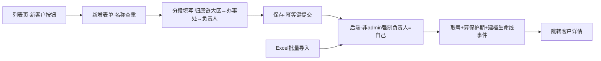
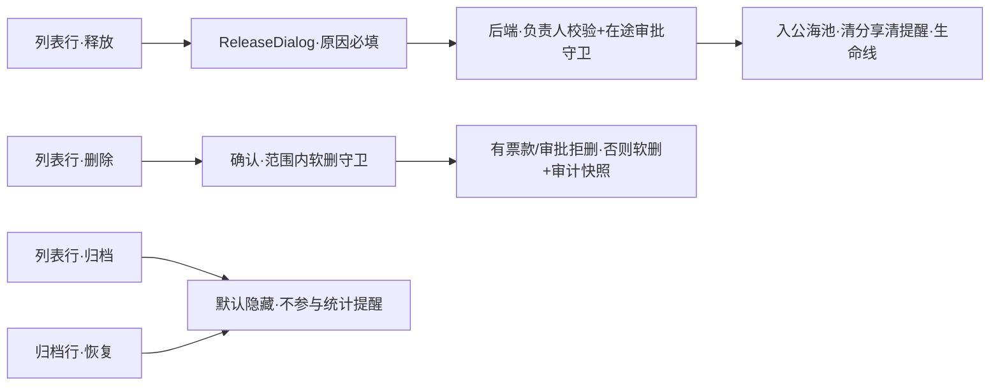
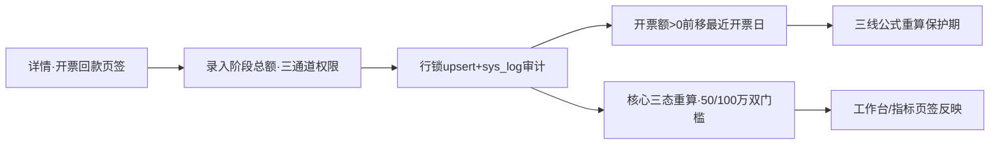

# PC·客户管理

> 审计日期 2026-11-08。方法：逐文件通读 `aigicrm-ui/src/views/customer`（16 个组件 + 2 个 composable）与后端 `CustomerController`/`CustomerService`/`CustomerAccessService`/`CustomerEventService`/`TaskController`/`ApprovalController`/`SeaService.addToSea` 源码，按钮全部落到 `文件:行号`；「谁能看到」列一律引用《菜单功能按钮数据范围验收表-20261107》（§二矩阵与 §三逐菜单表），不重新推导。

## 概述

- **侧栏位置/路由**：业务核心组「客户管理」，侧栏主路由 `/customer`（路由定义 `aigicrm-ui/src/router/index.js:49-73`）：
  - `/customer` 客户列表（`views/customer/list.vue`，`permission: 'customer:view'`）
  - `/customer/add` 新增客户（`views/customer/add.vue`，`customer:add`）
  - `/customer/edit/:id` 编辑客户（同 `add.vue`，`customer:edit`）
  - `/customer/detail/:id` 客户详情（`views/customer/detail.vue`，`customer:view`）
- **菜单权限码**：`customer:view`。谁能看到：验收表 §二「客户管理（列表/详情/新增）」行——admin ✓ / 销售总监 ✓ / 行政 ✓ / 销售员 ✓（4 角色全员可见）。
- **本菜单消费的按钮级权限码**（前端 `userStore.hasPermission` 门控，代码证据见各表）：`customer:add`、`customer:edit`、`customer:delete`、`customer:import`、`customer:export`、`customer:date:edit`（注册日）、`customer:invoice-date:edit`（最近开票日）、`finance:view`、`finance:manage`、`customer:finance:edit`（开票回款三通道）、`contact:view`、`incentive:view`、`task:manage`（跟进日志生成任务）。
- **数据范围**（验收表 §三.2/§四）：admin/总监=全公司（all）；行政=本办事处（office，行政三人另有 USER 级 custom）；销售员=本人+团队（team）+**分享给我的客户（只读）**。列表过滤由后端 `CustomerService.applyDataScope` 统一走 OrgScopeResolver（`CustomerService.java:1370-1405`），详情/编辑/删除单条守卫由 `CustomerAccessService.canView/canEdit/canDelete`（`CustomerAccessService.java:48-131`）把关，两者同一解析链路。
- **归档口径**（议题五.4）：归档客户默认隐藏、不参与统计与到期提醒，可恢复（`CustomerService.java:850-877`）。
- **核心判定口径**：真核心/争核心/非核心三态由后端按阶段总额年度口径算好回传（`CustomerService.computeCoreTypeFromRows`，`CustomerService.java:1952-1985`），双门槛走 sys_config（`customer.core.minor.wan`/`major.wan`，默认 50/100 万，`CustomerService.java:1909-1912`），前端只消费不落死值（`useCustomerDetail.js:102-108`）。

## 功能清单

| 功能 | 一句话说明 |
|---|---|
| 客户列表查询 | 关键字（名称/别名/编号多词 AND）+行业+状态+开发类型页签（全部/成熟创新/突破开拓/铺垫宣传/新建改建扩建大修）服务端分页查询 |
| 高级筛选 | 省/市/保护状态/负责人/注册日与到期日区间/部门树（含子部门）/组织多选/人员多选，全部服务端参数化 |
| 统计条 | 页签计数+「预警中/已超期」覆盖计数，服务端口径（`/list/counts-by-filter`） |
| 列设置 | 21 列白名单勾选，localStorage 持久化 |
| Excel 批量导入 | 下载模板→上传 xlsx→逐行校验建客，返回成功/失败/提示明细 |
| 导出 Excel | 与列表同一份筛选参数全量导出（护栏 5 万行） |
| 新增/编辑客户 | 分段长表单：基本信息/业务分类/归属负责人/地址/联系人（+编辑态经营指标），名称失焦查重、保存带幂等键 |
| 客户详情六页签 | 基本信息（含联系人/客情/转移/延期）/生命线/开票回款（阶段总额制）/四项服务/核心指标/跟进日志 |
| 释放到公海 | 负责人专属动作，原因必填，入池后清分享/清提醒/写生命线 |
| 归档/恢复 | 停止跟进（默认隐藏+不参与统计提醒），可随时恢复 |
| 删除（软删） | 移入回收站，有票/款/在途审批的客户拒删，删除留审计快照 |
| 申请延期/转移客户 | 详情页发起 type=extend / type=transfer 审批单 |
| 分享客户 | 选人只读共享（admin 入口隐藏） |
| 跟进日志+生成任务 | 记录跟进并可一键建待办任务（task:manage 门控） |

## 按钮明细

### ① 列表·查询与筛选（`list.vue` + `TopBar.vue` + `MainTable.vue` + `AdvFilterDialog.vue` + `ColPickerDialog.vue`）

| 按钮 | 在哪 | 前端行为 | 后端动作 | 谁能看到 |
|---|---|---|---|---|
| 搜索输入框 | TopBar.vue:3 | 输入 400ms 防抖 + 回车立即重载（`useCustomerList.js:405-413,484`），重置页码 | `GET /api/customer/list`（keyword 多词 AND、名称/别名/编号 OR 模糊，`CustomerService.java:184-194`） | 4 角色（customer:view） |
| 高级筛选按钮（带条件角标） | TopBar.vue:4 | 打开 AdvFilterDialog，角标统计已填条件数（`useCustomerList.js:171-185`） | — | 4 角色 |
| 高级筛选·基本筛选组（行业/省/市/状态/保护/负责人/注册日区间/到期日区间） | AdvFilterDialog.vue:7-17 | v-model 即时生效，watch 统一重置页码+防抖重载（`useCustomerList.js:481`） | `GET /api/customer/list`（protectionStatus 精确、province/city LIKE 转义通配符、日期 ge/le，`CustomerService.java:210-224,257-260`） | 4 角色 |
| 高级筛选·所属部门树（含子部门） | AdvFilterDialog.vue:24（canFilterByOrg 才渲染，`useCustomerList.js:342`） | onDeptFilterChange 收集该部门全部子部门 id（`useCustomerList.js:425-448`） | `GET /api/customer/list?deptId=`（后端递归子树 IN，`CustomerService.java:202-207`）；组织树数据 `GET /api/system/depts/tree` | admin/总监/行政（数据范围 all/office/managedOrgIds 派生，验收表 §三.2） |
| 高级筛选·组织多选 | AdvFilterDialog.vue:36 | 多选组织写 advFilter.orgIds（officeIds CSV 参数） | 同上（office 或 dept 命中即算，`CustomerService.java:230-235`；CSV 去重+200 上限防巨型 IN，`CustomerController.java:116-136`） | 同上 |
| 高级筛选·人员多选 | AdvFilterDialog.vue:52 | 多选人员写 userIds | 同上（ownerId IN；候选来自 `GET /api/customer/users/simple`——按集团成员收敛、无需 system:user:view，`CustomerService.java:355-385`） | 数据范围 all/org_and_children/managedOrgs 且候选>1（`useCustomerList.js:349-354`） |
| 高级筛选·清空全部/取消/确定 | AdvFilterDialog.vue:62-64 | 清空全部字段（含 deptId 派生 deptIds，`useCustomerList.js:450-454`）/关弹窗（条件即时生效不回滚） | — | 4 角色 |
| 行业/状态快速筛选下拉 | MainTable.vue:18-23 | onQuickFilterChange 重置页码+防抖重载（`useCustomerList.js:487`） | `GET /api/customer/list`；状态 expired=expireDate<今日 且排公海/归档（与统计页同判据，`CustomerService.java:173-179`） | 4 角色 |
| 显示已归档勾选 | MainTable.vue:25 | toggleArchived：状态优先、勾选时传 include_archived（`useCustomerList.js:92-93,239-243`） | 同上（include_archived=仅排 sea，归档可见；`CustomerService.java:164-169`） | 4 角色 |
| 开发类型页签 ×5（全部/成熟创新/突破开拓/铺垫宣传/新建改建扩建大修） | MainTable.vue:3-13 | 切页签清快速筛选、重置页码重载（`useCustomerList.js:415-422`）；默认页签 'all'（`useCustomerList.js:27`） | `GET /api/customer/list?devType=` + 并发 `GET /api/customer/list/counts-by-filter`（五页签+预警/超期计数，`CustomerService.java:93-103`；`@PreAuthorize customer:view`，`CustomerController.java:76`） | 4 角色 |
| 列设置按钮 | MainTable.vue:26 | 打开 ColPickerDialog | — | 4 角色 |
| 列设置·全选/全不选/取消/确定 | ColPickerDialog.vue:4-5,12 | 勾选 21 列白名单（`useCustomerList.js:32-47`），watch 写 localStorage 持久化（`useCustomerList.js:131-133`） | — | 4 角色 |
| 分页（页码/页大小） | list.vue:15-25 | 服务端分页：onCurrentChange/onSizeChange 重载（`useCustomerList.js:490-491`） | `GET /api/customer/list`（current/size；`CustomerService.pageList` 排序 createdAt desc，`CustomerService.java:83-89`） | 4 角色 |
| 空态「清空搜索与筛选」 | MainTable.vue:57 | clearSearch 一键清空搜索词+快速+高级筛选回第一页（`useCustomerList.js:467-477`） | 同列表 | 4 角色 |
| 失败条「重试」 | MainTable.vue:45 | 重跑 loadData（请求序号守卫防旧响应覆盖，`useCustomerList.js:264-266,287-308`） | 同列表 | 4 角色 |
| 统计条（MetricStrip） | StatCards.vue:6-9 | **纯展示无交互**：客户总数(全部页签口径)/当前分类/预警中/已超期（`StatCards.vue:29-37`） | 数据来自 `GET /customer/list/counts-by-filter` + 列表 total | 4 角色 |

### ② 列表·顶栏动作（TopBar.vue）

| 按钮 | 在哪 | 前端行为 | 后端动作 | 谁能看到 |
|---|---|---|---|---|
| 批量导入 | TopBar.vue:7（`v-if hasPerm('customer:import')`） | 打开 ImportDialog | 见 ④ | 4 角色（验收表 §二「客户导入按钮」行 ✓✓✓✓） |
| 导出 | TopBar.vue:8（`customer:export`） | handleExport 与列表共用 `buildListParams` 拼 URL 下载（`useCustomerList.js:510-522`，token 走统一入口） | `GET /api/customer/export`（`@PreAuthorize customer:export`，`CustomerController.java:655`；不分页 selectList+数据范围 applyDataScope，内存护栏 5 万行截断留痕，`CustomerService.java:118-130`；名称回填四列，`CustomerService.java:1563-1594`） | 4 角色（验收表「客户导出/导入按钮」行） |
| 新客户（主按钮） | TopBar.vue:9（`customer:add`） | 跳 `/customer/add` | — | 4 角色（`customer:add` 全员有码，验收表 §三.3） |

### ③ 列表·行操作与批量操作（MainTable.vue + useCustomerList.js）

| 按钮 | 在哪 | 前端行为 | 后端动作 | 谁能看到 |
|---|---|---|---|---|
| 行勾选框 | MainTable.vue:60 | 被分享行（非本人客户）禁选（`:selectable !isShared`） | — | 4 角色 |
| 表格行点击 → 详情 | MainTable.vue:53（row-click viewDetail） | 携 tab/kw/page 跳详情；被分享行追加 `readonly=1`（`useCustomerList.js:493-507`） | — | 4 角色 |
| 行内「恢复」（仅归档行） | MainTable.vue:110（`canRelease`=customer:edit） | 直接恢复+刷新 | `POST /api/customer/{id}/restore`（`customer:edit` + canEdit 范围守卫；仅 archived 状态可恢复→normal，`CustomerService.java:866-877`） | customer:edit（4 角色均有码，验收表 §三.2「行内：…恢复（归档行）」） |
| 行内「释放」 | MainTable.vue:113 | 打开 ReleaseDialog（见 ⑤） | — | customer:edit |
| 行内「归档」 | MainTable.vue:114 | confirmAction 确认（danger:false）后归档 | `POST /api/customer/{id}/archive`（customer:edit + canEdit；status→archived + 清全部 pending 提醒，`CustomerService.java:851-863`） | customer:edit |
| 行内「删除」 | MainTable.vue:116（`canDelete`=customer:delete，`useCustomerList.js:151`） | confirmAction 红色确认，文案「移入回收站，保留期内可由管理员恢复」（`useCustomerList.js:524-543`） | `DELETE /api/customer/{id}`（`@PreAuthorize customer:delete`，`CustomerController.java:270`；canDelete=池级 PERM_DELETE 或"删除范围"统一层判定，`CustomerAccessService.java:116-131`；事务内：有未捞取池行拒删→assertDeletable 有开票/回款/在途审批拒删→软删+删分享+清全部 pending 提醒+sys_log 删除快照，`CustomerService.java:747-798`） | customer:delete（4 角色均有码，验收表 §二「客户删除…」行；⚠️见疑点2） |
| 批量释放（勾选后出现） | MainTable.vue:29 | ElMessageBox.prompt 统一填写必填原因→逐条 POST+成功/失败计数+清勾选（`useCustomerList.js:621-640,608-619`）；范围过滤 batchReleasable 排除共享行与已归档行（`useCustomerList.js:603`） | 逐条 `POST /api/customer/{id}/release`（见 ⑤ 后端） | customer:edit |
| 批量归档 | MainTable.vue:30 | confirmAction 确认后逐条归档 | 逐条 `POST /{id}/archive` | customer:edit |
| 批量删除 | MainTable.vue:31 | confirmAction 红色确认后逐条软删 | 逐条 `DELETE /{id}` | customer:delete |

### ④ Excel 批量导入弹窗（ImportDialog.vue）

| 按钮 | 在哪 | 前端行为 | 后端动作 | 谁能看到 |
|---|---|---|---|---|
| 下载导入模板 (.xlsx) | ImportDialog.vue:4 | downloadFile 下载（token 统一入口，`api/customer.js:183-190`） | `GET /api/customer/import/template`（`@PreAuthorize customer:import`，`CustomerController.java:593`；EasyExcel 双 sheet：模板+填写说明，示意行/16 行字段说明硬编码，`CustomerController.java:595-653`） | customer:import（4 角色） |
| 拖拽/点击上传区（限 1 个文件） | ImportDialog.vue:6 | handleFileChange 暂存 raw；on-remove 清引用防"已移除仍可导入"（`ImportDialog.vue:73-81`）；超限提示（`:84-86`） | — | 同上 |
| 开始导入（无文件禁用） | ImportDialog.vue:27 | doImport 上传后映射后端 `{successCount,failCount,totalCount,failures,warnings}` 分区展示成功/失败/提示（`ImportDialog.vue:49-71,97-112`）；成功>0 触发 refreshAll | `POST /api/customer/import`（`@PreAuthorize customer:import`，`CustomerController.java:585`；ImportGuard 非空/仅 xlsx·xls/≤5MB/≤5000 行，`ImportGuard.java:32-46`；EasyExcel 逐行：必填校验→范围内重名查重→`customerService.create`（导入客户 ownerId=当前导入人、officeId=当前人办事处，`CustomerImportListener.java:46-54`；注册日缺失按导入当天兜底并出提示）；**非整体事务**：逐行独立成败，单行失败记入 failures 不回滚已成功行 | customer:import（4 角色；⚠️销售员有码见疑点1） |
| 取消 | ImportDialog.vue:26 | 关弹窗并重置文件与结果（`ImportDialog.vue:115-119`） | — | 同上 |

### ⑤ 释放确认弹窗（ReleaseDialog.vue）

| 按钮 | 在哪 | 前端行为 | 后端动作 | 谁能看到 |
|---|---|---|---|---|
| 释放原因输入（必填，≤200 字） | ReleaseDialog.vue:10 | v-model releaseReason，默认「放弃客户」（`useCustomerList.js:142,575`）；空值/纯空格禁用确认钮（`ReleaseDialog.vue:33`） | — | customer:edit |
| 确认释放 | ReleaseDialog.vue:21 | composable 内再兜底校验原因非空（`useCustomerList.js:579-584`）→ `POST /api/customer/{id}/release {reason}` → 刷新列表/统计/计数 | `@PreAuthorize customer:edit`（`CustomerController.java:473`）+ assertCanEdit（`CustomerController.java:476`）+ **仅客户负责人可释放**（dataScope≠all 时 ownerId 不匹配即 403，`CustomerController.java:481-485`）+ 办事处必须已配公海池（`:487-489`）+ 在途审批守卫 assertNoActiveApprovals（`:492`，`CustomerService.java:839-848`）；事务内 `SeaService.addToSea`：幂等防重复入池、插池行(status=available)、客户 status→sea+保护 expired、**写生命线 released 事件**、**删全部分享**、**清全部 pending 提醒**（`SeaService.java:162-216`）；控制器侧再删一次分享（`CustomerController.java:496`） | customer:edit 且是负责人（admin 例外） |
| 取消 | ReleaseDialog.vue:20 | 关弹窗 | — | 同上 |

### ⑥ 新增/编辑客户表单（add.vue + 5 个分段组件 + useCustomerForm.js）

| 按钮 | 在哪 | 前端行为 | 后端动作 | 谁能看到 |
|---|---|---|---|---|
| 返回 | add.vue:5 | 编辑回详情、新增回列表（`useCustomerForm.js:195-201`） | — | customer:add / customer:edit（按路由 meta，`router/index.js:55-67`） |
| 分段锚点 chips（基本信息/业务分类/归属负责人/地址/联系人/经营指标[仅编辑态]） | add.vue:15-18,68-78 | IntersectionObserver 滚动高亮+平滑定位；经营指标区新建不渲染（裁决 2026-10-10，add.vue:28） | — | 同上 |
| 客户名称输入失焦查重 | BasicSection.vue:9（checkDup） | `GET /customer/check-name`，命中展示创建人/创建时间；编辑态 excludeId 排除自身（`useCustomerForm.js:204-212`） | `GET /api/customer/check-name`（`customer:view` 即可调，`CustomerController.java:692`；**查重限定当前用户数据范围**——scopeUserIds IN 过滤防跨范围探测，空集 fail-closed，`CustomerService.java:523-542`） | 4 角色 |
| 联系人「添加联系人」/行删除 | ContactsSection.vue:6,20 | 行内增删；提交时校验"有其他字段必填姓名"并滚动定位（`useCustomerForm.js:172-181,259-267`） | 随保存 diff 提交：`POST/PUT/DELETE /api/customer/{id}/contacts…`（后端 `customer:edit∨contact:manage` + assertCanEdit，`CustomerController.java:519-542`） | 同上 |
| 注册日选择 | AddressSection.vue:22（`:disabled="!canEditProtectedDates"`） | 新增默认今天；编辑态仅 admin 或 `customer:date:edit` 可改（`useCustomerForm.js:72`） | 编辑时 protectCustomerDateFields 硬校验：无 `customer:date:edit` 改注册日→BusinessException「注册日录入后仅总监或行政可修改」，未改则强制回填库内值（`CustomerService.java:709-728`） | 编辑修改=admin 或 customer:date:edit（验收表 §三.3）；后端注释指明该码绑定总监0/行政05/admin（`CustomerService.java:720`） |
| 最近开票日选择（编辑态） | AddressSection.vue:27（`v-if canEditInvoiceDate`，无码显示只读输入框） | 人工设定=新基准 | protectCustomerDateFields：非 `customer:invoice-date:edit` 改开票日→BusinessException；人工改动→清零已批延期+三线公式重算+写生命线 invoice_manual 事件（`CustomerService.java:709-737,679-693`） | admin 或 customer:invoice-date:edit（后端注释名单=毛颖娜/肖赟/李艳梅/马吉亮/admin，`CustomerService.java:710-712`；前端同码三入口：AddressSection.vue:27/InfoTab.vue:55/FinanceTab.vue:14） |
| 捞取日期（只读展示） | AddressSection.vue:38 | disabled 输入框 | 捞取日为审批域派生字段，创建/编辑一律清空或保持库内值，任何请求体不可直写（`CustomerService.java:414,683`） | 只读 |
| 取消 | add.vue:40 | goBack | — | 同表单 |
| 保存客户/更新客户（吸底主按钮） | add.vue:41（handleSubmit） | 校验+联系人 diff；新建 `POST /customer/full` 带 Idempotency-Key（失败弃用旧键，`useCustomerForm.js:304-307,331-335`）；编辑 `PUT /customer/{id}/full`+联系人三路 diff（增/改/删，`useCustomerForm.js:276-302`）；新建成功跳新客户详情，联系人保存失败引导去详情补录防重复建客（`useCustomerForm.js:310-321`） | `POST /api/customer/full`（`customer:add`，`CustomerController.java:195`；带指标时另须 customer:edit，`:203-206`；**Redis 幂等**：awaitResult/tryBegin/finish/abort，重复请求回同一客户 id+响应头 Idempotent-Replay，`:207-241`）→ `createWithIndicator` 单事务（`CustomerService.java:1863-1870`）→create：强制清 approved_extend_days/claim_date/last_invoice_date、注册日缺失兜底当天、三线公式算到期日、**非 admin 强制 ownerId=当前用户**（防挂单到他人，`CustomerService.java:398-439`）、集团行 FOR UPDATE 取号+唯一键冲突 3 次退让重试（`:441-482`）、dept_id=负责人部门、写生命线 created 事件。`PUT /{id}/full`（customer:edit + assertCanEdit + 行锁读现值；公海池客户禁改负责人/状态；非 admin 禁改负责人与状态字段；日期字段保护见上行；`CustomerService.java:629-698`） | customer:add / customer:edit（4 角色均有码，验收表 §三.3） |

### ⑦ 客户详情·头部与分享（detail.vue）

| 按钮 | 在哪 | 前端行为 | 后端动作 | 谁能看到 |
|---|---|---|---|---|
| 返回客户列表/公海池 | detail.vue:17 | goBack 携 tab/kw/page 带参回跳（`detail.vue:219-229`）；readonly 时回公海 | — | 4 角色（customer:view） |
| 分区失败警示条「重试加载」 | detail.vue:10 | 重跑 loadAll（首屏 getCustomer 单独锚定+9 路分区 allSettled，单路失败不连坐，`useCustomerDetail.js:156-199`） | `GET /api/customer/{id}` 等 | 4 角色 |
| 首屏错误态「重试/返回」 | detail.vue:167-168 | loadAll / goBack | 同上 | 4 角色 |
| 编辑 | detail.vue:21（`customer:edit`） | 跳 `/customer/edit/{id}` | — | customer:edit |
| 分享 | detail.vue:22（`customer:edit && !isAdmin()`，detail.vue:194） | 打开分享弹窗 | — | customer:edit 且非 admin（admin 无集团归属分享必 403，入口隐藏防误导，detail.vue:191-194 注释） |
| 分享弹窗·用户多选/确认分享/已分享 tag×移除 | detail.vue:151-157 | handleAddShare 批量分享 / handleRemoveShare 撤回（`useCustomerDetail.js:302,319`） | `POST /api/customer/{id}/shares`、`DELETE /api/customer/{id}/shares/{userId}`（`customer:edit` + assertCanEdit，`CustomerController.java:454-468`）；`GET /{id}/shares`（customer:view + assertCanView，`:447-452`） | customer:edit（非 admin 入口） |

### ⑧ 详情·基本信息页签（detail/InfoTab.vue）

| 按钮 | 在哪 | 前端行为 | 后端动作 | 谁能看到 |
|---|---|---|---|---|
| 最近开票日「笔形」编辑→保存/取消 | InfoTab.vue:55-61（canEditInvoiceDate=admin∨`customer:invoice-date:edit` 且非只读，InfoTab.vue:181） | 行内日期编辑→`PUT /{id} {lastInvoiceDate}`→loadAll | 同 ⑥ 开票日条目（新基准清零延期+重算+生命线） | admin 或 customer:invoice-date:edit |
| 申请延期 | InfoTab.vue:75（仅 `!readonly`，**无权限码门控**） | confirm 后提交 `{type:'extend'}` 审批，天数由服务端快照 sys_config 进 extraData、审批人可调（`useCustomerDetail.js:252`） | `POST /api/approval/submit`（`@PreAuthorize approval:view`——4 角色均有码；ApprovalController.java:40-54） | 所有非只读入口（4 角色；发起≠审批） |
| 转移客户→弹窗接收人下拉/「提交转移审批」/取消 | InfoTab.vue:77-98（仅 `!readonly`，无权限码门控） | 接收人候选=可分享用户列表排除当前负责人（InfoTab.vue:210-211）；前端校验接收人≠当前负责人（`useCustomerDetail.js:305-318`）；提交 `{type:'transfer', extraData:{newOwnerId}}` | `POST /api/approval/submit`（同上）；审批**通过后**后端才落库负责人/部门/转移日（转移链，见业务链） | 所有非只读入口（4 角色） |
| 联系人「添加」/行「编辑」/行「删除」/弹窗确认 | InfoTab.vue:104,114-115,159（卡片随 `canViewContacts` 渲染，操作随 `!readonly`） | 弹窗增改删+刷新（`useCustomerDetail.js:297-299`） | `GET /{id}/contacts`（customer:view+assertCanView；**无 contact:view 只回空列表不报错**，`CustomerController.java:511-517`）；`POST/PUT/DELETE /{id}/contacts…`（customer:edit∨contact:manage + assertCanEdit，`:519-542`） | 查看=contact:view（4 角色，验收表）；写=customer:edit 或 contact:manage |
| 客情四档选项卡（0-3 分直存） | InfoTab.vue:125-129（`!readonly`） | selectRelationship 保存并回读（`useCustomerDetail.js:301`） | `PUT /api/customer/{id}/relationship`（`customer:edit` + assertCanEdit；0-3 域校验+触发核心三态重算，`CustomerController.java:437-443`，`CustomerService.java:1882-1904`） | customer:edit |
| 核心客户指标摘要卡 | InfoTab.vue:134-150 | **纯展示**（只读，编辑在核心指标页签） | 数据来自 `GET /{id}/stage-amounts` 摘要 | 随详情页 |

### ⑨ 详情·开票回款页签（detail/FinanceTab.vue，页签本身 `v-if canViewFinance`，detail.vue:120）

| 按钮 | 在哪 | 前端行为 | 后端动作 | 谁能看到 |
|---|---|---|---|---|
| 最近开票日「更新」 | FinanceTab.vue:11-16（canEditInvoiceDate 同码，FinanceTab.vue:197） | 日期选择+更新→loadAll | 同 ⑥ 开票日条目 | admin 或 customer:invoice-date:edit |
| 「+ 录入阶段数据」/阶段行「编辑」 | FinanceTab.vue:33,62-66（`canWriteFinance`= finance:manage ∨ (customer:edit ∧ finance:view)，FinanceTab.vue:218-220——与后端三通道对齐，readonly 不再锁财务写） | openStageDialog 空白/回填弹窗 | — | finance:manage 或 customer:edit+finance:view 或 customer:finance:edit（后端 `@PreAuthorize` 三通道，`CustomerController.java:406`） |
| 阶段弹窗「保存」/「取消」 | FinanceTab.vue:173-174 | 前端校验两项至少一项>0（`useCustomerDetail.js:281-296`）→ `POST /{id}/stage-amounts` → reloadFinance（7 路并发刷新台账/汇总/指标/客户/阶段） | `@PreAuthorize` 三通道（同上）+ assertCanManageFinance（`finance:manage` 全通 / `customer:finance:edit` 按自身 finance_edit 范围 / 否则 assertCanEdit，`CustomerAccessService.java:197-221`）+ 先过客户存在/未删/同集团校验（`assertFinanceCustomerWritable`，`:229-242`）；事务内：周期/年份/金额校验（类型白名单、≥2000、非负、至少一项>0、上限 1e12）→ 唯一键 FOR UPDATE 行锁 upsert → **sys_log 审计快照（改动前后值）** → 开票额>0 时以阶段末日期（不晚于今天）前移最近开票日（仅前移才清零已批延期）→ 清 invoice 类 pending 提醒 → **核心三态重算落库**（`CustomerService.java:2143-2198`） | 三通道码（验收表：行政 finance_edit=region；销售员只可查看） |
| 「历史逐笔明细」折叠 | FinanceTab.vue:77-148 | 展开只读台账（2026-10-10 前逐笔流水，作废行置灰悬停看原因） | `GET /{id}/invoices`、`GET /{id}/invoices/summary`、`GET /{id}/payments`、`GET /{id}/payments/summary`（customer:view + assertCanView；**无 finance:view 一律回空骨架不外露财务数据**，`CustomerController.java:312-326,546-560`） | 页签=finance:view（4 角色，销售员只读查看）；无 finance:view 者整个分区空 |

### ⑩ 详情·核心指标页签（detail/IndicatorTab.vue）

| 按钮 | 在哪 | 前端行为 | 后端动作 | 谁能看到 |
|---|---|---|---|---|
| 五项评分下拉（客情/指标02-05，各 0-3 分四档） | IndicatorTab.vue:20-22（readonly 禁用） | v-model indicatorForm；五项总分仅客情参考不参与核心判定 | — | customer:view（随详情页） |
| 「保存指标」 | IndicatorTab.vue:26（`!readonly`） | `POST /{id}/indicator` 整表保存并回读（`useCustomerDetail.js:300`） | `@PreAuthorize customer:edit`（`CustomerController.java:429`）+ assertCanEdit；0-3 分值域硬校验（越界拒入库防污染排行口径）、core_type/is_core 强制置空由服务端重算写、存在则 update 不存在则 insert、触发核心三态重算（`CustomerService.java:1823-1856`） | customer:edit |
| 硬性门槛行（真核心/争核心/非核心三态） | IndicatorTab.vue:4-16 | 纯展示，门槛数字随接口回传不落死值 | 来自 `GET /{id}/stage-amounts`（coreType/coreMinorWan/coreMajorWan） | 随详情页 |

### ⑪ 详情·四项服务页签（detail/IncentiveTab.vue，页签 `v-if canViewIncentive`，detail.vue:134）

| 按钮 | 在哪 | 前端行为 | 后端动作 | 谁能看到 |
|---|---|---|---|---|
| 图片缩略图点击放大 | IncentiveTab.vue:21-38 | el-image 缩略墙（thumbnail=1）+内建查看器看原图 | `GET /api/file/download/{id}?token=…&thumbnail=1`（文件下载门禁，属文件域） | incentive:view（4 角色） |
| 非图片文件条点击预览 | IncentiveTab.vue:39-45 | FilePreview 阅读器（previewKindOf 判型） | 同上 | 同上 |
| （页面加载） | useCustomerDetail.js:204-211 | 按 customerId 拉记录列表；无 incentive:view 不发请求 | `GET /api/incentive/records?customerId=`、`GET /api/incentive/score/customer/{id}`（激励域范围口径——行政 view-all=region 即本大区该客户全部记录） | incentive:view（4 角色） |

### ⑫ 详情·跟进日志页签（detail/LogsTab.vue）

| 按钮 | 在哪 | 前端行为 | 后端动作 | 谁能看到 |
|---|---|---|---|---|
| 「记录」按钮（textarea 必填） | LogsTab.vue:17（`!readonly` 区） | 先 submitLog 存日志（失败不建任务、保留内容供重试，`useCustomerDetail.js:249`）；勾选任务时再 `POST /api/task` | `POST /api/customer/{id}/logs`（`customer:edit` + assertCanEdit，落 biz_customer_log 带当前用户，`CustomerController.java:294-301`，`CustomerService.java:1023-1026`）；`GET /{id}/logs`（customer:view+assertCanView，时间倒序） | 日志写=customer:edit；读=customer:view |
| 「生成下一步任务」勾选（+任务标题/截止时间） | LogsTab.vue:8-14（有内容且 `task:manage` 才渲染，LogsTab.vue:48） | 勾选后展开标题/截止输入；建任务 assignee=当前用户（LogsTab.vue:69-77） | `POST /api/task`（`@PreAuthorize task:manage`，TaskController.java:45-49——**仅 admin/总监/销售员有码、行政无**，验收表 §二「任务查看/管理按钮」行） | task:manage（无码者隐藏勾选项，防"日志已存+任务 403"部分成功） |

### ⑬ 详情·生命线页签（detail/EventsTab.vue）

| 按钮 | 在哪 | 前端行为 | 后端动作 | 谁能看到 |
|---|---|---|---|---|
| （无按钮，纯只读时间线） | EventsTab.vue:1-57 | 展示建档/开票推进/人工维护开票日/延期/释放进公海/捞取/转移七类事件（时间倒序、变更前后值、操作人） | `GET /api/customer/{id}/events`（customer:view + assertCanView，与详情同口径，`CustomerController.java:287-292`；事件表只增不改、与主业务同事务写入，`CustomerEventService.java:47-71`，上限 200 条） | 4 角色（customer:view） |

## 业务链条

### 链A：客户建档链（对应 23 条业务链之 **#2 客户建档链**）

文字链：列表「新客户」/Excel 批量导入 → 表单（查重拦截 → 归属链 → 联系人行）→ 幂等保存（customer:add，Redis Idempotency-Key 防重）→ 服务端强制归属（非 admin 建在自己名下）→ 取号/保护期三线公式/生命线建档事件 → 详情页。

### 链B：客户处置链（对应 **#4 客户处置链** + **#7 公海捞取链** 的本侧起点）

文字链：释放（customer:edit+负责人专属，原因必填）→ 公海池 →（他侧）捞取审批转移归属；归档=停止跟进可恢复；删除=customer:delete 范围内软删 → 回收站（恢复=system:recycle:restore **仅 admin**）。

### 链C：财务·核心判定链（对应 **#6 财务·核心判定链**）

文字链：详情「录入阶段数据」（finance:manage ∨ customer:edit∧finance:view ∨ customer:finance:edit）→ upsert+审计 → 保护期接力（只前移不清延期）→ 真核心/争核心三态落库 → 详情徽章/概览条联动。

### 链D：客户转移/延期链（对应 **#5 保护期延期链** + **#13 客户转移链**）

文字链：详情基本信息页签「申请延期」→ type=extend 审批（天数走 sys_config 快照，审批人可调）→ 通过后 applyExtendApproval 累加延期重算保护期；「转移客户」→ type=transfer 审批（extraData.newOwnerId）→ 通过后负责人/部门/转移日落库、数据范围即时随新负责人锚点生效。前端入口仅 `!readonly` 门控（无独立权限码），后端 submit 统一 `approval:view`。

### 链E：客户跟进链（对应 **#3 客户跟进链**）

文字链：详情跟进日志页签输入 →「记录」落库（customer:edit）→ 可选勾选「生成下一步任务」（task:manage）→ POST /api/task 建待办 → 任务页完成/取消闭环。

## ⚠️ 疑点

> 9 条核查重点中与本章节相关者逐条展开；标注【核查重点 N】的为指定清单项，标注【新发现】的为本次审计新检出。核查重点 3（学分录入只读）、4（激励 view-all=region）、5（激励分享制）、7（阅读排行榜/日志仅 admin）属其他菜单章节，不在此展开（4/5 仅在本章四项服务页签的数据口径处沾边，已在该表注明）。

### 【核查重点 1】销售员有客户导入码（customer:import）——属实，且导入即建在自己名下

- 前端：`TopBar.vue:7` 以 `hasPerm('customer:import')` 显示「批量导入」；验收表 §二「客户导入按钮」行 4 角色全 ✓。
- 后端：`POST /api/customer/import` 挂 `@PreAuthorize customer:import`（`CustomerController.java:585`）。`CustomerImportListener.java:53-54` 将导入客户 `ownerId=currentUserId`、`officeId=currentOfficeId` ——即销售员批量导入的客户**全部落在导入人自己名下、按本人办事处归属**，数据范围天然收敛为本人可见。资源护栏齐备（5MB/5000 行，`ImportGuard.java:32-46`），范围内重名查重（`CustomerImportListener.java:44-46`）。是否预期由管理者裁决；技术面无越权放大点。

### 【核查重点 2】销售员有客户删除码（customer:delete）——属实，但为"范围内软删"而非任意删

- 前端：`MainTable.vue:116` 行内删除、`:31` 批量删除，均以 `canDelete`=customer:delete 显示（`useCustomerList.js:151`）。
- 后端删除为四道闸：① `@PreAuthorize customer:delete`（`CustomerController.java:270`）；② `assertCanDelete` → canDelete=公海池行级 PERM_DELETE 或统一层"删除范围"判定（`CustomerAccessService.java:116-131`）——销售员 team/self 档位下只能删范围内客户；③ `assertDeletable`：有任何开票/回款记录（含已作废）或在途审批即拒删，文案引导改用「归档」（`CustomerService.java:805-832`）；④ 软删+删分享+清提醒+sys_log 快照留痕（`CustomerService.java:773-798`）。实害有限；是否保留一线删除码待裁决。

### 【核查重点 6】马吉亮全公司客户范围特例——在客户列表全面生效，含导出

- 验收表 §四 USER 行：马吉亮 NO001 customer 增/删/改/导/入/查看/分享 **全部=all**。
- 代码链路：列表 `applyDataScope`（`CustomerService.java:1370-1405`）经 `rolePermScopeService.anchorOf` 读取该 USER 级档位，all=本集团不过滤 → 他打开客户列表/页签计数/导出（`/export` 走同一 `buildListFilter`+applyDataScope，`CustomerController.java:683-685`）均为**全公司客户**；批量导入上限与 5 万行导出护栏是唯一规模约束。验收表标注「11-12 可见性事件后的特例，是否仍需保留？」——本章仅记录代码事实，不裁决。

### 【核查重点 8】总监无回收站恢复/清空按钮——与客户删除链衔接的实害点

- 本章删除确认文案明确承诺「删除后将移入回收站，保留期内可由管理员恢复」（`useCustomerList.js:529,661`）。
- 回收站恢复/彻底删两码仅 admin（验收表 §二「恢复/清空回收站按钮」行 ✓✗✗✗；§18「恢复（restore 码=admin）」）。即：**总监（及行政/销售员）删除客户后自己无法恢复，只有 admin 能在回收站捞回**。前端文案与权限现实一致（说的是"管理员"），不算误导，但"可恢复"承诺对总监本人不可自助兑现，属流程依赖点。

### 【核查重点 9】六项指标对销售员的实际数据口径——本章的"核心指标页签"不受该待核影响（口径区分）

- 待核项针对的是独立菜单页 `/indicator`（statistics:view 档位兜底 self），不在本章节范围。
- 本章客户详情「核心指标」页签是**单客户五项评分**维护/展示：读 `GET /{id}/indicator`、写 `POST /{id}/indicator`，均先过 `assertCanView`/`assertCanEdit`（`CustomerController.java:422-435`）——口径=客户数据范围（销售员 self/team+分享），与第 9 条待核的榜单口径无关。另注：核心三态判定已与五项评分解耦（2026-10-10 裁决，金额三态），五项总分仅客情参考（`CustomerService.java:1934-1941` 注释）。

### 【新发现 A】逐笔开票/回款的前端按钮已整体下线，但后端写端点与前端 handler 原样保留——休眠入口

- FinanceTab 模板只有「录入阶段数据/阶段行编辑/历史明细折叠」，无任何逐笔发票/回款按钮；`useCustomerDetail.js:258-265` 的 `handleAddInvoice/handleDeleteInvoice/handleConfirmInvoice/handleVoidInvoice/handleAddPayment/handleDeletePayment/handleConfirmPayment/handleVoidPayment` 八个 handler 仍定义、仍从 composable 返回（`:342-343`），但全 UI 无调用点。
- 后端对应端点仍在暴露：`POST /{id}/invoices`、`POST /{id}/invoices/{invoiceId}/confirm|void`、`DELETE /{id}/invoices/{invoiceId}`、`POST /{id}/payments`、`POST /{id}/payments/{paymentId}/confirm|void`、`DELETE /{id}/payments/{paymentId}`（`CustomerController.java:329-389,562-581`，均带三通道 @PreAuthorize 与 assertCanManageFinance 守卫，权限面完整）。
- 结论：UI 层不可达（直连接口仍可写，属"下线未摘除"状态）。建议后续版本删 handler/端点或明确保留为 API 兼容层。

### 【新发现 B】「申请延期」「转移客户」两个高危发起入口无独立权限码门控

- 前端仅 `!readonly` 判定（`InfoTab.vue:75,77`），不要求 customer:edit；被分享只读客户因 `readonly=1` 被挡住（`useCustomerList.js:505`），但任何持 customer:view 且非只读入口的角色都可发起。后端 `POST /approval/submit` 也仅 `approval:view`（`ApprovalController.java:40-42`，4 角色均有码）。
- 缓解：发起≠生效——延期/转移均须审批通过才落库（转移经 ApprovalService 执行侧校验，延期天数走审批单）。与验收表 §三.4「申请延期→type=extend 审批 / 转移客户→type=transfer 审批」口径一致，属有意设计；但"发起权限宽、执行权限严"的不对称值得管理者知悉。

### 【新发现 C】详情页 readonly 判据三通道，PC 内部实际只产生两通道

- `useCustomerDetail.js:45-48`：`from==='share' || from==='sea' || readonly==='1'`。PC 端生成点：列表 viewDetail 对被分享行产 `readonly=1`（`useCustomerList.js:505`）；公海页跳详情产 `from=sea`（公海章节）。`from=share` 在 PC 全库无生成点（小程序分享页使用）。结果正确但存在一条 PC 死判据，属低危一致性瑕疵。

### 【新发现 D】导入为逐行独立成败（非整体事务），部分成功是设计行为

- `CustomerService.importCustomers`（`:544-561`）+ `CustomerImportListener.invoke`：单行失败记入 failures 继续下一行，已成功行不回滚；前端按成功/失败/提示三区回显（`ImportDialog.vue:49-71`）。与 `POST /customer/full` 的强幂等单事务形成对照。提示：导入接口无事务包裹意味着"导入到一半崩进程"会留下部分数据——与模板「5000 行上限」组合后风险可控，如实记录。

### 【新发现 E】行政的「客户财务管理」码 finance:manage 为休眠码（零绑定）——开票回款编辑实际走 customer:finance:edit

- 后端写通道三选一（`CustomerAccessService.assertCanManageFinance`，`:197-206` + `CustomerController.java:329` 注释「2026-11-03 拆码」）；验收表 §二「客户财务管理/开票回款编辑」行标注 admin/总监/行政 ✓、销售员 ✗，且页面按钮全量对照 §8-F6 已记 finance:manage 休眠。行政场景正解=勾 `customer:finance:edit` + 范围 region（验收表 §四 05 行政行 customer finance_edit=region）。本章 FinanceTab 写门控已与该三通道对齐（`FinanceTab.vue:213-220` 注释「2026-11-01 审计修复…与后端口径统一」）。

---

*本文件为只读审计产出，未改动任何源代码。所有行号以 2026-11-08 工作区代码为准。*
