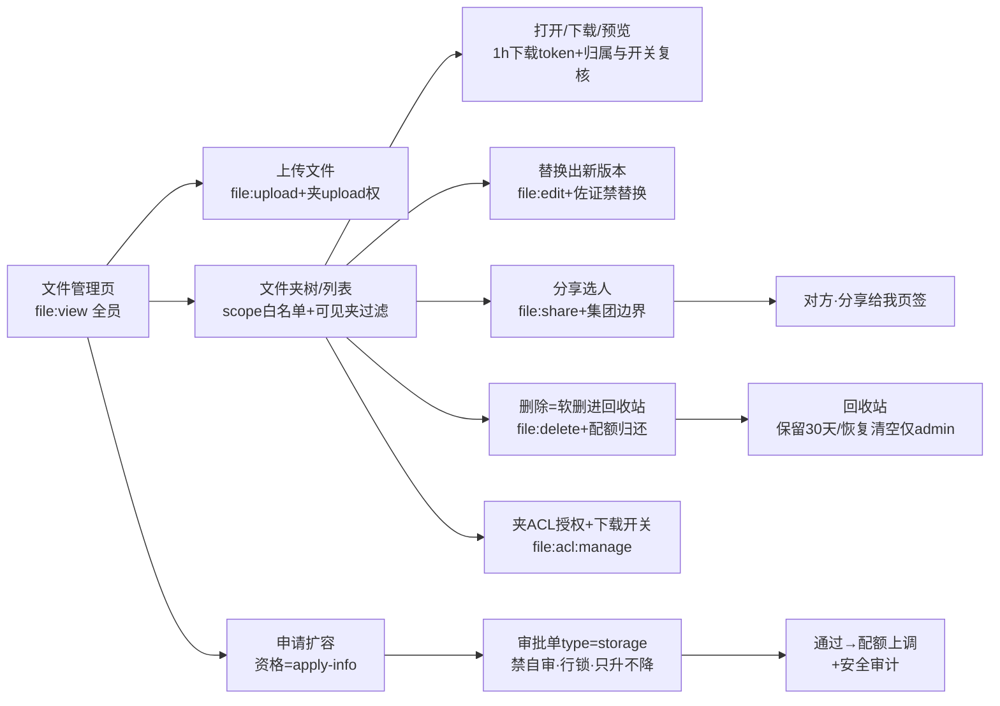

# PC·文件管理

> 审计口径：一律以代码为准；「谁能看到」列引用《菜单功能按钮数据范围验收表-20261107.md》，不重新推导。
> 前端根目录简写 `ui/` = `aigicrm-ui/src`，后端简写 `be/` = `aigicrm-backend/src/main/java`。

## 概述（侧栏位置/路由、权限码、谁能看到该菜单——引用验收表）

- **侧栏位置/路由**：业务核心组「文件管理」，路由 `/file`（`ui/router/index.js:77-80`，`meta.permission='file:view'`）；菜单行来自 `sys_menu` id=14（`sql/migration/20260802/sys_menu_all.sql:11`，`/file` / `file/index` / `file:view`）。
- **权限码全景**（按钮码均挂在菜单 14 下）：
  | 码 | 出处 | 后端消费 |
  |---|---|---|
  | `file:view` | sys_menu id=14 | 列表/树/存储/分享给我/下载/permissions 读（FileController.java:50,57,120,131,146,207,273,282；FolderAclController.java:47） |
  | `file:upload` / `file:delete` | sys_menu id=47/48（sys_menu_all.sql:11） | 上传（FileController.java:68）、删除文件（:98） |
  | `file:edit` | sys_menu id=81 | 替换（:106）、文件改名（:113） |
  | `file:share` | V26__split_file_mutation_permissions.sql:24-29 | 分享（FileController.java:266） |
  | `file:folder:manage` | 同上 :31-36 | 建/改/删文件夹（FileController.java:77,84,91）、对账（FileReconciliationController.java:28） |
  | `file:acl:manage` | rbac-convergence-m1.sql:28-31 建码；V2026.09.11.6__seed…sql:1130-1141 绑 admin/05/0/06 | ACL 读写五端点（FolderAclController.java:20,24,33,37,59） |
  - 历史事故记录：V22 曾把 upload/delete/edit/share/folder:manage 五码误停（status=0+删绑定，致全员含 admin 写端点 403），V2026.09.11.3__restore_file_mutation_permission_bindings.sql:1-126 恢复 status=1 并按 file:view 角色重建绑定——五码现为"持有 file:view 的角色默认继承"。
- **谁能看到该菜单**（验收表 §7 + 角色矩阵）：
  - 验收表 L95：「文件管理（file:view，**全员**）」。
  - 角色矩阵 L38：「文件管理 + 上传/删除/编辑/分享/ACL 五码 | admin ✓ | 总监 ✓ | 行政 ✓ | 销售员 ✓」。
  - 数据范围（验收表 L98，原样引用）：admin/总监=全公司文件（view=all，仍受夹 ACL 约束）；行政=本大区（region）+上传不限（upload=all）；销售员=本人上传+被 ACL/分享授权的夹（兜底 self）；"分享给我"=被点名的文件；四项服务页签=激励附件按激励可见性。
  - 页内按钮显隐的代码实现是**双重门**：全局权限码（`userStore.hasPermission`）× 文件夹级 ACL 权限位（`folderPerms`，来自 GET /file/folders/{id}/permissions 或树内嵌 perms），见 `ui/composables/useFilePage.js:88-98`、`ui/views/file/FolderPanel.vue:26-36,61-64`。

## 功能清单（每功能一行，说人话）

1. **四页签文件库**：公共/私人/四项服务/分享给我四个 Tab，各带计数徽标（`ui/views/file/index.vue:47-58`，计数来自 useFilePage.js:171-184）。
2. **文件夹树**：左侧树+「全部文件」根节点，按 scope 过滤且只显示我有权看的夹（be/…/file/service/FileService.java:115-152）。
3. **文件列表与全局搜索**：文件名/上传人/所在文件夹三字段 LIKE（FileService.java:161-166），分页 30/页。
4. **上传**：弹窗多选/拖拽，逐个直传，支持落到选中文件夹（ui/views/file/UploadDialog.vue）。
5. **预览**：图片渐进加载/视频/音频/PDF/Word/Excel/文本内嵌阅读器（ui/components/FilePreview.vue:19-49）。
6. **下载**：下载完成即用系统阅读器打开；下载走 1h 短时专用 token，主 JWT 不进 URL（be/…/FileController.java:36-48）。
7. **替换（出新版本）**：行内选定新文件覆盖，version+1，激励佐证禁替换（FileService.java:488-543）。
8. **分享**：点对点分享给同事（只读），对方在「分享给我」页签看到（FileService.java:1421-1487）。
9. **文件夹管理**：新建/重命名/删除（仅空夹），删除级联清 ACL（FileService.java:318-395）。
10. **夹级 ACL 权限**：按角色授 6 项权限（查看/上传/编辑/删除/分享/下载）+ 夹级下载开关（FolderAclController.java 全部）。
11. **删除=进回收站**：软删+配额即时归还，保留期 30 天到期自动清（FileService.java:404-450；FileRecycleCleanupTask.java:32-46）。
12. **存储配额与扩容申请**：顶部配额条+进度；「申请扩容」走 type=storage 审批，通过后自动调额+写安全审计（ApprovalService.java:225-240,962-968；SysUserService.java:653-676）。
13. **附件对账（后端 Only）**：元数据 vs 磁盘全量核对，无前端入口（FileReconciliationController.java:27-32）。
14. **文件改名（后端 Only，PC 未接）**：PUT /file/{id}/rename 仅小程序接入（FileController.java:113-118）。

## 按钮明细（每个功能块一张表）

### A. 宿主页顶部「存储概览条 + Tab」（ui/views/file/index.vue）

| 按钮 | 在哪 | 前端行为 | 后端动作 | 谁能看到 |
|---|---|---|---|---|
| 申请扩容 | index.vue:26-31 | `openStorageApply` 打开弹窗（useFilePage.js:248）；按钮载入 `/file/storage/apply-info` 资格（useFilePage.js:198-206），不可申请时禁用+tooltip 显示原因（index.vue:19-24,111） | 无（纯打开弹窗）；资格数据来自 GET /api/file/storage/apply-info（file:view）：读用户 used/quota、生效上限（配置键 file.storage.max.quota，钳位 [1GB,1TB]，SysUserService.java:575-604,679-700），资格=管理员∨开关开+在授权名单（SysUserService.java:607-637 同口径），再叠加在途单判定——有 reviewing/pending 的 storage 单则 canApply=false（FileController.java:137-143 → ApprovalService.java:984-993） | 全员可见按钮；**可点资格**由后端 apply-info 裁定（admin 恒可；非 admin 须开关+名单，SysUserService.java:575-585），无码（无 file:view）整页不可达 |
| 搜索框（回车） | index.vue:35 | `searchFiles` 回第 1 页重查（useFilePage.js:231） | GET /api/file/list（file:view）：scope 白名单（public/private/incentive 之外返回空页，FileService.java:173-175）→ 可见文件夹过滤（本人创建/上级链/ACL view/公共，:209-233 → FolderPermissionService.java:69-90 上级链）→ incentive 另加本人+shared=1 旁路（:186-201）→ 关键字三字段 EXISTS 子查询参数绑定无注入（:161-166） | 全员（能进本页者） |
| 新建文件夹 | index.vue:37 | 显隐=全局码 `file:folder:manage`（useFilePage.js:88）× Tab/夹 upload 权（useFilePage.js:93-98：公共根仅 admin）；点击 `openCreateFolder`（useFilePage.js:235） | 弹窗「创建」触发 POST /api/file/folders（file:folder:manage）——见 C 表 | 持 file:folder:manage 且当前夹有 upload 权者（公共根目录再叠加 admin） |
| 上传文件 | index.vue:38-39 | 显隐=非 incentive/shared_to_me Tab 且 `folderPerms` 含 upload（useFilePage.js:105-126：选中夹时来自 GET /file/folders/{id}/permissions，根目录硬编码：公共根非 admin 也含 upload——⚠️见疑点4）；点击 `openUpload`（useFilePage.js:234） | 弹窗「开始上传」触发 POST /api/file/upload（file:upload）——见 D 表 | 全员显示资格同上；⚠️公共 Tab 根目录非 admin 显示但后端必拒 |
| Tab 公共/私人/四项服务/分享给我 ×4 | index.vue:47-58 | `switchTab`：重置选中夹/页码，重拉树+权限+列表（useFilePage.js:214-221）；incentive/shared_to_me 两 Tab 不渲染文件夹树（index.vue:62-66），权限固定 view+download（useFilePage.js:106-110） | 每个 Tab 各发 GET /api/file/folders（file:view：scope 白名单+可见性过滤+批量填充 perms/fileCount，FileService.java:115-152）与 GET /api/file/list（见上）；分享给我 Tab 走 GET /api/file/shared-to-me（file:view：biz_file_share 按 shared_to=本人 取 fileId 集合再查 biz_file，keyword 同款三字段，FileService.java:1466-1487）与计数 GET /api/file/shared-to-me/count（:1489-1498） | 四 Tab 全员可见；**数据行**按上述范围裁定（验收表 L98） |

### B. 左侧文件夹树（ui/views/file/FolderPanel.vue）

| 按钮 | 在哪 | 前端行为 | 后端动作 | 谁能看到 |
|---|---|---|---|---|
| 「全部文件」根节点 | FolderPanel.vue:6-11 | `selectFolder(null)` 回根（useFilePage.js:223-228，重拉权限+列表） | GET /api/file/list（folderId 空则返回无夹文件+可见夹文件集合，FileService.java:209-233） | 全员 |
| 文件夹行（选中） | FolderPanel.vue:14-20 | `selectFolder(folder)`，选中即调 GET /file/folders/{id}/permissions 刷新按钮权限（useFilePage.js:223-228,105-126） | GET /api/file/folders/{id}/permissions（**file:view**，2026-11-01 由 acl:manage 降码，FolderAclController.java:42-50）：admin→6 项全；夹主/上级链→6 项全（FolderPermissionService.java:93-114,98-100）；ACL 角色匹配→并集；公共夹兜底 view+download（:109-112）；夹不存在返回空 | 全员（树内只渲染可见夹，可见性=本人创建/上级链/ACL view/公共，FileService.java:132-136,1144-1169） |
| 重命名（悬停铅笔） | FolderPanel.vue:27-29 | 显隐=夹 perms 含 edit **且** 全局码 file:folder:manage（useFilePage.js:88；FolderPanel.vue:26）；打开 RenameFolderDialog | 弹窗「保存」触发 PUT /api/file/folders/{id}（file:folder:manage）——见 C 表 | 夹主/上级链/ACL edit 持有者 且 勾了 file:folder:manage 的角色 |
| 权限设置（悬停齿轮） | FolderPanel.vue:30-32 | 显隐=夹 perms 含 edit **且** 全局码 `file:acl:manage`（FolderPanel.vue:61-64，2026-11-01 审计修复：无码者不再看到恒 403 空壳入口）；打开 AclDialog | 弹窗内各按钮触发 FolderAclController 五端点（file:acl:manage）——见 G 表 | 持 file:acl:manage（admin/05/0/06，V2026.09.11.6 迁移绑定）且对该夹有 edit 权者 |
| 删除（悬停垃圾桶） | FolderPanel.vue:33-35 | 显隐=夹 perms 含 delete 且 file:folder:manage（FolderPanel.vue:26,33-35）；`handleDeleteFolder`：红色确认框文案已对齐后端"仅空夹可删"（useFilePage.js:297-312）；成功后清选中、刷新树/权限/列表 | DELETE /api/file/folders/{id}（file:folder:manage）：夹存在性→P_DELETE 权限（admin/夹主/上级链/ACL，FolderPermissionService.java:45-56）→夹内有未删文件拒绝（"请先清空"，FileService.java:377-383）→有子夹拒绝（:385-389）→级联删该夹全部 ACL 行防孤儿（:392）→删夹 | 同重命名（换 delete 权位） |
| 个人存储空间进度条 | FolderPanel.vue:42-46 | 仅私人 Tab 渲染，读共享态 storagePercent | 数据来自 GET /api/file/storage（file:view）：读 sys_user.storage_used/storage_quota 并格式化（FileService.java:1127-1137） | 全员（私人 Tab） |

### C. 文件夹新建/重命名弹窗（ui/views/file/CreateFolderDialog.vue、RenameFolderDialog.vue）

| 按钮 | 在哪 | 前端行为 | 后端动作 | 谁能看到 |
|---|---|---|---|---|
| 创建 | CreateFolderDialog.vue:10 | `handleCreateFolder`：非空名校验，POST /file/folders 带 {folderName, folderType=当前Tab, parentId=选中夹\|\|0}（CreateFolderDialog.vue:24-37），成功刷树 | POST /api/file/folders（**file:folder:manage**，FileController.java:77-82）：folderType 白名单仅 public/private（FileService.java:322-324）；parentId=0 归一化为根（0 是 DDL 哨兵，:329-331 修复 PC/MP 传 0 被 403 的事故）；子夹→父夹 P_UPLOAD 校验（:335-338）；公共根（无父）→仅 admin（:339-341）；私人夹 ownerId=当前人（:342-344）后 insert | 弹窗入口见 A 表「新建文件夹」 |
| 取消 | CreateFolderDialog.vue:9 | 关弹窗 | — | 同上 |
| 保存（含输入框回车） | RenameFolderDialog.vue:10,5 | `handleRenameFolder`：trim 非空→PUT /file/folders/{id} {folderName}（RenameFolderDialog.vue:31-40）；打开时回填原名（watch :25-29） | PUT /api/file/folders/{id}（**file:folder:manage**，FileController.java:84-89）：非空校验→P_EDIT 权限唯一仲裁（FileService.java:348-363→FolderPermissionService.check）→updateById 改名 | 夹主/上级链/ACL edit 且持 file:folder:manage |
| 取消 | RenameFolderDialog.vue:9 | 关弹窗 | — | 同上 |

### D. 上传弹窗（ui/views/file/UploadDialog.vue）

| 按钮 | 在哪 | 前端行为 | 后端动作 | 谁能看到 |
|---|---|---|---|---|
| 拖拽区（点击选择/拖放） | UploadDialog.vue:3-20 | 点击 `pickFiles`（:44）调起多选 input（:19）；拖放 `handleDrop` 合并待传列表（:45-48）；提示语按 Tab 区分公共/私人（:16-18） | — | 弹窗由「上传文件」按钮唤起（A 表） |
| 取消 | UploadDialog.vue:22 | 关弹窗并清空待传（@close :2） | — | 同上 |
| 开始上传（N 个） | UploadDialog.vue:23-25 | `startUploads` 逐个 `uploadOne`（:65-80）：FormData 带 file+scope+folderId（folderId 为 null 不携带，防后端 400，:59-60）；单文件超时 600s（:61）；全部完成汇总成功/失败名单并 `refreshAll`（useFilePage.js:209-211 刷列表/树/计数/配额） | POST /api/file/upload（**file:upload**，FileController.java:68-75）：①scope 白名单 public/private/incentive 之外 403（FileService.java:255-257）；②公共 scope+无夹+非 admin→拒绝"公共根目录文件仅管理员可上传"（:262-264，与匿名公共下载通道对称的门槛）；③落夹→夹 P_UPLOAD 校验（:267-269）；④私人 scope→`tryConsumeQuota` DB 端原子扣配额（WHERE used+size<=quota，并发安全，:273-280）；⑤文件名消毒防路径穿越（sanitizeFilename :1183-1191）+扩展名白名单（30 类，html/svg/js 等被拒、无扩展名拒绝，:1199-1230）→落盘 scope/userId/唯一文件名（重名加 (1) 后缀 :1235-1254）→本地写后回读字节数校验（:620-630）→插 biz_file；失败补偿归还配额（:310-315）。无重算/通知副作用 | 入口按 A 表；后端再按 scope/夹权二次裁定 |

### E. 文件列表行操作（ui/views/file/FileTable.vue）

| 按钮 | 在哪 | 前端行为 | 后端动作 | 谁能看到 |
|---|---|---|---|---|
| 打开（眼睛） | FileTable.vue:29-31 | `handlePreview`：先 `refreshDownloadToken`（utils/token.js:60,75 → GET /api/file/download-token）再拼下载 URL，按扩展名定预览种类（useFilePage.js:261-271）→ FilePreview 弹窗 | GET /api/file/download-token：签发 1h 专用下载 token（scope=download），并携带主 token 的 jti——登出拉黑主 token 后下载 token 联动失效（FileController.java:36-48）；预览内容走 GET /api/file/download/{id}（见「下载」行） | 全员（列表可见即可打开预览——预览与下载同一鉴权端点，实际可看面由后端裁定） |
| 下载 | FileTable.vue:32-34 | 显隐=夹 perms 含 download **且** `folderDownloadable===1`（FileTable.vue:32；permissions 接口返回）；`handleDownload`：下载保存后自动唤起预览弹窗（2026-10-17 客户口径"下载完成即打开"，useFilePage.js:273-283）；带实时 Bearer 头（防切换集团旧 token，:276-281 注释） | GET /api/file/download/{id}（file:view，FileController.java:146-153）：`canDownloadFile` 判定（FileService.java:1302-1321）= canAccessFile（admin/公共文件/上传者/被分享者 :1272-1281）∨ 夹 P_DOWNLOAD ∨ 激励文件按 admin∨can_view_all∨shared 可见（:1307-1310）；再叠加**夹级下载开关**——非 admin 且夹 downloadable≠1 一律仅预览不可下（:1314-1319）；本地文件支持 Range 断点/206（:769-783）与 ≤300px 缩略图分支（thumbnail 参数 :757-760）；OSS 文件 302（仅 https:// 白名单，:811-815）；Content-Disposition：纯图/视频/PDF inline，SVG/HTML 等活性内容强制 attachment 防存储型 XSS（:733-738）。另有按 key 的 GET /api/file/download/**（:207-262，同权 canDownloadFile+路径穿越 normalize 校验 :216-219）与匿名 GET /api/file/download/public/**（:155-205，无登录、物理路径限 public/ 段+元数据须 file_scope=public+忽略租户拦截器专用查询，:175-188） | 夹内文件=有 download 权位且开关开者；根级公共文件=全员（含匿名）；根级私人/激励=上传者/被分享者/admin |
| 分享 | FileTable.vue:35-37 | 显隐=非 public/shared_to_me Tab 且夹 perms 含 share；`openShareDialog`（useFilePage.js:240-243） | 弹窗「确认分享」触发 POST /api/file/{id}/share（**file:share**，FileController.java:266-271）——见 F 表 | 私人/四项服务 Tab 中有夹 share 权位者 |
| 替换 | FileTable.vue:38-40 | 显隐=夹 perms 含 edit；`openReplaceFile` 触发隐藏 input 选文件（FileTable.vue:64,88-91）；选定后 `handleReplaceChosen` POST 替换并提示"替换成功，版本 N"（:93-113），刷列表/树/计数 | POST /api/file/{id}/replace（**file:edit**，FileController.java:106-110）：`checkFile(P_EDIT)`（admin/夹 edit 权/无夹文件按上传者+上级链，FolderPermissionService.java:59-66）→**激励计分佐证禁替换**（五槽任一被激励记录引用即拒绝，引导走激励模块删除重传触发重算，FileService.java:499,579-595）→@Transactional：新文件先落盘（旧扩展兜底过白名单 :504-506,609-617）→更新 oss_key/oss_url/file_size/version+1/replace_by/replaced_at（:513-522）→私人文件按差额原子调配额（同事务 :528-530）→**旧文件物理删除注册 afterCommit**（回滚不删防"报失败但文件已丢"，:531-534,549-561）；失败路径 best-effort 清孤儿新媒体（:536-541,568-575）；清旧版本缩略图缓存（:523-525） | 夹主/上级链/ACL edit 且持 file:edit 码 |
| 删除 | FileTable.vue:41-43 | 显隐=夹 perms 含 delete；`handleDelete`：确认框文案"移入回收站，保留期内可由管理员恢复"（useFilePage.js:286-295）→DELETE 成功后 `refreshAll` | DELETE /api/file/{id}（**file:delete**，FileController.java:98-103）：非 admin 时夹内文件按 P_DELETE（FolderPermissionService.checkFile）、公共根文件仅 admin、私人/激励根文件仅上传者本人、其余 scope 一律拒绝（IDOR 修复，FileService.java:417-431）→@Transactional 逻辑删（deleted=1）影响行数≠1 即并发重复删，幂等成功不二次退款（:438-442）→清缩略图缓存（:444）→私人文件 DB 原子归还配额（:447-449）；**不物理删字节**——回收站保留期由定时任务清（FileRecycleCleanupTask.java:32-46，每天 03:30，sys_config file.recycle.retention.days 默认 30，0=不清理）；物理清空/恢复入口在系统管理→回收站（RecycleService） | 夹内文件=有夹 delete 权位且持 file:delete；根级按 scope 归属（见左） |
| 分页器 | FileTable.vue:51-60 | 改页/改每页条数→`loadFiles`（keyword 搜索回第 1 页由 searchFiles 单独处理，useFilePage.js:230-231） | 同列表 GET（范围过滤每次请求都重新生效） | 全员 |

### F. 分享弹窗（ui/views/file/ShareDialog.vue）

| 按钮 | 在哪 | 前端行为 | 后端动作 | 谁能看到 |
|---|---|---|---|---|
| 确认分享 | ShareDialog.vue:11 | 多选用户（懒加载 GET /customer/users/simple 简版字典，ShareDialog.vue:28-35；api/customer.js:73-74）→`confirmShare` POST 分享→刷 Tab 计数（:37-45） | POST /api/file/{id}/share（**file:share**）：夹内文件按 P_SHARE（admin/夹主/上级链/ACL share，FileService.java:1430-1433）；无夹文件仅上传者本人（:1434-1436）；**集团边界守卫**——目标用户不在当前集团直接拒绝（GroupScopeUtil 比对，防跨集团死行，:1440-1451）；逐目标幂等去重插 biz_file_share（已存在跳过，:1452-1464）；只读语义（被分享人获得查看/下载权，无写权） | 私人/四项服务 Tab 有夹 share 权位且持 file:share 者（验收表 L38：四角色均有码；实际按钮再看夹权位） |
| 取消 | ShareDialog.vue:10 | 关弹窗 | — | 同上 |

### G. 权限设置（夹级 ACL）弹窗（ui/views/file/AclDialog.vue）

| 按钮 | 在哪 | 前端行为 | 后端动作 | 谁能看到 |
|---|---|---|---|---|
| 角色多选（字典） | AclDialog.vue:5-7 | 打开弹窗懒加载 GET /file/folders/acl-roles（AclDialog.vue:89-97）——专用轻量端点替代要求 system:role:view 的 /system/roles，修复 05/06 及非 admin 夹主打开时下拉恒空（api/file.js:56-58 注释） | GET /api/file/folders/acl-roles（**file:acl:manage**，FolderAclController.java:58-62）：只暴露启用角色的 id+名称最小面（FolderAclService.java:55-64） | 弹窗入口本身需 file:acl:manage（FolderPanel.vue:30-32,61-64）+ 夹 edit 权位 |
| 保存授权 | AclDialog.vue:14-16 | 选角色+勾 6 项权限（查看/上传/编辑/删除/分享/下载，PERM_OPTIONS :60-67）→**逐角色循环** POST /file/folders/{id}/acl（:106-108）→刷 ACL 列表与列表页按钮权限（:112-114）；⚠️循环中途失败 catch 静默，无部分成功提示（见疑点7） | POST /api/file/folders/{id}/acl（**file:acl:manage**，FolderAclController.java:23-30）：body 畸形（缺 roleId/非数字/perms 非数组）→"参数错误"不冒泡 500（FolderAclService.java:71-87）；每次仍先 `requireEdit` 夹 P_EDIT（:130-135）→权限项白名单校验（6 项之外拒绝 :93）→按 (folderId,roleId) upsert biz_folder_acl，新插记 createdBy（:95-104） | 持 file:acl:manage 且对该夹有 edit 权者（admin/夹主/上级链） |
| 下载开关（el-switch） | AclDialog.vue:24 | `handleDownloadableChange` PUT {downloadable:0\|1}，失败回滚开关态（:133-145）；即时回写共享态 folderDownloadable | PUT /api/file/folders/{id}/download（**file:acl:manage**，FolderAclController.java:36-40）：requireEdit→值域 0/1 校验→更新 biz_file_folder.downloadable（FolderAclService.java:113-120）；开关在下载端点生效（非 admin 且 ≠1 的夹内文件拒绝下载字节，FileService.java:1314-1319） | 同上 |
| 移除（已授权角色行） | AclDialog.vue:36 | DELETE /file/folders/{id}/acl/{roleId}→刷列表（:122-131） | DELETE /api/file/folders/{id}/acl/{roleId}（**file:acl:manage**，FolderAclController.java:32-34）：requireEdit→删对应 ACL 行（FolderAclService.java:107-111） | 同上 |
| （读）已授权角色列表 | AclDialog.vue:29-40 | 打开弹窗 GET /file/folders/{id}/acl 渲染 | GET /api/file/folders/{id}/acl（**file:acl:manage**，FolderAclController.java:19-21）：requireEdit→ACL 行展开 roleId→角色名+perms 数组（FolderAclService.java:36-47） | 同上 |

### H. 存储扩容申请弹窗（ui/views/file/StorageApplyDialog.vue）

| 按钮 | 在哪 | 前端行为 | 后端动作 | 谁能看到 |
|---|---|---|---|---|
| 提交申请 | StorageApplyDialog.vue:51 | `handleSubmit`：前端预检——整数 GB、须大于当前配额（min=当前+1GB，:72,90-92）、不超上限（max 向下取整 :71,94-96）、理由非空≤200 字（:98-105）→`submitApproval({type:'storage', extraData:{quota(bytes), reason}})`（:109-112）→成功关弹窗并只刷 apply-info 资格（:114-115，不重拉列表） | POST /api/approval/submit（审批模块）：类型白名单（claim/transfer/extend/storage，ApprovalService.java:77,217-220）；storage 分支：解析 extraData（quota 正整数 bytes、reason 规范化 1-200 字，ApprovalService.java:225-240→parse :996-1040、SysUserService.java:640-649）→**申请人行 SELECT…FOR UPDATE 串行化**（:231-233）→资格/只升不降/上限复核（SysUserService.java:607-637）→在途单拒绝（:234-236）→extraData 规范化落单（忽略客户端 oldQuota，库取当前值快照 :239,1042-1048）。审批通过执行侧：申请人行锁内再复核（并发导致不升反降→明确报错随事务回滚）→改 sys_user.storage_quota→**写安全审计**（oldQuota/newQuota/approvalId，SysUserService.java:653-676）。禁自审由审批中心通用规则保证（验收表/审批章节） | 按钮「可点资格」由 GET /file/storage/apply-info 裁定：admin 恒可；非 admin 须系统开关开+在授权名单 JSON（SysUserService.java:575-585）；配额已达上限也关入口（:587-589）；有在途单入口置灰并提示（FileController.java:137-143） |
| 取消 | StorageApplyDialog.vue:50 | 关弹窗 | — | 同上 |

### I. 预览弹窗（ui/components/FilePreview.vue，由「打开/下载」唤起）

| 按钮 | 在哪 | 前端行为 | 后端动作 | 谁能看到 |
|---|---|---|---|---|
| 关闭 | FilePreview.vue:52 | 关弹窗 | — | 随预览入口 |
| 下载文件 | FilePreview.vue:53 | `download()`：downloadFile 保存本地副本（带实时 Bearer 头），成功提示"已下载"（:113-120）——只存副本不再弹新页（:108-110 注释口径） | 同「下载」行的 download/{id} 端点（每次请求重新鉴权+下载开关复核） | 随预览入口；可否取到字节仍由后端裁定 |
| （渲染器）图片渐进/视频/音频/PDF/Docx/Sheet/Text | FilePreview.vue:19-49 | 按扩展名 previewKindOf 分流，重渲染器按需懒加载不进首屏（:66-70）；图片先缩略秒开再换高清（:95-106） | 内容流同 download/{id}（图片缩略图走 thumbnail 参数分支，FileService.java:829-890，缓存键含 version/mtime 防替换后旧图命中） | 同上 |

## 业务链条（mermaid + 文字链）

文字链：**上传**（file:upload+夹 upload 权，公共根仅 admin）→**树/列表**（可见夹过滤+激励 shared 旁路）→**打开/下载/预览**（短时下载 token、夹级下载开关）→**分享选人**（集团边界内点对点）→**对方「分享给我」页签**预览下载；支线①**替换/删除**（删除=软删→回收站，30 天保留期定时清，恢复/清空按钮仅 admin）；支线②**夹 ACL 授权**（六项权限+下载开关，file:acl:manage）；支线③**申请扩容**（apply-info 资格→type=storage 审批→通过配额上调+审计）。对应《页面按钮全量对照-20261107.md》§0 业务链：**#11 文件协作链、#12 文件扩容链、#18 回收站链**（删除入回收站段）、#14 审批中枢链（storage 单审批段）。

## ⚠️ 疑点（9 条核查重点中与本章节相关者 + 本次新发现）

**疑点1（核查重点 #5：激励分享制 29 条授权 can_view_all 全=0）——已核实，PC 文件中心与分享制同源，无缺陷。**
「四项服务」Tab 列表与下载共用一套激励可见性：全量旁路=admin∨`biz_incentive_grant.can_view_all=1`（FileService.java:186-190,1293-1300），否则=本人上传 ∨ 他人 shared=1 记录五槽附件并集（:191-201,1330-1390，指纹+30s TTL 缓存 :55-58,1348-1366）。销售员 can_view_all 全 0（验收表 §9 登记）→ 在文件中心只能看到自己上传的激励附件+被点对点分享的，与激励模块分享制口径一致。旁路数据源与激励模块同表（IncentiveService.java:49-51），非独立配置。

**疑点2（核查重点 #8：总监无回收站恢复/清空按钮）——已核实，代码与验收表一致；总监删除文件后依赖 admin 兜底。**
文件删除为软删（FileService.java:404-450），字节保留至回收站保留期（默认 30 天，FileRecycleCleanupTask.java:26,32-46，sys_config `file.recycle.retention.days`）；恢复/清空入口在系统管理→回收站「已删除文件」页签，前端按钮显隐用 `system:recycle:restore`/`system:recycle:purge`（ui/views/system/recycle.vue:350-351,48-50,218）。验收表角色矩阵：「回收站」菜单 admin✓总监✓，而「恢复/清空回收站按钮」仅 admin✓总监✗——即总监在文件页删错文件无法自恢复，需找 admin。口径成立，登记提醒业务侧。

**疑点3（核查重点 #4：行政激励 view-all=region 与文件中心的口径分叉）——待核生产授权行。**
文件侧激励全量旁路只认 `can_view_all=1` 这一个布尔（FileService.java:1293-1300），**没有 region/大区维度**；且激励模块自身的"看全部"资格还叠加 can_edit/can_delete 旁路（IncentiveService.java:185-191），文件侧没有这两个旁路。若行政的激励授权行是"本大区"档位（can_view_all=0，大区范围另存），则行政在激励查询能看本大区全部记录，但在 PC 文件中心「四项服务」Tab 看不到本大区未分享记录的附件（只能看本人+shared=1）→ 同一份材料两端可见面不一致。验收表 L98 写"四项服务页签=激励附件按激励可见性"，未明确 region 是否传导到文件侧。**待核**：生产 `biz_incentive_grant` 行政行的实际字段值，及产品预期（附件可见是否要求跟随大区）。

**疑点4（本次新发现）公共 Tab 根目录「上传文件」对非管理员是"必败按钮"。**
前端根目录权限硬编码：非管理员公共根= `['view','upload','download']`（useFilePage.js:113-117），于是「上传文件」按钮在公共 Tab 根目录对普通用户可见可点（index.vue:38-39）；但后端明确拒绝——公共 scope+无夹+非 admin 抛"公共根目录文件仅管理员可上传"（FileService.java:262-264，2026-10-27 加的门槛，与匿名公共下载通道对称）。2026-10-27 已对「新建文件夹」修过同款不对称（canCreateFolder 公共根叠加 isAdmin，useFilePage.js:85-98 注释），**上传按钮未同步修**：普通用户每次点都会得到失败提示。建议同款收口（公共根非 admin 隐藏按钮或改 tooltip 说明）。

**疑点5（本次新发现）PC 端无「文件改名」入口——后端端点已上线但 PC 未接。**
PUT /api/file/{id}/rename 于 2026-11-06 上线（FileController.java:113-118，file:edit+checkFile(P_EDIT)，仅改 file_name 不动物理对象，FileService.java:459-474），当前只有小程序接入（aigicrm-miniprogram/api/file.js:57-59、pages/files/index.js:1145）；PC `api/file.js` 无 renameFile 函数（全文核对 ：1-83），FileTable 行操作只有 打开/下载/分享/替换/删除 五个（FileTable.vue:29-43）。PC 用户无法改文件名——若产品预期双端同功能，PC 需补按钮。

**疑点6（本次新发现）附件对账端点无任何前端入口，且仅 local 存储模式有效。**
GET /api/file/reconciliation（file:folder:manage，FileReconciliationController.java:27-32）在全前端（PC aigicrm-ui + 小程序）零调用（本次 `grep -rn "file/reconciliation"` 仅命中 PermScopeManager.vue 中无关的"范围对账"注释）；Service 自认潜伏项——存在性检查只查本地磁盘，`STORAGE_TYPE=oss` 部署后对账失真（FileReconciliationService.java:27-28 注释、:91-100 仅 Files.exists）。当前只能手工调 API 做数据治理；若切 OSS 需先补 OSS 探测。

**疑点7（本次新发现）ACL「保存授权」多角色循环无部分失败提示。**
选中多个角色时前端逐角色串行 POST（AclDialog.vue:106-108），任一失败即中断循环进 catch 静默（:115-116）——已成功的角色不提示、失败角色不点名，用户只看到"无反应"。低频操作且每笔后端都有独立校验（FolderAclService.java:89-105），影响为体验而非数据正确性；建议改为汇总成功/失败名单（同上传弹窗的 failedNames 模式 UploadDialog.vue:75）。

**疑点8（备查）「下载」按钮的实际行为=保存+自动打开阅读器。**
`handleDownload` 在 downloadFile 成功后立刻 `handlePreview(row)`（useFilePage.js:273-283），即点一次「下载」会先后出现保存与预览两个动作——这是 2026-10-17 按客户口径"下载完成即用系统文件阅读器打开"刻意实现的（代码注释在案），非缺陷；但与图标语义有出入，pptx 等浏览器不可渲染格式会弹"暂不支持"说明（文件本体已存本地）。培训口径需说明。

---
### 附：端点覆盖清单（本章节实际核对的后端端点，共 26 个）

FileController（18）：GET /file/download-token、GET /file/folders、GET /file/list、POST /file/upload、POST /file/folders、PUT /file/folders/{id}、DELETE /file/folders/{id}、DELETE /file/{id}、POST /file/{id}/replace、PUT /file/{id}/rename（PC 未接）、GET /file/storage、GET /file/storage/apply-info、GET /file/download/{id}、GET /file/download/public/**、GET /file/download/**、POST /file/{id}/share、GET /file/shared-to-me、GET /file/shared-to-me/count。
FolderAclController（6）：GET /file/folders/{id}/acl、POST /file/folders/{id}/acl、DELETE /file/folders/{id}/acl/{roleId}、PUT /file/folders/{id}/download、GET /file/folders/{id}/permissions、GET /file/folders/acl-roles。
FileReconciliationController（1）：GET /file/reconciliation（无前端入口）。
审批模块（1）：POST /approval/submit（type=storage 扩容链；其 approve 侧 storage 执行段随审批章节详审）。
辅助字典（未计入）：GET /customer/users/simple（ShareDialog 用户下拉，api/customer.js:73-74）。
