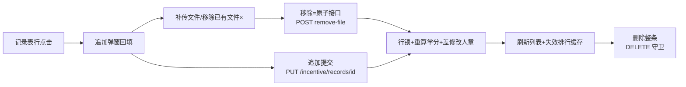
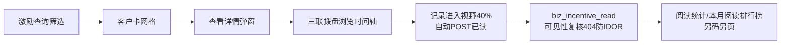
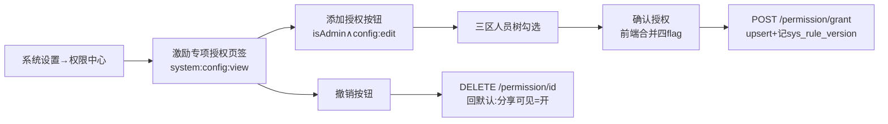

# PC·四项激励

> 审计基准：以 2026-11-08 仓库源代码为准（前端 aigicrm-ui/src、后端 aigicrm-backend/src/main/java）；三份 docs 参考文档仅作骨架与「谁能看到」列的引用来源，正文一律以代码证据为准。
> 仓库根：`/Users/dongjun/东来/项目/02-已上线/01-AIGICRM/02-迭代源代码`（下文相对路径均以此为基）。

## 概述

- **侧栏位置/路由**（`aigicrm-ui/src/router/index.js`）：
  - 激励上传 `/incentive`（index.js:84-93，meta 权限码 `incentive:add`，parentTitle「四项激励」）
  - 激励统计 `/incentive/stats`（index.js:95-102，码 `incentive:stats:view`）；下钻明细 `/incentive/stats/detail/:childId`（index.js:105-110，同码）
  - 激励查询 `/incentive/search`（index.js:112-117，码 `incentive:view`）
  - 案例库 `/case-library`（index.js:122-126，码 `incentive:view`，parentTitle「四项服务」）
  - 授权管理不在本组侧栏：位于 系统设置→权限中心→「激励专项授权」页签（`views/system/PermCenter.vue:25`），页面码 `system:config:view`
- **谁能看到该菜单**（引自《菜单功能按钮数据范围验收表-20261107.md》第 39-41 行，不重新推导）：「四项激励组（上传/查询/统计+查看/排行/编辑/阅读统计）」admin ✓ / 总监 ✓ / 行政 ✓ / 销售员 ✓；「案例库（四项服务组）」四角色 ✓；授权面板本身见验收表 §13（权限中心，system:config:view/edit，canEdit=isAdmin∧system:config:edit）。
- **权限码全景**：`incentive:view`（查询/案例库/记录列表数据面）、`incentive:add`（上传）、`incentive:stats:view`（统计表）、`incentive:rank:view`（排行页签）、`incentive:rank:export`（客户排行导出，默认仅 admin，RankTableView.vue:9-11 注释）、`incentive:person-rank:export`（个人排行导出，PersonRankTableView.vue:8-9）、`incentive:read-stats`（阅读统计，工作台卡，dashboard/index.vue:350-351）、`incentive:read-ranking:view`（本月阅读排行榜，仅 admin，router/index.js:291-300）。旧码 `incentive:view-shared / view-all / manage` 已废弃（IncentivePermissionController.java:19 注释），改为用户级授权表 `biz_incentive_grant` 四开关（can_view_shared/can_view_all/can_edit/can_delete，IncentiveService.java:165-171）。
- **数据面两种可见性口径并存**（后端 IncentiveService.java）：
  - 记录列表（`GET /incentive/records`、分类角标、客户学分）：分享制——`canSeeAllIncentive`（admin∨can_view_all∨can_edit∨can_delete，IncentiveService.java:189-194）→ 全量；否则「本人 ∨ (shared=1 ∧ can_view_shared)」（applyShareVisibility，IncentiveService.java:202-210）。
  - 客户分组面（`GET /incentive/customer-records`，激励查询/案例库共用）：2026-11-05 用户拍板改走**组织范围档位**——客户属 (customer,view) 数据范围 ∨ 本人上传恒可见；can_view_shared/shared=1 在本面退役（orgScopeVisibleCustomerIds/applyOrgQueryVisibility，IncentiveService.java:212-246）。
  - 统计家族（category-stats/scoreboard，2026-11-04 收口）：按独立档位 (incentive, stats_view) 解析可见人员集（statsVisibleUserIds，IncentiveService.java:873-880；客户排行按可见客户 statsVisibleCustomerIds:883-893）。

## 功能清单（每功能一行，说人话）

- **激励上传**：选大类→子分类→「上传文件」弹窗→选客户/行业/产品→传佐证文件（前/中/后三槽或单槽+跟踪记录）→提交落库并按分类规则计分。
- **记录追加与编辑**：记录表行点开追加弹窗，补传/移除已有文件（原子移除+学分重算）、改共享开关、删整条记录。
- **激励查询**：按客户卡片检索全量激励案例（关键字/同事/产品/两级分类/开发类型/日期/组织树），详情弹窗三联拨盘看时间轴，滚动到哪条自动上报已读。
- **激励统计**：顶部个人概览卡 + 三页签——激励统计表（可下钻明细）、客户排行（可导出）、个人排行（可导出）。
- **案例库**：四项服务照片墙，点卡片灯箱翻看该案例全部照片/视频，给客户展示用，不显示分值。
- **阅读上报**：查询详情内记录进入视野 40% 自动 POST 已读，喂给阅读统计/本月阅读排行榜。
- **授权管理**：系统设置→权限中心里按人/按角色勾四个开关（看分享/看全部/编辑他人/删除他人），撤销即回到默认（分享可见=开，其余=关）。

## 按钮明细

### 块 1｜激励上传页·页面骨架与筛选（/incentive，码 incentive:add）

| 按钮 | 在哪 | 前端行为 | 后端动作 | 谁能看到 |
|---|---|---|---|---|
| 分类 Tab ×4（外出参观/交流拜访/两谈两做方案/产品试点） | views/incentive/index.vue:6（`@click` 切 activeTab，角标 `_recordCount` index.vue:9） | 切 activeTab，watch 清子分类筛选并重查（useIncentiveUpload.js:827） | 拉取记录列表：按分享制过滤本人∨已分享，按周期/大类过滤，批量填充分类/人员/客户/文件名（GET /incentive/records，IncentiveController.java:52-64 → IncentiveService.getRecords:344-408） | 有 incentive:add 的角色（验收表：四角色全员） |
| 子分类行点击 | views/incentive/SubCategoryPanel.vue:16（toggleCategoryFilter） | 行选中过滤右侧表格，再点取消（useIncentiveUpload.js:80,258，纯客户端） | 无请求 | 同上 |
| 折叠/展开子分类面板 | SubCategoryPanel.vue:8,27（localStorage 持久化 :43-51） | 面板收成窄轨 | 无请求 | 同上 |
| 筛选栏·部门树 | views/incentive/IncentiveFilterBar.vue:7-16（onDeptChange） | 选部门→人员下拉换成该部门可见用户并重查（useIncentiveUpload.js:355-368） | 范围感知部门树 GET /common/scope/depts（useIncentiveUpload.js:347-352）；部门成员 GET /common/scope/users（:358） | 同上 |
| 筛选栏·人员下拉 | IncentiveFilterBar.vue:20-22（selectedUser） | 触发 loadRecords 重查 | GET /incentive/records?userId=…：显式传人时校验可见性——admin/专项授权→全部；本人→全部；他人→仅当其有 shared=1 记录且 can_view_shared（canViewIncentiveUser，IncentiveService.java:1129-1138；getRecords:346-353） | 同上；人员下拉数据源 getUserList（GET /incentive/users，IncentiveController.java:229-233）与查看语义同口径（本人+有分享记录的作者；授权者全量，IncentiveService.java:84-116） |
| 筛选栏·周期下拉 | IncentiveFilterBar.vue:26-28 | 重查（空串=全部，省略参数 useIncentiveUpload.js:373-374） | 后端空白周期不做等值过滤（getRecords:361） | 同上 |
| 筛选栏·行业/时间区间 | IncentiveFilterBar.vue:32,38 | 纯客户端过滤（useIncentiveUpload.js:259-264），不发请求 | 无请求 | 同上 |
| 筛选栏·文件名/客户名搜索框 | IncentiveFilterBar.vue:50-51 | 纯客户端过滤（useIncentiveUpload.js:247-253） | 无请求 | 同上 |
| 「分类：xx」可关标签 | IncentiveFilterBar.vue:55-57 | 关闭即恢复全部子分类 | 无请求 | 同上 |
| 隐藏文件选择框 | index.vue:30-36（handleFileSelected） | 按当前槽位追加所选文件，每槽≤5 超限提示不静默截断（useIncentiveUpload.js:667-685） | 无请求（提交时才传） | 同上 |

### 块 2｜记录表（RecordTable.vue，追加/编辑/删除/共享入口）

| 按钮 | 在哪 | 前端行为 | 后端动作 | 谁能看到 |
|---|---|---|---|---|
| 行点击（整行） | RecordTable.vue:4（@row-click="startReplace"，cursor:pointer） | 打开追加弹窗回填已有文件/字段（useIncentiveUpload.js:486-527；预热下载 token :493） | 无请求（提交时 PUT）；加载 sharedCustomerIds：GET /customer/list?scope=shared_to_me（useIncentiveUpload.js:541-548） | 所有能进本页者；但**写动作**受后端守卫（见「追加提交」行） |
| 前/中/后文件标签 | RecordTable.vue:22-24（previewFile） | 取槽位首个文件打开 FilePreview 预览（useIncentiveUpload.js:62-71，拼 download token） | GET /api/file/download/{id}（带 ?thumbnail=1 为缩略图，useIncentiveUpload.js:569） | 所有能进本页者（文件下载另有 token 校验） |
| 共享 switch | RecordTable.vue:46-50（仅 isRecordOwner 渲染可点版，非本人显示 ●共享/— 文本 :52） | 开=全员可见/关=仅本人+授权，仅本人可改（toggleShare，useIncentiveUpload.js:470-483；非本人直接拒绝 :472） | 更新记录：方法级 `incentive:view` 底线 + 方法内归属守卫 admin∨can_edit∨本人（PUT /incentive/records/{id}，IncentiveController.java:82-88 + assertCanEditRecord:111-118）；shared 字段仅记录本人可改，admin 编辑他人时忽略（updateRecord，IncentiveService.java:493-499）；事务内重算学分并盖修改人章（:507-513），失效排行缓存（:514, evictScoreboardCache:976-978） | 仅记录本人可操作开关；他人只能看状态 |
| 「追加」 | RecordTable.vue:57（v-if isAdmin()∨canEdit∨本人；canEdit 来自 GET /incentive/permission/check，useIncentiveUpload.js:389-405） | 同行点击打开追加弹窗 | 同上 PUT 守卫；改挂客户仅 admin/can_edit 允许，本人编辑保持原值否则 403（updateRecord:450-454）；新引入文件必须为当前用户上传（:479-491）；至少保留一份文件（:502-504） | admin；有 can_edit 授权者；本人记录 |
| 「删除」 | RecordTable.vue:58（v-if 同上，canDelete） | confirmAction 二次确认「删除后不可恢复，学分将随之移除」（useIncentiveUpload.js:460-467） | 删除记录：`incentive:view` 底线 + admin∨can_delete∨本人守卫（DELETE /incentive/records/{id}，IncentiveController.java:131-146）；事务内先清已读子表再删主记录（@Transactional，IncentiveService.java:420-425），失效排行缓存 | admin；有 can_delete 授权者；本人记录 |
| 分页（每页条数 30/50/100） | RecordTable.vue:65-74 | 前端切片翻页 | 无请求 | 所有能进本页者 |

### 块 3｜上传/追加弹窗（UploadDialog.vue + FileSlotPager.vue）

| 按钮 | 在哪 | 前端行为 | 后端动作 | 谁能看到 |
|---|---|---|---|---|
| 关联客户远程搜索框 | UploadDialog.vue:25-29（searchCustomers） | 远程拉候选客户并标「分享」角标（useIncentiveUpload.js:529-539）；选客户自动回填行业（:830-834） | GET /customer/list?keyword=（走客户列表自身数据范围） | 弹窗打开者 |
| 行业下拉（弹窗内） | UploadDialog.vue:33 | 本地表单，字典 industry 兜底硬编码（useIncentiveUpload.js:379-386） | GET /system/dict/data/{industry} | 弹窗打开者 |
| 相关产品大类/小类 | UploadDialog.vue:38-43 | 树派生「产品试点」三级分支，常量兜底（useIncentiveUpload.js:120-126） | 无独立请求（分类树 GET /incentive/categories 已含） | 弹窗打开者 |
| 具体产品输入（trial 类） | UploadDialog.vue:47 | 选填文本 | 随提交落库 | 产品试点类目时出现 |
| 详情描述/安装备注 | UploadDialog.vue:57-58 | textarea（单槽=详情描述；trial=安装备注） | 随提交落库 | 弹窗打开者 |
| 文件槽 [+] 添加 | FileSlotPager.vue:18-21（pick/pickTrackFile） | 触发隐藏 input 选文件；上传中禁止再选（useIncentiveUpload.js:655-665） | 无请求 | 弹窗打开者 |
| 槽位翻页箭头 ×2 | FileSlotPager.vue:6,16（turn） | 槽内左右翻文件卡 | 无请求 | 弹窗打开者 |
| 文件卡移除 × | FileSlotPager.vue:12（handleRemoveSlotFile） | 新文件本地剔除；**已有文件**确认后走后端原子移除（useIncentiveUpload.js:609-652；确认文案「学分将按最新规则重算」:620-623；在途移除时禁提交 :724） | 移除槽位文件：行锁读→槽位白名单 file/pre/mid/post/track→五槽合计≥1 守卫→重算学分→盖修改人章，物理文件保留只解除引用（POST /incentive/records/{id}/remove-file，IncentiveController.java:95-101 → @Transactional removeFile，IncentiveService.java:580-640） | 同「追加」（admin∨can_edit∨本人） |
| 文件卡点击预览 | FileSlotPager.vue:7（previewCardFile） | 新文件本地 blob 预览，已有文件走远端（useIncentiveUpload.js:580-593） | GET /api/file/download/{id} | 弹窗打开者 |
| 「共享给团队」switch | UploadDialog.vue:122（:disabled=!canToggleShare；非本人提示 :124） | 新上传默认开（useIncentiveUpload.js:94,418）；编辑他人记录时不携带 shared（:793-794） | 随提交：新建写 shared；编辑仅本人生效（IncentiveService.java:493-499） | 仅记录本人可改 |
| 「取消」/X/ESC | UploadDialog.vue:140（:disabled=uploading）+ handleDialogBeforeClose:169-172 | 上传中阻断关闭；关闭释放 blob 清槽（useIncentiveUpload.js:436-445） | 无请求 | 弹窗打开者 |
| 「上传并提交 / 追加提交」 | UploadDialog.vue:141-143（:disabled=!canSubmit：无客户或零文件禁点，useIncentiveUpload.js:159-168） | 逐文件上传（进度条节流、10 分钟超时 :701-717）→ 追加模式合并保留已有文件 id（:754-777）→ 新建 addRecord / 编辑 updateRecord（:781-814）→ 刷新列表 | ① 逐文件 POST /file/upload(scope=incentive)；② 新建：`incentive:add` 权限码（POST /incentive/records，IncentiveController.java:67-72）→ 校验分类/客户存在、至少一个文件、槽位 JSON 合法、文件必须为本人上传（validateNewRecord，IncentiveService.java:705-737）→ 按 calcScore 计分（plan/visit/exchange 任一文件即得 base 分；trial 三槽齐全才得分，:766-783）→ 强制 userId=当前登录人、失效排行缓存（:683-692，@Transactional）；③ 编辑：PUT 守卫见块 2 | 页面码 incentive:add 放行入口；后端编辑再按归属二次把关 |

### 块 4｜激励查询（/incentive/search，码 incentive:view）

| 按钮 | 在哪 | 前端行为 | 后端动作 | 谁能看到 |
|---|---|---|---|---|
| 主搜索框（客户名/关键字） | views/incentive/search.vue:8（@change doSearch） | customerName+keyword 双参重查（search.vue:229-230） | 客户分组查询：组织范围过滤（applyOrgQueryVisibility，IncentiveService.java:1160）→ 客户名 ∨ 相关产品 ∨ 具体产品三路强命中（:1195-1213）→ 按客户分组、组内四区排序、按总学分排序返回（:1304-1349）（GET /incentive/customer-records，IncentiveController.java:174-192） | 有 incentive:view 者（验收表：四角色全员；销售员实际可见范围=组织范围档位，见疑点⑤） |
| 「高级筛选」 | search.vue:9-11（徽标显示已选项数 :213） | 展开/收起筛选面板 | 无请求 | 有 incentive:view 者 |
| 分值排序下拉 | search.vue:12-15 | 客户端 sortByScore（search.vue:257；不发后端，:242-243 注释） | 无请求 | 有 incentive:view 者 |
| 「查询」 | search.vue:16（doSearch:226-263，请求序号守卫 :225,239,246） | 带筛选参数重查 | 同上 customer-records；分值排序为前端行为 | 有 incentive:view 者 |
| 「重置」/「清空筛选」 | search.vue:17,25（doReset:264） | 清全部筛选重查 | 同上 | 有 incentive:view 者 |
| 筛选器组：同事姓名/产品大小类/行业/一级二级分类/开发类型/日期/组织树 | search.vue:31,38-43,48,57-62,70,76,80 | 一级分类发 mainCategoryId 服务端收窄（含子孙类，search.vue:232；后端 mainCategoryId 展开 2 级 :1222-1234）；二级分类客户端过滤（:251-255）；开发类型走系统字典（:204-211）；组织树含子部门展开（后端 getDescendantDeptIds，IncentiveService.java:1141-1150,1235-1251）；orgIds 逗号串发后端（search.vue:235） | GET /system/dict/data/{industry,dev_type}；GET /incentive/users；GET /system/depts（组织树 search.vue:267-272）；主查询同上 | 有 incentive:view 者 |
| 卡片缩略图/视频/文档占位卡 | search.vue:110,114,118,123（preview） | 开灯箱（SearchLightbox 内预览/下载） | GET /api/file/download/{id} | 有 incentive:view 者 |
| 「查看详情 →」 | search.vue:130（showDetail:222） | 打开 SearchDetailDialog | 无独立请求（数据已在卡片）；弹内触发已读上报 | 有 incentive:view 者 |
| 分页（每页 8 起步） | search.vue:133-136 | 前端切片 | 无请求 | 有 incentive:view 者 |

### 块 5｜查询详情弹窗（SearchDetailDialog.vue，阅读上报发生地）

| 按钮 | 在哪 | 前端行为 | 后端动作 | 谁能看到 |
|---|---|---|---|---|
| 「← 返回列表」/「关闭」 | SearchDetailDialog.vue:9,170 | 关弹窗拆观察器（:406-417） | 无请求 | 弹窗打开者 |
| 详情关键字搜索/「清除」 | SearchDetailDialog.vue:39-43,51 | 客户端过滤（分类/产品/上传人/描述/备注/附件名） | 无请求 | 弹窗打开者 |
| 「最新在前/按时间增量」radio | SearchDetailDialog.vue:44-47 | 重排月份时间轴 | 无请求 | 弹窗打开者 |
| 三联拨盘 年/月/日 | SearchDetailDialog.vue:66-84（dialPick/onDialScroll） | iOS 式拨动级联定位，无数据月份置灰 | 无请求 | 弹窗打开者 |
| 「回到今天」 | SearchDetailDialog.vue:62（goToday） | 拨盘回到当天 | 无请求 | 弹窗打开者 |
| 附件 ZoomIn/缩略图点击 | SearchDetailDialog.vue:121-124,129-134 | 灯箱预览该组附件 | GET /api/file/download/{id}（缩略图带 thumbnail=1） | 弹窗打开者 |
| 附件下载 ×3 处 | SearchDetailDialog.vue:125,141,148（downloadFile） | 刷 token 后保存 | GET /api/file/download/{id}（+ GET /api/file/download-token 换新，utils/token.js:75） | 弹窗打开者 |
| （自动）视野即读 | SearchDetailDialog.vue:419-442（IntersectionObserver 阈值 0.4，markVisibleRead:435-442 乐观更新失败回滚） | 记录进入视野 40% 自动上报 | 标已读：`incentive:view` + 写前可见性复核（含集团边界，不可见统一 404 防 IDOR；POST /incentive/records/{id}/read，IncentiveController.java:194-199 → @Transactional markRead，IncentiveService.java:1364-1373，canViewRecord:1380-1404；biz_incentive_read upsert） | 弹窗打开者（仅可见记录上报成功） |

### 块 6｜激励统计（/incentive/stats，码 incentive:stats:view）

| 按钮 | 在哪 | 前端行为 | 后端动作 | 谁能看到 |
|---|---|---|---|---|
| 页签「激励统计表」 | views/incentive/stats.vue:12-14（v-if canStats，码 `incentive:stats:view` stats.vue:59） | 切视图 | 无请求（数据页加载时拉） | 有 incentive:stats:view 者（四角色全员，验收表 §10） |
| 页签「客户排行」/「个人排行」 | stats.vue:15-21（v-if canRank，码 `incentive:rank:view` stats.vue:60；无码自动回落首签 :61-64） | 切视图 | 无请求 | 有 incentive:rank:view 者（stats_view/rank:view 当前全角色同发，stats.vue:9-11 注释） |
| 周期下拉「全部周期」 | stats.vue:25-27（watch period loadData stats.vue:66；30s 轮询+聚焦重拉 :68-69） | 并发刷新五接口（useIncentiveStats.js:125-180 Promise.allSettled） | ①GET /incentive/categories；②GET /incentive/records（顶部卡=本人记录 :134-135）；③GET /incentive/category-stats（`incentive:stats:view`，IncentiveController.java:222-226 → 按可见客户基线聚合文件数/学分/三阶段，IncentiveService.java:912-959）；④GET /incentive/customer-records（客户排行数据，非 admin 按组织范围；rank 全量定序后 06 销售仅过滤自己名下客户行、名次不重编，useIncentiveStats.js:157-171 + utils/customer-rank）；⑤GET /incentive/scoreboard（`stats:view∨rank:view`，IncentiveController.java:155-159 → 个人榜按可见人员基线聚合，非 admin 按调用人分键的 30s TTL 缓存，IncentiveService.java:980-1068；写穿透失效 :976-978） | 页面码放行者；各接口再按各自数据范围收口（见疑点⑥⑨） |
| 统计表行点击/「查看 ›」 | StatsTableView.vue:26,44（openDetail:77-86） | router.push 下钻明细页（带 parentId/childName/score/period） | 无请求 | 有 incentive:stats:view 者（明细页同码，router/index.js:105-110） |
| 明细页「← 返回激励统计」 | StatsDetail.vue:6（goBack:86-88） | router.back | 无请求 | 同上 |
| 明细页文件名预览/下载图标 | StatsDetail.vue:43-44（openPreview:124-130 / download:107-118） | 内嵌预览 / 刷 token 下载；数据按 parentCategoryId 拉后客户端按子类收敛（:132-147） | GET /incentive/records（分享制过滤，同块 1）；GET /api/file/download/{id}；GET /api/file/download-token | 同上 |
| 客户排行「导出」 | RankTableView.vue:11（v-if `incentive:rank:export`；useIncentiveStats.js:114-123） | 前端生成 CSV（BOM 防乱码，utils/csv.js），排名直取全量榜序号 | 无后端请求（纯前端导出当前榜单） | 有 incentive:rank:export 者（默认仅 admin，RankTableView.vue:9-11 注释；验收表 §10：06 无此码） |
| 个人排行「导出」 | PersonRankTableView.vue:9（v-if `incentive:person-rank:export`；导出组装 :81-92） | 前端 CSV，与表格同构（2026-11-02 已去安装前/中/后三列） | 无后端请求 | 有 incentive:person-rank:export 者（验收表 §10：全员有码） |
| 分页 ×2 | RankTableView.vue:52 / PersonRankTableView.vue:59 | 前端切片（每页 15 起步） | 无请求 | 页面码放行者 |
| 顶部概览卡（激励事项数/可共享项数/本周期文件/累计学分） | StatsCards.vue:16-21（纯展示无点击） | 随 loadData 刷新 | 同周期下拉五接口（本人口径 :63-64） | 页面码放行者 |

### 块 7｜案例库（/case-library，码 incentive:view）

| 按钮 | 在哪 | 前端行为 | 后端动作 | 谁能看到 |
|---|---|---|---|---|
| 关键字输入 | views/incentive/case-library.vue:13-14（enter/clear 触发） | customerName+keyword 双参重查（:104） | 同块 4 customer-records（组织范围过滤） | 有 incentive:view 者（四角色全员，验收表 §11） |
| 服务大类/小类下拉 | case-library.vue:15-20 | 一级 mainCategoryId 服务端收窄；二级客户端过滤（:116-118） | 分类树 GET /incentive/categories（:151-155）；主查询同上 | 有 incentive:view 者 |
| 日期范围 | case-library.vue:21-22 | startDate/endDate 重查（:106） | 同上（后端 createdAt 区间过滤 IncentiveService.java:1260-1261） | 有 incentive:view 者 |
| 「查询」 | case-library.vue:23（doSearch:101-141） | 记录级打散成案例墙（无附件记录不进墙 :119），按时间倒序（:134） | 同上 | 有 incentive:view 者 |
| 案例卡片点击 | case-library.vue:30（openCase:145-149） | 灯箱从封面打开，左右翻该案例全部文件 | GET /api/file/download/{id} | 有 incentive:view 者 |
| 分页 | case-library.vue:53-58 | 前端切片（每页 12） | 无请求 | 有 incentive:view 者 |

### 块 8｜授权管理（系统设置→权限中心→激励专项授权；页面码 system:config:view，操作码 system:config:edit）

| 按钮 | 在哪 | 前端行为 | 后端动作 | 谁能看到 |
|---|---|---|---|---|
| 「添加授权」 | views/system/PermCenter.vue:27（v-if canEdit = isAdmin()∧system:config:edit，PermCenter.vue:151） | 打开 PermGrantDialog（可见性区/编辑区/删除区三段人员树） | 无请求 | 仅「系统管理员且有 system:config:edit」 |
| 人员树「全选」/「清空」 | views/system/PermGrantDialog.vue:23-24（checkAllUsers/clearUsers，usePermissionData.js） | 勾选/清空授权名单 | 无请求 | 同上 |
| 「取消」 | PermGrantDialog.vue:109 | 关弹窗 | 无请求 | 同上 |
| 「确认授权」 | PermGrantDialog.vue:110（grantPerm，usePermissionData.js:250-313） | 前端按已有授权行合并四 flag 终态（防全量覆盖 upsert 抹掉已有授权 :262-273），终态相同者合组逐组提交（:288-304） | 批量授予：`system:config:edit` + 二次 isAdmin 硬校验（POST /incentive/permission/grant，IncentivePermissionController.java:76-137）；userIds 优先、兼容单 userId、roleIds 展开为启用角色启用成员并集去重（:88-113）；逐人 upsert biz_incentive_grant（ON DUPLICATE KEY UPDATE :127-133）；**审计副作用**：upsert 前读旧值，写 sys_rule_version 版本记录（recordGrantVersion:143-145，失败不阻断主流程）；实时生效无需清权限缓存 | 同上 |
| 「撤销」 | PermCenter.vue:47（v-if canEdit；revokePerm，usePermissionData.js:315-317，confirmAction 二次确认） | 删除该人授权行 | 撤销授权：`system:config:edit` + isAdmin 硬校验（DELETE /incentive/permission/{id}，IncentivePermissionController.java:163-180）；删除前读旧值并记 sys_rule_version（无行时幂等不记 :176-178）；撤销后回默认（分享可见=开，其余=关） | 同上 |
| 授权列表（只读表） | PermCenter.vue:25-51（数据源 loadPermList，usePermissionData.js:178） | 展示四开关状态 | 非平台管理员仅返回当前集团成员（GET /incentive/permission/list，`system:config:view`，IncentivePermissionController.java:44-63） | 有 system:config:view 者（按钮列仅 canEdit 可见） |
| （页面挂载）权限自检 | usePermissionData 同实例 + views/incentive/index.vue:67 loadPermission | 上传页 canEdit/canDelete 按钮态 | GET /incentive/permission/check（无权限注解，登录即可；admin 四项恒 true，IncentivePermissionController.java:192-200） | 登录用户 |

### 补充说明（不占按钮行）

- **后端存在但本章节 PC 端无按钮调用的接口**：`POST /incentive/records/recalculate`（批量重算，`incentive:edit`，IncentiveController.java:122-127）——全前端仅 api/incentive.js 未定义、无调用方（grep "records/recalculate" aigicrm-ui/src 仅命中后端）；`GET /incentive/ranking`（IncentiveController.java:162-171）PC 端 api/incentive.js:55-57 有定义但本章节页面不用（legacy 路由 /incentive/ranking 已改挂学分排行页，router/index.js:128-132）；`GET /incentive/score/customer/{id}`（:148-152）由客户详情四项激励 tab 使用（属客户管理章节）。
- **激励类别管理**（POST/PUT/DELETE /incentive/categories，`incentive:edit`，IncentiveController.java:30-50）的 PC 入口在 系统设置→激励类别管理（views/system/CategoryManager.vue），属系统设置章节，此处不展开。

## 业务链条

### 链 A：激励上传→计分→统计刷新（对应 23 条业务链之 #8「激励上传链」）

```mermaid
flowchart LR
    A[分类Tab/子分类] --> B[上传文件按钮<br/>incentive:add]
    B --> C[上传弹窗选客户/行业/产品]
    C --> D[文件槽选文件<br/>每槽≤5]
    D --> E[上传并提交<br/>POST /file/upload×N]
    E --> F[新建激励记录<br/>POST /incentive/records]
    F --> G[后端校验+计分落库<br/>@Transactional]
    G --> H[失效排行缓存<br/>evictScoreboardCache]
    H --> I[激励统计/排行刷新<br/>30s缓存+聚焦重拉]
```

文字链：分类Tab/子分类 → 上传文件按钮 → 选客户/产品/文件槽 → 上传并提交（逐文件 POST /file/upload）→ 新建记录（POST /incentive/records，incentive:add，校验+计分）→ 失效排行缓存 → 统计/排行页拉取即见新数。

### 链 B：记录追改链（对应 #9「激励追改链」）



文字链：记录表行点击 → 追加弹窗（回填+审计信息）→ 补传/移除已有文件（POST /incentive/records/{id}/remove-file，行锁重算学分盖修改人章）或追加提交（PUT /incentive/records/{id}）→ 刷新列表并失效排行缓存；整条删除走 DELETE（admin∨can_delete∨本人守卫）。

### 链 C：阅读闭环链（对应 #10「阅读闭环链」）



文字链：激励查询筛选 → 客户卡「查看详情」→ 三联拨盘浏览 → 视野即读（POST /incentive/records/{id}/read，canViewRecord 复核）→ 喂给阅读统计（incentive:read-stats）与本月阅读排行榜（incentive:read-ranking:view，仅 admin，系统设置下页面）。

### 链 D：授权管理链（对应权限中心子链）



文字链：系统设置→权限中心→激励专项授权 → 「添加授权」（isAdmin∧system:config:edit）→ 三区勾选 → 「确认授权」（POST /incentive/permission/grant，upsert biz_incentive_grant + sys_rule_version 审计）→ 实时生效；「撤销」删行回默认语义。

## ⚠️ 疑点（9 条核查重点中与本章节相关者逐条展开；本次新发现同样标注）

### 疑点 1｜行政能看本大区全部激励记录（view-all=region）——核查重点 #4
验收表 §8/§9 与「核查重点」第 4 条均记「行政 incentive view-all/view-shared=region（本大区全部，含未分享他人记录）」。代码侧核实：**后端判定根本不读这个 region 档位**——记录列表可见性=canSeeAllIncentive（admin∨can_view_all∨can_edit∨can_delete，IncentiveService.java:189-194）∨分享制（:202-210）；客户分组面走 (customer,view) 组织档位（:212-246）。`biz_incentive_grant` 是纯用户级布尔表（can_view_all=0/1，IncentivePermissionController.java:127-133），没有 region 维度。也就是说：**「行政 view-all=region」在激励代码路径里无处落地，实际语义只能是「行政若被勾 can_view_all=1 则看全公司，若 0 则走分享制/组织范围」**。验收表口径与代码机制不一致，待核（notes 已记）。

### 疑点 2｜激励分享制现状：29 条授权 can_view_all 全=0——核查重点 #5
验收表核查重点第 5 条与 §9 记「29 条授权记录、can_view_all 全部=0——无人有全量授权，销售员确实只能看自己+被分享的」。代码机制吻合：无授权行=默认（分享可见开、其余关）（IncentiveService.java:165-171 grantFlag 默认值），can_view_all=0 时非 admin 走 applyShareVisibility（:202-210）。本次为只读代码审计、未连生产库，**「29 条」「全=0」的存量数据未能现场复核**，待核（notes 已记）。

### 疑点 3｜阅读排行榜仅 admin——核查重点 #7
与本章相关的「本月激励查询阅读排行榜」路由/页面码 `incentive:read-ranking:view` 默认只绑系统管理员（router/index.js:288-300 注释；接口同码 IncentiveController.java:214-218；页面 views/system/incentive-read-ranking.vue:150 错误提示自带码名）。该页在系统设置组，属系统设置章节展开；此处核实：**后端 monthlyReadAggregate 非 admin 路径还叠加集团 fail-closed 边界**（IncentiveService.java:1490-1510），有码非 admin 也只见本集团。与验收表「仅 admin」口径一致。

### 疑点 4｜销售员激励上传客户候选=全部客户——验收表 §8 记「06 档位 incentive add=all」
上传弹窗客户搜索走 GET /customer/list（useIncentiveUpload.js:529-539），数据范围由客户模块 (customer,view/add) 档位决定，激励侧不再叠加过滤；后端 addRecord 仅校验客户存在，不校验「该客户归我」（validateNewRecord，IncentiveService.java:705-737）。即销售员可为非本人名下客户上传激励记录（与小程序口径一致）。验收表把它列为 add=all 档位——机制吻合，但「销售员可给任意客户记激励」是否符合业务预期，验收表未标注疑义，**建议管理者确认**（notes 已记）。

### 疑点 5（新发现）｜激励查询数据面 2026-11-05 改组织范围档位，与验收表「销售员=分享制」口径冲突
验收表 §9 写「销售员=分享制：本人记录+被点对点分享」；但代码 `getCustomerRecords` 已于 2026-11-05 用户拍板 B 改为组织范围：客户属 (customer,view) 档位 ∨ 本人上传恒可见，**can_view_shared/shared=1 在本面退役**（IncentiveService.java:212-217 注释明说）。两个口径的差异是实质性的：组织范围下销售员能看到「自己名下（或范围内负责人）客户」的**他人未分享**记录；分享制下看不到。案例库/小程序查询同受影响（注释自述三面统一）。验收表落笔在 11-07，晚于代码改动 11-05，疑为验收表未同步——待核（notes 已记）。

### 疑点 6（新发现）｜统计/排行数据范围已从「全员看全公司」收口为独立档位 (incentive, stats_view)
验收表 §10 写「stats_view 三角色档位均=all → 全员看全公司统计」；代码 2026-11-04 用户令已收口：categoryStats 按可见客户基线（IncentiveService.java:912-917）、scoreboard 按可见人员基线且非 admin 按调用人分缓存键（:980-997,1012-1014），档位读取独立键 (incentive, stats_view)（:873-880，存量角色由迁移 V2026.11.05.7 回填）。PC 前端客户排行还叠加 06 销售只看自己名下客户行、名次保留公司级（useIncentiveStats.js:157-171）。**若线上仍按旧档位「均=all」则行为不变；若档位被改小则统计骤缩**——验收表与代码时序谁新待核（notes 已记）。

### 疑点 7（新发现）｜「追加」按钮前端可见性用 `canEdit`（授权表 can_edit），但页面码是 incentive:add
RecordTable.vue:57 「追加」按钮显示条件=isAdmin∨canEdit∨本人（canEdit 来自 GET /incentive/permission/check，useIncentiveUpload.js:389-405）——与后端 PUT 归属守卫（admin∨can_edit∨本人，IncentiveController.java:111-118）对齐，这是对的。但**页面本身只要 incentive:add 就能进**（router/index.js:92），意味着无 incentive:view 的纯 add 角色理论上能进页（loadRecords 会 403 降级空态，useIncentiveUpload.js:370-377 catch 降级）。当前生产码分配下 incentive:add 与 view 全员同发，无实际差异；若未来单独勾选会出现「能进页但列表全 403」的半残页。备查非缺陷。

### 疑点 8（新发现）｜`POST /incentive/records/recalculate` 是死接口（PC 端无调用方）
控制器保留批量重算端点（`incentive:edit`，IncentiveController.java:122-127），全前端 grep 无任何调用（本次 grep "records/recalculate" aigicrm-ui/src 零命中）。单个记录的重算已由 updateRecord/removeFile 内联完成，且 recalculateAllScores 无行锁外的进度保护（全表遍历+行锁重算，IncentiveService.java:644-670）。保留原因（运维兜底 vs 误触风险）待管理者确认（notes 已记）。

### 疑点 9（新发现）｜个人排行按人聚合把「记录数」计入无分记录，客户排行/统计表只计有文件记录
scoreboard 聚合：score 只在 fileCountOf>0 时计（有文件才算分，IncentiveService.java:1019），但 recordCount 无条件 +1（:1025）——跟踪记录槽、0 分记录都计入「合计」列；而 categoryStats 的 fileCount 也按 fileCountOf（:923,930-934，同口径）。前端个人排行「合计」列读 recordCount（PersonRankTableView.vue:42），客户排行「上传数」读 recordCount||count（useIncentiveStats.js:162）。口径一致但**「合计=上传条数」≠「合计=得分条数」**，展示语义易被误读为工作量指标。备查。

### 与本章节无关的核查重点（不展开，仅列编号）
#1 客户导入码、#2 客户删除码（客户管理章节）；#3 学分录入只读（学分管理章节）；#6 马吉亮客户范围特例（客户管理章节）；#8 总监回收站按钮（系统设置章节）；#9 六项指标口径（统计分析章节——但注意激励侧 stats_view 档位收口疑点 6 与其同源）。
