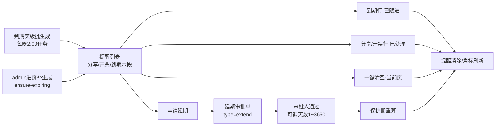
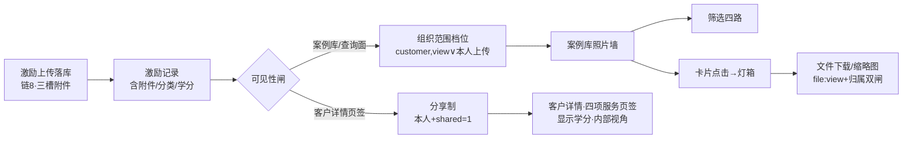

# PC·四项服务与提醒

> 审计日期 2026-11-08 · 只读代码审计 · 全部结论落到 `文件路径:行号`，参考文档仅作骨架、口径以代码为准。

## 概述（侧栏位置/路由、权限码、谁能看到该菜单）

本章节覆盖三个页面域：

| 域 | 侧栏位置 | 路由 | 权限码（路由守卫） | 前端文件 |
|---|---|---|---|---|
| 案例库（PC 四项服务的全部内容） | 「四项服务」组（/service-case-group） | `/case-library` | `incentive:view` | `aigicrm-ui/src/views/incentive/case-library.vue` |
| 客户详情·四项服务页签 | 客户管理 → 客户详情第 4 个页签 | `/customer/detail/:id`（页签 `incentive`） | `incentive:view`（页签级门控） | `aigicrm-ui/src/views/customer/detail.vue:133-139`、`detail/IncentiveTab.vue` |
| 提醒管理 + 提醒详情 | 「流程协同」组 | `/reminder`、`/reminder/detail/:id` | `reminder:view` | `aigicrm-ui/src/views/reminder/index.vue`、`detail.vue` |

- 路由守卫证据：`aigicrm-ui/src/router/index.js:122-125`（案例库 `meta.permission: 'incentive:view'`，注释明确「PC 四项服务=案例库」）、`:143-146`（提醒管理 `reminder:view`）、`:150-153`（提醒详情 `reminder:view`，activeMenu 归 `/reminder`）。
- **谁能看到（引用验收表，不重新推导）**：`docs/菜单功能按钮数据范围验收表-20261107.md:41-42` —— 「案例库（四项服务组）✓✓✓✓」「提醒管理 ✓✓✓✓」，即 admin/总监/行政/销售员四角色全部有菜单授权。
- **数据范围（引用验收表）**：案例库「同激励查询」（验收表 §11，`:113-114`）；提醒管理「全部'与我相关'六段（我负责的/我分享的/分享我的/我名下开票/到期客户）；admin 全部」（验收表 §12，`:119-121`）。代码实际口径见下文各表「后端动作」列与 ⚠️ 疑点。
- 定位差异：案例库是对客展示面，**不显示激励分值**（`case-library.vue:3-6` 注释「展示面不显示激励分值(内部口径)」）；客户详情四项服务页签是内部视角，显示 `+N分`（`IncentiveTab.vue:6`）。

## 功能清单（每功能一行）

1. **案例库**：把我可见的四项服务记录打散成照片墙卡片（封面+客户+服务类别+日期），点卡片开灯箱翻看该案例全部照片/视频/文档。
2. **案例库筛选**：按客户名/关键字、服务大类、服务小类、日期范围四路过滤（小类为客户端过滤）。
3. **客户详情·四项服务页签**：看该客户名下全部激励记录（两级分类、学分、安装前中后附件缩略墙），图片点开放大、文档走阅读器。
4. **提醒列表**：六段固定序合并分享（3 类）/开票（2 类）/到期三路提醒，服务端分页，支持关键词/部门树/负责人筛选。
5. **提醒处理**：分享/开票行「已处理」、到期行「已跟进」（当日已跟进置灰）、行点击进详情。
6. **一键清空**：把当前页全部提醒批量标记已处理（循环逐条调用，无后端批量端点）。
7. **申请延期入口**：到期行一键发起保护期延期审批单（type=extend），走保护期延期链。
8. **提醒详情**：提醒本体 + 客户摘要下钻，待处理状态可标记已处理，可跳客户完整档案。
9. **（admin 专属，非按钮）**：admin 进入提醒页自动补生成今日到期提醒（普通用户跳过）。

## 按钮明细

### 1. 案例库（`views/incentive/case-library.vue`，路由码 incentive:view）

| 按钮 | 在哪 | 前端行为 | 后端动作 | 谁能看到 |
|---|---|---|---|---|
| 关键字搜索框 | 顶部筛选栏 `case-library.vue:13-14` | `@keyup.enter`/`@clear` → `doSearch()`，同时带 `customerName`+`keyword` | 查按客户分组的服务记录（GET `/api/incentive/customer-records`，权限码 `incentive:view`，`IncentiveController.java:174-193`）。后端先过可见性闸 `applyOrgQueryVisibility`（客户属当前账号 `(customer,view)` 数据范围 ∨ 本人上传恒可见，`IncentiveService.java:232-246,1159-1160`），再按关键词命中强相关三路（客户名集合 ∨ 关联产品 ∨ 具体产品，`IncentiveService.java:1189-1206`） | 四角色均有（验收表 `:41`） |
| 服务大类下拉 | `case-library.vue:15-17` | `@change=onMainCatChange` 清小类并 `doSearch()`，带 `mainCategoryId` | 同上端点；大类 id 展开含子类+孙类 IN 过滤（`IncentiveService.java:1216-1227`） | 同上 |
| 服务小类下拉 | `case-library.vue:18-20` | `@change=doSearch`；后端只收大类，小类在客户端按记录 `categoryName` 过滤（`case-library.vue:117`） | 同上端点（小类不传后端） | 同上 |
| 日期范围选择器 | `case-library.vue:21-22` | `@change=doSearch` 带 `startDate/endDate` | 同上端点；`ge(createdAt, start 00:00:00)`/`le(...)` 区间过滤（`IncentiveService.java:1266-1267` 附近） | 同上 |
| 「查询」按钮 | `case-library.vue:23` | `@click=doSearch()`，请求序号守卫防旧响应覆盖（`case-library.vue:99-111`） | 同上端点 | 同上 |
| 案例卡片（点卡片） | 照片墙网格 `case-library.vue:30` | `openCase(c)` 打开 SearchLightbox，从封面进入、左右翻该案例全部文件（`:145-149`）；封面=首个图片或首文件（`:120`），无附件记录不进墙（`:119`） | 灯箱/缩略图走文件下载（GET `/api/file/download/{id}?token=…&thumbnail=1`，权限码 `file:view`，`FileController.java:146-152`）。后端先做单文件归属校验——仅上传者/被分享者/管理员可下载（`FileService.java:747-752` canDownloadFile），缩略图场景授权仍每次先执行再读字节缓存（`FileService.java:755-758`）。下载 token 由 GET `/api/file/download-token` 签发（1h 短时 token、携带主 token jti 联动失效，`FileController.java:36-49`） | 卡片=有 incentive:view 即渲染；附件能否打开另受 `file:view`+文件归属双闸（四角色均有 file:view，验收表 `:40`；归属校验可能拦非分享附件，见 ⚠️） |
| 分页器（sizes/翻页/跳页） | `case-library.vue:53-58` | `paginate` 前端切片（`:97`），`onSizeChange` 回第 1 页（`:96`） | 无后端请求（数据一次性拉全量后客户端分页） | 同页面 |

### 2. 客户详情·四项服务页签（`views/customer/detail.vue` + `detail/IncentiveTab.vue`）

| 按钮 | 在哪 | 前端行为 | 后端动作 | 谁能看到 |
|---|---|---|---|---|
| 「四项服务」页签 | `detail.vue:133-139` | `v-if="canViewIncentive"`（`useCustomerDetail.js:41-43` `hasPermission('incentive:view')`）；无权限不发请求、不渲染误导性空态（`useCustomerDetail.js:205` 同口径守卫）；页签角标=记录数 | 进页自动拉该客户激励记录：GET `/api/incentive/records?customerId=`（权限码 `incentive:view`，`IncentiveController.java:52-64`）。后端按**分享制**过滤：admin/专项授权（can_view_all/can_edit/can_delete）→全量；否则本人 ∨ shared=1 且未被收窄 can_view_shared（`IncentiveService.java:196-211` applyShareVisibility、`:345-358`）；再按 customerId 等值过滤、createdAt 倒序（`:360-362`）。另拉激励学分 GET `/api/incentive/score/customer/{id}`（`incentive:view`，`IncentiveController.java:148-151`）与分类字典 GET `/api/incentive/categories`（`incentive:view`，`:24-27`） | 客户详情页本身四角色可见（验收表 `:31`）；此页签仅 `incentive:view` 持有者（验收表 `:128`「四项服务=incentive:view」） |
| 图片缩略图（点开放大） | `IncentiveTab.vue:21-38` | `el-image` 缩略墙（≤300px 缩略图），点开内建查看器看原图（`:preview-src-list`） | 文件下载 GET `/api/file/download/{id}?token=…`（原图）/`&thumbnail=1`（缩略）；同上 `file:view`+归属双闸（`FileController.java:146-152`、`FileService.java:747-752`） | 同页签 |
| 视频/文档文件条（点开预览） | `IncentiveTab.vue:39-45` | `previewIncentiveFile(f)`：刷下载 token 后开 FilePreview 阅读器，类型按文件名判定（`useCustomerDetail.js:236-245`） | 同上文件下载端点 | 同页签 |

### 3. 提醒管理列表（`views/reminder/index.vue`，路由码 reminder:view）

列表数据结构：六段固定拼接序（分享 3 类 → 开票 2 类 → 到期），每段独立服务端分页、按段区间取块拼接，`loadData` 并发探测六段 total 后映射当前页（`index.vue:144-248`）。

| 按钮 | 在哪 | 前端行为 | 后端动作 | 谁能看到 |
|---|---|---|---|---|
| 关键词搜索框 | 工具栏 `index.vue:11` | `@change=search()` 回第 1 页重查 | 分享/开票段：GET `/api/reminder/list` 带 `keyword`，服务端真过滤——客户名/编码 LIKE 或提醒类型标签/类型码 IN，与范围条件 AND 叠加，total 同口径（`ReminderController.java:32-44`、`ReminderService.java:107-195,237-263`）。到期段：GET `/api/reminder/expiring-list`，keyword 仅匹配客户名 LIKE（`ReminderService.java:285-287`） | 四角色均有（验收表 `:42`）；数据范围见下 |
| 部门树筛选 | `index.vue:12-22` | `el-tree-select` 选办事处（含子部门）→ `search()` | 两端点均收 `deptId`：提醒段 `in(officeId, 子树展开集)`（`ReminderService.java:127-130`）；到期段客户查询 `in(officeId, 子树)`（`:288-293`）。子树展开 `DeptTreeUtils.expandSubtree` 递归（`:122-126` 并发段） | 下拉数据源 GET `/api/common/scope/depts`（登录即可，范围 service 内强制，`ScopeController.java:32-35`）——**下拉只列自己范围可见部门** |
| 负责人下拉 | `index.vue:23-25` | `el-select`（范围感知人员）→ `search()` | 两端点收 `ownerId`：`applyOwnerScope`——all 档不过滤；其余档恒含本人，显式 ownerId 须落在可见集合内否则置 `-1L` 返回空集（防手改参数越权，`ReminderService.java:73-90,298-309`）。范围解析走 OrgScopeResolver 六级档位（`(reminder,view)` 显式配置优先、回退角色档，`ReminderService.java:125,275`） | 下拉数据源 GET `/api/common/scope/users`（登录即可，范围强制，`ScopeController.java:26-29`） |
| 「一键清空」红钮 | `index.vue:28` | `handleClearAll()`：confirmAction 红色确认（文案如实标注「当前页 N 条 / 筛选共 M 条」，`:250-257`）→ 循环对当前页有 `reminderId` 的行逐条 `processReminder`（`:259-261`）→ 回第 1 页刷新 + 刷角标 | 每条走 POST `/api/reminder/{id}/process`（`reminder:view`，`ReminderController.java:71-76`）。后端单条处理：查提醒 → `assertVisible` 可见性校验（非 admin 时负责人必须在其 `(reminder,view)` 范围集合内，防按 ID 越权，`ReminderService.java:485-488,565-573`）→ 幂等守卫仅 `pending` 才置 `processed`+`processedAt`（`:490-493`，2026-11-02 P2 修复）。**无批量端点**，N 条=N 次请求；副作用=处理后侧边栏角标重算（前端 GET `/api/reminder/pending-count`，`store/user.js:81-85`） | 四角色均有按钮；能清掉哪些取决于本人 reminder 数据范围（assertVisible 拦越权） |
| 行点击（整行） | 表格 `index.vue:36` | `@row-click=openDetail` → `buildReminderDetailLocation` 跳提醒详情（`utils/reminder-detail.js:65-75`；无提醒实体的到期行以 `none` 占位降级） | 进详情页后 GET `/api/reminder/{id}`（`reminder:view`，`ReminderController.java:47-51`）。后端：提醒不存在报错；`assertVisible` 防按 ID 猜读他人提醒（客户名/开票日期属敏感信息，`ReminderService.java:501-506`）→ 返回提醒本体+客户摘要（customerBrief 只暴露白名单字段不整表返回，`:508-554`） | 同页面 |
| 「详情」按钮 | 行操作列 `index.vue:70` | 同行点击（`openDetail`） | 同上 | 同页面 |
| 分享行「已处理」 | 行操作列 `index.vue:71-74` | `handleProcessShare(row)` → 单条处理后回第 1 页刷新+刷角标（`:269-277`） | 同 POST `/api/reminder/{id}/process`（校验/幂等同上） | 同页面 |
| 开票行「已处理」 | 行操作列 `index.vue:75-77` | 同上（同一 handler） | 同上 | 同页面 |
| 到期行「已跟进」（当日已跟进置灰） | 行操作列 `index.vue:78-80` | 未跟进：`handleFollowUp` → 处理后 `row.todayFollowedUp=true`；已跟进：disabled。**提醒实体未物化（reminderId=null）时弹指引**：每日 2:00 自动补建或请管理员触发补生成，不静默失败（`:279-293`） | 同 POST `/api/reminder/{id}/process`。到期行的提醒实体来自 `ensureExpiring` 物化（存在 pending 或今日已处理则不重建，防生产 401 条 pending 积压的去重口径，`ReminderService.java:386-433`）；expiring-list 每行回传 `reminderId`（pending 优先、无则今日已处理行）与 `todayFollowedUp`（`ReminderService.java:370-376`） | 同页面；到期行本身按客户数据范围过滤（见下） |
| 到期行「申请延期」 | 行操作列 `index.vue:81` | `handleExtend`：确认弹窗（2026-10 修复加确认防误触）→ `submitApproval({type:'extend', customerId, actionAfterApprove:'保护期延长(天数以审批单为准)'})`（`:295-304`）。**前端无权限码门控**（仅路由级 reminder:view） | POST `/api/approval/submit`（权限码 `approval:view`，`ApprovalController.java:40-56`）。后端 extend 分支：类型白名单校验（`ApprovalService.java:216-220`）→ 公海守卫（池内客户禁止发起延期，`:283-289`）→ **发起人必须对该客户有查看权限**（非 admin 走 customerAccessService.canView，防任意有码者对无权客户 +360 天，`:290-299`）→ 同客户只允许一张在途延期单（客户行 FOR UPDATE 串行化+数 reviewing/pending，`:300-309`）→ 天数快照进 extraData（默认取 sys_config `customer.extend.days`=360，审批人通过时可调整覆盖，`:353-359`）→ 取号插入（集团行锁+唯一键重试防并发同号，`:366-372`）→ 节点实例化（配置流程串行阶段/兜底旧版角色+直属领导，`:374-430`） | 四角色均有（验收表 `:43` 审批按钮行 ✓✓✓✓，approval:view 四角色放开）；现状四角色均有 approval:view 故不炸，但见 ⚠️ 解耦疑点 |
| 分页器 | `index.vue:88-102` | `loadData` / `handleSizeChange`，六段 total 求和为真实总数（`:242-243`） | 见上两端点（每页并发探测六段+按段取块，`index.vue:213-248`） | 同页面 |
| （非按钮·admin 自动动作） | `onMounted` `index.vue:323-328` | 仅 `userStore.isAdmin()` 才发 `ensureExpiring()` 补生成，普通用户跳过（2026-09-23 修复：此前人人触发、后端 403 弹窗） | POST `/api/reminder/ensure-expiring`（`reminder:view` @PreAuthorize + 方法内 `SecurityUtils.isAdmin()` 手工校验双重收紧，非 admin 返回 403「仅管理员可批量生成到期提醒」，`ReminderController.java:59-69`）。后端物化今日到期提醒：扫 warningDays（配置 `customer.warning.days`，缺省 30 天）内到期客户（排 sea/archived），按本人 reminder 范围过滤，幂等去重（`:386-433`）。另有每晚 2:00 `CustomerExpireTask` 定时兜底（`index.vue:282-284` 注释引述） | 仅 admin 触发 |

### 4. 提醒详情（`views/reminder/detail.vue`）

| 按钮 | 在哪 | 前端行为 | 后端动作 | 谁能看到 |
|---|---|---|---|---|
| 「← 返回提醒管理」 | 页头 `detail.vue:4` | `goBack()` → `router.push({name:'Reminder'})` | 无请求 | 同页面（reminder:view） |
| 「查看客户完整档案 ›」 | 客户信息卡片头 `detail.vue:52` | 有 customerId 才渲染；`goCustomer()` 跳客户详情路由。**前端无权限码门控** | 跳转后由客户详情页自身按 `customer:view` 门控加载；本页已先行用客户接口降级兜底——提醒详情无客户块时调 GET `/api/customer/{id}` 补齐，403/无权时显示「无客户查看权限，仅显示提醒信息」，不阻断页面（`detail.vue:158-165`） | 有 customerId 即渲染；能否真看档案取决于客户详情路由码与后端客户可见性 |
| 「标记已处理」 | 底部操作区 `detail.vue:72-78` | 仅 `hasReminder && statusText==='待处理'` 时渲染；`markProcessed` → 成功后刷角标并重载详情（`:186-198`） | POST `/api/reminder/{id}/process`（同列表行处理：assertVisible+幂等，`ReminderService.java:485-494`） | 同页面（仅待处理状态可见按钮） |
| 「返回列表」 | 底部操作区 `detail.vue:79` | 同「← 返回」 | 无请求 | 同页面 |

## 业务链条

### 链 A：提醒闭环链（对应 23 条业务链之 **第 21 条 提醒闭环链** + **第 5 条 保护期延期链**）

文字链：到期天级批生成（或 admin 进页补生成）→ 提醒列表（六段合并）→ 已跟进 / 已处理 / 一键清空（当前页循环标记）→ 提醒消除；或 申请延期 → 审批单(type=extend) → 审批人通过（可调整天数 1~3650，服务端校验）→ 保护期重算 → 提醒消除（第 21 条 + 第 5 条）。

### 链 B：案例库展示链（上游为 **第 8 条 激励上传链**，本链支撑 **第 19 条 排行激励链** 的「四项服务」数据面；案例库本身未在 22 条主链中独立成链，为对客案例展示面）

文字链：激励上传落库（链 8）→ 激励记录 → 可见性闸（案例库/查询=组织范围档位；客户详情页签=分享制）→ 案例库照片墙（筛选 → 卡片 → 灯箱 → 文件下载）。

## ⚠️ 疑点

### 与 9 条核查重点相关者

**重点 5「激励分享制 29 条授权 can_view_all 全=0」——与本章节强相关，且代码已发生口径翻转：**
- 生产授权现状：`biz_incentive_permission` 29 条、`can_view_all` 全 0（验收表 `:108,183`，生产库实拉）；建列迁移默认 0（`sql/migration/20260808/incentive-permission-can-view-all.sql:11`），RBAC 收敛迁移注明「存量直绑 can_view_all=1 为 0 人」(`sql/migration/20260814/rbac-convergence-m1.sql:39`)。
- 代码「全量旁路」不只看 can_view_all：`canSeeAllIncentive() = admin ∨ can_view_all ∨ can_edit ∨ can_delete`（`IncentiveService.java:189-194`）——**任何被授 can_edit/can_delete 的人也走全量旁路**，与「29 条全 0=无人全量」的字面结论不完全等价；29 条授权中是否存在 can_edit/can_delete=1 者未在本章核实（属权限中心域，待核）。
- 更关键：**2026-11-05 用户拍板后，案例库/激励查询数据面（`/incentive/customer-records`）已不再走分享制**，改走组织范围档位——客户属当前账号 `(customer,view)` 数据范围 ∨ 本人上传恒可见（`IncentiveService.java:211-231` applyOrgQueryVisibility、`:1159-1160` 调用点；「can_view_shared/shared=1 在本面退役」注释 `:216-217`）。验收表 §11「数据范围：同激励查询（销售员=分享制口径）」（`:113-114`）的括注**与当前代码不同步**——销售员在案例库实际看到的是其 `(customer,view)` 档位（self 档=名下客户的服务记录+本人上传），不是「本人+被分享」。

**重点 4「行政能看本大区全部激励记录(view-all=region)」——本章映射：**
- 案例库面：行政的可见集=其 `(customer,view)` 档位（region）内的客户服务记录+本人上传（`IncentiveService.java:232-246`）。验收表 §11 的「同激励查询」口径在此档位下对行政仍然成立（region 客户集）。
- 提醒面：行政看提醒的范围由 `(reminder,view)` 档位决定（`ReminderService.java:125` resolveModuleUsers(user,"reminder")），非 customer 档位——两模块档位独立配置，行政在 reminder 模块的档位验收表未单列明细（§12 仅写「与我相关六段」），**待核**。

**重点 6「马吉亮全公司客户范围特例」——本章映射：**
- 验收表 `:19,171`：马吉亮（USER 11，销售员角色）customer 增/删/改/导出/导入/查看/分享 **全=all**（用户级高于角色档）。
- 案例库走 `(customer,view)`：orgScopeVisibleCustomerIds 用 **customer 模块**范围解析（`IncentiveService.java:218-231`）→ 若其 customer:view=all，则马吉亮的案例库=全公司案例（含其他销售上传的记录）。
- 提醒面走 `(reminder,view)` 模块档位——马吉亮是否有 reminder 模块用户级 override，验收表与代码注释均未载明，**待核**（若仅 customer=all 而 reminder=self，则他案例库全公司可见但提醒列表仅本人相关，两页口径不一致属设计使然）。

**重点 1/2/3/7/8/9**：客户导入/删除码、行政学分录入只读、阅读排行榜仅 admin、总监回收站、六项指标口径——均不落在本章节页面（分别属客户管理、学分、激励查询/系统、回收站、核心指标章节），本章不展开。

### 本次审计新发现

**新发现 1：案例库附件「双闸」耦合，激励可见 ≠ 附件可看。** 案例库/客户详情页签的图片与文档走 `/api/file/download/{id}`，该端点 `@PreAuthorize("hasAuthority('file:view')")`（`FileController.java:146-152`）且每次请求先做单文件归属校验——仅上传者、被分享者、管理员可下载（`FileService.java:747-752`）。即持 `incentive:view` 但无 `file:view` 的角色页面全灰；更值得注意的是**激励附件的可见性并不跟随激励记录的可见性**，而跟随文件管理域的分享/ACL 归属——案例库里能看到的案例卡片，其附件仍可能被归属校验 403（前端仅表现为缩略图 error 占位 `case-library.vue:32-40`）。现状四角色均有 file:view+五码（验收表 `:40`）故不炸，属隐性耦合，建议管理者知悉。

**新发现 2：同一「四项服务」域两套可见性并存。** 案例库（`customer-records`）已改组织范围档位（2026-11-05），而客户详情·四项服务页签（`GET /incentive/records`，`useCustomerDetail.js:205-210`）仍走分享制 `applyShareVisibility`（本人+shared=1，`IncentiveService.java:196-211,345-358`）。后果：某条他人上传、`shared=0` 但客户在本人大区/名下的记录，行政/总监在案例库可见（客户在范围内）、在客户详情页签却不可见（非本人且未分享）——两入口对同一客户同一记录呈现不一致。是否属拍板 B 的预期遗留（注释称「记录列表面仍用分享制」`IncentiveService.java:216-217`），**待与需求方确认**。

**新发现 3：「申请延期」「查看客户完整档案」两按钮前端无权限码门控。** `reminder/index.vue:81` 申请延期按钮对任何 reminder:view 持有者渲染（后端 submit 需 `approval:view`，`ApprovalController.java:40-41`）；`reminder/detail.vue:52` 查看档案按钮仅以 customerId 是否存在为条件（后端走客户可见性）。现状四角色均有 approval:view（验收表 `:43`）不产生实际越权，但前端按钮可见性与后端权限码解耦，若未来收窄 approval:view 会出现「按钮可见、点了 403」。

**新发现 4：「一键清空」的实际能力边界。** 仅清当前页（前端循环逐条 POST，无后端批量端点，`reminder/index.vue:250-267`）；`reminderId=null` 的到期行被 `filter(r => r.reminderId)` 静默跳过（`:253`）——弹窗文案已如实标注「当前页 N 条…其余页需翻页逐页处理」（`:256`），口径无欺骗性，但「一键清空」按钮名与实际作用域（当前页）存在语义落差，管理者验收时勿以「清空全部」预期。每条处理后端幂等（重复点不覆盖 processedAt，`ReminderService.java:489-493`）且有 assertVisible 越权防线（`:565-573`），安全面无恙。

**新发现 5：同页两数据源 keyword 口径不一致。** 分享/开票段 keyword 命中客户名/编码/类型标签三路（`ReminderService.java:237-263` applyKeywordScope），到期段仅客户名 LIKE（`:285-287`）——在提醒页搜索「开票」等类型词时，分享/开票段命中、到期段不命中，六段 total 求和后筛选口径在段间不等价。属体验级不一致，非越权问题。
