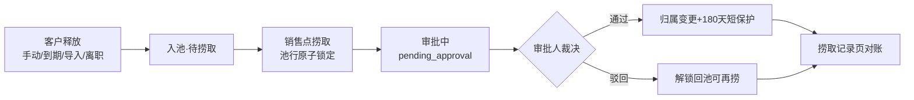
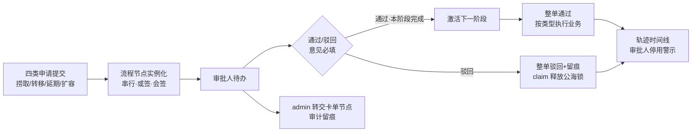

# PC·公海与审批

> 审计日期 2026-11-08 · 只读代码审计，全部结论以源码为准；三份参考文档仅作骨架引用。
> 覆盖：公海管理（公海池 /sea、捞取记录 /sea/records、公海池名单配置）+ 审批管理（/approval 四类单据、通过驳回、admin 转交、轨迹、审批流程配置）。

## 概述（侧栏位置/路由、权限码、谁能看到该菜单）

| 页面 | 路由 | 组件 | 路由权限码（router/index.js） |
|---|---|---|---|
| 公海池 | /sea | views/sea/index.vue | sea:view（router/index.js:157-161） |
| 捞取记录 | /sea/records | views/sea/records.vue | sea:view（router/index.js:163-167） |
| 审批管理 | /approval | views/approval/index.vue | approval:view（router/index.js:169-174） |
| 公海池名单配置 | /system/config（系统设置→权限中心→专项权限→「公海池名单」） | views/system/SeaConfigManager.vue | 页面门槛 system:config:view（router/index.js:247-252）；按钮门槛 sea:config:edit（SeaConfigManager.vue:178） |
| 审批流程配置 | /system/config（系统设置→「审批流程配置」页签） | views/system/approvalConfig.vue | 页面门槛 system:config:view；按钮门槛 system:config:edit（approvalConfig.vue:95） |

- 路由守卫：无权限直达 URL 会被 layout 守卫弹「没有访问权限」并跳回首个可达页（layout/index.vue:345-349）。
- 侧栏菜单树来自后端 sys_role_menu 下发（layout/index.vue:211-241 按菜单树渲染），「谁能看到」一律引用《菜单功能按钮数据范围验收表-20261107.md》§二角色×菜单矩阵（下称验收表）：
  - 公海池/捞取记录/公海捞取：admin✓ 总监✓ 行政✓ 销售员✗——四角色全 ✓（验收表 line 43）。
  - 公海配置查看/编辑/公海导入：admin✓ 总监✓ 行政✓，销售员 ✗（验收表 line 44）。
  - 审批通过/驳回按钮：四角色全有码 ✓（验收表 line 45）；「实际可审=该流程配置的审批人」（验收表 line 131）。
  - 数据范围档位：sea.view 档 admin/总监=all、行政/销售员=office（验收表 line 127）；审批「待审批=我是审批人的；我发起=我提的；admin=全部」（验收表 line 132）。
  - 审批配置（system:config:edit）与公海池名单配置（sea:config:edit=admin/总监/行政）见验收表 line 160-161。
- 公海池本身=三个大区池（山西/内蒙古/河北），逐池「可见/编辑/删除/导入/捞取」五类名单，由 SeaConfigManager 配置，支持部门+人员+角色引用三种授权载体（验收表 line 127；代码 SeaConfigService.java:142-155）。

## 功能清单（每功能一行，说人话）

- 公海池：看自己可见的池里「待捞取/审批中」的客户，可按池/部门/行业/入池原因/关键词筛选，点捞取发起审批、按池级名单编辑或删除。
- 批量导入到公海：下载模板、传 Excel，每行新建客户并直接进公海待捞取（入池原因固定「保护期满」）。
- 捞取记录：本人历史捞取申请与审批结果的对账页（KPI 按数据范围统计，见疑点③）。
- 公海池名单配置：管理员逐池配置「谁能看、谁能编、谁能删、谁能导、谁能捞」，支持部门递归/人员直命/角色引用。
- 审批管理：四类单据（捞取 claim / 转移 transfer / 延期 extend / 存储空间 storage）的六页签裁决台，通过/驳回带必填意见、看轨迹、admin 可转交卡单节点、延期单审批人可调天数。
- 审批流程配置：管理员为四类流程配审批人（指定人员/指定角色）+ 或签(ANY)/会签(ALL) + 多阶段串行排序。
- 后台支撑：客户释放四入口（手动释放/到期任务/导入/离职交接）统一走 SeaService.addToSea；捞取锁超时由 CustomerExpireTask.releaseStaleClaimLocks 定时解锁（CustomerExpireTask.java:45,254）。

## 按钮明细

> 统计口径：每行=一个可交互控件（按钮/筛选器/弹窗表单控件/分页器），同类控件组（如 6 个状态页签、4 个权限区块的同款树）合并 1 行。合计 **63** 个交互项；端点 **22** 个（SeaController 11 + ApprovalController 7 + ApprovalConfigController 4），另列间接依赖 6 个。

### 功能块① 公海池页·顶部（sea/index.vue）

| 按钮 | 在哪 | 前端行为 | 后端动作 | 谁能看到 |
|---|---|---|---|---|
| 公海池下拉选择器 | sea/index.vue:12-14 | 选中后重查列表（@change=search），选项=可见池+区域名 | 拉取 GET /sea/configs/visible（SeaController:96-100，sea:view）；列表查询时 poolId 必须在可见池集合内，否则返回空页（SeaService.java:83-88） | 有 sea:view 的四角色；池下拉内容=逐池「可见名单」命中者（SeaConfigService.listVisible，:50-56，view 档 all 全可见） |
| 捞取记录 | sea/index.vue:15 | 路由跳 /sea/records | —（纯导航） | 有 sea:view 者 |
| 批量导入 | sea/index.vue:16 | 打开导入弹窗；按钮显隐=hasPermission('sea:import')（:163） | 无（打开弹窗不请求） | 有 sea:import 码者（验收表：admin/总监/行政；销售员✗）。⚠️按钮可见门槛只有 sea:import，后端还叠池级 import 名单二闸（见疑点④） |
| 下载导入模板 | sea/index.vue:119 | 下载「客户导入模板.xlsx」，成功/失败 toast | GET /api/customer/import/template（api/customer.js:183-190；token 统一走 getToken） | 打开弹窗者（弹窗本身受 sea:import 门控） |
| 选择/拖拽上传 Excel | sea/index.vue:121-125 | el-upload 手动模式限 1 个文件，超限提示「只能上传一个文件」（:175） | 无 | 同上 |
| 开始导入 | sea/index.vue:134 | FormData 上传，成功后展示成功/失败计数与逐行失败原因，并刷新列表+指标（:184-200） | POST /sea/import（SeaController:76-83，sea:import + ImportGuard 校验非空/扩展名/5MB）；SeaService.importToSea（:343-367）先按导入人办事处路由目标池并校验池级 import 名单（hasPoolPerm PERM_IMPORT，:348-354），再 EasyExcel 逐行解析（SeaImportListener.java:35-71：客户名必填、重名校验、无启用池整行失败不建客户、建客户后 addToSea(…,"保护期满")） | 有 sea:import 且在其办事处路由池 import 名单内者；admin 恒有（SeaConfigService.java:144） |
| 取消/关闭（导入弹窗） | sea/index.vue:134 | 关闭弹窗并清空文件/结果（:201-205） | 无 | 同上 |

### 功能块② 公海池页·筛选栏（sea/index.vue）

| 按钮 | 在哪 | 前端行为 | 后端动作 | 谁能看到 |
|---|---|---|---|---|
| 状态页签组（全部/待捞取/审批中/已捞取） | sea/index.vue:29-32 | setStatus 切换并回第 1 页重查 | GET /sea/list 带 status；不传 status 时后端默认排除已捞取（SeaService.java:71-76） | 有 sea:view 者 |
| 部门树筛选 | sea/index.vue:35-45 | 树选部门（含子部门）后重查；树数据来自 getScopeDepts（:328-332） | GET /sea/list 带 deptId；后端 DeptTreeUtils.expandSubtree 展开子树→按客户 officeId 反查客户 id 集过滤（SeaService.java:89-97） | 有 sea:view 者 |
| 行业筛选 | sea/index.vue:46-48 | 选中重查；字典拉取失败回退共享兜底常量（:333-336） | GET /sea/list 带 industry；后端以客户表子查询下沉 SQL 保证分页正确（SeaService.java:99-105） | 有 sea:view 者 |
| 进入原因筛选 | sea/index.vue:49-53 | 选中重查（保护期满/放弃客户/离职交接） | GET /sea/list 带 enterReason，DB 层等值过滤（SeaService.java:78-80） | 有 sea:view 者 |
| 关键词搜索 | sea/index.vue:54 | 回车触发，按客户名称模糊 | GET /sea/list 带 keyword；后端 like 客户名子查询（SeaService.java:99-105） | 有 sea:view 者 |
| 重置 | sea/index.vue:55 | 清空全部筛选回第 1 页（:230-239） | 重新 GET /sea/list | 有 sea:view 者 |

### 功能块③ 公海池页·表格行（sea/index.vue）

| 按钮 | 在哪 | 前端行为 | 后端动作 | 谁能看到 |
|---|---|---|---|---|
| 客户名称链接 | sea/index.vue:75 | 跳客户详情 /customer/detail/:id?from=sea | —（导航） | 行渲染者 |
| 捞取 | sea/index.vue:99-105 | 仅 row.status==='available'&&row.canClaim 显示；confirmAction 普通确认（:275）后提交 submitApproval({type:'claim',customerId,…})（:277），成功自动切「审批中」页签+刷新指标+刷新角标（:278-282）；取消与后端失败区分提示（:284-287） | POST /approval/submit（ApprovalController:40-55，approval:view）；ApprovalService.submit（:241-279）：客户必须在池→池级 claim 名单校验（hasPoolPerm PERM_CLAIM，兼容存量 sea:claim 角色码，:252-256）→非 all 范围者须可见该池（:257-262）→已被他人申请拦截（:263-265）→**原子条件更新锁池行** available→pending_approval 并写 claim_user_id/claim_date（:266-278），锁失败即报「已被他人申请」；零审批人/自审自批的流程配置会让提交整体回滚（含解锁，:437-453） | 行级 canClaim 由后端按池 claim 名单下发（SeaService.java:128），admin 恒有 |
| 编辑 | sea/index.vue:106 | row.canEdit 时跳客户编辑 /customer/edit/:id?from=sea | —（导航到客户模块编辑页） | 行级 canEdit=池 edit 名单下发（SeaService.java:126） |
| 删除 | sea/index.vue:107 | row.canDelete&&status==='available' 显示；confirmAction 红色确认（:296）后 deleteSeaPool(row.id)（:297），成功刷新列表+指标 | DELETE /sea/pool/{id}（SeaController:66-73，sea:view 门禁）；SeaService.deletePool（:302-338）：仅 available 可删、池级 delete 名单校验（hasPoolPerm PERM_DELETE，:313-315）+可见性防横向越权（:316-319）、三处统一 404 文案防存在性探测、复用客户删除业务保护 assertDeletable（有票款/在途审批不可删，:325-328）、池行带 status='available' 条件删除与并发捞取互斥（:329-334）、最后走客户删除统一内核 deleteFromSeaPool（含分享/提醒清理，:335-337），全程 @Transactional | 行级 canDelete=池 delete 名单下发（SeaService.java:127），admin 恒有 |
| 分页器 | sea/index.vue:112-115 | 页码/每页条数变更重查 | GET /sea/list 分页参数 | 有 sea:view 者 |

### 功能块④ 捞取记录页（sea/records.vue）

| 按钮 | 在哪 | 前端行为 | 后端动作 | 谁能看到 |
|---|---|---|---|---|
| 返回公海池 | sea/records.vue:8 | 跳 /sea | —（导航） | 有 sea:view 者 |
| 开始/结束日期 | sea/records.vue:62-63 | 选日期重查 | GET /sea/claim-records dateFrom/dateTo（SeaController:136-157） | 有 sea:view 者 |
| 状态筛选（已通过/已驳回/待审批） | sea/records.vue:64-68 | 选中重查 | 同上 status 等值过滤（SeaController:149-151） | 有 sea:view 者 |
| 关键词搜索 | sea/records.vue:69 | 客户/捞取人/审批人模糊 | 同上 keyword；后端因关联字段无法下推 SQL，有 keyword 时全量构建→内存过滤→手工分页保证 total 一致（SeaController:160-219，S7 注释） | 有 sea:view 者 |
| 分页器 | sea/records.vue:105-108 | 变更重查 | 同上 | 有 sea:view 者 |

- 页面 KPI 四卡（总记录/已通过/已驳回/待审批，sea/records.vue:12-57）与列表同一接口返回；列表固定「仅本人申请」（SeaController:146 applicantId=当前用户），KPI 统计则按数据范围可见申请人（scopeResolver.resolveModuleUsers("sea")，SeaController:225-236）——口径差异见疑点③。

### 功能块⑤ 审批管理页·列表（approval/index.vue）

| 按钮 | 在哪 | 前端行为 | 后端动作 | 谁能看到 |
|---|---|---|---|---|
| 指标条点击直达（待审批/我发起的/本月通过/本月驳回） | approval/index.vue:14-19,352-359 | interactive MetricStrip，点击切对应页签并重查 | 页面加载 GET /approval/statistics（ApprovalController:100-104，approval:view） | 有 approval:view 者 |
| 状态页签×6（待审批/我发起的/审批中/已通过/已驳回/全部） | approval/index.vue:22-59 | 切页签重查（@tab-change=search） | GET /approval/list 带 tab（ApprovalController:22-32，approval:view）；ApprovalService.page（:79-135）：pending=我是 pending 节点审批人（:82-93）；mine=本人申请（:94-95）；reviewing/approved/rejected/all 非 admin 套数据范围（本人申请∨本人参与∨权限矩阵 approval.view 可见用户，all 档全量，:96-113 + applyDataScope:790-807）；**未知 tab 按最窄口径处理**（:107-113，堵 tab 越权）；deptId=申请人部门子树过滤（:119-127） | 有 approval:view 者；页签角标数字=statistics（approvedTotal/rejectedTotal 全量键，ApprovalService:842-845） |
| 部门树筛选 | approval/index.vue:64-73 | 选部门重查；树=GET /common/scope/depts（:382-387） | GET /approval/list deptId（同上展开子树→申请人过滤） | 有 approval:view 者 |
| 类型筛选（捞取/转移/延期/存储空间） | approval/index.vue:74-79 | 选中重查 | GET /approval/list type 等值过滤（ApprovalService:115-117） | 有 approval:view 者 |
| 关键词搜索 | approval/index.vue:80-88 | 编号/客户名/申请人模糊 | GET /approval/list keyword；后端并行查客户表/用户表再 OR 组合（applyKeywordFilter，ApprovalService:137-165） | 有 approval:view 者 |
| 编号链接→详情 | approval/index.vue:107 | openDetail 打开右侧抽屉并拉详情（:410-424） | GET /approval/{id}（ApprovalController:34-38，approval:view）；ApprovalService.detail（:167-200）：admin 或 canViewApproval（申请人∨节点审批人∨权限矩阵，:202-210）否则统一 404 文案；返回单据+全部节点（轨迹） | 有 approval:view 且在单据可见范围者 |
| 行内通过 | approval/index.vue:138-140 | 仅 pending 页签且 canApprove 显示；prompt 审批意见（必填校验，:437-443）后 approve(id,{comment})；extend 单改走专用弹窗（:429-435） | POST /approval/{id}/approve（ApprovalController:75-90，approval:approve + @AigicrmLog(module=审批,action=审批通过) 审计日志）；ApprovalService.approve（:552-613）：主行 FOR UPDATE 锁单（:557）→终态守卫（approved/rejected 统一 404，:563-565）→节点必须=本人+pending（:567-573）→**自审自批封禁**（申请人不能审自己，:578-580）→extendDays 仅 extend 单可调、1~3650 校验并写进意见留痕（:584-592）→条件流转 pending→approved 防并发重复（:596-605）→advanceApproval 阶段推进（:624-695）→整单通过 finalizeApproval 条件更新只回写一次（:698-707）→executeApprovalAction 按类型执行业务（:857-969） | 有 approval:approve 且为该单 pending 节点审批人（四角色都有码，实际可审=流程配置审批人，验收表 line 131） |
| 行内驳回 | approval/index.vue:141-143 | 同上，prompt 驳回原因（必填，:458-462）后 reject(id,{comment}) | POST /approval/{id}/reject（ApprovalController:92-98，approval:reject + @AigicrmLog(module=审批,action=审批驳回)）；ApprovalService.reject（:709-781）：同款主行锁+终态守卫+条件流转；整单 rejected 后 **claim 单释放公海锁**（池行回 available、清 claim_user_id/claim_date，:751-765）；级联作废其余 pending/waiting 节点（:770-780） | 有 approval:reject 且为该单 pending 节点审批人 |
| 空态：去公海池发起捞取 | approval/index.vue:100 | 跳 /sea | —（导航） | pending 页签空表时 |
| 空态：查看我发起的 N 条 | approval/index.vue:101 | 切 mine 页签 | —（前端切换） | pending 页签且 stats.mine>0 时 |
| 分页器 | approval/index.vue:149-161 | 变更重查 | GET /approval/list 分页参数 | 有 approval:view 者 |

### 功能块⑥ 审批详情抽屉（approval/index.vue:164-249）

只读展示区（不计按钮数）：申请天数（extend 单读 extraData.extendDays 快照，:188-190 + :489-497）、配额变更/申请理由（storage 单解析 extraData，:192-197 + :510-517）、审批轨迹时间线（节点状态/操作时间/意见，:207-228）、**「审批人已停用」卡单警示标签**（:218，后端 approverInvalid 标记停用/删除审批人，ApprovalService:183-193）。

| 按钮 | 在哪 | 前端行为 | 后端动作 | 谁能看到 |
|---|---|---|---|---|
| 转交（轨迹节点内） | approval/index.vue:220-221 | 仅 isAdmin 且节点 pending/waiting 显示；openTransfer 拉候选人（:319-327） | 无（打开弹窗） | 仅 admin（isAdmin=userStore.isAdmin() 调用取值，:310-311，注释注明修复过「非 admin 也见按钮」的 P4 缺陷）；后端二次校验 isAdmin（见下） |
| 抽屉驳回 | approval/index.vue:235-240 | pending 页签且 canReject 时显示，同行内驳回 | 同 POST /approval/{id}/reject | 同行内驳回 |
| 抽屉通过 | approval/index.vue:241-246 | pending 页签且 canApprove 时显示，同行内通过 | 同 POST /approval/{id}/approve | 同行内通过 |
| 关闭 | approval/index.vue:234 | 关抽屉 | — | 打开抽屉者 |

### 功能块⑦ 转交弹窗（approval/index.vue:252-266）

| 按钮 | 在哪 | 前端行为 | 后端动作 | 谁能看到 |
|---|---|---|---|---|
| 候选人单选列表 | approval/index.vue:256-260 | getUserList({current:1,size:200}) 后前端过滤 status===1（:324-326）；空列表显示空态（:261） | GET /system/user 列表接口（system 模块） | 仅 admin 打开弹窗时；⚠️>200 人时第一页可能不含目标人（见疑点⑤） |
| 取消 | approval/index.vue:263 | 关弹窗 | — | 同上 |
| 确认转交 | approval/index.vue:264 | transferApprovalNode(单id,节点id,新审批人id)（:329-342），成功刷新列表+重开详情轨迹 | PUT /approval/{id}/nodes/{nodeId}/transfer（ApprovalController:66-73，approval:view 门禁）；ApprovalService.transferNode（:510-539）：**服务层二次校验 isAdmin**（:512-514）、单据未终态、节点须 pending/waiting、新审批人须存在启用未删、换审批人后 securityAudit.userAdminEvent("approval_transfer",…) 审计留痕 + 日志（:535-538），@Transactional | 仅 admin（前端按钮+后端双层把关） |

### 功能块⑧ 延期审批弹窗（approval/index.vue:269-284）

| 按钮 | 在哪 | 前端行为 | 后端动作 | 谁能看到 |
|---|---|---|---|---|
| 延期天数输入 | approval/index.vue:273 | input-number 1~3650，默认预填申请快照天数（:431） | 无（随通过提交） | 对 extend 单点「通过」的审批人 |
| 审批意见输入 | approval/index.vue:277 | textarea，默认「同意」（:432） | 无 | 同上 |
| 取消 | approval/index.vue:281 | 关弹窗 | — | 同上 |
| 通过并延期 | approval/index.vue:282 | confirmExtendApprove 校验 1~3650 与意见非空（:519-528）后 approve(id,{comment,extendDays})（:531），成功关弹窗刷新列表/指标/角标 | 同 POST /approval/{id}/approve；服务端把调整值合并进 extraData.extendDays（执行侧单源读取，ApprovalService:607-611），执行侧客户行悲观锁内 applyExtendApproval 统一公式累加+重算到期日、写延期事件（:869-895）；客户在途入海则拒绝执行（公海守卫，:877-879） | 同上（1~3650 前后端双校验） |

### 功能块⑨ 公海池名单配置（SeaConfigManager.vue，挂载于 系统设置→权限中心→专项权限→「公海池名单」，PermCenter.vue:19-22 + config.vue:33,50）

| 按钮 | 在哪 | 前端行为 | 后端动作 | 谁能看到 |
|---|---|---|---|---|
| 新增公海池 | SeaConfigManager.vue:6 | 打开新建弹窗（权限区块全展开，:297-304） | 无（提交时落库） | hasPermission('sea:config:edit')（:178）；验收表：admin/总监/行政 |
| 编辑（池卡片） | SeaConfigManager.vue:21 | 回填表单+双保险回填树勾选防误清空（:309-353） | 无 | 同上 |
| 删除（池卡片） | SeaConfigManager.vue:22 | confirmAction 红色确认（:358）后 deleteSeaConfig(id)（:359-361） | DELETE /sea/configs/{id}（SeaController:125-130，sea:config:edit）；SeaConfigService.delete（:113-123）：@Transactional 内校验池内客户记录数>0 则拒绝（防孤儿，B9+TOCTOU 修复），否则删配置 | 同上 |
| 可见范围组织树 | SeaConfigManager.vue:47-57 | check-strictly 勾选部门/人员（总部灰显），同步 visibleKeys（:246-249） | 树数据 GET /sea/org-tree（SeaController:102-108，sea:config:view——注释注明修复过 sea:view 门槛会向普通销售员泄露全组织全人员的问题） | 弹窗打开者（按钮层已限 sea:config:edit） |
| 可见范围已选标签/清空 | SeaConfigManager.vue:65-80 | 标签可删、一键清空（:250-257） | 无 | 同上 |
| 四权限区块·按角色引用下拉 | SeaConfigManager.vue:99-102 | edit/delete/import/claim 各自勾选角色（「勾角色=成员自动获得」），提交时未改动不传字段防误清空（:389-405） | POST/PUT /sea/configs；后端 *_role_ids CSV 存储，判定时用户启用角色与授权角色交集命中（SeaConfigService.isInScope，:169-174；2026-11-03 权限中心 P3） | 同上 |
| 四权限区块·组织树 | SeaConfigManager.vue:110-120 | 同款树勾选同步各区块 keys（:271-273） | 无（提交时拆分为 *_dept_ids/*_user_ids） | 同上 |
| 四权限区块·已选标签/清空 | SeaConfigManager.vue:128-144 | 同款标签管理（:275-284） | 无 | 同上 |
| 启用状态开关 | SeaConfigManager.vue:153-155 | 启用/禁用池，附「禁用池内已有记录不可见不可删」警示文案 | POST/PUT /sea/configs status 字段；create 缺省默认启用（SeaConfigService:59-62）；listVisible 只吐启用+可见池（:50-56），禁用池存量客户从公海页消失 | 同上 |
| 排序 | SeaConfigManager.vue:156-158 | input-number | 写 sortOrder；多池命中释放路由按 sortOrder 升序取首个（SeaService.matchSeaConfig，:227-244） | 同上 |
| 取消 | SeaConfigManager.vue:161 | 关弹窗 | — | 同上 |
| 确定 | SeaConfigManager.vue:162 | 校验名称/可见范围非空（:371-372）后 create/update（:409-413）；错误显式提示（:417-420） | POST /sea/configs（SeaController:110-115）与 PUT /sea/configs/{id}（:117-123）；SeaConfigService.create（:58-75）：新池四操作权限默认=可见范围回填、deriveRegionIds 由可见部门/人员派生办事处集合、checkOfficeOverlap 拒绝办事处跨池重叠（:94-111）；update（:77-87）：可见范围未传时不重算 regionIds 防清空路由 | 同上 |

### 功能块⑩ 审批流程配置（system/approvalConfig.vue，挂载于 系统设置→「审批流程配置」，config.vue:25,48）

| 按钮 | 在哪 | 前端行为 | 后端动作 | 谁能看到 |
|---|---|---|---|---|
| 新增流程 | approvalConfig.vue:6 | 打开新建弹窗 | 无（提交时落库） | hasPermission('system:config:edit')（:95）；验收表 line 160 |
| 编辑 | approvalConfig.vue:28 | 回填表单（approverIds JSON 兜底解析，:115-118） | 无 | 同上 |
| 删除（popconfirm） | approvalConfig.vue:29-31 | 二次确认后 doDelete | DELETE /approval/config/{id}（ApprovalConfigController:42-48，system:config:edit）；**逻辑停用**（status=0，ApprovalConfigService:59-65），非物理删 | 同上 |
| 流程表单（名称/类型/审批人类型/人员或角色多选/签署方式/排序） | approvalConfig.vue:38-80 | 流程类型四选一（claim/transfer/extend/storage，编辑时锁定，:44）；审批人类型 USER/ROLE（:53-56）；签署方式 ANY/ALL（:66-71） | 保存走 POST/PUT /approval/config；后端 validateFlowType 白名单=提交侧四类同源，白名单外拒绝（ApprovalConfigService:36-44） | 同上 |
| 取消 | approvalConfig.vue:77 | 关弹窗 | — | 同上 |
| 保存 | approvalConfig.vue:78 | 校验名称/类型/审批人非空（:132-133）后保存 | POST /approval/config（ApprovalConfigController:27-31）与 PUT /{id}（:34-40）；@Transactional。配置在提交审批时由 createNodes 实例化节点（唯一入口，:78-106：首阶段 pending、后续 waiting、空阶段跳过），审批人解析过滤停用/删除用户与停用角色（:109-160） | 同上 |

**间接依赖端点**（本章节页面直接调用，不属于三个目标 Controller）：GET /common/scope/depts（sea/index.vue:328、approval/index.vue:384）、GET /api/customer/import/template（api/customer.js:183）、GET /system/user（转交候选人 approval/index.vue:324）、GET 字典 industry（sea/index.vue:334）、GET 角色列表 getRoleList（SeaConfigManager.vue:217、approvalConfig.vue:111）、GET 简化用户列表 getSimpleUserList（approvalConfig.vue:112）。

## 业务链条

### 链条A：公海捞取链（对应《页面按钮全量对照-20261107》§0 业务链 **#7 公海捞取链 + #4 客户处置链**的公海段）

文字链：客户释放（四入口统一 SeaService.addToSea，:161-220，幂等防重+无启用池拒绝入池+清理分享/死提醒+写释放事件）→ 入池 available → 公海池页「捞取」submit(type=claim) 原子锁池行 → 审批管理页通过 → SeaService.completeClaim（:246-295：判主校验防错配、ownerId 变更、normal/active 状态、applyClaimReset 统一公式、清理分享、清 pending 提醒、写捞取事件）→ 客户进名下/捞取记录页可对账；驳回则 ApprovalService.reject 释放公海锁（:751-765），锁超时由 CustomerExpireTask.releaseStaleClaimLocks 定时兜底（CustomerExpireTask.java:45,254）。

### 链条B：审批中枢链（对应业务链 **#14 审批中枢链**，并覆盖 **#5 保护期延期链 / #12 文件扩容链 / #13 客户转移链** 的裁决与执行段）

文字链：四类申请（submit 白名单校验→claim 锁池行→extend/transfer 提交侧归属与在途单防重→storage 锁用户行防并发重复单）→ ApprovalConfigService.createNodes 实例化串行/或签(ANY)/会签(ALL)节点 → 待办审批人通过/驳回（意见必填、自审自批双闸、条件流转防并发）→ 阶段推进直至整单通过 → executeApprovalAction 按类型执行：捞取=归属变更（链条A）、延期=锁客户行累加天数重算到期日、转移=接收人有效性+集团边界+属主与部门同步、扩容=锁行复核只升不降调配额；驳回=意见留痕+claim 单释放公海锁+级联作废其余节点；admin 可对 pending/waiting 节点转交（securityAudit 审计）；全过程轨迹可在详情抽屉回看。

## ⚠️ 疑点

### 一、9 条核查重点中与本章节相关者

**重点①（销售员有客户导入码 customer:import）——与本章节的交叉口径，已核：公海导入与客户导入是两套独立码。**
公海页「批量导入」门槛是 `sea:import`（sea/index.vue:163），不是 `customer:import`；后端 POST /sea/import 只认 sea:import（SeaController:78），并额外叠池级 import 名单（SeaService.java:352-354）。验收表 line 44：销售员 sea:import=✗（admin/总监/行政=✓），故销售员的 customer:import 码**不会**让它能进公海导入。销售员能否批量建档本身属客户管理章节，此处不重复裁决，仅澄清两码互不影响。

**重点②（销售员有客户删除码 customer:delete）——与本章节的交叉口径，已核：公海删除不走 customer:delete。**
公海删除按钮显隐由后端行级 `canDelete` 下发（SeaService.java:127=hasPoolPerm(PERM_DELETE)），后端 DELETE /sea/pool/{id} 校验链=sea:view 门禁+池级 delete 名单+可见性防越权+available 状态+assertDeletable 业务保护（SeaService.java:302-338），全程与 customer:delete 无关。含义：**销售员若被配进某池的 delete 名单，也能物理走通公海删除**（前端按钮随 canDelete 出现）——这是池名单配置问题而非码泄漏；是否给销售员配池级删除名单属业务预期确认项（验收表 line 126 口径「删除（canDelete）」与此一致）。

其余 7 条重点（行政学分只读/激励 view-all/分享制 can_view_all/马吉亮特例/阅读排行榜/总监回收站/六项指标口径）分属学分、激励、回收站、统计章节，与本章节无代码交叉，不在此展开。

### 二、本次审计新发现

**新发现①（P3·死参数）GET /sea/list 的 officeId 参数被接收但后端从未使用。**
SeaController.page 声明 `@RequestParam officeId` 并传入 service（SeaController.java:51,57），但 SeaService.page 签名中的 officeId 在函数体（SeaService.java:64-132）中无任何引用（deptId 才是实际消费的部门筛选）。前端公海页 query 也只传 deptId（sea/index.vue:218,244），当前无实际影响，属死参数，建议清理避免误导后续调用方。**待核**：是否有其他外部调用方在用 officeId（本次仅审计 PC 前端views/sea、views/approval，未全库检索调用方）。

**新发现②（P3·展示缺陷）审批列表「客户」列的行业行恒为空。**
前端渲染 `row.customerIndustry`（approval/index.vue:120），但后端 fillApprovalNames 只填充 applicantName 与 customerName（ApprovalService.java:1152-1161），全后端 grep `customerIndustry` 无填充点（本次执行：`grep -rn "setCustomerIndustry\|customerIndustry" aigicrm-backend/src/main/java`，零命中）。列表「客户」列第二行行业文字永远不出现，属后端漏填充或前端多余渲染，二者取一修复。

**新发现③（口径提示）捞取记录页 KPI 与列表数据口径不同。**
列表固定「仅本人申请」（SeaController.java:146 `eq(ApplicantId, 当前用户)`）；KPI 四卡统计按权限矩阵 sea.view 档可见申请人（scopeResolver.resolveModuleUsers("sea")，SeaController.java:225-236，注释明确「上级/负责人可见下级捞取统计」）。对销售员（self 档）两者一致；对上级/负责人，KPI 含下级而列表只有自己——页面标题「捞取审批记录/查看客户捞取申请与审批结果」（sea/records.vue:5-6）未说明该口径，管理者易误读 KPI≠列表之和是 bug。属有意设计（统计泄漏修复 2026-08-08），建议页面文案标注。

**新发现④（P3·按钮与权限不对齐）公海导入按钮可见门槛只有 sea:import，池级 import 二闸延迟到提交才报错。**
有 sea:import 但其办事处路由池的 import 名单不含此人时，按钮可见、弹窗可开，点「开始导入」才收到 403「没有该公海池的导入权限」（SeaService.java:352-354）。与公海删除/捞取（按钮显隐直接由行级 canDelete/canClaim 下发，SeaService.java:126-128）的精细口径不一致，体验层轻微；数据安全无缺口（后端双闸完整）。

**新发现⑤（P3·可用性）admin 转交候选人列表最多取 200 人。**
openTransfer 用 `getUserList({current:1,size:200})` 取第一页再前端过滤 status===1（approval/index.vue:324-326）。用户总数超 200 时目标审批人可能不在候选列表（无搜索框）。安全无缺口——服务端校验新审批人必须存在且启用（ApprovalService.java:527-531），不会转给无效人；但大组织下「想转的人选不到」只能等 404 防线报错或改配置。建议候选人接口改专用启用用户列表或加搜索。

**待核汇总（写入 notes）**：①officeId 死参数的外部调用方未全库检索；②业务链编号引用自《页面按钮全量对照-20261107》§0（该文档 §0 标题写「22 条主链」但实际列 23 项、文末又称 23 条，编号以列表顺序为准，文档自身口径略不一致）；③捞取记录页 keyword 内存过滤分支在数据量大时有性能隐患（代码注释 S7 已自知，SeaController.java:160-161，本次未做压测，仅记录）。
