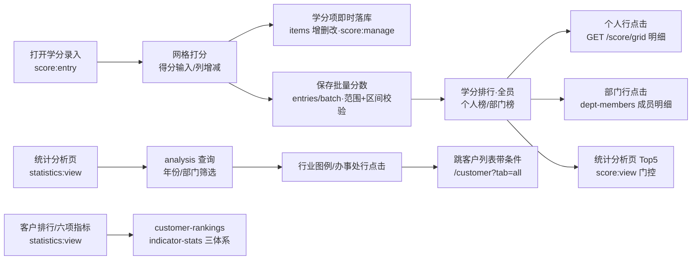

# PC·学分与统计

> 审计日期 2026-11-08 · 只读代码审计 · 所有按钮/接口均以源码为准，路径相对仓库根 `02-迭代源代码/`。
> 涉及前端：`aigicrm-ui/src/views/score/{entry,ranking}.vue`、`views/statistics/index.vue`、关联页 `views/indicator/index.vue`、`views/ranking/customer.vue`；后端：`ScoreController`、`ScoreService`、`StatisticsController`、`StatisticsQueryService`。

## 概述（侧栏位置/路由、权限码、谁能看到该菜单）

2026-11-05 起菜单分组定格（迁移 `aigicrm-backend/src/main/resources/db/migration/V2026.11.05.4__customer_score_stats_module_split.sql:31-44`）：撤销「考核与分析」组，**学分录入+学分排行 → 新「学分管理」组**；**统计分析独立成「统计分析」组**；**核心客户六项指标(/indicator)+客户排行(/ranking/customer) → 客户管理组**。权限码零变化。

| 页面 | 路由 | 权限码（路由守卫 `aigicrm-ui/src/router/index.js`） | 谁能看到（引自验收表） |
|---|---|---|---|
| 学分录入 | `/score/entry`（router/index.js:184-188） | `score:entry` | 验收表 §15：admin ✓ 总监 ✓ 行政 ✓ 销售员 ✗（菜单矩阵行「学分录入（score:entry）」；页面可写另需 `score:manage`=admin/总监，行政打开=只读） |
| 学分排行 | `/score/ranking`（router/index.js:190-194）；旧路径 `/incentive/ranking` 复用同一组件自愈（router/index.js:127-132） | `score:view` | 验收表 §16 + 菜单矩阵行「学分排行」：**四角色全 ✓（全员）** |
| 统计分析 | `/statistics`（router/index.js:176-182） | `statistics:view` | 验收表 §17 + 菜单矩阵行「统计分析组（顶层）」：**仅 admin/总监**（行政 ✗、销售员 ✗） |
| 核心客户六项指标 | `/indicator`（router/index.js:206-211，挂客户管理组） | `statistics:view` | 验收表 §5 + 矩阵行「核心客户六项指标/客户排行」：admin ✓ 总监 ✓ **行政 ✗** 销售员 ✓ |
| 客户排行 | `/ranking/customer`（router/index.js:195-202，挂客户管理组；菜单节点由 `V30__score_menu_and_customer_ranking_menu.sql:23-35` 创建） | `statistics:view` | 同上（admin/总监/销售员 ✓，行政 ✗） |

路由守卫统一在 `router/index.js:345-349`：无码访问回退到首个可访问路径或 /403。

## 功能清单（说人话）

- **学分录入**：管理员/总监在一张「学分项 × 同事」网格里打分；学分项（大类/产品/分值区间）可增删改；保存后整期分数落库并直达排行。
- **学分排行**：全员可看的公司级排行榜——个人榜（总学分/文件数/趋势）、部门榜（总学分/人数/人均），行点击可看个人学分明细、部门成员明细。
- **统计分析**：admin/总监的经营看板——客户/文件月度趋势、行业分布环图、办事处对比表、保护期状态与业务总览，行业/办事处可点击跳客户列表。
- **核心客户六项指标**：真核心/争核心客户榜单（五项评分+年度开票回款双门槛），挂客户管理组。
- **客户排行**：客户维度三体系排行（四项服务激励 / 客情商务关系深度 / 核心六项指标）同页对比。

## 按钮明细

### ① 学分录入（`views/score/entry.vue`）

前端可写门控：`isAdmin = hasPermission('score:manage')`（entry.vue:130）；无码者所有输入控件 `disabled` 并显示「只读」tag（entry.vue:23、70、75、81、90）。

| 按钮 | 在哪 | 前端行为 | 后端动作 | 谁能看到 |
|---|---|---|---|---|
| 年度下拉 | entry.vue:8-10 | 切年份触发 `watch(period, loadGrid)`（entry.vue:190）重拉网格 | GET `/api/score/grid?period=`（`score:view`，ScoreController.java:46-50）；Service 返回学分项+大类中文名回填（score_category 字典，ScoreService.java:90-98）、候选同事池按 `resolveModuleUsersWithinGroup(user,"score")` 收口（ScoreService.java:44-47,102-106）、已存参与名单与分数矩阵同范围过滤（ScoreService.java:117-121,145-148） | 页面进入者（score:entry）；无 manage 码时只读查看 |
| 保存 | entry.vue:18,167 | 收集全部已填分数批量提交，成功后跳排行（`goRanking` entry.vue:170 带当前周期） | POST `/api/score/entries/batch`（`score:entry`，ScoreController.java:52-67）；Service **@Transactional 增量 upsert**（ScoreService.java:155-262）：服务端逐一校验①参与名单人员与目标人员均在可管理范围（ScoreService.java:184-196）、②学分项存在、③分数落在本项 min~max 区间（ScoreService.java:198-207）；只清空名单内被显式置空的记录，名单外历史分数不删（修复数据丢失 FEAT-20260804，ScoreService.java:159-164,238-245）；重写本周期参与名单（仅集团范围内物理删，ScoreService.java:248-261）。无发提醒/审计副作用 | 有 `score:manage` 码者=**admin/总监**（验收表 §15；前端按钮仅 isAdmin 渲染，entry.vue:15-18） |
| 查看排行 | entry.vue:20,170 | 携当前录入周期跳 `/score/ranking?period=` | 无后端调用（页面跳转） | 同上（isAdmin 门控，entry.vue:15-22） |
| 导出 | entry.vue:21,183-188 | 先 `refreshDownloadToken` 确保下载 token 就绪（不拼空 token），再 fetch blob 强制下载 `学分统计-<周期>.xlsx` | GET `/api/score/export/grid?period=&token=`（**`score:manage`**，ScoreController.java:101-107——2026-10-08 修复：原挂 score:view 使只读者可直连导出全量）；Service 按数据范围导出：同事列与分数均经 `visibleUserIds()` 过滤（ScoreService.java:434-449），大类转中文名、0 分导出为 0 而非空白（ScoreService.java:474-483 注释），末行合计 | admin/总监（同保存） |
| 行内大类下拉 | entry.vue:70-72,156 | 改大类后即时落库并清空产品（2026-11-01 修复：原仅区间落库，改大类刷新即回退） | PUT `/api/score/items/{id}`（`score:manage`，ScoreController.java:29-35）；Service 直接 updateById（ScoreService.java:67-69），无范围/参数再校验 | admin/总监；无码者控件 disabled |
| 行内产品下拉 | entry.vue:75-78,157 | 按大类联动过滤后即时落库（D14 修复：字典未按大类维护时回退全量，entry.vue:148-152） | 同上 PUT `/api/score/items/{id}` | 同上 |
| 行内区间下拉 | entry.vue:81-83,158 | 选 `min-max` 区间即时落库 scoreMin/scoreMax | 同上 PUT `/api/score/items/{id}` | 同上 |
| 行删除（垃圾桶） | entry.vue:86,173-178 | 红色确认框（confirmAction）后删除该行 | DELETE `/api/score/items/{id}`（`score:manage`，ScoreController.java:37-42）；Service **级联删除该学分项全部周期评分明细**再删项——否则孤儿 entry 继续进排行（幽灵分数，体检 P1 2026-10-12，ScoreService.java:71-78）。无审计日志副作用 | admin/总监（确认框文案即承诺"所有周期数据一并删除"） |
| 得分输入框 | entry.vue:89-91,163 | 前端按行区间钳制暂存（0 分合法，`??` 区分未评与 0，entry.vue:161-163），随「保存」批量提交 | 无独立调用（随批量保存落库，服务端再验区间） | admin/总监可写；无码 disabled 只读 |
| 添加行 | entry.vue:97,171 | 建 0-5 区间空学分项并追加到网格 | POST `/api/score/items`（`score:manage`，ScoreController.java:23-27）；Service 默认 sortOrder 排到最后（ScoreService.java:57-65） | admin/总监 |
| 列头「×」移除同事 | entry.vue:52,179 | 仅从本次可见列移除（本地），保存时以 participantIds 提交 | 无独立调用；效果经批量保存的参与名单持久化（ScoreService.java:251-261），且名单外同事**历史分数保留不删**（ScoreService.java:238-245） | admin/总监 |
| 「+」添加同事 | entry.vue:55-63,180 | popover 从候选池（`hiddenUsers`）选人加列 | 无独立调用（同上随保存持久化；候选池来自 grid 接口的范围收口名单） | admin/总监 |

### ② 学分排行（`views/score/ranking.vue`，全员 `score:view`）

| 按钮 | 在哪 | 前端行为 | 后端动作 | 谁能看到 |
|---|---|---|---|---|
| 评分周期下拉 | ranking.vue:13-16,176-177 | 切周期重拉三路数据；周期仅「XXXX全年」（半年已退役） | GET `/api/score/ranking?type=personal|dept`、GET `/api/score/ranking/stats`（均 `score:view`，ScoreController.java:71-87）；**个人/部门榜无数据范围过滤=公司级全员榜**（设计规则注释 ScoreService.java:274-279）；排序=总分降序→文件数→姓名，趋势=上一期（上年全年）名次对比（ScoreService.java:291-328,534-547）；stats 汇总参与人数/部门数/最高学分/文件总数（ScoreService.java:402-430） | 全员（admin/总监/行政/销售员） |
| 「学分规则」 | ranking.vue:17,155-160 | 打开静态规则弹窗（4 条文案，纯前端） | 无后端 | 全员 |
| 页签 个人排行/部门排行 | ranking.vue:23-27,217 | 切 tab 重查 | 同上两接口（dept 走 `deptRanking` 按部门聚合总分/人数/人均，ScoreService.java:373-400） | 全员 |
| 个人榜行点击 | ranking.vue:57,247-271 | 打开「学分明细」弹窗，行结构对齐录入网格（#/大类/产品/区间/得分，得分>0 蓝字、0 显"—"） | GET `/api/score/grid?period=`（`score:view`）；⚠️该端点分数矩阵按 **score 模块数据范围**收口（ScoreService.java:145-148），与公司级排行不同口径，见⚠️疑点 N4 | 全员（但他人分数受范围过滤） |
| 部门榜行点击 | ranking.vue:87,226-239 | 打开「部门明细」弹窗（成员总分降序+公司名次） | GET `/api/score/ranking/dept-members?period=&deptName=`（`score:view`，ScoreController.java:91-97）；Service 复用个人排行结果按 officeName 过滤聚合（部门名空校验，零新查询面，ScoreService.java:343-371）；MP/PC 双端共用 | 全员 |
| 部门明细内成员行点击 | ranking.vue:111 | 复用个人明细弹窗下钻 | GET `/api/score/grid`（同上） | 全员（同范围限制） |
| 分页器（两榜） | ranking.vue:75,102 | 前端切片分页，切每页条数回第 1 页（ranking.vue:184-186） | 无后端 | 全员 |

### ③ 统计分析（`views/statistics/index.vue`，`statistics:view`，仅 admin/总监）

| 按钮 | 在哪 | 前端行为 | 后端动作 | 谁能看到 |
|---|---|---|---|---|
| 年份下拉 | index.vue:10-12 | 切年份 `loadAll` 全量重查 | GET `/api/statistics/analysis?year=&deptId=`（`statistics:view`，StatisticsController.java:56-62）；Service 逐月 COUNT 客户/文件（文件按上传者范围、客户按负责人范围），客户口径统一排 sea+archived（StatisticsQueryService.java:816-839 及各段 B5 注释）；数据范围守卫 `applyCustomerScope/applyFileScope`：null=全量、空集显式 `1=0` 防 IN() 500（StatisticsQueryService.java:1095-1114），口径源 `CustomerService.getCurrentScopeUserIds()`（CustomerService.java:1423-1440，statistics 模块 view 锚点解析） | admin/总监（两者档位均 all=全公司，验收表 §17） |
| 部门树选择 | index.vue:14-25 | 选部门（含子部门）重查；下拉数据来自 GET `/api/common/scope/depts`（`api/system.js:51-53`） | analysis 同上，`deptId` 经 `DeptTreeUtils.expandSubtree` 展开子树过滤（StatisticsQueryService.java:823,897） | admin/总监 |
| 刷新 | index.vue:26 | 手动 `loadAll`（另有聚焦重拉+30s 轮询，index.vue:416） | 同 analysis；并发拉 Top5（见下行） | admin/总监 |
| 行业分布图例行点击 | index.vue:143,278-283 | 跳客户列表带 `?tab=all&industry=<行业>`；合成段（其他/未填行业）不可点（index.vue:321-322） | 无统计后端调用（前端路由跳转）；行业数据来自 analysis 的 `industryStats`（服务端仅统计非空行业，StatisticsQueryService.java:958-964；前端补「未填行业」段并统一分母，index.vue:298-323） | admin/总监；下钻落客户列表后继承其客户范围 |
| 办事处对比行点击 | index.vue:167,178 | 跳客户列表带 `?office=<办事处>` | 无独立调用（行数据来自 analysis 的 `officeComparison`：按 dept_type=3 逐办事处算客户数/本月新增/活跃率/近5月，活跃率分子已排归档防 >100%，StatisticsQueryService.java:841-892） | admin/总监 |
| 人员学分 Top5（只读卡） | index.vue:242-249,407 | 仅当有 `score:view` 才发请求（2026-11-01 修复：原无门控 403 被吞成假"暂无数据"，index.vue:267-269）；**不带周期参数** | GET `/api/score/ranking?type=personal`（`score:view`）；⚠️空周期=全周期合计而非所选年份（ScoreService.java:276-278 空周期不过滤），与页面"截至 filterYear 年"文案口径不符，见⚠️疑点 N3 | admin/总监（均有 score:view） |

### ④ 核心客户六项指标（`views/indicator/index.vue`，`statistics:view`，挂客户管理组）

| 按钮 | 在哪 | 前端行为 | 后端动作 | 谁能看到 |
|---|---|---|---|---|
| 核心类型筛选下拉 | indicator/index.vue:36-40,110-112 | 真/争核心本地过滤，筛选后排名仍按原榜次、翻页回第 1 页（indicator:114-120） | 无独立调用（榜单来自页面加载） | admin/总监/销售员（行政无菜单） |
| 分页器 | indicator/index.vue:90-92 | 前端切片分页，排名=绝对榜次跨页连续（indicator:114-118） | 无后端 | 同上 |
| 页面加载（无按钮） | indicator:123-128 | 拉 `GET /api/statistics/indicator-stats`（`statistics:view`，StatisticsController.java:44-48）；Service：指标行随**客户可见范围**同步收口（StatisticsQueryService.java:431-454），核心三态=阶段总额年度口径纯金额双门槛（真核心=开票回款双≥大门槛、争核心=双≥小门槛，门槛读 sys_config 可配，StatisticsQueryService.java:57-98,458-461），个人/部门/大区三榜内存聚合（StatisticsQueryService.java:496-654） | admin/总监/销售员；**销售员实际口径见⚠️疑点 N2（待核）** |

### ⑤ 客户排行三体系（`views/ranking/customer.vue`，`statistics:view`，挂客户管理组）

| 按钮 | 在哪 | 前端行为 | 后端动作 | 谁能看到 |
|---|---|---|---|---|
| 周期下拉 | customer.vue:8-10,147 | 切周期重查；默认空=全部（原默认上半年导致 0 条已修，customer.vue:146 注释） | GET `/api/statistics/customer-rankings?period=`（`statistics:view`，StatisticsController.java:50-54）；Service 三榜同页组装（StatisticsQueryService.java:665-743）：**四项服务榜=客户可见范围基线**（2026-11-02 用户裁决选项一：你能看到哪些客户就按哪些客户算，StatisticsQueryService.java:685-695），激励记录按 customerId 过滤后按大类聚合（0 分客户不展示，StatisticsQueryService.java:696-717）；客情榜/指标榜复用 indicatorStats 的 customerRanking 再过滤排序（StatisticsQueryService.java:719-730）；门槛文案随接口回传（StatisticsQueryService.java:739-741） | admin/总监/销售员（销售员=仅本人客户口径，见⚠️疑点 N2） |
| 三页签切换 | customer.vue:43-45 | 四项服务/客情关系/核心指标本地切换 | 无后端 | 同上 |
| 核心类型筛选（仅指标页签） | customer.vue:47-51,164-166 | 真/争核心本地过滤 | 无后端 | 同上 |

> 注：客户排行页**无导出按钮**；验收表矩阵行「客户排行导出（incentive:rank:export）admin ✓ 总监 ✓ 行政 ✗ 销售员 ✗」的导出入口在激励统计页（属四项激励章节，非本片）。

## 业务链条

文字链：打开学分录入(score:entry) → 网格打分 → 学分项即时落库(PUT/POST/DELETE /score/items) → 保存批量分数(POST /score/entries/batch，服务端范围+区间双校验) → 学分排行(全公司，个人/部门) → 行点击个人/部门明细钻取 → 统计分析(GET /statistics/analysis) → 行业/办事处点击下钻跳客户列表闭环；客户排行三体系走 GET /statistics/customer-rankings 与 /indicator-stats。——对应 23 条业务链中的 **19.排行激励链** 与 **20.统计下钻链**。

## ⚠️ 疑点

**N1【9条重点之3】行政打开学分录入=只读——已核实，非故障。**
前端可写门控唯一依据 `score:manage`（entry.vue:130 `isAdmin` computed），行政有菜单（score:entry）无 manage 码 → 输入控件全部 `disabled`（entry.vue:70、75、81、90）、头部显示「只读」tag（entry.vue:23）、保存/导出/增删按钮整块不渲染（entry.vue:15-22）。后端与前端同门：items 增删改与导出挂 `score:manage`（ScoreController.java:24,30,38,104），批量保存挂 `score:entry` 但另有服务端范围+区间校验（ScoreService.java:184-207）。验收表 §15 口径一致（score:manage=admin/总监）。历史注：entry.vue:128-129 注释提及 2026-08-10 时字典曾授销售员 score:manage，现验收表（2026-11-07）已收口为 admin/总监，以验收表为准。

**N2【9条重点之9】六项指标/客户排行对销售员的实际数据口径——待线上预览核对。**
代码事实：`indicatorStats` 与 `customerRankings` 的客户集合均经 `visibleCustomers()` 过滤（StatisticsQueryService.java:431-440：admin=全量；其余按 `resolveModuleUsers(user,"statistics")` 解析，null=全量、非空=按 ownerId 过滤；691 行、447 行两处消费）。⚠️ 该方法上方注释仍写「核心客户六项指标全员可见、不做数据范围过滤」（StatisticsQueryService.java:446）——**注释与代码矛盾**，以代码为准（G2 2026-09-21 已收口）。销售员无 statistics 显式范围行时回退角色 dataScope 默认 `self`（`V1__baseline.sql:1149` 列默认 'self'；迁移目录未见 statistics 档位 seed），即销售员榜单应只含本人客户——但这与验收表 §5/§6「榜单允许暴露」的历史裁决相悖，且 2026-11-02 用户裁决已把三类排行统一为「客户可见范围基线」（StatisticsQueryService.java:685-689 注释原文）。三方（验收表待核项 / 方法注释 / 最新裁决注释）并存，**最终线上行为取决于生产库 role_perm_scope 是否有 statistics 行，代码审计无法定论，待核**。台账另注：客户排行接口 2026-11-02 前曾按分享制口径（2026-09-23），现按客户范围，分值聚合不含范围外客户。

**N3（本次新发现）统计分析页「人员学分 Top5」不按所选年份过滤。**
index.vue:407 调 `getScoreRanking({ type: 'personal' })` 未传 period；后端 `ranking()` 空周期时不过滤周期（ScoreService.java:276-278 `if (period != null && !period.isEmpty() ...)`），即 Top5=**全部周期累计总分**，而同卡所在「业务总览」区块文案写「截至 filterYear 年 X 月」（index.vue:189）。切换年份下拉时 Top5 数字不变（仅 analysis 重查带 year）。属展示口径不一致，非越权；是否要改成带年份过滤待产品定。

**N4（本次新发现）学分排行「个人明细」弹窗看得到榜、未必看得到分。**
个人行点击复用录入页端点 GET /score/grid（ranking.vue:253），该端点分数矩阵按 **score 模块数据范围**收口：`visible != null && !visible.contains(e.getUserId())` 的分数直接跳过（ScoreService.java:145-148）。销售员（score 模块回退 self）点开任意同事的明细行，所有得分格显示「—」、底部与公司级排行总分对不上；排行榜本身则是无范围过滤的全公司口径（ScoreService.java:274-279）。同一页面两个口径并存（榜=公司级、明细=个人范围），行政同理（score 模块范围通常窄于全公司）。是否预期"明细对全员开放"待核——若开放应给 /score/grid 明细读走公司级口径或另设端点。

**N5（本次新发现，低危）导出链与遗留路由备忘。**
①学分导出与前端按钮同门 `score:manage`（ScoreController.java:101-107 注释：2026-10-08 修复原 score:view 使只读者可直连 API 导出全量学分），前端先刷下载 token 再拼参（entry.vue:183-188），后端导出内容另按 score 数据范围收口（ScoreService.java:434-449）——链路闭合，无越权残留。②旧路径 `/incentive/ranking` 仍复用学分排行组件作书签自愈（router/index.js:127-132），侧栏高亮归位 `/score/ranking`，非独立功能。③本片五页面均只读统计/写学分，无提醒、审计日志、通知类副作用；删除学分项的级联删（ScoreService.java:71-78）是唯一不可逆副作用，已有确认框（entry.vue:175）。

> 9条重点中与本章节无关者（1、2、4、5、6、7、8）分属客户/激励/系统章节，本片未展开。
