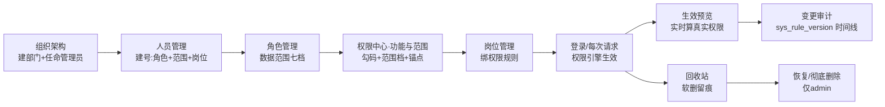

# PC·系统管理

> 审计日期 2026-11-08 · 只读代码审计（PC前端 aigicrm-ui/src + 后端 aigicrm-backend/src/main/java）
> 所有「后端动作」均读 Controller+Service 源码后撰写；「谁能看到」列引自《菜单功能按钮数据范围验收表-20261107》（行 51-58、149-160、185-186），未重新推导。

## 概述

- **侧栏位置/路由**：PC 侧栏「系统管理」组，共 7 个真实路由（`aigicrm-ui/src/router/index.js:216-311`）：
  - 人员管理 `/system/user`（码 `system:user:view`，index.js:216-221）
  - 组织架构 `/system/org`（码 `system:dept:view`，index.js:222-225）；旧路径 `/system/dept` 自愈同页（index.js:229-234）
  - 角色管理 `/system/role`（码 `system:role:view`，index.js:236-240）
  - 岗位管理 `/system/position`（码 `system:position:view`，index.js:242-246）
  - 系统设置 `/system/config`（码 `system:config:view`，index.js:248-252）；旧路由 `/system/perm-center`、`/system/log` 均重定向到此（index.js:258-274，权限中心/日志已收敛为系统设置内页签）
  - 回收站 `/system/recycle`（码 `system:recycle:view`，index.js:276-282）
  - 权限规则 `/system/rule`（码 `system:rule:view`，index.js:283-287）
  - 本月激励查询阅读排行榜 `/system/incentive-read-ranking`（码 `incentive:read-ranking:view`，index.js:289-299）
  - 集团管理 `/system/group`（码 `system:group:view`，index.js:301-307）
- **谁能看到**（验收表实拉 sys_role_menu，行 51-58、149-160、185-186）：组织架构/人员管理/部门管理 = admin✓ 总监✓ 行政✓ 销售员✗；角色/岗位/集团管理、权限规则 = admin✓ 总监✓ 行政✗ 销售员✗；回收站 = admin✓ 总监✓ 行政✗；**恢复/清空回收站按钮 = 仅 admin✓（总监✗）**；系统设置/系统配置编辑/部门编辑/菜单查看/组织管理员 = admin✓ 行政✓（总监✗——即总监可看大部分系统管理但无系统设置组）；日志查看（system:log:view）与本月激励查询阅读排行榜 = **仅 admin**（验收表行 185「总监也看不到」）。
- **页面骨架**：`views/system/` 22 个文件；人员管理由 user.vue 组合 UserFilterBar/UserTable/UserPager/UserFormDialog 四子组件（user.vue:20-23）+ 共享 composable `useUserList.js`；系统设置由 config.vue 左导航挂 6 个内页签（config.vue:17-52）；退役组件 PermMatrixManager.vue 全库无引用（按钮全量对照 F4，本次 grep 复核仅自身文件命中）。

## 功能清单

| 功能 | 说人话 |
|---|---|
| 人员管理 | 建号/改号/停号/删号/重置密码，选角色+数据范围七档+岗位多选；删人自动把名下客户释放公海 |
| 组织架构 | 维护总部→大区→办事处→部门四级树，可给每个组织任命「组织管理员」 |
| 角色管理 | 角色主档+数据范围七档+自定义组织矩阵；功能勾选已收口权限中心（此处只读） |
| 岗位管理 | 岗位 CRUD + 给岗位绑定权限规则；人员编辑弹窗里给用户挂岗位（第一个为主岗位） |
| 集团管理 | 多集团主档维护；「删除」实为软禁用可恢复 |
| 系统设置·基本设置 | 系统名/Logo、保护期四口径、核心客户双门槛（保存即全量重算核心标签）、存储配额与扩容申请、客户编号规则、新客户自动共享、上级看下属/组织负责人开关 |
| 系统设置·字典管理 | 字典类型/数据的增删改（业务下拉的源头） |
| 系统设置·审批配置 | 捞取/转移/延期/扩容四类流程的审批人+会签规则 |
| 系统设置·激励类别 | 激励一/二级分类与分值维护（三级小类已撤下管理页，走 SQL） |
| 系统设置·权限中心 | 四页签：功能与范围（给谁→码→范围档→锚点）/ 专项权限（公海池名单+激励四开关授权）/ 生效预览（实时算某人真实权限）/ 变更审计（sys_rule_version 只读时间线） |
| 系统设置·日志管理 | 全模块操作日志/登录日志 7 页签 + 安全审计 append-only 只读 |
| 权限规则 | 列过滤/组织过滤/时间范围三类 SQL 模板规则，供岗位绑定消费 |
| 回收站 | 已删客户/人员/文件三页签：查看详情、恢复、彻底删除、文件批量清空 |
| 阅读排行榜 | 本月激励发布记录为分母、个人已读为分子的全员排行（仅 admin） |
| 定时任务（无页面） | 客户保护期检查每日 02:00 自动跑（CustomerExpireTask.java:91 cron `0 0 2 * * ?`）；`POST /api/system/task/check-expire` 手动触发仅系统管理员（ScheduledTaskController.java:19-27），前端全库 grep 无入口按钮 |

## 按钮明细

### 人员管理（/system/user）

| 按钮 | 在哪 | 前端行为 | 后端动作 | 谁能看到 |
|---|---|---|---|---|
| 新增用户 | UserFilterBar.vue:8（码 `system:user:add`） | 开弹窗，账号按办事处最大流水号提示（useUserList.js:66-84） | 建账号：必填五项兜底校验、用户名唯一、随机初始密码+首登强制改密（明文只弹一次「复制并转交」useUserList.js:280-286）；防提权双闸——不可授 admin 角色且所授角色/数据范围不得宽于自身（SysUserService.validateGrantableRoleAndScope:290-314，权限子集校验:315-338）；非 admin 目标组织须在可见范围（assertTargetOrgVisible:339-371）；写审计 securityAudit.userAdminEvent("user_create")（SysUserController.java:41-50、SysUserService.java:373-438） | admin✓ 行政✓（新增按钮码 system:user:add） |
| 搜索框（回车） | UserFilterBar.vue:11 | keyword 回到第 1 页重查 | 分页查人员；服务端可见范围收口：admin 不限，非 admin 按数据范围解析可见部门并与请求 deptIds 交集，越权请求直接返回空页不下发记录（SysUserService.page/applyVisibleDeptScope:136-197） | 登录+`system:user:view`/`system:org:admin`（SysUserController.java:24-25） |
| 部门树筛选 | UserFilterBar.vue:12 | 选部门自动带上全部子部门 ID（useUserList.js:88-98） | 同上，deptIds 与可见集交集 | 同上 |
| 状态筛选 | UserFilterBar.vue:13-14 | 正常/禁用筛选重查 | 同上 status 参数 | 同上 |
| 列表失败「重试」 | UserTable.vue:7 | 重新 loadData | 同列表接口 | 同上 |
| 行「编辑」 | UserTable.vue:69（码 `system:user:edit`） | 回显详情（custom 拉授权组织 useUserList.js:239-244；岗位回显 getUserPositions useUserList.js:246-253） | 改资料/换角色：非 admin 一律过 canManageUser 守卫（防行政越权改 admin，SysUserController.java:52-63 注释 P0-1）；数据范围必选、防提权同 create；单角色替换保留激励载体角色防静默提权（SysUserService.update:443-512）；custom 组织保存/清空（:496-503）；改后 Redis 权限缓存 evict+版本递增（:505-511）；另调 PUT /system/positions/users/{id} 分配岗位（useUserList.js:276-278，后端 SysPositionController.java:80-93：非 admin 指派「携带权限规则的岗位」直接拒绝 :86-89，目标用户可见性+岗位集团/组织校验 SysPositionService.assignUserPositions:169-199） | admin✓ 行政✓ |
| 行「重置密码」 | UserTable.vue:70（码 `system:user:edit`） | 红色确认框后生成随机临时密码弹窗展示一次（useUserList.js:298-310） | 重置口令：非 admin 禁止重置 admin 角色账号（服务层 H1 兜底 SysUserService.resetPassword:514-535）；置 pwdResetRequired=1 + DB 改密时刻（旧 token 立即失效 jwtTokenProvider.markPasswordChanged）；写审计 user_reset_password | admin✓ 行政✓（对 admin 目标必 403） |
| 行「删除」 | UserTable.vue:71（码 `system:user:delete`） | 确认框明示「名下客户将释放到公海池」（useUserList.js:312-324） | 软删用户的事务级联：先校验后落审计（拒绝路径零副作用 P2-2）；非 admin 禁删 admin 账号；名下客户逐个入公海「离职交接」（无启用公海池的客户跳过入池但清分享）；清该用户作为分享接收方的记录；清角色/岗位/用户组织/组织管理员关联；软删后权限缓存 evict（SysUserService.deleteUser:738-790） | admin✓ 行政✓（对 admin 目标必 403） |
| 弹窗「保存」 | UserFormDialog.vue:104 | 字段级校验（姓名/账号/角色/手机号必填、邮箱格式、数据范围必选 useUserList.js:46-57），失败自动滚到首个错误字段（:264-268） | → 即上面的 create/update 链 | 同编辑/新增 |
| 弹窗「取消」 | UserFormDialog.vue:103 | 关弹窗 | 无 | 同上 |
| 分页器 | UserPager.vue（page-sizes 30/50/100） | 换页重查 | 同列表 | 同上 |

### 组织架构/部门（/system/org，dept.vue）

| 按钮 | 在哪 | 前端行为 | 后端动作 | 谁能看到 |
|---|---|---|---|---|
| 新增部门 | dept.vue:5（canEditDept=`system:dept:edit`，dept.vue:120） | 弹窗预选父级下级类型（dept.vue:164-169） | 建组织节点：集团边界守卫——未传 groupId 兜底当前集团（无集团 fail-closed 拒绝），显式越权集团拒绝（SysDeptService.create:90-102，SysDeptController.java:39-44 码 `system:dept:edit`） | admin✓ 行政✓（验收表「部门编辑」行 56） |
| 树行「管理(N)」 | dept.vue:35 | 打开组织管理员弹窗，计数并发拉取（dept.vue:151-156） | 列出该组织管理员（GET /system/depts/{deptId}/admins，SysDeptController.java:63-67，码 `system:dept:view`） | admin✓ 行政✓ |
| 树行「编辑」 | dept.vue:36 | 弹窗回显，前端层级校验「根=总部/大区挂总部/办事处挂大区/部门挂办事处」（dept.vue:184-193） | 改组织：三向集团边界（目标/新归属/新父节点任一跨集团拒）；改 groupId/层级后全量失效权限缓存+版本递增（SysDeptService.update:104-128） | 同上 |
| 树行「添加子部门」 | dept.vue:37 | 弹窗带 parentId | 同 create | 同上 |
| 树行「删除」 | dept.vue:38 | 前端先拦「有子部门」（dept.vue:216-219），confirmAction 红钮 | 删组织：集团边界先拒；有子部门拒；部门下有在职用户拒（SysDeptService.delete:130-149） | 同上 |
| 弹窗「保存」 | dept.vue:80 | → create/update | 同上 | 同上 |
| 管理员弹窗「添加」 | dept.vue:92 | 远程搜用户（size=50，dept.vue:255-260）后选人 | 任命组织管理员：仅能在调用者管辖组织内任命（canManageOrg，OrgAdminService.addOrgAdmin:57-77）；幂等去重；写 sys_org_admin 后失效该用户权限缓存+版本递增 | admin✓ 行政✓（须是本组织管理员/超管才过 canManageOrg） |
| 管理员弹窗「移除」 | dept.vue:99-103（popconfirm） | 确认后移除 | 移除前校验被移除记录的组织在管辖范围（OrgAdminService.removeOrgAdmin:81-93）；同步失效缓存 | 同上 |

### 角色管理（/system/role，role.vue）

| 按钮 | 在哪 | 前端行为 | 后端动作 | 谁能看到 |
|---|---|---|---|---|
| 新增角色 | role.vue:5（码 `system:role:add`，role.vue:133） | 弹窗含数据范围七档下拉（role.vue:55-63） | 建角色：防提权（非 admin 不可建 admin 码角色/范围超自身拒，SysRoleService.validateGrantableRole:81-104）；集团边界 fail-closed；编码唯一；同事务落菜单勾选（menuIds 超集校验 :311）与 custom 组织矩阵（SysRoleService.create:106-130）；写审计 permission_change("role_create") | admin✓ 总监✓ |
| 行「编辑」 | role.vue:30（码 `system:role:edit`） | custom 时拉组织矩阵回显（GET /system/roles/{id}/orgs，role.vue:215-224） | 改角色：存在性+集团越权拒；role_code 改名同步迁移 role_perm_scope 防孤儿配置（:157-163）；menuIds 清空重建（含权限子集校验）；dataScope 变更同步组织关联；缓存 evictByRole+受影响用户版本递增（SysRoleService.update:133-188）；写审计 role_update | admin✓ 总监✓ |
| 行「权限」 | role.vue:31（canEditRole 显隐） | **只读弹窗**：树形回显该角色已勾菜单，顶部提示「功能勾选已收口至权限中心」（role.vue:100-114、276-287） | GET /system/roles/{id}（码 view）+ GET /system/menus/tree（码 `system:menu:view`，SysMenuController.java:19-23） | admin✓ 总监✓ |
| 「去权限中心配置」 | role.vue:113 | 置 activeTab='permCenter' 并跳 /system/config（role.vue:292-296） | 无（纯导航） | 同上 |
| 行「删除」 | role.vue:32（码 `system:role:delete`） | confirmAction | 删角色：集团越权拒；先捕获受影响用户再删绑定（缓存自愈 G2 修复）；连带清 role_menu/role_org/role_perm_scope/sys_user_role/biz_folder_acl（按集团限定防跨集团误删）；逐用户 evict（SysRoleService.delete:216-260）；写审计 role_delete | admin✓ 总监✓ |
| 组织矩阵勾选（custom） | role.vue:73-80 | 勾选即含下级（后端固定 include_children=1，契约注释 role.vue:147-151） | 随 POST/PUT /system/roles 请求体 orgIds 一次落库（role.vue:241-253；SysRoleService.saveRoleOrgs:327+）；独立入口 PUT /system/roles/{id}/orgs 有集团守卫（SysRoleService.updateOrgs:191-214） | 同编辑 |
| 弹窗「保存」 | role.vue:95 | → create/update | 同上 | 同上 |

### 岗位管理（/system/position，position.vue）

| 按钮 | 在哪 | 前端行为 | 后端动作 | 谁能看到 |
|---|---|---|---|---|
| 新增岗位 | position.vue:5（码 `system:position:add`） | 弹窗（编码字母开头正则） | 建岗位：集团边界 fail-closed+越权拒；编码唯一（SysPositionService.create:75-92，SysPositionController.java:29-34） | admin✓ 总监✓ |
| 行「编辑」 | position.vue:33（码 `system:position:edit`） | 弹窗回显 | 改岗位：三向集团边界（SysPositionService.update:94-115） | admin✓ 总监✓ |
| 行「规则」 | position.vue:34（canEditPosition 显隐） | checkbox 勾选规则列表（先 GET /system/positions/{id}/rules 回显，position.vue:219-228） | 读规则（码 `system:position:view`）；**保存规则 admin-only**：非 admin 直接 403「仅系统管理员可修改岗位权限规则」（SysPositionController.java:59-70，P1 复审修复——岗位规则=权限定义本身）；保存=清空重建，且缓存失效/版本递增在 early-return 之前（SysPositionService.saveRules:141-156） | admin✓ 总监✓（按钮可见，但非 admin 保存必 403 ⚠️见疑点） |
| 规则弹窗「保存规则」 | position.vue:100 | → PUT …/rules | 同上 | 同上 |
| 行「删除」 | position.vue:35（码 `system:position:delete`） | confirmAction | 删岗位：集团越权拒（SysPositionService.delete:116-134） | admin✓ 总监✓ |
| 弹窗「保存」 | position.vue:74 | → create/update | 同上 | 同上 |

### 集团管理（/system/group，group.vue）

| 按钮 | 在哪 | 前端行为 | 后端动作 | 谁能看到 |
|---|---|---|---|---|
| 新增集团 | group.vue:5（码 `system:group:add`） | 弹窗（编码禁改规则同岗位） | 建集团：编码唯一（SysGroupService.create:28-35，SysGroupController.java:25-30）。**无集团边界校验（本表 CRUD 全无）⚠️见疑点** | admin✓ 总监✓ |
| 行「编辑」 | group.vue:23（码 `system:group:edit`） | 弹窗回显 | 改集团（SysGroupService.update:36-40） | admin✓ 总监✓ |
| 行「禁用」 | group.vue:25（码 `system:group:delete`；2026-11-02 文案已改「禁用」，group.vue:24 注释 P2） | confirmAction「可随时重新启用」 | 软禁用=置 status=0（SysGroupService.delete:41-47），非物理删除 | admin✓ 总监✓ |
| 弹窗「保存」 | group.vue:53 | → create/update | 同上 | 同上 |

### 系统设置骨架（/system/config，config.vue）

| 按钮 | 在哪 | 前端行为 | 后端动作 | 谁能看到 |
|---|---|---|---|---|
| 左导航页签×6 | config.vue:19-39（基本设置/字典管理/审批配置/激励类别管理/权限中心/日志管理） | 自定义按钮切换，重组件首访才挂载（visited-once，config.vue:76-79）；**日志管理页签显隐=码 `system:log:view`**（config.vue:71） | 页签为纯前端切换；数据加载见下列各块 | 系统设置菜单= admin✓ 行政✓（验收表行 56）；日志页签仅 admin（行 57） |

### 系统设置·基本设置（BasicSettings.vue）

| 按钮 | 在哪 | 前端行为 | 后端动作 | 谁能看到 |
|---|---|---|---|---|
| 上传Logo | BasicSettings.vue:20-29（el-upload→POST /api/file/upload 带 Bearer，:207） | 上传成功即触发保存，失败回滚预览（:320-335） | Logo 值变更仅平台 admin 可改：校验必须以 `/api/file/download/public/` 开头、禁 `..` 穿越、归一后首段必须 public（SysConfigController.validateLogoConfigs/validateLogoValue:124-156）；PUT /system/configs 码 `system:config:edit`（:51-52） | admin✓（行政点保存其它项可以、改 Logo 会 403） |
| 清除Logo | BasicSettings.vue:30 | 置空后走保存 | 空值=清除 Logo（validateLogoValue:143） | 同上 |
| 真核心/争核心双门槛 | BasicSettings.vue:66-81（万元输入） | 前端兜底：1–1000000 整数且 minor≤major（:372-386） | 服务端同款校验双保险（SysConfigController.validateCoreThresholdConfigs:84-99）；**保存后门槛真实变化才全量重算客户核心标签**（customerService.recalculateAllCoreStatuses，:57-65） | 编辑需 `system:config:edit`（BasicSettings.vue:203、174 保存钮+只读提示 :173） |
| 文件回收站保留天数 | BasicSettings.vue:93-100 | 0–3650 整数，0=不自动清理（:215-228） | 随整表 PUT upsert | 同上 |
| 允许申请扩容/可申请人员/单用户配额上限 | BasicSettings.vue:101-123 | 开关+多选人员（JSON 数组）+1–1024GB 上限 | 随保存写入 file.storage.apply.* 三键；后端消费见 SysUserService 常量 :46-58（上限 1GB–1TB 边界） | 同上 |
| 默认存储空间 | BasicSettings.vue:88-92 | GB 编辑、字节落库（:337-345） | 写 user.default.storage；create 用户时读取赋默认配额（SysUserService.create:411-419） | 同上 |
| 编号规则 | BasicSettings.vue:130-135 | 大区-年月-顺序号 / 大区-顺序号 | 写 customer.code.rule | 同上 |
| 新客户默认共享（上级/管理员/指定角色/指定人员） | BasicSettings.vue:136-154 | autoShare 对象序列化回 customer.auto_share JSON（:393-399） | 随整表保存 | 同上 |
| 上级看下属/组织负责人开关 | BasicSettings.vue:155-167 | 归一 true/false 字符串，DB 无行默认开（:290-292） | 写 perm.superior.see.subordinate / perm.org.leader.see.org（系统级数据范围推导开关） | 同上 |
| 「保存设置」 | BasicSettings.vue:174 | 防程序化绕过：无码直接 warning 返回（:346-351）；整表按 configKey upsert（:400-409） | PUT /system/configs（批量 upsert）；Logo 变更 admin 校验+门槛重算副作用见上 | admin✓ 行政✓（码 `system:config:edit`） |
| 公开配置/Logo 读取（无按钮） | — | 登录页品牌与保护期口径回显 | GET /system/configs/public 匿名白名单 7 键（SysConfigController.publicConfig:158-175）；GET /system/configs/logo 只读 public 目录防穿越（:177-222） | 匿名 |

### 系统设置·字典管理（DictManager.vue）

| 按钮 | 在哪 | 前端行为 | 后端动作 | 谁能看到 |
|---|---|---|---|---|
| 类型「新增/编辑/删除」 | DictManager.vue:7、24-25（canEditConfig=`system:config:edit`，:119；删除仅非内置 :25） | 字段级校验+confirmAction | 类型 CRUD：读 `system:config:view`，写 `system:config:edit`（SysDictController.java:22-48） | admin✓ 行政✓ |
| 类型行选中 | DictManager.vue:10-15 | 右侧载入数据列表 | GET /system/dict/data/type/{id}（**登录即可**，SysDictController.java:65-69——业务表单下拉依赖） | 全员 |
| 数据「新增/编辑/删除」 | DictManager.vue:40、53-54 | 弹窗保存 | 数据 CRUD 码 `system:config:edit`（SysDictController.java:71-91）；按 code 读数据亦登录即可（:59-63） | admin✓ 行政✓（写） |

### 系统设置·审批配置（approvalConfig.vue）

| 按钮 | 在哪 | 前端行为 | 后端动作 | 谁能看到 |
|---|---|---|---|---|
| 「新增流程」 | approvalConfig.vue:6（canEditConfig=`system:config:edit`，:95） | 弹窗：流程类型四选一（捞取/转移/延期/存储扩容，类型禁改 :44）、审批人按人/按角色多选、会签开关 | POST /api/approval/config（码 `system:config:edit`，ApprovalConfigController.java:27-31；读列表 :20-24 码 view） | admin✓ 行政✓ |
| 行「编辑」 | approvalConfig.vue:28 | 弹窗回显（approverIds JSON 兜底解析 :115-118） | PUT /api/approval/config/{id}（:34-40） | 同上 |
| 行「删除」 | approvalConfig.vue:29-31（popconfirm） | 确认删除 | DELETE /api/approval/config/{id}（:42-48） | 同上 |
| 弹窗「保存」 | approvalConfig.vue:78 | → create/update | 同上 | 同上 |

### 系统设置·激励类别管理（CategoryManager.vue）

| 按钮 | 在哪 | 前端行为 | 后端动作 | 谁能看到 |
|---|---|---|---|---|
| 「新增类别」 | CategoryManager.vue:13（码 `incentive:edit`） | 弹窗上级只列顶级（三级小类撤下，:144-148） | POST /incentive/categories（码 `incentive:edit`，IncentiveController.java:30-36） | admin✓ 总监✓ 行政✓（全员有 incentive:edit 者可写；验收表行 46 四项激励组三角色✓） |
| 组头「编辑/子项/删除」 | CategoryManager.vue:27-29 | 子项=以该顶级为父新建；删除前拦有子项（:187-192） | PUT/POST/DELETE 同上族 | 同上 |
| 子项行「编辑/删除」 | CategoryManager.vue:63-64 | 弹窗/confirm | 同上族 | 同上 |
| 弹窗「保存」 | CategoryManager.vue:109 | 名称必填前端兜底（:174） | 同上族；树读 GET /incentive/categories（码 `incentive:view`，IncentiveController.java:24-29） | 同上 |

### 系统设置·权限中心（PermCenter.vue 四页签）

| 按钮 | 在哪 | 前端行为 | 后端动作 | 谁能看到 |
|---|---|---|---|---|
| 页签 chips×4（功能与范围/专项权限/生效预览/变更审计） | PermCenter.vue:9-12 | chip 切换+惰性挂载（:154-156） | 无（纯前端） | 系统设置可见者（admin/行政）；**可写门槛另加 isAdmin** |
| 主体切换 radio（按角色/岗位/用户） | PermScopeManager.vue:7-11 | 切换拉岗位/用户选项（:352-368） | GET /system/positions、GET /system/users | 权限矩阵读需 `system:menu:view`/`system:role:view`（PermScopeManager.vue:32-35 空态文案） |
| 「刷新」 | PermScopeManager.vue:18 | 重拉角色/菜单树/各角色 menuIds（:386-397） | GET /system/roles、/system/menus/tree、/system/roles/{id}×N（usePermissionData.loadPermData:147-157） | 同上 |
| 权限项勾选（单点） | PermScopeManager.vue:65-66（禁用条件 `!isRoleMode \|\| !canEditScope`；canEditScope=`isAdmin ∧ system:config:edit`，:223） | 本地翻转→PUT 整角色 menuIds，失败回滚勾选（usePermissionData.togglePerm:127-145） | PUT /system/roles/{roleId}（saveRoleMenus 权限子集校验防横向提权 SysRoleService.java:311） | admin✓（行政可见但禁用） |
| 范围下拉/锚点下拉/「荐」标 | PermScopeManager.vue:72-83 | 仅对后端真实消费的 13 个码显示控件（PERMISSION_SCOPE_TARGETS:165-185），其余灰字标注真实控制面（:189-211） | PUT /system/perm-scopes/{roleCode} 或 /assignee/{type}/{key}：写门槛=码 `system:config:edit` **+ requireAdmin()**（非超管 403 防自提权，RolePermScopeController.java:31-38、50-61、63-69）；读=码 `system:config:view`（:25-27、43-47） | admin✓（读写）；行政可读 |
| 「全不勾/全勾」 | PermScopeManager.vue:57-58（仅角色模式+可写） | 单次 PUT 整角色 menuIds（:238-254） | 同单点勾选 | admin✓ |
| 「恢复默认范围」 | PermScopeManager.vue:59 | 空数组覆盖（:308-323） | PUT perm-scopes …=[]（同上 requireAdmin） | admin✓ |
| 高危组合二次确认（删除/财务×全部） | PermScopeManager.vue:288-295 | ElMessageBox 确认后才保存 | 同范围保存 | admin✓ |
| 专项权限·「添加授权」（激励） | PermCenter.vue:27（canEdit=`isAdmin ∧ system:config:edit`，PermCenter.vue:151） | PermGrantDialog 弹窗：可见性区（角色批量+组织人员树+两查看开关）/编辑区/删除区各自独立名单，提交时按终态合组逐人 upsert（PermGrantDialog.vue:13-111、usePermissionData.grantPerm:249-313） | POST /incentive/permission/grant：仅超管（码 `system:config:edit`+isAdmin 硬校验，IncentivePermissionController.java:76-80）；roleIds 展开为启用角色启用成员（:99-113）；四 flag 全量覆盖 upsert biz_incentive_grant；**每次授权写审计 sys_rule_version("incentive_grant:{uid}", 旧4flag→新4flag)**（:116-137、143-145）；canViewShared 缺省 1、canViewAll 缺省 0（:82-83） | admin✓ |
| 专项权限·「撤销」 | PermCenter.vue:47 | 确认「回到基础可见范围」 | DELETE /incentive/permission/{userId}：仅超管；删授权行=回到默认（分享可见=开）；无行幂等；审计写「默认(分享可见=开,其余=关)」（IncentivePermissionController.java:163-180） | admin✓ |
| 专项权限·公海池「新增/编辑/删除」 | SeaConfigManager.vue:6、21-22（canEditSeaConfig=`sea:config:edit`，:178） | 池级名单勾选（部门/人员/角色，勾角色=成员自动获得） | POST/PUT/DELETE /api/sea/configs（码 `sea:config:edit`，SeaController.java:110-127）；名单查看 GET /api/sea/configs（码 view，:87-89） | admin✓ 行政✓（验收表行 49 公海配置三角色✓；销售员只读 visible 口径 :94-97） |
| 生效预览·搜索/选人 | PermCenter.vue:58-61 | 远程搜人→实时算真实权限（:168-190） | GET /system/users + GET /system/perm-center/preview（码 `system:config:view`；复用每请求鉴权同链路只读重建目标用户，PermCenterController.java:30-37） | admin✓ 行政✓（只读） |
| 变更审计·分页 | PermCenter.vue:130-131 | 翻页读时间线 | GET /system/rule-versions（码 `system:config:view`；append-only 表触发器拒改删，SysRuleVersionController.java:23-32） | admin✓ 行政✓（只读） |

### 系统设置·日志管理（log.vue 内嵌页签）

| 按钮 | 在哪 | 前端行为 | 后端动作 | 谁能看到 |
|---|---|---|---|---|
| 页签×7（全部/操作/登录/文件/人员/系统/安全审计） | log.vue:126-135 | 切页签重查；审计页签走独立接口+事件类型筛选（:151-160） | 操作日志 GET /system/logs（码 `system:log:view`，SysLogController.java:20-31）；安全审计 GET /system/audit-logs（同码；append-only 表库层触发器拒改删，SysAuditLogController.java:27-35） | **仅 admin**（验收表行 57；config.vue:71 页签显隐同码） |
| 日期范围/关键字/事件类型筛选 | log.vue:26-33 | 审计页签隐藏日期框（后端不支持日期参数，:25 注释） | 同上列表参数 | 同上 |
| 行「查看」 | log.vue:72 | 详情弹窗（:87-96、205-208） | 同列表数据，无额外请求 | 同上 |
| 页签计数/分页 | log.vue:79-83、175-185 | 计数条+每页条数切换 | GET /system/logs/counts（码 `system:log:view`，SysLogController.java:33-39） | 同上 |

### 权限规则（/system/rule，rule.vue）

| 按钮 | 在哪 | 前端行为 | 后端动作 | 谁能看到 |
|---|---|---|---|---|
| 「新增规则」 | rule.vue:5（码 `system:rule:add`，:108） | 弹窗：列过滤/组织过滤/时间范围三型，规则值支持 `${user.userId}` 等变量模板（:71-79） | POST /system/rules（码 `system:rule:add`，SysPermissionRuleController.java:25-30）；规则供岗位「规则」绑定后在登录时并入 RuleResult 生效（SysPositionController.java:83-84 注释） | admin✓ 总监✓ |
| 行「编辑」 | rule.vue:31（码 `system:rule:edit`） | 编码禁改 | PUT /system/rules/{id}（:32-38） | admin✓ 总监✓ |
| 行「删除」 | rule.vue:32（码 `system:rule:delete`） | confirmAction | DELETE /system/rules/{id}（:40-45） | admin✓ 总监✓ |
| 弹窗「保存」 | rule.vue:93 | 必填四项前端兜底（:150-154） | 同上族 | 同上 |

### 回收站（/system/recycle，recycle.vue）

| 按钮 | 在哪 | 前端行为 | 后端动作 | 谁能看到 |
|---|---|---|---|---|
| 统计卡×3 / 页签 seg×3 | recycle.vue:11-24、31-39 | 点卡片/页签切换客户/人员/文件列表；计数全量口径与搜索隔离（:377、454-470） | GET /system/recycle/customers｜users｜files（码 `system:recycle:view` **+ 全端点 requireAdmin()**，RecycleController.java:38-46、69-77、100-108） | admin✓（总监菜单可见但接口 403 ⚠️见疑点；验收表行 54-55） |
| 搜索框 | recycle.vue:42-46 | 回车/清空触发重查 | 同上列表 keyword | 同上 |
| 「清空回收站」（仅文件页签） | recycle.vue:48-50（canPurge=`system:recycle:purge`，:351） | 先重拉全量计数再确认（数量不一致不进流程，:558-574） | POST /system/recycle/files/purge（码 `system:recycle:purge`+requireAdmin）；逐文件行锁复核 deleted=1 后物理删内容+台账，返回清理/跳过/失败计数（RecycleController.java:140-152、RecycleService.purgeAllDeletedFiles） | **仅 admin** |
| 「刷新」 | recycle.vue:52 | 列表+计数一起刷新 | 同列表 | 同上 |
| 行点击/「详情」 | recycle.vue:79-89、110、159、217 | 抽屉展示全字段+关联数据计数+不可删原因提示；请求带序号防旧响应覆盖（:586-603） | GET /system/recycle/…/{id}（view 码+requireAdmin；详情含 related 计数，RecycleService.deletedCustomerDetail:166-174 等） | admin✓ |
| 「恢复」（行内/抽屉，三实体） | recycle.vue:111、160、218、324（canRestore=`system:recycle:restore`，:350） | 确认框列明恢复校验项 | 客户恢复：同名活跃客户拒/原负责人已删拒/公海残留拒/行级条件更新（RecycleService.restoreCustomer:98-122）；人员恢复：账号被占拒/原部门已删拒，恢复后**角色岗位组织已清空需重新分配**，权限缓存 evict+版本递增（restoreUser:141-162）；文件恢复：行锁防并发清理（TOCTOU 注释 :340-348），内容已物理清除则 fail-closed 拒，私有文件校验上传人（restoreFile:340+）；各写审计 writeAuditLog | **仅 admin** |
| 「彻底删除」（行内/抽屉，三实体） | recycle.vue:112、161、219、325（canPurge） | 确认「不可恢复；有业务关联会拒绝」 | 客户：发票/回款/激励/指标/日志/阶段金额/审批存在即拒，通过后连带删分享/提醒/公海/联系人（hardDeleteCustomer:212-239）；人员：业务关联拒，随删阅读记录/角色/岗位/组织/管理员关联+缓存 evict（hardDeleteUser:242-271）；文件：激励引用拒，行锁复核后物理删内容+分享+台账（hardDeleteFile:274-301）；各写审计 | **仅 admin** |
| 抽屉「下载文件」 | recycle.vue:314 | downloadFile 带 Bearer（:665-670） | GET /system/recycle/files/{id}/content（view 码+requireAdmin，按 deleted=1 行读存储内容，RecycleController.java:118-123） | admin✓ |
| 分页 | recycle.vue:226-230 | 换页/换每页条数 | 同列表 | 同上 |

### 本月激励查询阅读排行榜（/system/incentive-read-ranking）

| 按钮 | 在哪 | 前端行为 | 后端动作 | 谁能看到 |
|---|---|---|---|---|
| 月份选择 | incentive-read-ranking.vue:9-18 | 换月重查 | GET /incentive/read-ranking（码 `incentive:read-ranking:view`，IncentiveController.java:213-219） | **仅 admin**（验收表行 58/185；路由与接口同码，默认只绑系统管理员角色，index.js:290 注释） |
| 「刷新」 | incentive-read-ranking.vue:19 | 重新 load | 同上 | 同上 |
| 分页 | incentive-read-ranking.vue:100-109 | 前端分页（rows 已全量拉回，:137） | 同上 | 同上 |

### 自服务/公共支撑（本章节后端范围内、无页面按钮）

| 端点 | 说明 |
|---|---|
| GET /api/auth/permission-explain（PermissionExplainController.java:24-29） | 登录即可查「我的有效权限怎么来的」自检（PR-21） |
| GET /api/common/scope/users、/depts（ScopeController.java:26-35） | 所有模块人员/部门下拉统一入口：登录即可，数据范围在 service 内强制 |
| POST /api/system/task/check-expire（ScheduledTaskController.java:19-27） | 手动触发保护期检查，**仅系统管理员**（原 config:view 销售员/行政可触发已收口）；日常走每日 02:00 cron（CustomerExpireTask.java:91）；前端无入口按钮（grep 全库无命中） |

## 业务链条

**对应 23 条业务链中的第 18 条「系统管理」**（验收表 `### 18. 系统管理`，行 149-160）。

文字链：建组织→建人（角色+数据范围+岗位）→角色/权限中心配码配范围→岗位绑规则→登录生效→生效预览核验→变更审计追溯；删除侧人员/客户软删进回收站→admin 恢复或彻底删除。激励专项授权（看分享/看全部/编辑/删除）不走此链，走 `biz_incentive_grant` 授权表按人实时判定（IncentivePermissionController.java:15-19），授权变更同样落 sys_rule_version 审计。

## ⚠️ 疑点

**核查重点 7（相关）：阅读排行榜/日志查看仅 admin——代码与验收表一致**
路由码 `incentive:read-ranking:view`（index.js:293-295）、接口同码（IncentiveController.java:214）；日志页签显隐 `system:log:view`（config.vue:71）、日志/审计接口同码（SysLogController.java:21、SysAuditLogController.java:28）。「仅 admin」是 sys_role_menu 绑定事实，引自验收表行 57-58/185（未重新推导，代码层面码可经角色管理勾给其它角色——是否仍只绑 admin 为 DB 现状，代码无法核实）。

**核查重点 8（相关）：总监无回收站恢复/清空按钮——且后端比「无按钮」更强**
前端 `canRestore/canPurge` 按 `system:recycle:restore/purge` 显隐（recycle.vue:350-351）；**RecycleController 全部 13 个端点在权限码之上再加 `requireAdmin()` 硬闸**（RecycleController.java:31-36 每个方法先调）——总监即使被补授两个码，恢复/清空也会 403「仅平台管理员可访问回收站」。结论与验收表行 55/186 一致且更强；同时解释了「回收站菜单可见但按钮无码」的总监视角。

**核查重点 5（相关）：权限中心「添加授权」的 can_view_all 默认=0**
后端 grant 的 canViewAll 缺省 0（IncentivePermissionController.java:83）、撤销即回默认（:154-180）；前端「查看全部」复选框默认未勾（PermGrantDialog.vue:43-49）、授权合并底座对无记录用户 va=0（usePermissionData.grantPerm:268-274）。与验收表行 108「29 条授权 can_view_all 全 0」机制吻合；29 条为 DB 实拉数（引自验收表，代码不可核实现值）。

**【新发现】岗位「规则」与用户岗位分配：前端按钮显隐码 ≠ 后端 admin 闸**
岗位行「规则」按钮按 `system:position:edit` 显隐（position.vue:34），但保存接口 admin-only（SysPositionController.java:64-67）；人员编辑弹窗里的岗位分配按 `system:user:edit` 显隐（UserTable.vue:69 触发 useUserList.js:278），但指派「携带权限规则的岗位」时非 admin 403（SysPositionController.java:86-89）。行政若持这两码会看到按钮、点了必失败——建议前端同步 isAdmin 显隐或在按钮旁标注。

**【新发现】集团管理 CRUD 无集团边界守卫**
部门（SysDeptService:90-149）、角色（SysRoleService:106-260）、岗位（SysPositionService:75-134）的增删改都有 GroupScopeUtil 三向集团校验，**集团主档本身（SysGroupService.create/update/delete:28-47）完全没有**：持 `system:group:edit/delete` 的非 admin 可改/禁用任意集团。当前生产仅 1 集团在用（SysUserService.java:110 注释「当前测试/生产库仅 1 个集团在用」），风险暂未暴露，接第二集团前建议补齐。

**【新发现】权限规则（rule.vue）定义本身未收口 admin**
岗位绑定规则是 admin-only（上文），但规则的**定义**（SysPermissionRuleController:25-45）只按 `system:rule:add/edit/delete` 三码放行、无 isAdmin 闸、无集团边界——总监✓行政✗（验收表行 53），而总监非超管；改规则值即可改写绑定该规则岗位的全员数据/字段权限。与岗位规则的 admin-only 口径不对称，建议对齐评估。

**【新发现】删除人员的级联副作用面大且「无池客户」不入公海**
SysUserService.deleteUser（:738-790）：名下客户逐个「离职交接」入公海，**所属办事处无启用公海池的客户不入池只清分享**（:754-765，复核注释标注 Low）；同时清其作为分享接收方的全部记录、角色/岗位/组织管理员关联并软删。恢复人员后角色岗位为空需重新分配（RecycleService.restoreUser:161 返回文案明示）。管理者知悉即可：删号≠可完整还原权限。

**【新发现】「清空回收站」只清文件页签，客户/人员无批量清空**
「清空回收站」按钮仅文件页签渲染（recycle.vue:48 `v-if="activeTab === 'files' && canPurge"`），对应端点仅 `POST /files/purge`（RecycleController.java:140-152）；客户/人员只有逐条「彻底删除」。验收表行 70「清空（system:recycle:purge）」未区分页签，实际口径如上——以代码为准。

**待核：六项指标口径（核查重点 9）、激励授权/马吉亮特例（核查重点 4/6）**
属其它章节主责（统计/激励），本章节不重复展开；权限中心「生效预览」即用于核该口径的管理侧工具（PermCenter.vue:62「预览=与真实请求同一套引擎判定」）。
