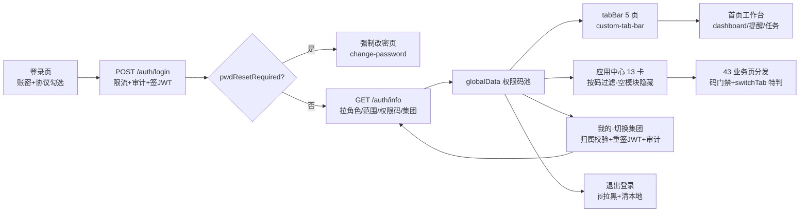

# MP·应用壳（小程序 tabBar 5 页 + 应用中心 + 登录/切换集团/我的 + 全局转发注入）

> 审计日期 2026-11-08。以下路径约定：`MP/`=aigicrm-miniprogram/，`BE/`=aigicrm-backend/src/main/java/com/aigicrm/。所有行号均为本次审计实读。

## 概述（侧栏位置/路由、权限码、谁能看到该菜单）

- **路由与壳结构**：小程序共 43 页（`MP/app.json:5-48`），底部 tabBar 为 custom 模式（`app.json:57` `custom: true`），5 个 tab 页注册于 `app.json:59-84`：首页 `pages/home/index`、四项服务 `pages/incentive/home/index`、文件 `pages/files/index`、应用 `pages/app/index`、我的 `pages/profile/index`。自定义 tabBar 组件 `MP/custom-tab-bar/index.js:20-31`（TABS/PATHS 五项，点击统一 `wx.switchTab`；每个 tab 页 onShow 里 `getTabBar().setData({selected:N})` 同步选中态，见 `pages/app/index.js:135-137` 等）。
- **权限模型**：无独立「应用壳」权限码。登录后 `GET /api/auth/info` 把权限码集合写进 globalData（`MP/api/auth.js:10-19`），应用中心 13 卡按注册码过滤：单码 `permission` 或多码并集 `permissions`（`MP/pages/app/index.js:104-130`），码值全部来自权限中心注册表，不在前端发明（`pages/app/index.js:125-126` 注释）。验收表明确「MP 端同码同源（应用中心 13 卡/tabBar 5 页按同一注册码过滤，与上表一致）」（《菜单功能按钮数据范围验收表-20261107.md》§二表尾）。
- **谁能看到**：登录用户全员可见 tabBar 5 页（验收表 §二「首页/工作台」一行 admin/总监/行政/销售员 全 ✓）；应用中心各卡随卡上权限码显隐，空模块整组隐藏（`pages/app/index.js:82` `filter(module => module.entries.length > 0)`），无任何卡时整页显示「暂无可用应用」（`pages/app/index.wxml:41`）。演示模式（develop 默认档无接口地址）下全部 13 卡无条件放行（`pages/app/index.js:127`）。
- **谁不能进**：未登录访问任一业务页被 `requireLogin()` 弹回登录页（`MP/utils/auth.js:53-58`）；401 由 `utils/request.js:89-91` 统一清令牌跳登录（403 不踢登录，`request.js:87-88` 注释钉明）。

## 功能清单（每功能一行，说人话）

| # | 功能 | 一句话 |
|---|---|---|
| 1 | 登录 | 账号密码登录，记住账号/密码，协议勾选前置，首登强制改密引导 |
| 2 | 忘记密码 | 三步向导：账号核验→短信验证码→重置新密码 |
| 3 | 首页工作台 | 问候+三态预警格+客户结构图（看板码门禁）+常用功能 6 入口+到期预警 5 条 |
| 4 | 四项服务轻量页 | 按时间/按客户双视图记录流，搜索+行业/产品平铺筛选+两级分类/人员/排序 |
| 5 | 文件管理 | 四页签文件库：上传三入口（先选夹）、预览/下载/重命名/分享/删除、文件夹管理、申请扩容 |
| 6 | 应用中心 | 六模块 13 卡宫格，按权限码过滤显隐 |
| 7 | 我的 | 账号信息/当前集团切换/数据范围展示、改密码、意见反馈、清除缓存、退出登录等 |
| 8 | 切换集团 | 多集团用户 picker 切换，后端校验归属后重签 JWT |
| 9 | 全局转发注入 | app.js 包一层 Page，给未自定义转发的页面注入默认转发（落地页=登录页） |

## 按钮明细

### 1. 底部 tabBar（custom-tab-bar，5 个）

| 按钮 | 在哪 | 前端行为 | 后端动作 | 谁能看到 |
|---|---|---|---|---|
| 首页 | 底栏 1（`custom-tab-bar/index.js:12,22,28-30`） | `wx.switchTab('/pages/home/index')`，同选中位不重复跳 | —（页面 onLoad 后自拉数据，见下） | 登录用户全员 |
| 四项服务 | 底栏 2（同上:13） | switchTab `pages/incentive/home/index` | — | 登录用户全员（页内 onLoad 再拦 `incentive:view`，`pages/incentive/home/index.js:248-251`，无码被弹回首页） |
| 文件 | 底栏 3（同上:14） | switchTab `pages/files/index` | — | 登录用户全员（页内 onLoad 拦 `file:view`，`pages/files/index.js:453-454`） |
| 应用 | 底栏 4（同上:15） | switchTab `pages/app/index` | — | 登录用户全员 |
| 我的 | 底栏 5（同上:16） | switchTab `pages/profile/index` | — | 登录用户全员 |

### 2. 登录页（pages/login/index）

| 按钮 | 在哪 | 前端行为 | 后端动作 | 谁能看到 |
|---|---|---|---|---|
| 用户名/密码输入 | 表单（`pages/login/index.wxml:9-16`） | onUsernameInput/onPasswordInput 落 data（`index.js:137-143`） | — | 所有人（demo 档隐藏字段，`index.js:36`） |
| 记住账号 | 勾选行（`index.wxml:18-22`） | toggleRememberAccount；取消时连带取消密码勾选并清已存值（`index.js:83-87`） | —（纯本地 Storage：`REMEMBER_KEYS`，`index.js:11-16`） | 所有人 |
| 记住密码 | 勾选行（`index.wxml:23-26`） | toggleRememberPassword；未勾账号先勾则 toast 拒绝（级联依赖，`index.js:89-95`） | —（密码经 base64 混淆落本地，`encodeSaved`，`index.js:18-20`；注释自认「非强加密」，`index.js:9`） | 所有人 |
| 登录/进入原型 | 主按钮（`index.wxml:28`） | submit：未勾协议先拒（`index.js:147-150`）；demo 档直接注入演示用户+权限含 `'*'` 进首页（`index.js:151-156`）；真档 `login({username,password,rememberMe:true})`→setToken→若 `pwdResetRequired===1` 引导改密页（`index.js:171-175`）→`loadCurrentUser()`→记录协议版本→进首页（`index.js:162-183`） | **POST /api/auth/login**（AuthController:24-43）：IP+用户名双层 Redis 失败限流（5 次/15min、IP 20 次，AuthService.java:76-89）；账号不存在/停用/密码错统一报「账号或密码错误」并计数+`securityAudit.loginFailed` 留痕告警（AuthService:97-113）；成功清用户名维计数、`loginSuccess` 审计（:117-120）；按岗位→组织→集团推导 groupIds、默认当前集团=最小 id（:124-125,156-173）；签 JWT 并回 `pwdResetRequired` 首登标记（:140-141）。控制器层再写 sys_log 登录审计（IP/UA 解析，AuthController:29-41） | 所有人 |
| 协议勾选框 | 协议行（`index.wxml:31-33`） | toggleAgreed（`index.js:191-193`）；未勾不允许登录 | — | 所有人 |
| 《用户服务协议》 | 协议行链接（`index.wxml:36`） | openAgreement → navigateTo 协议页（`index.js:194`） | — | 所有人 |
| 《隐私政策》 | 协议行链接（`index.wxml:37`） | openPrivacyDoc → navigateTo 隐私页（`index.js:195`） | — | 所有人 |
| 忘记密码？ | 文本按钮（`index.wxml:40`） | openForgot → navigateTo 三步向导（`index.js:196`） | — | 所有人（demo 档隐藏，`index.js:37`） |
| 陕ICP备2024024412号 | 页脚（`index.wxml:43`） | copyBeianUrl：复制备案系统网址到剪贴板（`index.js:198-203`） | — | 所有人 |
| （自动）会话续登 | onLoad（`index.js:60-64,129-135`） | 已有有效令牌则静默 `loadCurrentUser()` 成功后自动 switchTab 回首页（修冷启竞态；失败留在登录页） | **GET /api/auth/info**（AuthController:61-64→AuthService:209-262）：按当前登录态取用户/角色/有效 dataScope（`SecurityUtils.getCurrentDataScope()`，:247-248）/岗位/集团集合与集团名/菜单树（页面级 path 去重+过滤按钮点与隐藏节点+空容器不下发，:275-306）/权限码全集（:218,259） | 持有效令牌者 |

### 3. 忘记密码页（pages/login/forgot/index）

| 按钮 | 在哪 | 前端行为 | 后端动作 | 谁能看到 |
|---|---|---|---|---|
| 下一步（步骤1） | 主按钮（`forgot/index.wxml:28`） | next→lookup：账号非空校验后 `forgotPasswordLookup`，成功带脱敏手机进步骤2（`forgot/index.js:34-46`） | **POST /api/auth/forgot-password/lookup**（AuthController:89-100）：`securityAudit.anonymousProbe` 探测留痕；IP 60s 限流（AuthService:47-52）；账号不存在/停用返回**中性响应**（不暴露存在性，AuthService:310-329），有手机/邮箱回掩码（maskPhone/maskEmail，:453-462） | 匿名可访问 |
| 获取验证码 | 步骤2（`forgot/index.wxml:18`） | sendCode：60s 倒计时锁重发（`forgot/index.js:47-55,58-74`；离页清定时器 :75-76） | **POST /api/auth/forgot-password/send-code**（AuthController:102-108）：匿名探测留痕（AuthService:333）；email 方式显式拒绝（:334-337）；用户名级 60s+IP 级 1h/10 次双重限流（:338-352）；用户不存在/停用/未绑手机一律对外中性「已受理」（:354-367）；生成 6 位码存 Redis 5 分钟、阿里云短信下发（:369-385） | 匿名可访问 |
| 下一步（步骤2） | 主按钮 | next→verifyCode：本地非空校验后仅翻到步骤3（`forgot/index.js:77`） | —（真正校验在重置时） | — |
| 确认重置（步骤3） | 主按钮 | next→reset：前端校验 ≥8 位且两次一致（`forgot/index.js:78-82`，与 PC 同口径） | **POST /api/auth/forgot-password/reset**（AuthController:110-115）：探测留痕；验证码三态文案归一「验证码错误或已过期」（防枚举，AuthService:394-424）；错 5 次锁 15 分钟（:406-412）；改密落库并写 DB 级 `pwd_changed_at`（旧 token 撤销依据）+`markPasswordChanged` 立即失效旧 token（:426-435） | 匿名可访问 |
| 返回登录/上一步 | 文本按钮（`forgot/index.wxml:29`） | back：步骤>1 回退一步，否则 navigateBack（`forgot/index.js:84`） | — | — |

### 4. 首页（pages/home/index，tab1）

| 按钮 | 在哪 | 前端行为 | 后端动作 | 谁能看到 |
|---|---|---|---|---|
| 铃铛（提醒入口） | 头部左（`pages/home/index.wxml:6-9`） | openReminder：无码 toast「没有提醒权限」，有码 navigateTo 提醒页；角标=待办提醒数（`index.js:206-212`） | 角标数据 **GET /api/reminder/pending-count**（ReminderController:53-57，`reminder:view`）：`pendingCount()` 按 OrgScopeResolver 数据范围过滤——非 all 范围恒含「本人」且显式参数越界返空（ReminderService:67-83 注释钉明修复） | `reminder:view` 持有者 |
| 全部应用 › | 常用功能头（`index.wxml:53`） | openAppCenter：switchTab 到应用中心（`index.js:243-245`） | — | 登录用户全员 |
| 新增客户 | 常用功能格（`index.wxml:56-58`） | openNewCustomer：拦 `customer:add` 后 navigateTo 客户表单（`index.js:227-233`） | —（表单页动作属客户章节） | `customer:add` |
| 四项服务 | 常用功能格（`index.wxml:59-61`） | openIncentive：拦 `incentive:view` 后 switchTab 四项服务 tab（`index.js:182-188`） | — | `incentive:view` |
| 激励上传 | 常用功能格（`index.wxml:62-64`） | openIncentiveUpload：拦 `incentive:add` 后 navigateTo 上传页（`index.js:190-196`） | — | `incentive:add` |
| 审批管理 | 常用功能格（`index.wxml:65-67`） | openApproval：拦 `approval:view`（`index.js:198-204`） | — | `approval:view` |
| 提醒管理 | 常用功能格（`index.wxml:68-70`） | openReminder（同铃铛）（`index.js:206-212`） | — | `reminder:view` |
| 统计分析 | 常用功能格（`index.wxml:71-73`） | openStatistics：拦 `statistics:view`（`index.js:235-241`） | — | `statistics:view` |
| 客户结构卡 | `wx:if showDashboardCards`（`index.wxml:33-48`） | 纯展示：在保护期/即将到期/已超期占比条+保护率（`index.js:37-63`） | **GET /api/statistics/dashboard**（StatisticsController:26-29，码=`statistics:view` 或 `dashboard:view`；前端同码门禁 `index.js:132`）：StatisticsQueryService.dashboard() 按数据范围计数（`countByScope` 等，StatisticsQueryService:330-334→CustomerService:1029-1034 `applyDataScope`，排 sea/archived），共享段走范围签名缓存+TTL 抖动，审批/公海卡按 userId 独立缓存防互串（:221-246） | `statistics:view`/`dashboard:view`（验收表：销售员无统计分析顶层码 → 此卡对销售员隐藏，结构三格 hero 也随之空） |
| 待办条 | `wx:if taskSummary`（`index.wxml:31`） | 纯展示「待办 N 件(逾期 M)」（`index.js:152-163`） | **GET /api/task/statistics**（TaskController:38-43，码=`task:view`）：`taskService.statistics(userId)` 按当前用户算 pending/overdue | `task:view`（验收表：admin/总监/销售员 ✓，行政 ✗） |
| 到期预警行 | 列表行（`index.wxml:86-95`） | openCustomer：带 customerId 跳客户详情（`index.js:222-225`） | 列表数据 **GET /api/reminder/expiring-list**（ReminderController:21-34，码=`reminder:view`，size 取 5）：`expiringPage` 数据范围过滤+部门子树并行解析+孤儿行剔除（ReminderService:265-276,184-193） | `reminder:view` |
| 全部提醒 › | 到期预警头（`index.wxml:82`） | openReminder（同上） | — | `reminder:view` |
| 下拉刷新 | 页面手势（`index.js:121-129`） | onPullDownRefresh：`_lastShowTs=0` 绕过 onShow 30s 节流重拉 4 个接口（`index.js:109-116,131-180`） | 同上四个 GET | 同上 |

### 5. 四项服务轻量页（pages/incentive/home/index，tab2）

| 按钮 | 在哪 | 前端行为 | 后端动作 | 谁能看到 |
|---|---|---|---|---|
| ↻ 刷新 | 顶栏（`pages/incentive/home/index.wxml:11`） | refresh：loadRecords+loadUsers 重拉（`index.js:708-710`） | 同搜索（见下） | 页面门禁 `incentive:view`（`index.js:248-251`，无码 switchTab 弹回首页） |
| ＋ 上传 | 顶栏，`wx:if canUploadEvidence`（`index.wxml:12`） | goUpload：拦 `incentive:add` 后 navigateTo 上传页（`index.js:647-650`；canUploadEvidence 判定 :253） | —（上传动作属激励章节） | `incentive:add` |
| 搜索输入+搜索 | 检索卡（`index.wxml:17-20`） | searchRecords→loadRecords（`index.js:597-603`） | **GET /api/incentive/customer-records**（IncentiveController:174-192，码=`incentive:view`）：`getCustomerRecords` 走组织范围可见性 `applyOrgQueryVisibility`（客户属 customer:view 档位 ∨ 本人上传恒可见，IncentiveService:1156-1170；recordId 种子不可见返空集） | `incentive:view`（验收表：分享制销售员仅可见本人+已分享口径，由该可见性函数落） |
| 清空 | 检索卡（`index.wxml:20`） | resetRecordFilters：关键字/行业/产品/人员/排序/分类全归零后重拉（`index.js:624-639`） | 同上 | 同上 |
| 行业平铺 chips | 筛选区（`index.wxml:25-31`） | chooseIndustry：点哪个筛哪个，命中后 loadRecords（`index.js:607-612`） | 选项数据 **GET /api/system/dict/data/industry**（`index.js:329-341`；SysDictController 字典读，status≠0 过滤，失败 fail-open 兜底常量） | `incentive:view`（字典读登录即可） |
| 产品平铺 chips | 筛选区（`index.wxml:34-40`） | chooseProduct：同上（`index.js:614-619`） | 选项数据=分类树「产品试点」分支派生：**GET /api/incentive/categories**（IncentiveController:25-28，登录即可读；`index.js:315-326` 树拉不到时降级单层） | 同上 |
| 按时间/按客户 | 模式切换（`index.wxml:48-51`） | switchListMode：time=打散记录流（默认）/customer=封面卡归集，切页归 1（`index.js:652-663`，纯前端视图） | — | 同上 |
| 分类两级 picker | 筛选行（`index.wxml:54-56`） | chooseCategory：双列滚轮大类→子类，联动+取消回退（`index.js:411-455`） | 选项同分类树接口 | 同上 |
| 人员 picker | 筛选行（`index.wxml:57-59`） | chooseUser：选中后 loadRecords（`index.js:592-595`） | 选项数据 **GET /api/incentive/users**（IncentiveController:230-233）：`getUserList` 口径=本人+有 shared 记录的作者；admin/专项授权全量（IncentiveService:84-100 注释钉明与查看语义同口径） | 同上 |
| 排序 picker | 筛选行（`index.wxml:60-62`） | chooseOrder：四档排序纯前端 sort（`index.js:641-645,514`） | — | 同上 |
| 记录行（时间视图） | 记录流行（`index.wxml:70-90`） | openFlatRecord：直达 `/pages/incentive/detail?id=记录id` 拨盘详情（`index.js:665-671`） | —（详情属激励章节） | 同上 |
| 客户封面卡（客户视图） | 封面卡（`index.wxml:94-115`） | openCustomer：取该客户首条记录跳拨盘详情，无记录 toast（`index.js:676-684`） | — | 同上 |
| 分页器 | 底部 pager（`index.wxml:116-118`） | onPagerChange：双视图各自分页（`index.js:587-590,569-585`，纯前端切片） | — | 同上 |
| （回流契约）onShow 节流 | 生命周期（`index.js:265-281`） | forceRefresh.incentive 命中即强刷；30s 内回流不重拉；缩略图走 **GET /api/file/download-token** 短时下载令牌（`index.js:686-706`→FileController:38-48 按 jti 派生下载 token） | 同上 | 同上 |

### 6. 文件管理（pages/files/index，tab3）

| 按钮 | 在哪 | 前端行为 | 后端动作 | 谁能看到 |
|---|---|---|---|---|
| ＋ 上传 | 顶栏，`wx:if showUploadAction`（`pages/files/index.wxml:8`） | uploadFile：拦 `file:upload`；showUploadAction=canUpload ∧ 当前夹有 upload ACL ∧ 仅公共/私人页签（`index.js:336,947-963`）；弹三入口 ActionSheet（手机文件/从相册/从聊天） | —（见选夹后的上传） | `file:upload` + 夹 ACL upload |
| 上传·手机文件 | 上传面板项1（`index.js:954-960`） | 先选文件夹（openFolderSelect，仅列有 upload ACL 的夹，`index.js:970-980`）→ confirmFolderSelect 后带 folderId 进 H5 选传页（`index.js:993-1000`） | 选夹选项数据 **GET /api/file/folders?scope=**（FileController:50-55，码=`file:view`）：`getFolderTree(scope,userId)` 按夹 ACL 一次性过滤（FileService:1142 注释） | 同上 |
| 上传·从相册选择 | 上传面板项2 | 选夹后 wx.chooseMedia（含拍摄）→ doUploadFile（`index.js:1006-1016`） | 上传 **POST /api/file/upload**（FileController:68-75，码=`file:upload`）：scope 白名单 public/private/incentive（FileService:255-259）；无夹 public 上传仅管理员（:264-267）；夹内上传过 `FolderPermissionService.check(P_UPLOAD)`（:267-269）；private 走 DB 原子配额扣减 `tryConsumeQuota`（:272-279） | 同上 |
| 上传·从聊天选择 | 上传面板项3 | 选夹后 wx.chooseMessageFile → doUploadFile（`index.js:1018-1025,1030-1036`） | 同上 | 同上 |
| 申请扩容 › | 顶栏容量条，`wx:if canApply`（`index.wxml:13`） | openStorageApply：不可申请时透出后端短原因（未授权/在途/已上限，`index.js:130-160,831-837`）；弹窗内填总配额(GB)+理由（≤200 字） | 弹窗数据 **GET /api/file/storage/apply-info**（FileController:131-144，码=`file:view`）：`storageApplyInfo` 资格=管理员或开关∧授权名单；在途单置 canApply=false（hasPendingStorageApply）；容量 **GET /api/file/storage**（FileController:120-127） | `file:view` 且后端资格判定通过（D1=A 规则：管理员恒可，非管理员须 enabled+名单，SysUserService:566+ 注释） |
| 弹窗·提交申请 | 扩容弹窗（`index.wxml:106-109`） | submitStorageApply：本地校验配额/理由（`index.js:848-871`），成功后刷容量 | **POST /api/approval/submit**（type=storage，ApprovalController:41-52，码=`approval:view`）：类型白名单 400 拦截（ApprovalService:216-219）；storage 分支忽略客户端 oldQuota、库内重取当前配额规范化 extraData `{quota,oldQuota,reason}`（:225-239）；理由校验+配额校验（validateStorageApplyReason/Quota）；`SELECT ... FOR UPDATE` 锁用户行串行化并发提交，在途单存在即拒绝（:232-238）→ 落审批单待批（对应业务链12「禁自审自批」） | 同上 |
| 弹窗·关闭/取消 | 扩容弹窗（`index.wxml:89,107`） | closeStorageApply（提交中禁关，`index.js:838-841`） | — | 同上 |
| 本地上传自测 | 开发按钮，`wx:if canDevUploadSmoke`（`index.wxml:17`） | runDevUploadSmoke：仅本地 develop + apiBaseUrl 指向本地时显示（`index.js:471`），写临时文件走上传管线（`index.js:1037+`） | 同上传 | 仅本地开发者（生产不可见） |
| 搜索输入+搜索 | 检索框（`index.wxml:18`） | searchFiles→loadFiles 带 keyword（`index.js:769-793`） | **GET /api/file/list**（FileController:57-66，码=`file:view`）：`pageFiles(current,size,folderId,scope,keyword,userId)` 按夹 ACL 批量过滤+admin/授权 can_view_all 旁路同口径（FileService:185 注释） | `file:view` |
| 四页签（公共/私人/四项服务/分享给我） | 页签条（`index.wxml:19-21`） | onTabTap：切 scope 重新拉列表/计数（`index.js:795-807`；四项服务页签另走激励文件缓存 `index.js:521,598+`） | 同上（分享给我另走 GET /api/file/shared-to-me，`api/file.js:61`——本章只列不展开） | `file:view` |
| 文件夹卡 | 横滑夹列表（`index.wxml:22-30`） | openFolder：带夹 id/名过滤列表回第 1 页（`index.js:820-827`） | 同列表接口带 folderId | `file:view` |
| 返回全部 | 夹卡头部，进夹后显示（`index.wxml:23`） | clearFolder：清夹上下文重拉（`index.js:828`） | — | 同上 |
| 客户文档/团队共享（兜底夹） | demo 档兜底（`index.wxml:27-28`） | openFolder（按名过滤，demo 本地数据） | — | 仅演示模式 |
| 文件行点击 | 列表行（`index.wxml:43`） | openFile→previewFile：先过下载门（夹 downloadable/perms.download），图片=全视图可下载图组签名直链原生左右滑预览，其余走下载缓存管线按类型分派（`index.js:1069-1099,1152-1203`；缓存命中秒开 `file-cache`） | 预览下载 **GET /api/file/download/{id}**（FileController:207+，码=`file:view`）：服务端按 `checkFile(P_DOWNLOAD)` 判定（admin/本人/上级链/ACL，FileService:1305-1308），dlToken 短时令牌换签名直链 | `file:view` + 夹 download ACL |
| 行内···/长按 | 行尾（`index.wxml:43,51`） | openActionSheet：自绘半屏面板，动作按权限预构（`index.js:1238-1244`；sheetActions 构造 :258-287：打开恒有；下载=file+夹 download；重命名=夹 edit；分享=canShare∧私人/四项服务外∧夹 share；删除=canDelete∧非分享给我/四项服务∧夹 delete） | — | 见各动作行 |
| 面板·打开 | 操作面板（`index.wxml:60-71`） | 同文件行点击（`index.js:1251`） | 同预览 | 同文件行 |
| 面板·下载 | 操作面板 | downloadFile：同下载门，落盘保存（`index.js:1109-1113,1204-1213`） | 同下载接口 | file:view + download ACL |
| 面板·重命名 | 操作面板 | openRenameModal→confirmRename：≤200 字校验后 `renameFile(id,name)`（`index.js:1131-1149`） | **PUT /api/file/{id}/rename**（FileController:113-118，码=`file:edit`）：`checkFile(P_EDIT)` 夹级判定（FileService:459-465）；只改展示名 file_name，oss_key/版本不动；空名/超长 400（:466-468） | file:edit + 夹 edit ACL |
| 面板·分享 | 操作面板 | shareFile：拉用户列表 ActionSheet 单选→`shareFileApi(id,[uid])`（`index.js:1214-1235`） | 选人 **GET /api/customer/users/simple**（api/customer.js:40）；分享 **POST /api/file/{id}/share**（FileController:266-271，码=`file:share`）：`checkFile(P_SHARE)`（FileService:1421-1437）；**集团边界守卫**——目标用户不在当前集团即拒（:1439-1451）；按 (fileId,uid) 幂等插入 biz_file_share（:1452-1461） | file:share + 夹 share ACL；公共/分享给我/四项服务页签前端不给分享（`index.js:1215`） |
| 面板·删除 | 操作面板（danger） | removeFile：确认弹窗→`deleteFile(id)`（`index.js:1115-1130`） | **DELETE /api/file/{id}**（FileController:98-104，码=`file:delete`）：白名单放行默认拒绝——夹内走 `checkFile(P_DELETE)`，无夹 public 仅管理员，private/incentive 须上传者本人（FileService:405-431）；**逻辑删除进文件回收站**（不物理清字节，保留期任务清理）；私有文件 DB 原子归还配额；幂等防重复归还（:432-447） | file:delete + 夹 delete ACL |
| 面板·取消 | 操作面板（`index.wxml:69`） | closeActionSheet（`index.js:1245`） | — | — |
| 分页器 | 底部 pager（`index.wxml:57`） | onPagerChange（`index.js:669-678`，显式分页 10/30 条） | 同列表接口翻页 | `file:view` |
| ＋ 新建（文件夹） | 文件夹管理卡，`wx:if canManageFolder`（`index.wxml:72-73`） | openFolderForm：仅公共/私人页签；showModal editable 输名→`createFolder({folderName,folderType,parentId})`（`index.js:880-907`） | **POST /api/file/folders**（FileController:77-82，码=`file:folder:manage`）：父夹 P_UPLOAD 判定（含「根级公共夹仅管理员可建」归一化规则，FileService:318-347） | `file:folder:manage`（+父夹 ACL） |
| 文件夹行··· | 管理卡夹行（`index.wxml:78`） | openFolderActions：菜单只留 重命名/删除（2026-11-05 用户令撤除 MP 权限设置入口，`index.js:908-924`） | — | `file:folder:manage` |
| 文件夹·重命名 | 夹动作 | openFolderEdit：带真实名（rawName 去「· 」视图前缀）进 folder-form 页（`index.js:925-930`） | 该页提交 **PUT /api/file/folders/{id}**（FileController:84-89，码=`file:folder:manage`）：夹 P_EDIT 判定（FileService:348-363） | 同上 |
| 文件夹·删除 | 夹动作 | removeFolder：`canManageFolder` 拦截+确认弹窗→`deleteFolder(id)`（`index.js:931-945`） | **DELETE /api/file/folders/{id}**（FileController:91-96，码=`file:folder:manage`）：夹 P_DELETE 判定（FileService:365-372+） | 同上 |
| 选夹弹窗·上传到这里 | 上传选夹面板（`index.wxml:114-124`） | selectFolderItem/cancelFolderSelect/confirmFolderSelect：定死目标夹后才进选文件（`index.js:982-1004`） | —（选定夹 id 随上传提交） | 同上传 |
| 重命名弹窗·确认/取消 | 重命名面板（`index.wxml:127-133`） | confirmRename/cancelRenameModal（`index.js:1137-1149`） | 同 PUT rename | 同上 |

### 7. 应用中心（pages/app/index，tab4）——13 卡

分组骨架 `APP_MODULES`（`pages/app/index.js:36-52`）：客户经营/文件管理/四项激励/学分管理/统计分析/流程协同 六模块；卡定义 `onLoad` 内（`index.js:102-130`），空模块整组隐藏（`buildAppView` :75-95）。

| 按钮（卡） | 在哪 | 前端行为 | 后端动作 | 谁能看到（卡权限码） |
|---|---|---|---|---|
| 客户列表 | 客户经营组（`index.js:104`） | openApp→routes[key]：navigateTo `/pages/customer/index`（`index.js:139-153`） | —（业务页属客户章节） | `customer:view` |
| 新增客户 | 客户经营组（`index.js:106`） | navigateTo `/pages/customer/form/index` | — | `customer:add` |
| 客户排行 | 客户经营组（`index.js:108`） | navigateTo `/pages/ranking/index?tab=customer`（带 tab 直达） | — | `statistics:view` |
| 核心客户六项指标 | 客户经营组（`index.js:119`） | navigateTo `/pages/indicator/index` | — | `statistics:view`（验收表：行政 ✗ → 行政看不到此卡） |
| 文件管理 | 文件管理组（`index.js:109`） | routes 命中 tab 页路径→`wx.switchTab`（`index.js:146-153`，navigateTo 跳 tabBar 页会被微信静默拒绝，注释 #11 钉明） | — | `file:view` |
| 激励上传 | 四项激励组（`index.js:110`） | navigateTo `/pages/incentive/upload/index` | — | `incentive:add` |
| 激励查询 | 四项激励组（`index.js:111`） | navigateTo `/pages/incentive/index?mode=query`（mode 锁页签集） | — | `incentive:view` |
| 激励统计 | 四项激励组（`index.js:113`） | navigateTo `/pages/incentive/index?mode=stats` | — | `incentive:stats:view` ∨ `incentive:rank:view`（并集门禁 `permissions` 数组，`index.js:128`） |
| 学分排行 | 学分管理组（`index.js:118`） | navigateTo `/pages/ranking/index?tab=score` | — | `score:view` |
| 统计分析 | 统计分析组（`index.js:120`） | navigateTo `/pages/statistics/index` | — | `statistics:view`（验收表：统计顶层 admin/总监 ✓、行政/销售员 ✗） |
| 审批管理 | 流程协同组（`index.js:121`） | navigateTo `/pages/approval/index` | — | `approval:view` |
| 提醒管理 | 流程协同组（`index.js:122`） | navigateTo `/pages/reminder/index` | — | `reminder:view` |
| 公海池 | 流程协同组（`index.js:123`） | navigateTo `/pages/sea/index` | — | `sea:view` |

### 8. 我的（pages/profile/index，tab5）

| 按钮 | 在哪 | 前端行为 | 后端动作 | 谁能看到 |
|---|---|---|---|---|
| 当前集团 picker | 合并卡（`pages/profile/index.wxml:17-21`） | changeGroup：同集团/切换中不重复提交；`switchSessionGroup(groupId)`→成功重拉 `loadCurrentUser()` 刷新权限，失败回滚 picker 选中（`index.js:81-93`） | **POST /api/auth/switch-group**（AuthController:77-85）：`switchGroup(token,groupId)`——**归属校验**（groupId 必须在岗位→组织推导的 groupIds 内，否则「无权切换到该集团」，AuthService:176-181）；`securityAudit.groupSwitch` 审计留痕（:183-184）；保留原 token 的保持登录档重签 JWT（:185-189）；MP 侧换存新 token 并刷新 globalData 集团集合（`api/auth.js:21-29`）；随后 **GET /api/auth/info** 全量刷新权限码 | `groupIds.length>0` 的多集团用户才显示该行（`index.js:19` showGroupCard） |
| 数据范围（展示） | 合并卡（`index.wxml:22-26`） | 纯展示 `dataScopeLabel(user.dataScope)`（`index.js:66`；`utils/label-maps.js`） | 数据来自 GET /api/auth/info（有效 dataScope，AuthService:247-248） | 登录用户全员 |
| 我的客户 | 菜单卡（`index.wxml:29`） | openCustomers→navigateTo 客户列表（`index.js:95`） | — | 登录用户全员 |
| 我的四项服务 | 菜单卡（`index.wxml:30`） | openIncentive→switchTab 四项服务 tab（tabBar 页必须 switchTab，`index.js:96` 注释钉明 navigateTo 会被拒成死按钮） | — | 登录用户全员 |
| 我的捞取记录 | 菜单卡（`index.wxml:31`） | openClaims→navigateTo `/pages/sea/index`（`index.js:97`） | — | 登录用户全员 |
| 修改密码 | 菜单卡（`index.wxml:34`） | openPassword→navigateTo 改密页（`index.js:98`） | 见子页行 | 登录用户全员 |
| 数据权限说明 | 菜单卡（`index.wxml:35`） | openScope→navigateTo 说明页（纯文案，读 globalData 用户 dataScope 显示范围名，`pages/profile/scope/index.js:6-10`） | — | 登录用户全员 |
| 微信绑定 | 菜单卡（`index.wxml:38`） | openWechat→子页（见下） | — | 登录用户全员 |
| 清除缓存 | 菜单卡（`index.wxml:39`） | clearCache：确认弹窗→`wx.clearStorageSync()`+清 globalData 四项（ currentUser/permissions/groupIds/currentGroupId，对齐 logout 完整清理）→700ms 后 redirect 登录页（`index.js:105-120`） | —（纯本地） | 登录用户全员 |
| 关于我们 | 菜单卡（`index.wxml:40`） | openAbout→navigateTo 关于页（纯文案+版本号，`pages/profile/about/index.wxml`） | — | 登录用户全员 |
| 用户协议 | 菜单卡（`index.wxml:41`） | openAgreement→navigateTo（静态文案页） | — | 登录用户全员 |
| 隐私政策 | 菜单卡（`index.wxml:42`） | openPrivacy→navigateTo（静态文案页） | — | 登录用户全员 |
| 意见反馈 | 底部按钮（`index.wxml:45`） | openFeedback→navigateTo 反馈页（见下） | — | 登录用户全员 |
| 退出登录 | 底部按钮（`index.wxml:46`） | logout（`utils/auth.js:60-75`）：先尽力调服务端注销→清文件预览缓存→清 token+globalData 四项→redirect 登录页 | **POST /api/auth/logout**（AuthController:66-74）：取 Bearer token，`jwtTokenProvider.blacklistToken` 按 jti **拉黑当前令牌立即失效**（AuthService:202-207），防被盗 token 复用 | 登录用户全员 |

### 9. 我的子页（改密/反馈/微信绑定）

| 按钮 | 在哪 | 前端行为 | 后端动作 | 谁能看到 |
|---|---|---|---|---|
| 确认修改（改密码页） | `pages/profile/password/index.wxml:11` | submit：前端 8-30 位+两次一致校验→`POST /api/system/users/change-password`→成功清 token+globalData→900ms 后回登录页（`password/index.js:35-64`） | **POST /api/system/users/change-password**（SysUserController:75-80）：`changePassword`——原密码 BCrypt 校验（SysUserService:540-542）；后端补 8-30 位校验（:543-547，修三入口口径分裂）；落库写 DB 级 `pwd_changed_at`（截断到秒防 DATETIME 进位误杀同秒 token）+清 `pwdResetRequired` 标记（:548-554）；`markPasswordChanged` 旧 token 立即失效（:555-556） | 登录用户全员 |
| 保存草稿（反馈页） | `pages/profile/feedback/index.wxml:19` | saveDraft：trim 非空后存本机 Storage 草稿（`feedback/index.js:31-37`）；页头明示「当前版本尚未接入服务端反馈提交」（`feedback/index.wxml:12`） | **无后端动作（纯本地草稿）** | 登录用户全员 |
| 清空（反馈页） | `feedback/index.wxml:18` | clearDraft：删本机草稿（`feedback/index.js:38-41`） | — | 登录用户全员 |
| 返回（反馈页） | `feedback/index.wxml:8` | goBack：navigateBack（`feedback/index.js:42`） | — | 登录用户全员 |
| 查看接入说明（微信绑定页） | `pages/profile/wechat/index.wxml:9` | bindWechat：仅弹 modal「微信绑定暂未接入…待后端微信 OAuth、openid/unionid 绑定接口接入后再开放绑定」（`wechat/index.js:4-8`）；状态文案硬编码「待后端接入」（:3） | **无后端动作（占位）** | 登录用户全员 |

### 10. 全局转发注入（app.js，机制非按钮）

- **机制**：`MP/app.js:10-25` 在 App 之前包一层 `Page`：页面未自定义 `onShareAppMessage` 时注入默认转发——title=`config.appName`（`MP/config/env.js:60` 'AIGICRM'），path=`/pages/login/index`（落地页=登录页，已登录者由登录页 onShow resumeSessionIfPossible 自动 switchTab 回首页，`pages/login/index.js:129-135`）。注释钉明动机：微信规则下页面未定义 onShareAppMessage 则右上角「…」菜单不出现，1.0.26 前全项目零定义无从转发（`app.js:3-6`）。
- **有意不注入 onShareTimeline**：朋友圈单页模式无登录态，CRM 页面不可用（`app.js:6-7`）。
- **实证**：`grep -rn "onShareAppMessage" pages/` 零命中——全部页面均走注入路径，无页面自定义转发。对应业务链23「移动办公链」的「转发分享」环节。

## 业务链条

文字链：登录（限流/审计/首登改密）→ auth/info 拉权限码与集团 → 权限码池驱动 tabBar 页内门禁与应用中心 13 卡显隐 → 各业务页（对应 43 页章节）→ 多集团用户经 switch-group 归属校验+重签 JWT 后刷新权限 → 退出时 jti 拉黑。**对应业务链：链1「登录链」（登录/忘记密码三步/首登强制改密）与链23「移动办公链」（tabBar/应用中心分发+转发分享）；文件 tab 的上传/分享/扩容分别挂链11「文件协作链」与链12「文件扩容链」（细节在文件管理章节展开）。**

## ⚠️ 疑点

**（本次审计新发现，与 9 条核查重点分开列）**

1. **「应用中心 12 卡」与代码不符——实际 13 卡**：`pages/app/index.js:104-123` 定义 13 张卡（客户列表/新增客户/客户排行/文件管理/激励上传/激励查询/激励统计/学分排行/六项指标/统计分析/审批/提醒/公海池），六模块；验收表 §二表尾也写「应用中心 13 卡」。任务书与《菜单功能对照-20261107.md》§二标题写「12 卡（六模块）」但其正文列了 13 项——对照文档标题口径漂移，**以代码为准：13 卡**。
2. **意见反馈无服务端落点**：反馈页自我声明「当前版本尚未接入服务端反馈提交」（`pages/profile/feedback/index.wxml:12`），保存/清空均为本机 Storage（`feedback/index.js:31-41`），无任何 api 调用。管理侧永远收不到反馈，功能名实不符。
3. **微信绑定为纯占位**：绑定按钮只弹 modal「暂未接入」（`pages/profile/wechat/index.js:4-8`），状态硬编码「待后端接入」（:3）。建议在菜单上做「即将上线」角标或移除，避免误导。
4. **切集团后旧 token 不拉黑**：`switchGroup` 只重签新 token，注释明示「旧 token 继续有效至过期」（`AuthService.java:175` 注释、:186-189）。持有旧 token 的会话在过期前仍以**旧集团**身份可用，与「切换后刷新权限」的用户预期存在窗口差（注销链已有 jti 拉黑能力但此处未复用）。
5. **记住密码=本地 base64 混淆**：`pages/login/index.js:9-20` 注释自认「设备沙箱内、非强加密」。base64 可逆，Root/越狱设备上可提取；与 PC「记住密码」口径一致属产品决策，但审计角度应知悉强度边界。
6. **演示档权限全放行**：`pages/app/index.js:127` demo 模式 `return true` 跳过全部码过滤；登录页 demo 分支注入权限数组含 `'*'`（`pages/login/index.js:153`）。默认 develop 档=demoMode（`config/env.js:57-59,64`），release/trial 恒指生产（:27-33）——风险受控，但若误将带本地覆盖档的包发体验版会全量可见。
7. **首页 `logout` 注册但无绑定（死代码）**：`pages/home/index.js:247` 把 logout 挂进 Page，但 `pages/home/index.wxml` 无任何 `bindtap="logout"`——不构成可用按钮，建议清理；另 `pages/incentive/home/index.js:5` 导入的 `getGrantCheck` 全文件未使用（死导入）。
8. **文件 tab 删除=逻辑删除进回收站**：MP 删除文件后端进文件回收站（FileService:431-433），但 MP 无回收站恢复/清空入口（对应核查重点 8 在 MP 侧无对应 UI，仅 PC 有）；用户在 MP 删文件后无自助恢复通道。

**9 条核查重点与本章节的交集**

- 重点 1/2（销售员客户导入/删除码）、3（行政学分录入只读）、4（行政 view-all=region）、5（分享制 can_view_all=0）、6（马吉亮特例）、7（阅读排行榜/日志仅 admin）、9（六项指标口径）：均**不在应用壳范围**——应用中心无上述任何入口卡（客户导入入口在 PC 客户列表顶栏、学分录入在 PC 学分管理，MP 无对应卡与页），本章节不展开、不重复推导；「谁能看到」一律引用验收表。
- 重点 8（总监无回收站恢复/清空按钮）：MP 应用壳**无回收站入口**（43 页清单无 recycle 页），重点 8 在 MP 侧天然满足；唯文件删除走回收站（见新发现 8）。
- 应用壳内唯一涉及「范围/特判」的点：文件分享的集团边界守卫（FileService:1439-1451，跨集团分享拒绝）与激励人员下拉的「本人+有 shared 记录作者」口径（IncentiveService:84-100）——均无用户级特例。
