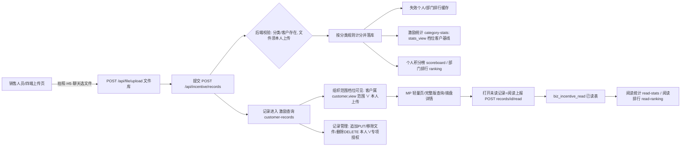

# MP·激励链路（小程序四项激励）

> 审计日期 2026-11-08。只读审计，全部结论以代码为准；参考文档仅作骨架（`docs/菜单功能对照-20261107.md`、`docs/页面按钮全量对照-20261107.md`、`docs/菜单功能按钮数据范围验收表-20261107.md`）。前端证据=小程序源码，后端证据=`aigicrm-backend/src/main/java`。

## 概述（侧栏位置/路由、权限码、谁能看到该菜单——引用验收表）

- **位置**：小程序端，非 PC 侧栏。tabBar 第 2 项「四项服务」=`pages/incentive/home/index`（`aigicrm-miniprogram/app.json` tabBar.list[1]；自定义 tabBar 选中态在 `pages/incentive/home/index.js:267` 同步）。注意与 PC 同名菜单「四项服务（案例库组）」是两回事。
- **完整版入口**：应用中心「四项激励」分组 3 卡（`pages/app/index.js:48`），卡片按码过滤（`pages/app/index.js:110-113`）：
  - 激励上传（`incentive:add`）→ `/pages/incentive/upload/index`
  - 激励查询（`incentive:view`）→ `/pages/incentive/index?mode=query`
  - 激励统计（`incentive:stats:view` ∨ `incentive:rank:view`）→ `/pages/incentive/index?mode=stats`
  - 路由表见 `pages/app/index.js:144`（`incentiveQuery/incentiveStats` 带 `?mode=`）。
- **权限码**（前端门禁落点）：
  - `incentive:view`：轻量页/完整页/详情页 onLoad 守卫（`pages/incentive/home/index.js:248`、`pages/incentive/index.js:619`、`pages/incentive/detail/index.js:357`）。
  - `incentive:add`：上传按钮显隐与 goUpload 守卫（`pages/incentive/home/index.js:253,648`、`pages/incentive/index.js:627,1500`、`pages/incentive/upload/index.js:536`）。
  - `incentive:stats:view` / `incentive:rank:view`：stats 模式双 pane 注册码，`utils/incentive-panes.js:8-11`（`computeStatsPanes`），无权 pane 不渲染不发请求（`pages/incentive/index.js:600-616`）。
  - `incentive:read-stats`（∨admin）、`incentive:read-ranking:view`（∨admin）：阅读两面板（`pages/incentive/index.js:625-626`，`isAdmin` 口径见 `utils/auth.js`）。
- **谁能看到**（引用验收表，不重新推导）：「四项激励组（上传/查询/统计+查看/排行/编辑/阅读统计）」admin/总监/行政/销售员 四角色全 ✓（`菜单功能按钮数据范围验收表-20261107.md:39`）；「本月激励查询阅读排行榜」仅 admin ✓（同文档 ：58）。
- **后端总入口**：`IncentiveController`（`/api/incentive/**`，`com/aigicrm/module/incentive/controller/IncentiveController.java`）、`IncentivePermissionController`（`/api/incentive/permission/**`）、配套 `FileController`（附件/下载凭证）、`FormDraftController`（草稿，经 `api/draft.js`）。

## 功能清单（每功能一行）

| 功能 | 一句话 |
|---|---|
| tabBar 轻量记录页 | 打散记录流（按时间）/客户封面卡（按客户）双视图，搜索+行业/产品 chip+两级分类+排序，点行直达拨盘详情 |
| 激励查询（完整版 query） | 客户记录横向表格+分类树+阅读面板；筛选/排序/分页，行直达拨盘详情 |
| 激励统计（完整版 stats） | 分类统计两级分组可下钻明细半屏（附件可开可下），排行三页签（客户/个人积分榜/部门）+阅读统计/阅读排行 |
| 激励上传/追加 | 纯表单页：大类→子类→客户半屏→产品→五槽位佐证（拍照/手机H5/聊天三通道）→提交落库计分；带草稿恢复与逐文件失败续办 |
| 拨盘详情页 | 年/月/日三联拨盘按日期看记录卡，附件预览/下载，编辑追加（进上传页）、删除记录，打开即自动阅读上报 |
| 客户激励档案页 | 一客一册（封面/时间轴/翻页/未读管理/全部已读）——⚠️当前无任何 UI 入口可达（死页） |
| 排行页·激励个人榜 | pages/ranking 的「激励排行」页签，调激励 scoreboard（无独立入口卡，见 ⚠️7） |
| 阅读上报 | 详情页打开未读记录 / 档案页逐条与全部标已读 → `POST /api/incentive/records/{id}/read` |

## 按钮明细

### 功能块 1：tabBar「四项服务」轻量记录页（pages/incentive/home；incentive:view）

| 按钮 | 在哪 | 前端行为 | 后端动作 | 谁能看到 |
|---|---|---|---|---|
| ↻ 刷新 | home/index.wxml:11 → `refresh()`（home/index.js:708） | 重拉记录+人员 | `GET /api/incentive/customer-records`：按 (customer,view) 组织范围档位过滤客户 ∨ 本人上传恒可见（IncentiveService.java:1156-1160 `applyOrgQueryVisibility`），多维筛选+按客户分组+未读标记（:1262-1302）；`GET /api/incentive/users`（Controller:229-233）：非专项授权者=本人+有已分享记录的作者集合（IncentiveService.java:84-116） | 持 incentive:view 者（四角色全有，验收表:39） |
| ＋ 上传 | home/index.wxml:12（wx:if canUploadEvidence）→ `goUpload()`（js:647-650） | 二次 toast 校验 incentive:add 后 navigateTo 上传页 | —（页面跳转） | incentive:add |
| 搜索框（confirm=查询） | home/index.wxml:18 → `inputKeyword/searchRecords`（js:597-603） | 发参重查 | 同 customer-records，keyword 走强相关三路（客户名集合∨关联产品∨具体产品，IncentiveService.java:1195-1213） | 同上 |
| 查询 | home/index.wxml:19 → `searchRecords`（js:601） | 同上 | 同上 | 同上 |
| 清空 | home/index.wxml:20 → `resetRecordFilters`（js:624-639） | 复位筛选并重查 | 同 customer-records | 同上 |
| 行业 chip | home/index.wxml:29 → `chooseIndustry`（js:607-612） | 选中重查 | industry 参数等值过滤（IncentiveService.java:1174）；选项=字典 `GET /api/system/dict/data/industry`（home/index.js:329-341） | 同上 |
| 产品 chip | home/index.wxml:38 → `chooseProduct`（js:614-619） | 同上 | product 参数 like 相关产品（IncentiveService.java:1186-1188）；选项由分类树「产品试点」分支派生（home/index.js:364-377，选项源 `GET /api/incentive/categories`） | 同上 |
| 分类两级拨盘 | home/index.wxml:54 → `onCategoryColumnChange/chooseCategory/onCategoryCancel`（js:411-454） | 大类联动子类、确认后本地过滤 | 数据源 `GET /api/incentive/categories`（Controller:24-28）：启用分类建树+按分享制口径角标计数（IncentiveService.java:173-182,252-274） | 同上 |
| 人员 picker | home/index.wxml:57 → `chooseUser`（js:592-595） | salesperson 参数重查 | 后端按 realName like 展开为 userId IN（IncentiveService.java:1214-1221）；候选= incentive users 接口（见「刷新」行） | 同上 |
| 排序 picker | home/index.wxml:60 → `chooseOrder`（js:641-645） | 本地四档排序（时间两档/分值两档），不发请求 | — | 同上 |
| 按时间 / 按客户 chips | home/index.wxml:49-50 → `switchListMode`（js:653-663） | 本地切视图（打散记录流/封面卡） | — | 同上 |
| 打散记录流行 | home/index.wxml:71 → `openFlatRecord`（js:666-671） | navigateTo `detail?id=记录id` | 详情页拉数（见功能块 6） | 同上 |
| 客户封面卡 | home/index.wxml:96 → `openCustomer`（js:676-684） | 取该客户首条记录 navigateTo `detail?id=` | 同上 | 同上 |
| pager | home/index.wxml:117 → `onPagerChange`（js:587-590） | 本地切片 | — | 同上 |

### 功能块 2：激励查询·完整版（pages/incentive/index?mode=query；incentive:view）

| 按钮 | 在哪 | 前端行为 | 后端动作 | 谁能看到 |
|---|---|---|---|---|
| ↻ 刷新 | index.wxml:9 → `refresh()`（index.js:1640-1649） | 七路数据源全重拉（records/categories/users/orgs/scoreboard/readStats/readRanking） | 各数据源接口见本块各行 | incentive:view |
| ＋ 上传 | index.wxml:10（wx:if canUploadEvidence）→ `goUpload()`（index.js:1499-1502） | 同轻量页 | — | incentive:add |
| 页签组（客户记录/分类树/阅读） | index.wxml:26 → `switchTab`（index.js:1376-1383） | 本地切 tab；stats 模式无权 pane 拒切（:1379） | — | incentive:view（stats 模式页签另受 pane 注册码过滤） |
| 搜索框 + 查询 | index.wxml:32-33 → `inputKeyword/searchRecords`（index.js:1433-1439） | 发参重查 | customer-records（同上口径）；服务端已收紧关键词语义（仅客户名/关联/具体产品，IncentiveService.java:1191-1213） | incentive:view |
| 清空 | index.wxml:34 → `resetRecordFilters`（index.js:1471-1488） | 复位（含分类 I3 修复）并重查 | 同上 | 同上 |
| 行业 / 类型 / 产品 / 组织 / 起始 / 截止 pickers | index.wxml:37-53 → `chooseIndustry/chooseDevType/chooseProduct/chooseOrg/chooseStartDate/chooseEndDate`（index.js:1441-1469） | 发参重查 | industry/devType 等值与客户展开、product like、orgIds 展开子部门→人员 IN、日期区间（IncentiveService.java:1174,1235-1261）；组织选项 `GET /api/system/depts`（index.js:833-851），行业/类型=字典 dict/data（index.js:854-881） | 同上 |
| 分类 / 人员 / 排序 pickers | index.wxml:60-66 → `chooseCategory/chooseUser/chooseOrder`（index.js:1392-1394,1428-1431,1492-1496） | 分类=名字集合本地过滤（含子类命中），人员/排序见块 1 | 分类选项源 categories 接口 | 同上 |
| 记录表格行 | index.wxml:85 → `openRecordDetail`（index.js:1232-1236） | navigateTo `detail?id=` | 拨盘页拉数（块 6） | 同上 |
| 「全部分类」行 | index.wxml:110 → `onCategoryAllTap`（index.js:1403-1406） | 清分类筛选并跳记录页签 | — | 同上 |
| 分类树节点行 | index.wxml:117 → `onCategoryRowTap`（index.js:1410-1426） | 选中分类（父含子名集合）筛记录，再点取消 | — | 同上 |
| pager | index.wxml:96 → `onPagerChange`（index.js:1257-1260） | 本地切片 | — | 同上 |

### 功能块 3：激励统计·完整版（pages/incentive/index?mode=stats；stats 页签=统计，rank 页签=排行，逐 pane 注册码）

| 按钮 | 在哪 | 前端行为 | 后端动作 | 谁能看到 |
|---|---|---|---|---|
| 页签（统计/排行） | index.wxml:26 → `switchTab`（index.js:600-616,1376-1383） | 无权 pane 不渲染不拒切；入口无权即 toast 弹回首页 | — | 统计=incentive:stats:view；排行=incentive:rank:view（utils/incentive-panes.js:8-11） |
| 一级统计分组头 | index.wxml:143 → `openGroupStatDetail`（index.js:1125-1171） | 半屏明细=组内全部子类合并 | `GET /api/incentive/records?parentCategoryId=`（Controller:52-64→IncentiveService.java:344-373）：**分享制可见性**（本人∨已分享，:202-210）+父类含子 IN 过滤；⚠️与统计聚合口径不同（见疑点②） | 统计 pane 有权者 |
| 二级统计行 | index.wxml:147 → `openStatDetail`（index.js:1040-1088） | 半屏明细=单子类（请求序号守卫防旧响应覆盖，:1097-1121） | 同上（无 parentCategoryId 时客户端按 categoryId/名称双通道过滤） | 同上 |
| 明细弹层遮罩 / 收起 | index.wxml:155,163 → `closeStatDetail`（index.js:1090-1093） | 关半屏清附件 | — | 同上 |
| 明细搜索框 / 清空 | index.wxml:167-168 → `onStatDetailKeywordInput/clearStatDetailKeyword`（index.js:1174-1183） | 本地过滤（2026-11-06 收紧为强字段） | — | 同上 |
| 明细附件瓦片（图/视频/文档） | index.wxml:190-195 → `previewStatDetailAttachment`（index.js:1556-1570） | 图片=整组签名直链连滑预览；其余走下载通道 | `GET /api/file/download/{id}`（api/file.js:14-23；FileController:146-147 `file:view`）+下载凭证 `GET /api/file/download-token`（api/file.js:45，FileController:38） | 同上 |
| 明细「打开 / 下载」 | index.wxml:201-202 → 同上 / `downloadStatDetailAttachment`（index.js:1589-1594） | 打开预览/保存到盘 | 同上 | 同上 |
| 明细 pager | index.wxml:210 → `onStatDetailPagerChange`（index.js:1186-1193） | 本地切片 | — | 同上 |
| ↻（积分榜区） | index.wxml:287 → `loadScoreboard`（index.js:1006-1038） | 重拉两榜 | `GET /api/incentive/scoreboard`：30s TTL 缓存+按集团/身份/调用人分键（IncentiveService.java:980-1007），个人榜按 **(incentive,stats_view) 档位可见人员**收口（:873-880,1014）；`GET /api/incentive/ranking?type=dept`（Controller:162-171）：由个人榜按办事处聚合（IncentiveService.java:1071-1109）。前端守卫：两码皆无不发请求（index.js:1009） | stats:view ∨ rank:view（Controller:155,162 `hasAnyAuthority`） |
| 客户排行页签 | index.wxml:221 → `switchRankTab`（index.js:1386-1390） | 本地切页签 | 数据=记录页客户聚合（index.js:1294-1328），并用 `GET /api/customer/list` 拉可见客户 id 集收口（60s 缓存，index.js:1272-1292；后端 customer/list 按数据范围过滤） | 排行 pane 有权者 |
| 个人积分榜页签 | index.wxml:222 → 同上 | 同上 | scoreboard（见↻行） | 同上 |
| 部门排行页签 | index.wxml:223 → 同上 | 同上 | ranking?type=dept（见↻行） | 同上 |
| 排行 pager ×3 | index.wxml:280,347,369 → `onCustomerRankPagerChange/onScoreboardPagerChange/onDeptPagerChange`（index.js:1329-1354） | 本地切片 | — | 同上 |

### 功能块 4：阅读面板（完整版「阅读」页签；阅读统计+阅读排行）

| 按钮 | 在哪 | 前端行为 | 后端动作 | 谁能看到 |
|---|---|---|---|---|
| 统计月份 picker | index.wxml:377 → `chooseReadPeriod`（index.js:998-1004） | 换月重拉两面板 | — | 见下行 |
| ↻（阅读统计） | index.wxml:384 → `loadReadStats`（index.js:964-978） | 重拉已读/未读 | `GET /api/incentive/read-stats`（Controller:201-205 `incentive:read-stats`）：月度聚合 SQL（IncentiveService.java:1406-1408,1476-1511）——admin 全量、非 admin 限本集团成员+集团租户记录（fail-closed） | incentive:read-stats ∨ admin（前端 index.js:625） |
| 阅读统计 pager | index.wxml:389 → `onReadStatsPagerChange`（index.js:1359-1364） | 本地切片 | — | 同上 |
| 阅读排行 pager | index.wxml:397 → `onReadRankingPagerChange`（index.js:1369-1374） | 本地切片 | — | 见下行 |
| 「点击重试」 | index.wxml:399 → `loadReadRanking`（index.js:980-996） | 失败态重试（I5：失败≠空数据） | `GET /api/incentive/read-ranking`（Controller:214-218 `incentive:read-ranking:view`）：readRanking 补部门/已读率/名次（IncentiveService.java:1421-1471）；排序=已读数 desc→未读少者优先 | incentive:read-ranking:view ∨ admin（前端 index.js:626；验收表:58 仅 admin 有码） |

### 功能块 5：激励上传/追加纯表单页（pages/incentive/upload；新增需 incentive:add）

| 按钮 | 在哪 | 前端行为 | 后端动作 | 谁能看到 |
|---|---|---|---|---|
| 大类 / 子类 picker | upload/index.wxml:16,25 → `chooseCategoryParent/chooseCategoryChild`（upload/index.js:757-773） | 两级选分类；编辑态分类锁定（js:369-370） | 选项 `GET /api/incentive/categories` | incentive:add（新增；编辑态入口另见块 6） |
| 客户选择卡 | upload/index.wxml:39 → `openCustomerSheet`（upload/index.js:681-683） | 打开半屏 | `GET /api/customer/list`（服务端搜索+分页，js:700-728，页大小 20） | 同上 |
| 半屏搜索框 / 清空 | upload/index.wxml:234-235 → `inputCustomerKeyword/clearCustomerKeyword`（js:690-698,687-689） | 防抖 300ms 服务端搜索、请求序号守卫 | 同上 | 同上 |
| 半屏客户行 / ✕ | upload/index.wxml:239,231 → `pickCustomer/closeCustomerSheet`（js:743-749,684-686） | 选中回填（对象快照，跨页不错位）+行业联动 | — | 同上 |
| 行业 picker | upload/index.wxml:50 → `chooseIndustry`（js:774） | 表单态 | 字典 `GET /api/system/dict/data/industry`（js:546-560） | 同上 |
| 相关产品大类/小类 | upload/index.wxml:60,66 → `chooseRelatedCat/chooseRelatedSub`（js:775-795） | 二级联动；选项由分类树三级派生（js:31-44,576-578） | — | 同上 |
| 具体产品 / 详情 / 备注 input·textarea | upload/index.wxml:76,85,89 → `inputSpecificProduct/inputPreInstallQuestion/inputRemark`（js:796-798） | 表单态 | 随提交落库 | 同上 |
| 槽位翻页 swiper | upload/index.wxml:112,154 → `onSlotPageChange`（js:520-531） | 每槽独立区块翻页（新增跳最新页/删减钳回末位 js:504-516） | — | 同上 |
| 已选文件缩略图/类型面 | upload/index.wxml:115-116,157-158 → `previewSelectedFile`（js:941-966） | 图片预览/视频 previewMedia/文本查看页/openDocument | 已有附件走 `GET /api/file/download/{id}`（js:980-995 fetchExistingFile） | 同上 |
| 预览 / 下载 / 移除（每文件） | upload/index.wxml:124-126,166-168 → `previewSelectedFile/downloadSelectedFile/removeSelectedFile`（js:941-1025） | 移除分三路：编辑态已有文件→确认后**真删**；URL 防御分支→拦截提示去 PC 处理；新建态→本地剔除 | 真删=`POST /api/incentive/records/{id}/remove-file`（Controller:95-101）：行锁读→槽位白名单校验（file/pre/mid/post/track）→五槽合计≥1 守卫→重算学分→盖修改人章（IncentiveService.java:580-640）；权限=admin∨can_edit∨本人（Controller:111-118） | 编辑者=canEdit∨admin∨本人 |
| 拍照/相册 | upload/index.wxml:132,174 → `chooseImage`（js:835-857） | chooseMedia（image+video，camera）逐个入槽；满员拒绝提示（js:817-819） | 文件随提交上传 | incentive:add |
| 手机文件 | upload/index.wxml:133,175 → `pickFromDevice`（js:878-882） | 跳 H5 picker（scope=incentive），返回 onShow 轮询回挂（15×2s，js:884-902） | 轮询 `GET /api/file/list?scope=incentive`（js:894）；回挂条目提交免二次上传（js:906-930） | 同上 |
| 从聊天选择 | upload/index.wxml:134,176 → `chooseFile`（js:859-873） | wx.chooseMessageFile 入槽 | 同上 | 同上 |
| 团队共享 switch | upload/index.wxml:204 → `toggleShared`（js:799-805） | 编辑态非上传人 toast 拒改 | 随提交：shared 仅本人可改，admin 改他人记录时后端忽略该字段（IncentiveService.java:493-499） | 上传人（编辑态）；新建态任意有 add 者 |
| 取消 | upload/index.wxml:218 → `cancelUpload`（js:1072-1080） | navigateBack/switchTab 兜底 | — | 同上 |
| 提交（上传并提交/追加提交） | upload/index.wxml:219 → `submit`（js:1082-1109） | 逐项校验 toast→逐文件串行上传（失败续办+重试弹窗 js:1117-1189）→组装 payload 落库→清草稿→置 forceRefresh→回列表 | 新建=`POST /api/incentive/records`（Controller:67-72 `incentive:add`）：校验分类/客户存在、至少一文件、槽位 JSON 合法、**文件必须本人上传**（IncentiveService.java:705-737）→按分类规则计分（plan/visit/exchange 任一槽=base，trial 三槽齐全=base，:766-783）→强制 userId=当前人→事务落库→失效排行缓存（:683-692）；追加=`PUT /api/incentive/records/{id}`（Controller:82-88）：`incentive:view` 底线+方法内归属守卫（admin∨can_edit∨本人，:111-118）→行锁合并（非 null 才合并，customerId 变更需 canEdit，shared 仅本人）→新引入文件归属核对→重算学分→updatedBy 落章（IncentiveService.java:439-515）；文件本体=`POST /api/file/upload`（FileController:68-69 `file:upload`） | 新增=incentive:add；追加=canEdit∨admin∨本人 |
| 草稿恢复弹窗（恢复/放弃） | 自动触发 → `tryRestoreDraft/applyDraft`（js:1302-1391） | 进入询问恢复、离开自动保存、提交成功清除、乐观锁版本 | `GET/PUT/DELETE /api/draft/incentive_upload`（api/draft.js:6-9）；草稿客户按 id 补拉 `GET /api/customer/{id}`（api/customer.js:7-9），404/403 才清草稿（js:1338-1345） | 新建态有 incentive:add 者 |
| 编辑态审计面板（纯展示） | upload/index.js:416-421（uploadView.auditRows） | 展示上传人/时间/最后修改人 | 数据源编辑回填 `GET /api/incentive/records`（js:595-613） | 同上 |

### 功能块 6：拨盘详情页（pages/incentive/detail；incentive:view）【含阅读上报】

| 按钮 | 在哪 | 前端行为 | 后端动作 | 谁能看到 |
|---|---|---|---|---|
| 返回 | detail/index.wxml:8 → `goBack`（detail/index.js:639） | navigateBack | — | incentive:view |
| 回到今天 | detail/index.wxml:42 → `goToday`（js:521-524） | 拨盘对位今天 | — | 同上 |
| 年/月/日三联拨盘 | detail/index.wxml:48 → `onDialChange`（js:510-520） | 本地按日期过滤记录卡（局部更新防掉帧 js:528-555） | 数据源：`GET /api/incentive/customer-records?recordId=` 定位该记录所属客户一组数据（js:433；后端种子可见性校验 IncentiveService.java:1163-1170）；客户累计学分 `GET /api/incentive/score/customer/{id}`（js:488-493；后端按分享制口径求和 :1114-1121） | incentive:view（页面守卫 js:357；数据本身经可见性过滤） |
| 附件图片/视频/文档瓦片 | detail/index.wxml:132-149 → `previewAttachment`（js:561-566） | 预览（演示态拦截） | `GET /api/file/download/{id}`+download-token（js:495-508） | 同上 |
| 打开 / 下载 | detail/index.wxml:156-157 → `previewAttachment/downloadAttachment`（js:561-572） | 同上 | 同上 | 同上 |
| 编辑 / 追加文件 | detail/index.wxml:164（wx:if showEditAction）→ `editRecord`（js:604-609） | 二次校验 canEdit 后 navigateTo `upload?id=`（追加态） | 权限=grant.canEdit∨admin∨本人（js:405-410 `GET /api/incentive/permission/check` + js:223-230 本人兜底；后端同口径 Controller:111-118） | canEdit∨admin∨本人 |
| 删除记录 | detail/index.wxml:165（wx:if showDeleteAction）→ `removeRecord`（js:610-638） | 确认弹窗→删除→本地收缩拨盘 | `DELETE /api/incentive/records/{id}`（Controller:131-146）：admin∨can_delete∨本人（否则 403）→事务先清 biz_incentive_read 再删记录→失效排行缓存（IncentiveService.java:420-425） | canDelete∨admin∨本人 |
| 关闭视频 | detail/index.wxml:175 → `closeVideoPreview`（js:586-588） | 关浮层 | — | 同上 |
| （自动）未读标已读【阅读上报】 | 打开未读记录即触发 → `markFocusedRead`（js:443,477-487） | 乐观置已读，失败回滚 | `POST /api/incentive/records/{id}/read`（Controller:194-199 `incentive:view`）：写前可见性判定（不存在/跨集团/无权统一 404 防越权，IncentiveService.java:1364-1373,1380-1404）→biz_incentive_read upsert | incentive:view（且对该记录可见） |

### 功能块 7：客户激励档案页（pages/incentive/customer-detail）⚠️ 当前无 UI 入口可达（死页）

> 完整版表格化后 `openCustomerDetail`（pages/incentive/index.js:1506-1538）在 index.wxml 已无 bindtap 绑定（本审计 grep index.wxml 全文无该绑定），全仓无其他 JS 跳 `/pages/incentive/customer-detail/index`。以下按钮均有代码但不可达。

| 按钮 | 在哪 | 前端行为 | 后端动作 | 谁能看到 |
|---|---|---|---|---|
| 打开档案 / 合上档案 | customer-detail/index.wxml:57,63 → `openArchive/closeArchive`（js:280-286） | 封面↔册内切换 | — | （无入口，理论上有 incentive:view 者） |
| 客户档案 › | wxml:69 → `onOpenCustomer`（js:439-443） | 跳客户详情（from=incentive） | — | 同上 |
| 未读 N › | wxml:70 → `openUnread`（js:445-462） | 打开未读列表 | — | 同上 |
| 最新 / 月份时间轴项 | wxml:77,81 → `latestMonth/selectMonth`（js:292-309） | 定位月份组 | — | 同上 |
| 照片瓦片 / 视频面 / 附件 | wxml:112,121,129 → `previewPhoto/previewVideo/previewAttachment`（js:341-386） | 签名 URL 直连预览/下载通道 | `GET /api/file/download/{id}`+download-token（js:322-339） | 同上 |
| 「···」actionSheet（详情/追加/删除） | wxml:135 → `onRecordMore`（js:388-404） | 按 canEdit/canDelete 组装菜单→跳详情/上传?id=/删除确认 | 删除=`DELETE /api/incentive/records/{id}`（js:416-431，后端同块 6） | 详情/追加=canEdit∨admin∨本人；删除=canDelete∨admin∨本人 |
| 上一条 / 下一条 | wxml:143,145 → `prevRecord/nextRecord`（js:311-320） | 组内翻页 | — | 同上 |
| 未读弹层遮罩 / × / 未读行 | wxml:149-157 → `closeUnread/jumpUnread`（js:464-474） | 跳转并标已读 | 跳转带 `POST /api/incentive/records/{id}/read`（js:476-493）【阅读上报】 | 同上 |
| 全部标为已读 | wxml:163 → `markAllRead`（js:495-514） | 全量置已读逐条上报 | 同上（逐条 POST read） | 同上 |

### 功能块 8：排行页·激励个人榜（pages/ranking 「激励排行」页签）

| 按钮 | 在哪 | 前端行为 | 后端动作 | 谁能看到 |
|---|---|---|---|---|
| 激励排行页签 | pages/ranking/index.js:206,241,305（页签机制；注册码映射 utils/ranking-tabs.js:12-14） | 按码放行（incentive:view）后本地切榜 | `GET /api/incentive/scoreboard`（pages/ranking/index.js:474-476；api/incentive.js:35-37）：后端要求 stats:view∨rank:view（Controller:155）；⚠️ 前端码= `incentive:view` 与后端数据码不一致（见疑点⑦） | 前端=incentive:view；后端=stats:view∨rank:view |
| 激励榜 pager | pages/ranking/index.js:229-231（incentivePage 分页） | 本地切片 | — | 同上 |

## 业务链条

文字链：上传（文件库→激励记录落库计分→失效排行缓存）→ 查询（组织范围可见性→MP 轻量页/完整版/拨盘详情）→ 阅读上报（打开即读→已读表→阅读统计/排行）→ 统计排行（category-stats 按 stats_view 档位；scoreboard/ranking 按 stats_view 档位人员基线+30s 缓存写穿失效）→ 记录管理（追加/移除文件/删除，本人∨can_edit/can_delete 授权）。对应 23 条业务链中的「四项激励上传佐证→计分→查询→阅读→统计排行」链（本链）。

## ⚠️ 疑点（9 条核查重点中与本章节相关者 + 本次新发现）

**①（重点4+5）行政"view-all=region"与代码实现脱节，且 29 条授权 can_view_all 全=0。**
验收表写"行政 incentive view-all=view-shared=region，能看本大区全部激励记录含未分享"（验收表:182，区域行 :108）；但代码中"看全部"只来自 `biz_incentive_grant.can_view_all`（IncentiveService.java:49-52、189-194），而验收表 ：183 记录 29 条授权 can_view_all 全=0——即行政**并没有**"看全部"资格，除非是 admin。行政在 MP 激励查询（customer-records 面）实际能看到的范围=2026-11-05 B 拍板的组织范围档位：客户属 (customer,view) 档位 ∨ 本人上传（IncentiveService.java:212-246）；在 `/api/incentive/records` 面仍是分享制（本人∨已分享，:202-210）。**待核**：(customer,view) 档位对 05行政 是否确实配置为"本大区"，否则验收表该行描述与实际可见范围不符。

**②（本次新发现）统计聚合与统计明细口径不一致，聚合数与明细行可能对不上。**
激励统计 pane 的聚合 `GET /api/incentive/category-stats` 按 **(incentive,stats_view) 档位的可见客户基线**收口（IncentiveService.java:873-893,911-917）；而点统计行下钻的明细 `GET /api/incentive/records` 按**分享制**（本人∨已分享）过滤（:202-210,344-357）。对销售员：聚合可能计入其客户范围内他人记录（若 stats_view 档位覆盖），明细却看不到 → 弹层明细数 < 统计行数。验收表 ：110-117 记 stats_view 三角色档位均=all，若如此 admin/总监/行政两端一致，仅销售员存在该差值——**待线上预览核对销售员实感**（同重点9性质）。

**③（重点7）阅读排行/阅读统计的 MP 门禁与"仅 admin"基本吻合，但依赖码而非 admin 硬码。**
MP 前端 `canViewReadStats = hasPermission('incentive:read-stats') || isAdmin()`、`canViewReadRanking = hasPermission('incentive:read-ranking:view') || isAdmin()`（index.js:625-626）；后端 read-stats=@PreAuthorize('incentive:read-stats')（Controller:201）、read-ranking=@PreAuthorize('incentive:read-ranking:view')（:214）。验收表 ：58 阅读排行榜仅 admin 有码 → 当前形态=仅 admin 可见，成立；但若日后把 read-stats 码授给非 admin 角色（验收表 ：39 行把"阅读统计"列入四角色全 ✓ 组），非 admin 也会看到"阅读统计"面板——两行验收表口径本身存在张力，**待权限中心确认 read-stats 实际授了谁**。

**④（重点6）马吉亮全公司客户范围特例会直接放大 MP 激励查询可见面。**
MP 轻量页/完整版查询的 customer-records 可见性=scopeResolver.resolveModuleUsers(user, "customer") 的客户集合 ∨ 本人上传（IncentiveService.java:218-246）。若马吉亮的用户级"全公司客户范围"特例仍生效（验收表 ：185 重点6），则他在 MP 上同样可见全公司客户名下的激励记录（该接口无额外收口）。**待核**：该特例是否仍保留。

**⑤（重点5 的衍生）授权四开关直接决定 MP 编辑/删除按钮显隐，前端有 admin 兜底与本人兜底双通道。**
`GET /api/incentive/permission/check`（IncentivePermissionController.java:192-200）返回 canViewAll/canViewShared/canEdit/canDelete（admin 恒 true）；MP 详情页用它置 canEditRecords/canDeleteRecords（detail/index.js:362,405-410），再叠加"本人记录"兜底（:214-230）。29 条授权 can_edit/can_delete 的实际值**待核库表**——若全 0，则 MP 上除 admin 外只有本人能编辑/删除自己的记录，验收表"编辑/管理他人记录 admin/总监/行政 ✓"（:40）将不成立于 MP 实感。

**⑥（本次新发现，对应按钮全量对照 F1）客户激励档案页是死页。**
`openCustomerDetail`（index.js:1506-1538）在 pages/incentive/index.wxml 无任何 bindtap 绑定（2026-11-02 表格化改造遗留），全仓无其他入口跳 `/pages/incentive/customer-detail/index`（本审计 grep 证实）。该页 16 个交互元素（含"全部标为已读"这一批量阅读上报入口）当前不可达；阅读上报在可达路径上只剩详情页"打开未读即上报"单条通道。

**⑦（本次新发现）排行页激励榜的前端码与后端数据码不一致（当前被角色配置掩盖）。**
前端页签放行码=`incentive:view`（utils/ranking-tabs.js:12-14），数据请求 scoreboard 的后端门槛=`stats:view ∨ rank:view`（Controller:155）。ranking-tabs.js 注释自述"已核迁移链基线不存在 incentive:view 独占角色"（:17-19，行政已随 V2026.11.04.1 回填双码）——即当前四角色不踩坑，但权限中心一旦造出"仅持 incentive:view"的角色，该用户会看到页签却 403。建议三方同步（页签码改 rank:view 或入口卡补码）。

**⑧（本次新发现）MP 上传页编辑态绕过 incentive:add 门禁是设计使然，但依赖后端归属守卫兜底。**
upload 页 onLoad 仅对"新增"校验 incentive:add（upload/index.js:536 `!editId && !hasPermission('incentive:add')`）；追加入口来自详情页编辑按钮（canEdit∨admin∨本人，detail/index.js:604-609），后端 PUT 亦为 `incentive:view` 底线+方法内归属守卫（Controller:80-88,111-118）。两端口径一致，无越权路径；仅提示：把"编辑"理解成"有 add 就能改"是错的，改他人记录必须 grant.can_edit 或 admin。

**⑨（重点9 关联，本章节不展开）六项指标页（pages/indicator）属客户经营域（`GET /api/statistics/...`），不在激励链路范围。** 其对销售员的实际数据口径待核事项归客户/统计章节（验收表 ：187 重点9）。
