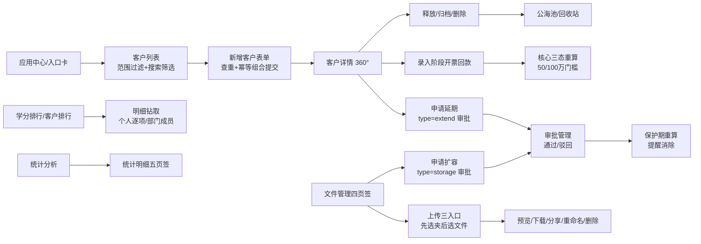

# MP·客户经营与其余模块

> 审计日期 2026-11-08 · 方法：逐文件通读小程序源码（aigicrm-miniprogram/pages）+ 对照后端 Controller/Service 源码（aigicrm-backend/src/main/java）。每个按钮给前端 handler 与 wxml 绑定行号证据，「后端动作」均读过后端源码后以业务语言描述。骨架参考 docs/ 三册，一律以代码为准。
> 统计口径：按钮 165 个（按明细表内交互元素逐个计，含 picker/pager/入口卡；演示模式专属入口与纯展示卡不计），覆盖后端端点 65 个（另有 H5 上传落地页 /mp-file-picker 1 个非 REST 端点单独记录）。

## 概述（侧栏位置/路由、权限码、谁能看到该菜单）

- **端**：微信小程序（aigicrm-miniprogram）。MP 无侧栏，入口两处：① 底部 tabBar 第 3 项「文件管理」直接 `switchTab` 进 `pages/files/index`（`custom-tab-bar`）；② tabBar 第 4 项「应用」→ `pages/app/index` 宫格 13 卡按权限码过滤后展示，点卡 `switchTab`/`navigateTo` 进入本章节各页（`pages/app/index.js:104-120` 各卡 `permission` 字段、`:128-129` 按码过滤、`:139` openApp）。
- **本章节覆盖页面**：客户经营 = `pages/customer/index`（客户列表）、`pages/customer/form`（新增/编辑）、`pages/customer/detail`（详情）及子页 finance/contact/share/log/filter/indicator、`pages/indicator/index`（核心客户六项指标）、`pages/ranking`（客户排行 tab，学分 tab 见「考核分析」）；文件管理 = `pages/files`（index/folder-form/textview/picker）；流程协同 = `pages/approval`（index/detail）；考核分析 = `pages/ranking` 学分 tab + `pages/ranking/detail`；经营分析 = `pages/statistics`（index/detail）。
- **不覆盖**（归其他 MP 章节）：四项激励（incentive 系 5 页）、首页/登录/我的、提醒 reminder、公海 sea、应用中心除入口外的激励/提醒/公海卡业务。
- **权限码与谁能看到**（引自《菜单功能按钮数据范围验收表-20261107》§二角色矩阵，MP 同码同源，见该表末行说明「MP 端同码同源」）：
  - 客户列表/详情/新增：customer:view / add / edit / delete——四角色（admin/总监/行政/销售员）全部有授权；
  - 六项指标页与客户排行：statistics:view——admin/总监/销售员（**行政无**，应用中心对应卡对行政隐藏）；
  - 学分排行：score:view——四角色全部有；
  - 文件管理五码（view/upload/delete/edit/share+folder:manage）：四角色全部有；
  - 审批（view/approve/reject）：四角色全部有码（实际可审=该流程配置的审批人）；
  - 统计分析：statistics:view——仅 admin/总监（行政/销售员卡隐藏）。
- **数据范围**（role_perm_scope，引自验收表 §四）：客户域 admin=全部、总监=全部、行政=本办事处(office)、销售员=本人+团队(team)+分享给我（只读）；用户级特例**马吉亮 customer 全组=all**（全公司客户）；文件域行政 view=region/upload=all、销售员=本人+ACL 授权夹。

## 功能清单（每功能一行）

- **客户列表**：按数据范围拉客户台账，关键词/开发类型/保护状态/高级筛选+显式分页，卡片点进详情，浮动「＋」新增。
- **新增/编辑客户**：主数据表单（集团可选可输、大区→办事处联动、负责人、省市区、注册日/开票日权限门）+ 客情六项评分（编辑态）+ 查重拦截 + 幂等组合提交 + 草稿自动保存/恢复。
- **客户详情**：档案头（含保护到期行内「申请延期」）+ 备注/联系人/跟进日志/开票回款摘要/核心判定卡/客情直存/六项指标卡 + 释放/归档/删除危险区 + 联系人/分享/跟进入口。
- **开票回款**：阶段总额制查看+录入（三通道权限门），录入开票额>0 自动前移保护期基准并重算核心三态。
- **联系人**：列表/拨打电话（脱敏拦截）/新增/编辑/删除。
- **分享管理**：勾选用户分享客户、撤回共享。
- **跟进日志**：纯文本跟进记录落库。
- **高级筛选**：省市/六类条件面板，草稿交接回列表页。
- **核心客户六项指标**（公司级指标总览页）：四指标卡+客户排行前 30，只读。
- **客户排行 / 学分排行 / 激励排行**（pages/ranking 三榜同页，按码显隐）：周期切换、榜内子页签、行钻取明细。
- **排行明细**：个人=逐项得分表格（#/大类/产品/得分）；部门=摘要+成员行下钻到个人。
- **统计分析**：九区块总览（年度/部门筛选）+「查看统计明细」进 detail 五页签（客户/审批/公海/团队动态/趋势）。
- **文件管理**：四页签文件库（公共/私人/四项服务/分享给我）、三入口上传（先选夹后选文件）、预览（图片组滑/文档/文本）、下载/重命名/分享/删除、文件夹新建/改名/删除、存储配额+申请扩容（走审批）。
- **审批管理**：六页签单据列表（待审批/我发起/审批中/已通过/已驳回/全部）+ 类型/部门/关键词筛选 + 通过/驳回（意见留痕）+ 详情轨迹 + 延期/扩容单字段成行展示。

## 按钮明细

### 1. 客户列表 pages/customer/index（码 customer:view；index.js:114-118 页门）

| 按钮 | 在哪 | 前端行为 | 后端动作 | 谁能看到 |
|---|---|---|---|---|
| 「海」公海入口 | index.wxml:8 | openSea（index.js:284，sea:view 门控 :121）→ 跳公海页 | 无（纯导航） | 持 sea:view 者（四角色均持） |
| 「↺」重置筛选 | index.wxml:9 | resetFilters（index.js:150）清关键词/页签/高级筛选并重拉 | 重发 GET /api/customer/list（CustomerController.java:41-70，@PreAuthorize customer:view；Service pageList 按数据范围过滤） | 全员 |
| 搜索框+「搜索」 | index.wxml:14-15 | search（index.js:144）→ loadCustomers 请求序号守卫（:228） | GET /api/customer/list（keyword=名称/编号模糊，服务端分页 current/size） | 全员（数据范围裁剪结果） |
| 开发类型 picker | index.wxml:18 | chooseFilter（index.js:155）本页过滤（含 2026-10-08 补的第 4 类「新建改建扩建大修」:91-93） | 不发新请求（本地过滤当前页） | 全员 |
| 保护状态 picker | index.wxml:19 | chooseStatusFilter（index.js:160）→ protectionStatus 参数 | 同 /api/customer/list 服务端过滤 active/expiring/expired | 全员 |
| 「高级」 | index.wxml:20 | openAdvancedFilter（index.js:148）→ 筛选面板页 | — | 全员 |
| 「清空」 | index.wxml:21 | resetFilters | 同搜索重拉 | 有筛选条件时显示 |
| 客户卡行 | index.wxml:26 | openDetail（index.js:274）带 id 跳详情 | 详情页另发 GET /api/customer/{id}（:161-166，accessService.assertCanView 数据范围断言 CustomerAccessService.java:168-173） | 能看到该卡=该客户在你范围内（负责人/被分享/范围层 canView，CustomerAccessService.java:48-72） |
| 分页 pager | index.wxml:43 | onPagerChange（index.js:261）10/30 条切页 | 同 /api/customer/list | 全员 |
| 「＋」新增客户 | index.wxml:47 | addCustomer（index.js:279，customer:add 门控 :120）→ 表单页 | 表单页另发下拉字典 | 持 customer:add 者（四角色均持） |

计数卡（全部/我的/共享/公海）纯展示：loadCounts（index.js:172-187）→ GET /api/customer/list/counts（CustomerController.java:138-142）；注释明确共享取 sharedToMe、公海显 0。

### 2. 新增/编辑客户 pages/customer/form（customer:add / customer:edit；index.js:149 页门）

| 按钮 | 在哪 | 前端行为 | 后端动作 | 谁能看到 |
|---|---|---|---|---|
| 「返回」 | form/index.wxml:8 | cancel（index.js:588）navigateBackWithFallback | — | 有权进页者 |
| 集团 picker | wxml:27 | chooseGroup（index.js:370），末项弹手动输入框 | 候选 GET /api/customer/group-names（CustomerController.java:149-153，需 add/edit 码，按数据范围去重） | 全员 |
| 行业 picker | wxml:46 | chooseIndustry（:346） | 字典 GET /api/system/dict/data/industry（失败报错+空选项，不回退演示数据 :205-208） | 全员 |
| 开发类型 picker | wxml:51 | chooseDevType（:347） | 字典 dev_type（兜底四类 :61-63） | 全员 |
| 终端 picker | wxml:56 | chooseTerminal（:348） | — | 全员 |
| 大区 picker | wxml:67 | chooseRegion（:351），换大区强制重选办事处 | 候选 GET /api/system/depts 按 deptType=2 过滤（:223-232） | 全员 |
| 办事处 picker | wxml:72 | chooseOffice（:362），仅列所选大区子级 | 同上 deptType=3 | 全员 |
| 负责人 picker | wxml:77 | chooseOwner（:363），公海客户禁改并提示走捞取 | 候选 GET /api/customer/users/simple | 全员 |
| 管理上级 picker | wxml:83 | chooseManager（:367） | 同 users/simple | 全员 |
| 省市区 picker | wxml:98 | chooseArea（:387）微信原生 region | — | 全员 |
| 注册日 picker | wxml:106 | chooseDate（:396）；编辑态 disabled=!canEditDates（index.js:156=admin∨customer:date:edit） | 后端 protectCustomerDateFields：非授权人改注册日直接报「注册日录入后仅总监或行政可修改」并强制回填库内值（CustomerService.java:709-725） | 编辑态：admin/总监/行政（customer:date:edit 绑定总监0/行政05/admin，验收表 §四） |
| 最近开票日 picker | wxml:113 | wx:if=canEditInvoiceDate（index.js:159=admin∨customer:invoice-date:edit，仅编辑态渲染） | 后端同函数：改开票日须 customer:invoice-date:edit，人工设定=新基准（CustomerService.java:711-717） | 名单=毛颖娜/肖赟/李艳梅/马吉亮/admin（2026-11-02 用户名单，代码注释 :711） |
| 联系人入口行 | wxml:127 | openContacts（index.js:407），无 id 提示先保存 | — | 全员 |
| 六项指标评分格 | wxml:153 | selectIndicatorScore（index.js:398）；指标未加载禁改（:400「指标未加载，请重试后再编辑」） | 随保存走组合提交；未加载/零分不提交 indicator 防覆盖（shouldSaveIndicator :444-451） | 全员 |
| 「取消」 | wxml:170 | cancel | — | 全员 |
| 「保存/新增客户」 | wxml:171 | submit（index.js:426）：必填校验→查重→saveCustomer | 新建 POST /api/customer/full 带 Idempotency-Key（api/customer.js:20-22；后端 Redis 幂等：命中回放同一客户 id 并置 Idempotent-Replay 头，CustomerController.java:195-241）；组合事务=建档+指标，任一失败整体回滚（CustomerService.java:1862-1870 @Transactional）。建档副作用：服务端强制 approvedExtendDays=0、注册日兜底当天、最近开票日一律清空、仅 admin 可代建指定负责人、编号=集团行 FOR UPDATE 取号+唯一键冲突重试、写「客户建档」生命线事件（CustomerService.java:397-440）。编辑 PUT /api/customer/{id}/full 先 assertCanEdit（CustomerController.java:243-252） | 持 add/edit 码者（四角色均持） |
| 草稿恢复弹窗（恢复/放弃） | tryRestoreDraft | wx.showModal（index.js:546-586）；onHide/onUnload 自动存草稿（:511-534） | GET/POST/DELETE /api/draft/customer_form（api/draft.js，乐观锁版本号回写） | 新建态真实环境 |

### 3. 客户详情 pages/customer/detail（customer:view；index.js:295-301 页门）

| 按钮 | 在哪 | 前端行为 | 后端动作 | 谁能看到 |
|---|---|---|---|---|
| 「返回」 | detail/index.wxml:8 | goBack（index.js:527），from=sea 时兜底跳公海 | — | 有权进页者 |
| 「编辑信息」 | wxml:19 | editCustomer（index.js:461，canEdit=customer:edit :306） | 详情页数据 GET /api/customer/{id} + 四路并发（contacts/logs/stage-amounts/indicator，各自 settle 降级 :408-458）；编辑跳表单 | 持 customer:edit 且在编辑范围内（canEdit 后端=customer:edit 码∧范围层 canAccess("edit")；公海池内客户=码∧池 PERM_EDIT，CustomerAccessService.java:80-99） |
| 「申请延期」（保护到期行内） | wxml:30 | submitExtendApproval（index.js:467，approval:view 门控 :469；公海客户整行隐藏 :182 mp-2 纵深守卫） | POST /api/approval/submit type=extend（ApprovalController.java:40-55）。后端：类型白名单→池内客户禁发延期→发起人必须 canView 该客户（P0-2 修复，ApprovalService.java:291-300）→节点解析全为本人则拒单（自审自批封堵 :445-453） | 页面显隐=非公海；实际提交仅需 approval:view（四角色均持） |
| 「查看明细」（开票回款卡） | wxml:66 | openFinance（index.js:536，finance:view 门控）→ 财务页 | 财务卡摘要来自 GET /api/customer/{id}/stage-amounts（无 finance:view 返回空骨架不外露金额，CustomerController.java:394-403） | 持 finance:view 者（四角色均持） |
| 「维护指标」/「编辑六项指标」 | wxml:86, wxml:147 | openIndicatorForm（index.js:552，canEdit 门控）→ 指标维护页 | 维护页另发 GET/POST indicator | 同「编辑信息」 |
| 客情评分格（0-3 直存） | wxml:110 | selectRelationship（index.js:556）立即保存并回拉指标 | PUT /api/customer/{id}/relationship（CustomerController.java:437-443，customer:edit+assertCanEdit）→ saveRelationshipScore | 同「编辑信息」 |
| 「释放到公海」 | wxml:151 | releaseToSea（index.js:476，customer:edit 门控+确认框，原因固定「移动端释放」） | POST /api/customer/{id}/release（CustomerController.java:473-498）：assertCanEdit→**仅客户负责人**（非 all 范围者）→办事处必须命中公海池配置→在途审批守卫 assertNoActiveApprovals→入池→删全部分享 | 负责人本人或 all 范围者 |
| 「归档（停止跟进）」 | wxml:156 | archiveCurrentCustomer（index.js:493，customer:edit；已归档隐藏 :190） | POST /api/customer/{id}/archive（:255-260）→默认隐藏/不参与统计与到期提醒 | 同编辑口径 |
| 「删除客户」 | wxml:162 | deleteCurrentCustomer（index.js:509，canDelete=customer:delete :307；公海客户隐藏按钮并给指引文案 :193-196） | DELETE /api/customer/{id}（:270-276，@PreAuthorize customer:delete）：assertCanDelete（池内=池 PERM_DELETE，非池=删除范围层判定，CustomerAccessService.java:116-135）→池行守卫（available/pending_approval 拒删并指引公海管理）→assertDeletable（有开票/回款拒删并提示「归档」；有在途审批拒删，CustomerService.java:805-832）→软删+清分享+清 pending 提醒+完整快照落 sys_log（:747-783） | 持 customer:delete 且在删除范围内（⚠️核查点 2：销售员有此码，可删自己范围内客户——软删进回收站，恢复仅 admin） |
| 「联系人」（动作卡） | wxml:167 | openContacts（index.js:540，contact:view 门控） | — | 持 contact:view 者 |
| 「分享」（动作卡） | wxml:168 | openShares（index.js:544）；admin 隐藏（:203，防「无有效集团归属，禁止共享」403 误导） | 分享页另发 GET shares+users/simple | 非 admin 且有权进详情者 |
| 「新增跟进记录」 | wxml:170 | openLogForm（index.js:548，canEdit 门控）→ 日志页 | — | 持 customer:edit 者 |

### 4. 开票回款 pages/customer/finance（+form）（finance:view；finance/index.js:106-112）

| 按钮 | 在哪 | 前端行为 | 后端动作 | 谁能看到 |
|---|---|---|---|---|
| 「返回」 | finance/index.wxml:9 | goBack | — | 有权进页者 |
| 「录入阶段数据」 | finance/index.wxml:50 | openForm（:180，canEdit 门控）→ 表单页 | canEdit 三通道=finance:manage ∨ customer:finance:edit ∨ (customer:edit∧finance:view)（finance/index.js:112，对齐后端 @PreAuthorize 三通道 CustomerController.java:406） | 持三通道任一者（销售员无 finance:manage/finance:edit 类码，只可查看——验收表 §二） |
| 阶段行「编辑」 | finance/index.wxml:29 | openForm 带行参回填 | 同上 | 同上 |
| 「录入与保护期规则」折叠 | finance/index.wxml:53 | toggleNote（规则文案含配置化门槛 50/100 万，finance/index.js:88-92） | — | 全员 |
| 「历史逐笔明细」折叠 | finance/index.wxml:63 | toggleHistory 懒加载 | GET /api/customer/{id}/invoices、/payments（先 assertCanView，再二道 finance:view 门，无码返回空数组，CustomerController.java:312-318, 546-552） | 持 finance:view 者 |
| 「返回」 | finance/form/index.wxml:8 | goBack | — | — |
| 年份 picker | finance/form/index.wxml:16 | chooseYear | — | 可录入者 |
| 周期 picker | finance/form/index.wxml:21 | choosePeriodType（上半年/下半年/全年） | — | 可录入者 |
| 「取消」 | finance/form/index.wxml:34 | goBack | — | — |
| 「保存」 | finance/form/index.wxml:35 | submit（至少一项>0，finance/form/index.js） | POST /api/customer/{id}/stage-amounts（:406-418 三通道码+assertCanManageFinance；Service saveStageAmount @Transactional：周期/年份/金额校验（非负、≤999999999999.99、至少一项>0）→FOR UPDATE 锁行更新→写 sys_log 留痕（旧值→新值）→开票额>0 时按阶段末日期前移保护期基准（只前进不缩短，提前录入按当天封顶）+清治愈类 pending 提醒→**重算核心三态** recalculateCoreStatus（CustomerService.java:2142-2209） | 同「录入阶段数据」 |

### 5. 联系人 pages/customer/contact（3 页）（contact:view；contact/index.js:46-50）

| 按钮 | 在哪 | 前端行为 | 后端动作 | 谁能看到 |
|---|---|---|---|---|
| 「返回」 | contact/index.wxml:8 | goBack | — | — |
| 联系人卡行 | contact/index.wxml:13 | openDetail → 联系人详情页（URL 传参） | 列表 GET /api/customer/{id}/contacts（无 contact:view 返回空数组，CustomerController.java:511-517） | 持 contact:view 者 |
| 「拨打电话」 | contact/index.wxml:16（catchtap call） | wx.makePhoneCall；含 * 号提示「手机号已脱敏」（contact/index.js:70-74） | — | 全员 |
| 「编辑」 | contact/index.wxml:17（canEdit=customer:edit，contact/index.js:51） | editContact（:80）带参跳表单 | 保存走 PUT contacts | 持 customer:edit 者 |
| 「删除」 | contact/index.wxml:18（canEdit） | deleteContact（:94）确认后删 | DELETE /api/customer/{id}/contacts/{contactId}（CustomerController.java:536-542，customer:edit∨contact:manage+assertCanEdit） | 持 customer:edit 者 |
| 「新增联系人」 | contact/index.wxml:25（showAddAction=canEdit :28） | openForm（:114） | 保存走 POST contacts | 持 customer:edit 者 |
| 「返回」 | contact/form/index.wxml:8 | goBack | — | — |
| 「取消」 | contact/form/index.wxml:21 | goBack | — | — |
| 「保存」 | contact/form/index.wxml:22 | submit | POST /api/customer/{id}/contacts 或 PUT …/contacts/{contactId}（ CustomerController.java:519-534；空串=清空字段语义由 api 层 keepEmpty 保留，api/customer.js:28-31） | 页门=customer:view+customer:edit（contact/form/index.js:42） |
| 「返回」 | contact/detail/index.wxml:8 | goBack | — | — |
| 「拨打电话」 | contact/detail/index.wxml:17 | call（脱敏拦截同上，contact/detail/index.js:49-53） | — | 全员 |

### 6. 分享管理 pages/customer/share（customer:view 页门；share/index.js:57-62）

| 按钮 | 在哪 | 前端行为 | 后端动作 | 谁能看到 |
|---|---|---|---|---|
| 「返回」 | share/index.wxml:8 | goBack | — | — |
| 「撤回共享」 | share/index.wxml:16（canEdit=customer:edit，share/index.js:62） | removeShare（:92）确认后撤 | DELETE /api/customer/{id}/shares/{userId}（CustomerController.java:462-468，customer:edit+assertCanEdit；被分享者随即失去只读可见） | 持 customer:edit 且在编辑范围内 |
| 分享对象勾选 | share/index.wxml:23 | selectUsers（:75）checkbox-group | 候选 GET /api/customer/users/simple（仅 canEdit 才拉，:69） | 同上 |
| 「取消」 | share/index.wxml:27 | goBack | — | — |
| 「确认分享」 | share/index.wxml:28 | addShares（:81） | POST /api/customer/{id}/shares（CustomerController.java:454-460，customer:edit+assertCanEdit）→被分享人获只读可见（数据范围 isSharedWith 分支，CustomerAccessService.java:60） | 同上 |

### 7. 跟进日志 pages/customer/log（customer:view+customer:edit 双码页门；log/index.js:32-36）

| 按钮 | 在哪 | 前端行为 | 后端动作 | 谁能看到 |
|---|---|---|---|---|
| 「返回」 | log/index.wxml:8 | goBack 回详情 | — | — |
| 「取消」 | log/index.wxml:15 | goBack | — | — |
| 「保存记录」 | log/index.wxml:16 | submit（:44，内容必填） | POST /api/customer/{id}/logs（CustomerController.java:294-301，customer:edit+assertCanEdit→addLog 落库） | 持 customer:edit 且在编辑范围内 |

### 8. 高级筛选 pages/customer/filter（customer:view；filter/index.js:75-77）

| 按钮 | 在哪 | 前端行为 | 后端动作 | 谁能看到 |
|---|---|---|---|---|
| 「返回」 | filter/index.wxml:8 | goBack | — | — |
| 开发类型/行业/状态/保护 picker | wxml:15/19/23/27 | choose*（行业走字典接口） | 字典 GET /api/system/dict/data/industry | 全员 |
| 部门/负责人 picker | wxml:35/39 | chooseDept/chooseOwner | 候选 GET /api/system/depts、/api/customer/users/simple | 全员 |
| 「重置」 | filter/index.wxml:43 | reset 清条件 | — | — |
| 「应用筛选」 | filter/index.wxml:44 | apply → saveFilterDraft 草稿交接列表页（onShow 恢复，customer/index.js:126-138） | 列表页按 draft 拼服务端参数（buildCustomerFilterParams，shared.js 单一出处）重拉 /api/customer/list | 全员 |

### 9. 核心客户六项指标 pages/indicator（statistics:view 页门；indicator/index.js:75-80）

| 按钮 | 在哪 | 前端行为 | 后端动作 | 谁能看到 |
|---|---|---|---|---|
| 下拉刷新 | indicator/index.js:90-93 | onPullDownRefresh → loadStats | GET /api/statistics/indicator-stats（StatisticsController.java:44-48，@PreAuthorize statistics:view）→ indicatorStats()：指标随**客户可见性**收口（visibleCustomers 按 statistics 模块范围解析，StatisticsQueryService.java:425-437, 442-452），卡片四数与排行同口径 | 持 statistics:view（admin/总监/销售员；行政无卡） |
| 排行 pager | indicator/index.wxml | onIndicatorPagerChange（index.js:68-73）本地切片前 30 名 | 同上（ranking 取 slice(0,30) :102，客户端分页） | 同上 |

无行点击、无导出——纯只读总览页（⚠️核查点 9 详后）。

### 10. 排行页（客户排行/学分排行/激励排行）pages/ranking（码并集；ranking/index.js:275-300）

| 按钮 | 在哪 | 前端行为 | 后端动作 | 谁能看到 |
|---|---|---|---|---|
| 「刷新」 | ranking/index.wxml:5 | refresh（index.js:525）→ loadRanking 按码懒加载 | 客户榜 GET /api/statistics/customer-rankings（statistics:view，StatisticsController.java:50-54）；学分榜 GET /api/score/ranking personal+dept（score:view，ScoreController.java:71-80）；激励榜 GET /api/incentive/scoreboard | 持对应码的页签才发请求（index.js:436-448 wantCustomer/wantScore/wantIncentive 门控） |
| 主页签（学分/客户/激励） | wxml:20 | switchMainTab（index.js:303），无权页签不渲染且拒切（:307） | 本地切（数据已加载） | 页签=权限码映射 score:view / statistics:view / incentive:view（utils/ranking-tabs.js:10-14，三方同源） |
| 学分周期 picker | wxml:34 | onPeriodChange（:343） | GET /api/score/ranking?period= | 持 score:view 者 |
| 学分子页签（个人/部门） | wxml:40 | switchScoreTab（:327）本地切 | — | 同上 |
| 学分卡行 | wxml:44 | openScoreDetail（:585）→ ranking/detail | 明细页另发 grid/dept-members | 同上 |
| 客户周期 picker | wxml:68 | onCustomerPeriodChange（:348） | GET /api/statistics/customer-rankings?period= | 持 statistics:view 者 |
| 客户子页签（四项服务/客情/核心指标） | wxml:74 | switchTab（:311）本地切 | — | 同上 |
| 客户卡行 | wxml:79 | openDetail（:580）→ 客户详情 | — | 同上（点开的客户仍受详情 assertCanView 保护） |
| pager×3（学分/客户/激励） | — | onScorePagerChange/onCustomerPagerChange/onIncentivePagerChange 本地切片 | — | 同上 |

### 11. 排行明细 pages/ranking/detail（score:view 页门；detail/index.js:39-44）

| 按钮 | 在哪 | 前端行为 | 后端动作 | 谁能看到 |
|---|---|---|---|---|
| 「返回」 | detail/index.wxml:8 | goBack | — | — |
| 部门成员行 | detail/index.wxml:33 | onMemberTap（detail/index.js:123-135）→ 带 userId 钻到个人模式 | 部门模式 GET /api/score/ranking/dept-members（ScoreController.java:91-97，score:view；返回成员人数/合计/人均/公司名次）；个人模式 GET /api/score/grid（:46-50，全学分项+scores 键值，前端拼 #/大类/产品/得分 表格） | 持 score:view 者（四角色均持，06 档位 score ranking=all=全公司榜，验收表 §16） |

### 12. 统计分析 pages/statistics（+detail）（statistics:view 页门；statistics/index.js:260-268）

| 按钮 | 在哪 | 前端行为 | 谁能看到 |
|---|---|---|---|
| 「刷新」 | statistics/index.wxml:6 | refresh（index.js:380）→ GET /api/statistics/analysis（year/deptId，StatisticsController.java:56-62） | admin/总监（行政/销售员无 statistics:view，入口卡隐藏） |
| 年度 picker | wxml:20 | chooseYear（index.js:368） | 同上 |
| 部门 picker | wxml:26 | chooseDept（:373）；候选按 scope 派生（loadDepts :344） | 同上 |
| 业务总览「↻」 | wxml:72 | refresh | 同上（GET /api/statistics/dashboard） |
| 雷达「展开」 | wxml:65 | openDetail | 同上 |
| 六区「明细/客户/分布/趋势/排行/全部」按钮 | wxml:79/116/129/148/162/174/179 | openDetail → statistics/detail | 同上（人员学分 Top5 区另受 score:view 门控 :311，GET /api/score/ranking） |
| 「查看统计明细」（吸底） | wxml:190 | openDetail | 同上 |
| 「返回」 | statistics/detail/index.wxml:9 | goBack | — |
| 「刷新」 | detail wxml:10/58 | refresh（detail/index.js:224） | 同上 |
| 五页签（客户/审批/公海/团队动态/趋势） | detail wxml:14 | switchSection（:223）本地切 | 同上 |

detail 数据：GET /api/statistics/dashboard、/team-activities、/daily-stats、/weekly-stats（StatisticsController.java:26-42, 64-68；均 statistics:view∨dashboard:view）。

### 13. 文件管理 pages/files（tabBar 直达；file:view 页门，等 /auth/info 回填后判定 files/index.js:445-457）

| 按钮 | 在哪 | 前端行为 | 后端动作 | 谁能看到 |
|---|---|---|---|---|
| 「＋上传」 | files/index.wxml:8 | uploadFile（index.js:947，canUpload=file:upload :472）；显隐再叠当前夹 upload 权（:336 mp-4） | 三入口 ActionSheet（手机文件/相册/聊天 :954-960）→ **先选文件夹**（面板 :114-124，逐夹按 upload 权过滤 openFolderSelect :970-979）→ 相册 wx.chooseMedia / 聊天 wx.chooseMessageFile → POST /api/file/upload（multipart，FormData 带 scope+folderId，api/file.js:67-87）。后端：scope 白名单→**公共根目录仅管理员可传**→夹 P_UPLOAD 校验→private 配额原子扣减（WHERE used+size<=quota，并发安全，FileService.java:249-296） | 持 file:upload 且当前夹可传者 |
| 「申请扩容 ›」 | files/index.wxml:13 | openStorageApply（index.js:831，canApply 门控；不可申请透出后端短原因 :14） | 资格 GET /api/file/storage/apply-info（FileController.java:131-144，复用 file:view；在途单即置不可申请） | 持 file:view 且配置允许申请者 |
| 扩容弹窗「关闭/取消」 | files/index.wxml:89/107 | closeStorageApply | — | 同上 |
| 扩容弹窗「提交申请」 | files/index.wxml:108 | submitStorageApply（index.js:848，配额/理由校验） | POST /api/approval/submit type=storage（extraData={quota,reason}）；后端：锁用户行串行化→校验配额上限→在途单拒重→忽略客户端 oldQuota 从库重取→customerId 置空（ApprovalService.java:226-240）→审批通过后配额上调 | 同上 |
| 「本地上传自测」 | files/index.wxml:17 | runDevUploadSmoke（index.js:1037）；仅 develop 版+本地 API 白名单显示（:465-472 fail-closed） | 同上传接口（临时文件） | 仅本地开发 |
| 搜索框+「搜索」 | files/index.wxml:18 | searchFiles | GET /api/file/list keyword（FileController.java:57-66，scope 白名单缺省返回空页 FileService.java:168-177） | 持 file:view 者 |
| 四页签（公共/私人/四项服务/分享给我） | files/index.wxml:20 | onTabTap（:795）重拉 | 公共/私人：GET /api/file/list?scope=public|private（夹内文件仅返回可见夹中的，封堵枚举他人夹，FileService.java:215-240）；四项服务：GET /api/incentive/customer-records 摊平文件（分享制+view-all 旁路与下载同口径，FileService.java:190-196）；分享给我：GET /api/file/shared-to-me（:273-280） | 四页签全员可见；四项服务行内激励文件按激励可见性（销售员=分享制） |
| 「返回全部」 | files/index.wxml:23 | clearFolder（:828） | — | — |
| 文件夹卡 | files/index.wxml:26 | openFolder（:820）进夹 | 夹树 GET /api/file/folders?scope=（:50-55；逐夹回填 perms/downloadable 供行按钮收敛 mp-4） | 树已按权限过滤 |
| 文件行（点行） | files/index.wxml:43 | openFile → previewFile 一步预览（index.js:1069-1099）：先过下载权限（:1082「该文件夹已关闭下载」），图片=当前视图内可下载图片签名直链整组 wx.previewImage 左右滑 | 预览/下载共用 GET /api/file/download/{id}（wx.downloadFile 带 Bearer；后端 downloadById 内 canDownloadFile=管理员/公开/上传者/被分享者/夹 download 权+downloadable 开关，FileService.java:1302-1310, 749） | 有下载权限者（缓存命中同样受前置拦截） |
| 「···」/长按 | files/index.wxml:51/43 | openActionSheet（index.js:1238）按 sheetActions 显隐（:270-281） | — | 按权限动态 |
| 面板「打开」 | files/index.wxml:64 | 同点行 | 同上 | — |
| 面板「下载」 | 同上 | downloadFile（index.js:1109）→ saveDownloadedFile 落本机 | 同下载通道 | 夹 download 权+downloadable=1 |
| 面板「重命名」 | 同上（2026-11-06 新增） | openRenameModal → 弹层「确认重命名」confirmRename（:1139） | PUT /api/file/{id}/rename（FileController.java:113-118，@PreAuthorize file:edit）→service checkFile(P_EDIT)（FileService.java:455-465） | 面板显隐=当前夹 edit 权限位（:279）；后端再查 file:edit 码+夹 edit 权 |
| 面板「分享」 | 同上 | shareFile（index.js:1214）：非公共/四项服务/分享给我 tab，选人 ActionSheet（GET /api/customer/users/simple） | POST /api/file/{id}/share（FileController.java:266-271，file:share）→service checkFile(P_SHARE)（FileService.java:1421-1431）；对方「分享给我」页签可见 | 持 file:share 且夹 share 权 |
| 面板「删除」 | 同上（danger） | removeFile（index.js:1115）：canDelete=file:delete+夹 delete 双门（:1116） | DELETE /api/file/{id}（FileController.java:98-103，file:delete）→service checkFile(P_DELETE) | 持 file:delete 且夹 delete 权 |
| 面板「取消」 | files/index.wxml:69 | closeActionSheet | — | — |
| 重命名弹层「取消」 | files/index.wxml:129 | cancelRenameModal | — | — |
| 重命名弹层「确认重命名」 | files/index.wxml:131 | confirmRename（非空/≤200 校验） | 同「重命名」 | 同上 |
| pager | files/index.wxml:57 | onPagerChange | 服务端分页 | — |
| 「＋新建」（文件夹管理卡，canManageFolder=file:folder:manage 显卡 :72-73） | files/index.wxml:73 | openFolderForm（index.js:880）：仅公共/私人页签；editable modal 输名，带当前夹 parentId（子夹建在夹内，根级传 0 归一化） | POST /api/file/folders（FileController.java:77-82，file:folder:manage）→根级夹仅 admin（非 admin 建根夹恒败 P_UPLOAD 校验，FileService.java:327-336） | 持 file:folder:manage 者 |
| 夹行「···」 | files/index.wxml:78 | openFolderActions（index.js:908）：2026-11-05 起仅「重命名/删除」，MP 无 ACL 设置实操作（:909 注释，权限只读弹窗退役） | 改名 GET 夹树后跳 folder-form | 持 file:folder:manage 者 |
| 「保存名称」（folder-form） | files/folder-form/index.wxml | 保存（缺 id 拒绝）→置 forceRefresh.files | PUT /api/file/folders/{id}（FileController.java:84-89）→service P_EDIT 校验（FileService.java:358） | 同上 |
| 「删除」（夹） | openFolderActions 第二项 | removeFolder（index.js:931）确认后删 | DELETE /api/file/folders/{id}（FileController.java:91-96）→service P_DELETE 校验（FileService.java:372） | 同上 |
| 上传夹面板「根目录/夹行」 | files/index.wxml:118-120 | selectFolderItem | — | — |
| 上传夹面板「取消」 | files/index.wxml:116 | cancelFolderSelect | — | — |
| 上传夹面板「上传到这里」 | files/index.wxml:122 | confirmFolderSelect（index.js:993）：定夹后再进选文件；手机文件入口把 folderId/scope 带进 H5 页 | H5 页 /mp-file-picker 直传 POST /api/file/upload（token 走 URL，picker/index.js:24-32；onUnload 置 forceRefresh 刷新列表） | 同上传 |

files/textview 纯文本阅读页（utf8→GBK 兜底，无按钮）；files/picker 为 web-view 容器（无按钮）。

### 14. 审批管理 pages/approval（approval:view 页门；approval/index.js:178-184）

| 按钮 | 在哪 | 前端行为 | 后端动作 | 谁能看到 |
|---|---|---|---|---|
| 「刷新」 | approval/index.wxml:8 | refresh（index.js:386）重拉列表+统计 | GET /api/approval/list、/statistics（ApprovalController.java:22-32, 100-104） | 持 approval:view 者（四角色均持） |
| 六页签（待审批/我发起/审批中/已通过/已驳回/全部） | approval/index.wxml:16 | changeTab（index.js:292）重拉 | GET /api/approval/list tab=：pending=我是节点审批人的单（ApprovalService.java:83-93）；mine=我发起（:94-95）；reviewing/approved/rejected/all=非 admin 限本人申请或本人参与审批（applyDataScope :96-113；未知 tab 白名单外按最窄口径 :114-118） | 全员（数据范围如上） |
| 搜索框+「查询」 | approval/index.wxml:21-22 | search（index.js:301） | keyword=审批编号/客户名/申请人模糊（applyKeywordFilter，ApprovalService.java:150-166） | 全员 |
| 类型 picker | approval/index.wxml:25 | chooseType（:305）：捞取/转移/延期/存储空间 | type=白名单过滤 | 全员 |
| 部门 picker | approval/index.wxml:28 | chooseDept（:310） | deptId=申请人部门子树过滤（ApprovalService.java:128-136） | 全员 |
| 「查看详情」 | approval/index.wxml:48 | openDetail（index.js:329）→ 详情页 | 详情 GET /api/approval/{id}（ApprovalController.java:34-38） | 全员 |
| 「客户档案」 | approval/index.wxml:49（有关联客户才显） | openCustomer（index.js:335）跳客户详情（from=approval） | — | — |
| 「驳回」 | approval/index.wxml:50 | reject（index.js:323）：showRejectAction=canReject(approval:reject)∧pending（:46）；editable modal **必填原因**（:352-369） | POST /api/approval/{id}/reject（ApprovalController.java:92-98，@PreAuthorize approval:reject+@AigicrmLog 审计）→Service：终态守卫（approved/rejected 不可再操作，统一 404 文案）→仅当前节点 pending 审批人可操作（查不到本人 pending 节点即拒）→意见留痕+剩余待办取消（ApprovalService.java:552-620, 710+） | 按钮=持码+单据待审；**实际可审=该单当前节点审批人**（见疑点 N1） |
| 「通过」 | approval/index.wxml:51 | approve（index.js:317）：意见默认「同意」（:352-353） | POST /api/approval/{id}/approve（:75-90，approval:approve+审计日志）→Service：先锁主行（并发串行化 :556）→自审自批闸门（申请人≠审批人 :575-579）→条件流转防重复点击（affected=0 拒绝 :596-606）→阶段感知推进（或签/会签/串行 :616-643）→整单通过后 executeApprovalAction：claim=池行归属转移；extend=客户行悲观锁内累加延期天数+重算到期日+公海守卫+生命线事件；transfer=新负责人有效性/集团边界/部门同步校验后换主+生命线事件（:857-960） | 同上 |
| pager | approval/index.wxml:57 | onPagerChange 服务端分页 | 同列表 | — |

统计卡四张（待审批/我发起/本月通过/本月驳回）纯展示 GET /api/approval/statistics。

### 15. 审批详情 pages/approval/detail（approval:view；detail/index.js:222-228）

| 按钮 | 在哪 | 前端行为 | 后端动作 | 谁能看到 |
|---|---|---|---|---|
| 「返回」 | detail/index.wxml:8 | goBack | — | — |
| 「查看客户完整档案」 | detail/index.wxml:30（有关联客户显） | openCustomer（detail/index.js:261） | — | — |
| 驳回原因输入 | detail/index.wxml:54 | onCommentInput（:241） | — | 待审且持码者 |
| 「驳回」 | detail/index.wxml:58 | reject（detail/index.js:259）原因必填（:245） | 同列表驳回 | 同列表 |
| 「通过」 | detail/index.wxml:59 | approve（:259）空意见传空串（:253 P2 修复） | 同列表通过 | 同上 |

延期单只读展示申请天数+「如需调整天数请在电脑端审批」（detail/index.js:181-185）——MP 无 extendDays 调整入口；扩容单展示「当前配额 → 申请配额」+理由（:93-100）。审批轨迹节点含审批人失效提示（:139-141 approverInvalid）。

### 16. 应用中心 pages/app（13 卡入口组，openApp 按码过滤）

| 卡片 | 权限码（pages/app/index.js:104-120） | 行为 |
|---|---|---|
| 客户列表/新增客户/客户排行/核心六项指标 | customer:view / customer:add / statistics:view / statistics:view | openApp → switchTab 或 navigateTo（客户排行带 ?tab=customer、学分排行带 ?tab=score 直达，ranking/index.js:290-297 入口范围=所带页签） |
| 文件管理 | file:view | switchTab |
| 激励上传/查询/统计 | incentive:add / incentive:view / stats∨rank | （归四项激励章节） |
| 学分排行 | score:view | navigateTo ?tab=score |
| 统计分析 | statistics:view | navigateTo |
| 审批管理/提醒管理/公海池 | approval:view / reminder:view / sea:view | （提醒/公海归流程协同其余章节） |

空态「暂无可用应用」。行政（无 statistics:view）看不到：客户排行/六项指标/统计分析卡；销售员看不到：统计分析卡。全员看得到：客户列表/新增/文件/激励系/学分排行/审批/提醒/公海。

## 业务链条

文字链：**客户建档链（链2）** 列表「＋」→表单查重→幂等 POST /full→详情；**客户跟进链（链3）** 详情「新增跟进记录」→POST logs；**客户处置链（链4）** 释放→公海池（他人捞取审批）/归档/软删→（PC 回收站恢复，MP 无回收站入口）；**保护期延期链（链5）** 详情「申请延期」→type=extend 审批→审批人通过（MP 不调天数，PC 可调 1~3650）→保护期重算；**财务·核心判定链（链6）** 财务页录阶段总额→saveStageAmount 前移保护期+重算核心三态→六项指标页/工作台反映；**文件协作链（链11）** 上传（先选夹）→分享选人→对方「分享给我」→预览/下载；**文件扩容链（链12）** 配额满→申请扩容（type=storage，禁自审：提交侧「审批人全为本人」拒单 ApprovalService.java:445-453+审批侧闸门 :575-579）→通过→配额上调；**审批中枢链（链14）** 四类单据→六页签→通过/驳回（意见留痕、@AigicrmLog 审计）→轨迹；**排行激励链（链19）** （MP 侧只读段）学分/客户榜→明细钻取；**统计下钻链（链20）** 统计分析→detail 页签；**移动办公链（链23）** 应用中心 13 卡按码过滤→转发/H5 直传回挂→表单草稿续办。

## ⚠️ 疑点

**核查点 1：销售员有「客户导入」码（customer:import）——MP 无导入入口，码在小程序零消费。**
后端 POST /api/customer/import、GET /import/template 均挂 customer:import（CustomerController.java:585, 593），但小程序 api/customer.js 无 import 函数、pages/customer/index.wxml 仅搜索/筛选/新客户 fab（逐行核对），全 MP grep `customer/import` 零命中。若产品预期「一线在手机上批量建档」，此为功能缺口；若导入仅限 PC，则销售员该码在 MP 场景无落地，风险与验收表 §五-1 一致（是否预期保留待管理层裁）。

**核查点 2：销售员有「客户删除」码（customer:delete）——MP 详情页确有「删除客户」按钮且销售员可见。**
前端 canDelete=customer:delete（detail/index.js:307），按钮显隐（wxml:162）；公海客户已隐藏并给指引文案（index.js:193-196）。后端 DELETE /api/customer/{id} 三重守卫：customer:delete 码+范围层 canDelete（销售员兜底 self→只能删自己范围内）→池行守卫→assertDeletable（有开票/回款/在途审批拒删）→软删+快照留痕（CustomerService.java:747-832）。疑点照录：销售员可软删自己范围内客户；恢复/清空在 PC 回收站且**恢复/清空码仅 admin**（验收表 §五-8），MP 无回收站入口，删除在手机上不可逆感知强。

**核查点 3：行政打开学分录入=只读——MP 不涉及。**
MP 无学分录入页（app.json 页面清单无 score/entry；学分域只有 ranking 只读排行+detail 钻取，ScoreController 的写端点 /items、/entries/batch、/export/grid 均挂 score:manage/score:entry，MP 全端零调用）。该核查点归 PC 章节核实，MP 侧无风险面。

**核查点 9：六项指标/客户排行对销售员的实际数据口径——代码已收口为「客户可见范围」，非全公司。**
`indicatorStats()` 与 `customerRankings()` 的可见客户集都经 `visibleCustomers()`：admin 全量；其余按 statistics 模块范围解析可见人员（resolveModuleUsers → OrgScopeResolver.resolveScope，销售员无 statistics 档位时兜底 self → 仅本人名下+未分配负责人客户），方法注释明言「原『核心指标全员可见不过滤』注释口径作废——统计范围必须 ≤ 明细可见范围(审计裁决)」（StatisticsQueryService.java:425-437, 442-452, 665-707）。客户排行另经 2026-11-02 用户裁决「三类排行统一客户可见范围基线」（:684-690 注释）。即：**销售员在手机上看六项指标卡片和客户排行=自己（team 内负责人）的客户，不是全公司榜**；与验收表「待线上预览核对」相比，代码证据已可核实，建议线上按销售员账号抽验一遍后销项。

**核查点 6（关联）：马吉亮用户级 customer 全组=all 在 MP 全链生效。**
范围解析单一链路（CustomerAccessService→OrgScopeResolver，CustomerAccessService.java:146-160），用户级 USER 行覆盖角色档（验收表 §四），其 MP 列表/详情/编辑/删除/分享/导出（PC）范围=全公司客户。MP 侧无额外特判，属范围层自然放大，记录备查（是否仍需保留该特例见验收表 §五-6）。

**新发现 N1（P3·UX/权限一致）：审批列表「通过/驳回」按钮不判「我是否当前节点审批人」。**
showApproveAction/showRejectAction 仅= 权限码∧单据 pending（approval/index.js:46-47），列表行不含节点数据无法判断审批人；在「审批中/已通过…/全部」页签看到他人 pending 单时按钮仍显示，点击后端因查不到本人 pending 节点统一报「资源不存在或无权访问」（ApprovalService.java:566-571）。建议列表接口回填 isCurrentApprover 位或前端隐藏，与 PC 口径对齐。

**新发现 N2（P3·一致性）：文件「重命名」入口缺 file:edit 权限码前置。**
面板显隐仅看当前夹 edit 权限位（files/index.js:279），未像删除/分享那样叠 canDelete/canShare 码检查；后端有 @PreAuthorize file:edit+checkFile(P_EDIT)（FileController.java:113, FileService.java:459-465）兜底，生产四角色均持 file:edit 故无实际越权，属前端判定口径不一致（私人夹 perms=全量 ：424-426 使所有持 file:view 者都能看到该入口）。

**新发现 N3（P3·体验）：公共页签选「根目录」上传，普通用户必被后端拒。**
MP 上传选夹面板提供「根目录」选项（files/index.wxml:118），公共页签 scope=public+folderId=null 时后端抛「公共根目录文件仅管理员可上传」（FileService.java:262-265），前端未按「公共+根目录+非管理员」预禁用该选项，用户会选完文件才收到 403 文案。私人页签根目录无此限制。

**记录备查（非缺陷）：**
- MP 客户详情「申请延期」不传 extendDays，天数以审批单/系统配置为准；调整天数入口在 PC 审批页（approval/detail/index.js:181-185 明示「如需调整天数请在电脑端审批」），与后端 extendDays 可选参数（ApprovalController.java:79-88）匹配。
- MP 无客户导出/回收站/审批配置/公海配置/日志/阅读排行 UI——customer:export、recycle:*、system:log:view、incentive:read-ranking:view 等码在 MP 零消费（grep 全端零命中），属「MP=移动办公子集」现状；核查点 7（日志/阅读排行仅 admin）与核查点 8（总监无回收站按钮）均在 PC 侧，MP 不涉及。
- 文件域四项服务页签对 admin/持 incentive:view-all 者走全量旁路，与激励查询可见性同口径（FileService.java:190-196），避免「MP 可见 PC 下载 403」双端分叉。
