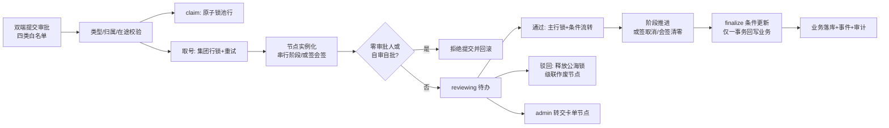

# 后端公共机制（横切章节 · 文档末章）

> 仓库：`/Users/dongjun/东来/项目/02-已上线/01-AIGICRM/02-迭代源代码`（后端 `aigicrm-backend/src/main/java/com/aigicrm`，PC 前端 `aigicrm-ui/src`，小程序 `aigicrm-miniprogram`）。本章节不入菜单树，按**机制**横向审计，为前面各菜单章节提供公共底座的可核查索引。全部结论以本次通读的源码为准（引用格式 `路径:行号`），参考文档仅作骨架。

## 概述

本章节覆盖 8 组横切机制及其后端落点：

| # | 机制 | 后端落点（Controller/Service/切面/定时类） | 双端触发 |
|---|---|---|---|
| 1 | 认证会话与 token 续期 | `security/JwtTokenProvider`、`security/JwtAuthFilter`、`module/auth/controller/AuthController`、`module/auth/service/AuthService`、`config/SecurityConfig` | PC 登录页/小程序登录页；两端请求封装静默换发 |
| 2 | 权限四层（菜单/功能/按钮/数据范围） | `security/UserDetailsServiceImpl`、`security/PermissionCacheService`、`common/engine/PermissionRuleEngine`、`common/engine/ActionGuardAspect`、`common/engine/FieldFilterAdvice`、`module/system/controller/{SysMenuController,PermCenterController,RolePermScopeController}`、`module/auth/controller/PermissionExplainController` | 登录后 `/auth/info` 下发菜单树+权限串；页面按钮 `hasPermission` 门控 |
| 3 | 数据范围（Resolver+守卫） | `common/scope/OrgScopeResolver`、`common/scope/{ScopeRequest,ScopeDecision,ScopeConfig,GroupScopeUtil}`、`common/scope/DataScopeGuard`、`module/common/{controller/ScopeController,service/ScopeService}` | 各列表/统计/下拉的「人员/部门筛选」统一走 `/api/common/scope/*` |
| 4 | 操作审计日志落库 | `config/LogAspect`（AOP）、`module/system/service/SysLogService`、`security/SecurityAuditService`、`module/system/controller/{SysLogController,SysAuditLogController}` | PC「系统管理→日志」页签页；MP 无日志页（仅 admin 有码） |
| 5 | 定时任务 | `task/CustomerExpireTask`（02:00）、`task/FileRecycleCleanupTask`（03:30）、`task/ScheduledTaskController`（手动触发入口） | 无界面按钮；仅后端 admin 可手动触发 |
| 6 | 字典与配置读取 | `module/system/{controller/SysDictController,service/SysDictService}`、`module/system/{controller/SysConfigController,service/SysConfigService}`、`module/system/controller/SysRuleVersionController` | PC「系统设置/字典管理」；MP 端经 `isAuthenticated()` 字典读接口消费 |
| 7 | 审批中枢引擎（四类单据与转交） | `module/approval/controller/{ApprovalController,ApprovalConfigController}`、`module/approval/service/{ApprovalService,ApprovalConfigService}` | PC 审批管理页 + 小程序审批页（同码同源） |
| 8 | 核心三态重算（50/100 万门槛可配置） | `module/customer/service/CustomerService`（`recalculateCoreStatus`/`recalculateAllCoreStatuses`）、`module/statistics/service/StatisticsQueryService`（读侧同口径）、`module/customer/entity/BizCustomerIndicator` | 系统设置双门槛保存触发；工作台/六项指标/客户排行只读消费 |

「谁能看到」类结论一律引自《菜单功能按钮数据范围验收表-20261107.md》（生产库实拉：sys_menu 97 行、role_perm_scope 90 行、biz_incentive_permission 29 条等），本章节不重新推导。

## 功能清单（说人话）

1. **登录与会话**：账号密码登录换 JWT（24h 档 / 勾「记住密码」升 7d 档）；活跃请求剩余寿命过半即静默换新 token（滑动续期）；注销/改密/被禁用即刻失效（jti 黑名单 + 改密时刻戳双保险，Redis 挂了回查 DB，查不动一律按「已失效」拒绝）。
2. **权限四层**：菜单层（登录后按角色勾选下发侧栏树）、功能层（`@PreAuthorize` 权限码）、按钮层（前端 `hasPermission` 显隐 + 后端同码兜底）、数据范围层（`role_perm_scope` 按 (模块,动作) 配档，未配回退角色 data_scope，多角色并集）。
3. **数据范围**：六级档位（all/region/office/dept/custom/team/self）解析成「可见用户集合」，外加两个系统开关（上级看下属链、组织负责人看子树，30s 缓存，缺省 false 收窄）；全局表（sys_user/sys_log）用「集团收口版」防 all 放大成全平台。
4. **操作审计**：所有写操作（POST/PUT/DELETE）自动落 `sys_log`，成功失败都记（失败带异常摘要+IP）；登录、爆破、越权 403、转交、改权限等安全事件另落 append-only 的 `sys_audit_log` 并有阈值告警。
5. **定时任务**：每晚 2 点客户保护期批（到期入公海/临期提醒/开票超期/悬挂提醒回收/公海捞取锁超时释放），以 admin 系统身份跨集团执行；凌晨 3:30 文件回收站按保留期清理。**全库仅这两个 `@Scheduled`**——「缓存刷新」不是定时任务，而是 TTL+写时失效（详见⚠️）。
6. **字典与配置**：字典类型/数据 CRUD（内置字典禁删、改值自动同步客户表字段）；系统配置按 key upsert，规则类键变更自动记版本；双门槛保存后全量重算核心三态；Logo/保护期天数等白名单键匿名可读。
7. **审批引擎**：四类单据（claim 捞取 / transfer 转移 / extend 延期 / storage 扩容）统一提交口；支持管理员配置的串行多阶段（阶段内或签/会签）与旧版「直属领导/角色」兜底流程；自审自批双侧封堵、公海锁原子化、编号取号行锁重试；admin 可把卡单节点转交。
8. **核心三态重算**：真核心（年度开票、回款双 ≥ 100 万档）/ 争核心（双 ≥ 50 万档）/ 非核心；门槛是 `sys_config` 可改（`customer.core.minor.wan`/`customer.core.major.wan`），财务写路径（发票确认/作废/删除、回款、阶段总额、五项评分）每次自动重算落 `biz_customer_indicator`，门槛变更后全量刷新。

## 按钮明细

### 块 A · 认证会话（登录/续期/注销/忘记密码）

| 按钮 | 在哪 | 前端行为 | 后端动作 | 谁能看到 |
|---|---|---|---|---|
| 登录（PC） | `aigicrm-ui/src/views/login/index.vue:155-156`（`login({...form, rememberMe})`） | 表单校验后 POST `/api/auth/login`，落盘 token | `AuthService.login`（`AuthService.java:72-143`）：IP+用户名双重限流（5 次/15 分钟、IP 20 次，`AuthService.java:43-44`）→ BCrypt 校验（账号不存在/停用/密码错统一「账号或密码错误」防枚举 :97-113）→ 失败计数与 `SecurityAuditService.loginFailed` 告警 → 成功清用户名维计数（IP 计数不清，防穿插洗计数 :116-120）→ 岗位→组织→集团推导 groupIds（:124-125）→ 签发 JWT（含 jti/username/currentGroupId/rm 声明，`JwtTokenProvider.java:66-86`）；登录成功另内联写一条「登录」审计日志（`AuthController.java:29-41`，UA 解析成浏览器/OS） | 匿名（SecurityConfig 白名单 `SecurityConfig.java:57-60`） |
| 记住账号（PC 勾选） | `login/index.vue:32` | 仅记住用户名（口令另走 WebCrypto 设备密钥加密 7 天档，`login/index.vue:33-35,76-87`） | 勾「记住密码」时 `rememberMe=true` → 签 7d 档 token（`jwt.remember-expiration`，`JwtTokenProvider.java:67`，rm 声明 :82-84） | 登录页所有人 |
| 记住密码（PC 勾选） | `login/index.vue:35` | 7 天档令牌联动 | 同上（rememberMe 分支） | 登录页所有人 |
| 登录（MP） | `aigicrm-miniprogram/pages/login/index.js:1,57`（`login` 来自 `api/auth.js`） | `wx.request` POST `/api/auth/login`，`setToken` 按分环境组合键落盘 | 同 PC 后端；401 在登录页只清令牌不跳转（`utils/request.js:13-24`） | 匿名 |
| 退出登录（PC） | `store/user.js:112-119` | 先调 `POST /api/auth/logout` 再本地清 token/store | `AuthService.logout` → `JwtTokenProvider.blacklistToken`（`JwtTokenProvider.java:183-210`）：jti 落 `sys_token_blacklist`（落库失败=撤销失败直接抛错不可静默 :196-199）+ Redis 黑名单 TTL=剩余寿命；`JwtAuthFilter.java:42-45` 每请求查黑名单（Redis miss/故障回查 DB :156-179，DB 也挂按「已拉黑」拒绝 fail-closed :173-178） | 已登录（四角色） |
| 退出登录（MP） | `aigicrm-miniprogram/pages/profile/index.js:121`（API `api/auth.js:33-34`） | POST `/api/auth/logout` + 本地完整会话清理 | 同上 | 已登录（四角色） |
| 切换集团（PC） | `store/user.js:102-104`（API `api/auth.js:16-17`） | POST `/api/auth/switch-group {groupId}`，用新 token 替换 | `AuthService.switchGroup`（`AuthService.java:176-200`）：校验集团 ∈ 用户归属集合（越界 403）→ 写集团切换安全审计（:183-184）→ **保留原 rm 档重签 JWT**（:186-189）；`JwtAuthFilter.java:93-102` 另做活体校验：token 内嵌 currentGroupId 已不在当前归属集合时降级最小集团/置 null（fail-closed） | 多集团用户（验收表：集团管理仅 admin/总监） |
| 忘记密码-查询账号 | `login/index.vue`（三步向导第一步；API `api/auth.js`） | POST `/api/auth/forgot-password/lookup` | `AuthController.java:89-100`：先 `securityAudit.anonymousProbe` 留痕（被限流的探测也是信号）→ IP 60s 限流 → `AuthService.lookupUser`（:310-329）账号不存在返回**中性响应**（全 false 无掩码，消存在性 oracle）；有手机/邮箱只回掩码 | 匿名 |
| 发送验证码 | 同上第二步 | POST `/api/auth/forgot-password/send-code` | `AuthService.sendResetCode`（:331-392）：邮箱通道显式拒绝（未开通 :334-337）→ 用户名 60s + IP 1h/10 次双限流（发码前置、每次请求都计 IP，封短信轰炸 :338-352）→ 用户不可用/未绑手机对外中性返回 → 6 位码 5 分钟 TTL 入 Redis → 阿里云短信发送 | 匿名 |
| 重置密码 | 同上第三步 | POST `/api/auth/forgot-password/reset` | `AuthService.resetPassword`（:394-436）：验证码三态文案归一（无码/错码/无账号同文案 :416-424）→ 错 5 次锁 15 分钟 → 改密落库并**截断到秒写 `pwd_changed_at`**（:426-431）→ `markPasswordChanged` 双撤销（Redis 标记 + DB 时刻戳）→ 删码 | 匿名 |

### 块 B · 权限治理（权限中心 = 权限四层的配置面）

| 按钮 | 在哪 | 前端行为 | 后端动作 | 谁能看到 |
|---|---|---|---|---|
| 生效预览（页签） | `aigicrm-ui/src/views/system/PermCenter.vue:11` | 切到预览面板，选人后 GET `/api/system/perm-center/preview` | `PermCenterController.java:30-31`（`system:config:view`）→ 组装该用户「四层最终生效结果」（角色/岗位/用户级覆盖叠加解释）；登录用户还可自助 GET `/api/auth/permission-explain`（`PermissionExplainController.java:24-28`，登录即可查自己） | 权限中心入口 canEdit=isAdmin∧system:config:edit（验收表 §三.18） |
| 添加授权 | `PermCenter.vue:27`（`v-if="canEdit"`） | 弹窗选主体（USER/POSITION/ROLE）+模块.动作+范围档+锚点，PUT 保存 | `RolePermScopeController.java:31-32,50-51`（写需 `system:config:edit`）→ `RolePermScopeService` 落 `role_perm_scope` 并 evict 权限缓存 + bump permVersion（装载点见 `UserDetailsServiceImpl.java:165-168`，版本号比对自愈 `:67-75`） | 同上 |
| 撤销授权 | `PermCenter.vue:47`（`v-if="canEdit"`） | 删除一条授权行 | 同上写链路（evict 全部受影响用户，`PermissionCacheService.java:67-127`：用户级/角色级反查/全量三类失效，事务内 afterCommit 防 evict-commit 窗口旧缓存回填 :70-81） | 同上 |

权限四层运行时读法（代码实证）：菜单层=`/auth/info` 下发（`AuthService.getUserInfo` :209-262，按 path 去重 + 过滤按钮/隐藏节点建树 :275-306）；功能层=`@PreAuthorize`（Spring 方法级安全，`SecurityConfig.java:34` `@EnableMethodSecurity`）；按钮层=前端 `userStore.hasPermission`（`store/user.js:91-92`，权限串来自 `menuMapper.selectPermissionsByUserId`）；数据范围层=`OrgScopeResolver.resolveScope`（`OrgScopeResolver.java:151-182`）优先 `scopeConfigs`（USER>POSITION>ROLE，主体内精确>通配 :227-260），未配回退角色 data_scope 并集（多角色并集 :384-394，任一 all 短路）。另有第四把刀：`PermissionRuleEngine` 五类规则（列过滤/组织过滤/时间窗/字段可见/操作控制）预求值进 `SecurityUser.ruleResult`（`UserDetailsServiceImpl.java:192-216`），由 `ActionGuardAspect.java:28-54`（按 Controller 类名→实体、方法名→动作拦截显式禁止项，403）与 `FieldFilterAdvice.java`（序列化期字段脱敏）消费。

### 块 C · 数据范围（无独立按钮，全部内嵌消费）

范围感知筛选器两端统一走 `GET /api/common/scope/users`、`GET /api/common/scope/depts`（`ScopeController.java:26-35`，无 `@PreAuthorize`，范围在 service 强制：`ScopeService.visibleUsers` :37-69 非 admin 的 all 收口为「当前集团成员集」、`visibleDeptTree` :78-92 非 admin 仅本人部门+祖先链）。列表/统计/单条判定共用 `OrgScopeResolver.resolveScope/canAccess`（`OrgScopeResolver.java:151-198`）；全局表专用收口版 `resolveModuleUsersWithinGroup`（:130-138，防 all 在无 tenant_id 表上放大为全平台）。**`DataScopeGuard` 组件本身当前无运行时消费者**（见⚠️N1）。

### 块 D · 操作审计日志（PC 日志页，仅 admin）

| 按钮 | 在哪 | 前端行为 | 后端动作 | 谁能看到 |
|---|---|---|---|---|
| 日志页签切换 | `aigicrm-ui/src/views/system/log.vue:14-17` | 按模块（客户/登录/文件/人员/系统）切页签并刷新 | GET `/api/system/logs`（`SysLogController.java:20-31`，`system:log:view`）；`SysLogService.page`（:20-32）按模块/用户名/关键词 like + 日期范围过滤；**数据范围**：非 admin 用 `resolveModuleUsersWithinGroup(user,"system")` 过滤 `user_id`（`SysLogService.java:48-59`，空集用 `LONG_MIN` 占位防 `IN ()` 语法错）；模块计数另有 `/counts`（`SysLogController.java:33-39`） | 验收表：`system:log:view` 仅 admin（总监也看不到，核查重点 7 一致） |
| 日期/关键词筛选 | `log.vue:26-28` | 日期区间 + 操作人/对象关键词 | 同上查询参数 | 仅 admin |
| 安全审计页签（`__audit__`）+事件类型筛选 | `log.vue:30-32`、API `api/system.js:211-212` | GET `/api/system/audit-logs` | `SysAuditLogController.java:27-35`（同码 `system:log:view`）；表 append-only（库层触发器拒改删），只读转 Map 输出 | 仅 admin |

落库侧（无按钮，自动）：`LogAspect.java:34-38` 切点=controller 包内所有 `@PostMapping/@PutMapping/@DeleteMapping`；成功 `@AfterReturning`（:40-65）与失败 `@AfterThrowing`（:68-95，detail=异常类名+消息截断 200 字）都写 `sys_log`；`@AigicrmLog` 注解可覆盖 module/action（如审批通过/驳回）；URL 模块/动作推断（:106-139）；detail 尽力提取业务字段或 path id（:142-177）；**刻意跳过 /auth/login、/auth/logout**（:50,76）——这两条由 AuthController 内联登录日志 + SecurityAuditService 结构化事件覆盖，不漏审。安全事件侧：`SecurityAuditService`（`SecurityAuditService.java:33-60`）结构化 `SECURITY_AUDIT` 日志 + 15 分钟窗口阈值告警（登录失败 5 次/IP 15 次/匿名探测 10 次/越权 30 次 :41-44），越权 403 由 `SecurityConfig.java:78-81` 的 `accessDeniedHandler` 统一汇入。

### 块 E · 定时任务（无界面按钮）

`@Scheduled` 全库仅两处（grep 实证）：

1. **客户保护期批** `CustomerExpireTask.checkCustomerExpire`（`CustomerExpireTask.java:91-99`，cron `0 0 2 * * ?`）：以 **admin(id=1) 系统身份**执行（定时线程无 SecurityContext，prod 租户拦截器会把无会话查询改写恒空 → `runWithSystemIdentity` :111-126 装载系统身份、finally 还原防线程池身份泄漏；admin 加载失败降级无身份执行并留痕 :128-144）。任务体 `doCheckCustomerExpire`（:146-256）：①已到期客户置 expired 并入公海（无池配置的办事处不自动入池防孤儿 :176-187，逐客户 try-catch 隔离脏数据 :161-231）；②30 天窗口内置 expiring/warning 并建「即将到期」提醒（`customer.warning.days` 可配，去重判据=无 pending 且今日未处理 :188-224）；③开票超期（`invoice.overdue.days` 默认 365）与从未开票（`invoice.never.grace.days` 默认 365，按注册日起算）两类提醒（:276-315）；④**悬挂 expiring 提醒回收**（到期日被推远/客户已删的旧 pending 提醒置 processed :325-353）；⑤**公海捞取锁超时释放**（`sea.claim.lock.days` 默认 3 天，锁行回 available + 对应 claim 审批连节点置 rejected :45-89）；⑥Micrometer 指标（run/entered_sea/failed/last_success，:239-247）。
2. **文件回收站清理** `FileRecycleCleanupTask.purgeExpiredFiles`（`FileRecycleCleanupTask.java:32-46`，cron `0 30 3 * * ?` 错峰）：按 `file.recycle.retention.days`（默认 30，0=不清理）走 `RecycleService.purgeExpiredFiles`；JdbcTemplate 直连 SQL 不受会话租户拦截器影响（类注释 :14-17）。

手动触发入口 `POST /api/system/task/check-expire`（`ScheduledTaskController.java:19-27`）：`SecurityUtils.isAdmin()` 硬校验（原 `system:config:view` 销售员/行政可触发属滥用风险，M9 收紧）；**双端前端均未发现调用点**（PC/MP grep `check-expire` 无命中）——供运维直调的保留入口。

手动触发端点计入端点数但不计入按钮数（无界面元素）。

### 块 F · 字典与配置读取

| 按钮 | 在哪 | 前端行为 | 后端动作 | 谁能看到 |
|---|---|---|---|---|
| 字典类型-新增 | `views/system/DictManager.vue:7`（`v-if="canEditConfig"`=`system:config:edit`，:117-118） | POST `/api/system/dict/types` | `SysDictController.java:28-29` → `SysDictService.createType`（:55-62，dictCode 查重） | 验收表：system:config:edit=admin/总监 |
| 字典类型-编辑 | `DictManager.vue:24` | PUT `/api/system/dict/types/{id}` | `SysDictController.java:35-36` → `updateType`（:64-66） | 同上 |
| 字典类型-删除 | `DictManager.vue:25`（内置字典不显删除钮） | DELETE `/api/system/dict/types/{id}` | `SysDictController.java:43-44` → `deleteType`（:68-77，`builtIn=1` 拒删 + 级联删字典数据，事务） | 同上 |
| 字典数据-新增 | `DictManager.vue:40` | POST `/api/system/dict/data` | `SysDictController.java:71-72` → `createData`（:99-104，同类型内 label/value 唯一查重 :27-40） | 同上 |
| 字典数据-编辑 | `DictManager.vue:53` | PUT `/api/system/dict/data/{id}` | `SysDictController.java:78-79` → `updateData`（:106-132）：查重 + **dictValue 变更时联动同步客户表字段**（industry/dev_type 白名单映射 `DICT_COLUMN_MAP` :42-46，全表 UPDATE 旧值→新值） | 同上 |
| 字典数据-删除 | `DictManager.vue:54` | DELETE `/api/system/dict/data/{id}` | `SysDictController.java:86-87` → `deleteData`（:134-136，无引用检查，联动只做值同步不做删除回收） | 同上 |
| 类型/数据弹窗-确定 | `DictManager.vue:80,102` | 提交上述增改 | 同上 | 同上 |
| 保存全部配置（含双门槛） | `views/system/BasicSettings.vue:409`（`updateConfigs`） | PUT `/api/system/configs`（整表回传） | `SysConfigController.batchUpdate`（:51-67）：Logo 变更仅 admin 且必须指向 `/api/file/download/public/`（:118-156，防穿越）→ **双门槛校验**（正数、争≤真，非法 400 :84-116）→ `SysConfigService.batchUpdate` 按 key upsert（`SysConfigService.java:44-65`，`customer.*`/`score.*` 规则键变更自动记 `sys_rule_version` 版本 :51-56,72-93）→ **门槛真实变化才触发 `recalculateAllCoreStatuses` 全量刷新**（:60-65，未动门槛的常规保存不重算） | system:config:edit（验收表：admin/总监；行政有系统设置菜单部分只读项） |
| 真核心/争核心门槛输入 | `BasicSettings.vue:66-79`（el-input-number，aria 标注万元） | 双门槛录入，前端预校验「争≤真」（:382） | 见上行；门槛键 `customer.core.major.wan`（默认 100 万）/`customer.core.minor.wan`（默认 50 万）（`CustomerService.java:1908-1913`） | 同上 |

**读侧**：配置读取 `GET /api/system/configs`（`system:config:view`，`SysConfigController.java:45-49`）；白名单公开键匿名可读 `GET /api/system/configs/public`（:158-175：品牌 + 保护期/提醒/调整/开票超期天数，登录页与列表页状态判断依赖）；Logo `GET /api/system/configs/logo`（:177-222，路径穿越双重校验）。字典读接口 `GET /api/system/dict/data/{dictCode}` 与 `/type/{typeId}` 仅要求登录（`SysDictController.java:59-66` `isAuthenticated()`）——**双端所有下拉（行业/开发类型等）即此消费**，对应业务链 #16。

### 块 G · 审批中枢引擎（PC + MP 同码同源）

| 按钮 | 在哪 | 前端行为 | 后端动作 | 谁能看到 |
|---|---|---|---|---|
| 页签切换/统计角标 | `views/approval/index.vue:100-101`；MP `pages/approval/index.js:75-76,84,134-135` | GET `/api/approval/list?tab=...` + `/statistics` | `ApprovalController.java:22-32,100-104`（均 `approval:view`）；`ApprovalService.page`（:79-135）：pending=我是当前审批人的节点；mine=我发起；reviewing/approved/rejected/all=非 admin 套「数据范围 ∪ 本人参与」过滤（`applyDataScope` :790-807，(approval,view) 显式配置优先）；**未知/空 tab 白名单外按最窄口径**（:107-113 防越权看全集团）；统计键含全量口径 approvedTotal/rejectedTotal（:840-845，修角标与分页 total 对不上） | 有 approval:view 者全员（验收表 §三.14） |
| 通过（PC） | `approval/index.vue:138,242`（`v-if="canApprove"`=`approval:approve`，:312） | POST `/api/approval/{id}/approve`（extend 单先弹天数弹窗） | `ApprovalController.java:75-90` + `@AigicrmLog(审批通过)`；`ApprovalService.approve`（:551-613）：**主行锁** `selectByIdForUpdate` 串行化同单并发（:557）→ 终态守卫（approved/rejected 不可再操作，404 统一文案防存在性探测 :559-565）→ 必须存在本人 pending 节点（:567-573）→ **自审自批闸门**（申请人≠审批人 :578-580）→ 条件流转仅 pending 可被审批（affected=1 否则「已处理」:596-605）→ `advanceApproval` 阶段推进（:624-695）：存量扁平单=全 pending 清零即过；新式单按 nodeOrder 分阶段，ANY 或签一人过即取消同阶段其余（:648-659）、ALL 会签清零才过，激活下一 waiting 阶段并回写 currentNode → `finalizeApproval`（:698-707）reviewing→approved 条件更新，**won==1 的事务才执行业务回写**（并发下只回写一次） | approval:approve 四角色都有码；实际可审=该流程配置的审批人（验收表 §三.14） |
| 驳回（PC） | `approval/index.vue:141,236`（`canReject`=`approval:reject`，:343） | POST `/api/approval/{id}/reject` | `ApprovalService.reject`（:709-781）：同款主行锁/终态守卫/条件流转 → 整单驳回条件更新（:743-746）→ claim 单释放公海锁（回 available、清申请人、清 claim_date :750-765）→ **级联作废其余 pending/waiting 节点**（:770-780 防终态残留脏数据） | 同上 |
| 通过并延期（延期弹窗） | `approval/index.vue:268-283`（天数 el-input-number 1~3650，预填申请快照） | approve 带 `extendDays` 参数 | `ApprovalController.java:79-88` 解析（非整数报错）→ `approve(id, comment, extendDaysOverride)`：仅 extend 单可调（:586-588）、1~3650 校验（:1058-1064）、调整值合并进 `extraData.extendDays` 并在意见留痕（:584-592,607-611） | 同上 |
| 转交（节点行） | `approval/index.vue:220-221`（`v-if="isAdmin && 节点 pending/waiting"`；`isAdmin` 为 Pinia action 调用 :311） | 打开转交弹窗（候选人=用户列表） | `PUT /api/approval/{id}/nodes/{nodeId}/transfer`（`ApprovalController.java:67-73`）→ `ApprovalService.transferNode`（:510-539）：**服务端二次校验 isAdmin**（:512-514）→ 主行锁 → 仅未终波单、仅 pending/waiting 节点可转 → 新审批人须存在且启用（:527-531）→ 换人 + `securityAudit.userAdminEvent("approval_transfer")` 审计留痕（:535） | 仅平台 admin（验收表 §三.14 一致） |
| 确认转交 | `approval/index.vue:252-264` | 提交 newApproverId | 同上 | 仅 admin |
| 通过/驳回（MP） | `aigicrm-miniprogram/pages/approval/index.js:317-329`（`canApprove/canReject` 同码 `hasPermission('approval:approve'/'approval:reject')` :187-188） | 同 PC 端点；detail 页跳转客户档案 | 同 PC 后端 | 同码同源 |

**提交侧引擎**（`POST /api/approval/submit`，`ApprovalController.java:40-55` → `ApprovalService.submit` :212-456，业务回写入口在各业务章节按钮，本节审引擎规则）：

- **类型白名单**：仅 claim/transfer/extend/storage 四类，未知类型 400（:75-77,216-220），防落「永远无法执行」的脏单。
- **claim 捞取**：池行原子锁（仅 `status=available` 条件更新，affected=1 才成 :266-278），锁定即写 `claim_date`（超时释放任务按它筛 :267-275）；池级权限（`seaConfigService.hasPoolPerm`，兼容存量 `sea:claim` 码 :252-256）+ 可见范围校验（:257-262）。
- **extend 延期**：池内客户禁发起（防审批通过拉回私海造成双归属 :284-289）；发起人须对该客户可查看（`customerAccessService.canView` :294-300）；**同一客户只允许一张在途延期单**（客户行 FOR UPDATE + 数 reviewing/pending :302-313）；天数快照进 `extraData.extendDays`（默认 `customer.extend.days`=360，申请人显式传 1~3650 校验后采用 :355-359）。
- **transfer 转移**：接收人有效性（存在/启用/未删）+ 集团边界（非 admin 接收人须同集团）+ 归属校验**前移到提交时 fail-fast**（:322-349），审批执行侧保留同口径校验作最终防线（:914-931）。
- **storage 扩容**：与客户无关，忽略客户端 oldQuota，库内锁用户行串行化并发提交（:226-238），规范化 `extraData={quota,oldQuota,reason}`（:1043-1053）；在途单唯一（:233-235）。
- **取号**：`P2026-` 前缀 MAX+1，集团行 FOR UPDATE 取号锁 + 唯一键冲突有限重试 3 次，死锁刻意不捕获防部分提交（:458-503）。
- **节点实例化**：优先管理员配置 `BizApprovalConfig`（多行=串行阶段，收敛到 `ApprovalConfigService.createNodes` :383-399）；无配置回退旧版 `BizApprovalFlow`（直属领导沿部门树上溯 5 层，否则按角色全员 :400-444）；**零审批人拒绝提交并回滚**（含公海锁释放 :387-391,437-443）；**唯一审批人=申请人本人直接拒单**（:449-454）。
- **审批配置管理**：`ApprovalConfigController.java:20-48` 四端点（读 `system:config:view`、写 `system:config:edit`）。

### 块 H · 核心三态重算（触发点全在这里，榜单消费见 07 章）

| 按钮 | 在哪 | 前端行为 | 后端动作 | 谁能看到 |
|---|---|---|---|---|
| 保存阶段开票/回款（触发） | 客户详情财务页签（按钮明细见 `02-PC-客户管理.md`） | `POST /customers/{id}/stage-amount` | `CustomerService.saveStageAmount`（:2143-2180）→ 保存审计（:2180）→ 触发 `recalculateCoreStatus`（同链） | finance:manage/customer:finance:edit 持有者（验收表 §三.4） |
| 发票确认/作废/删除、回款确认/作废（触发） | 同上财务页签 | 各财务按钮 | `CustomerService.addInvoice:1615-1636`、`confirmInvoice:1640-1653`、`voidInvoice:1657-1673`、`confirmPayment:1677-1690`、`voidPayment:1693-1709`、`deleteInvoice:1712-1730`——每条财务写路径末尾**都调用 `recalculateCoreStatus(customerId)`**（删除必填原因 + sys_log 完整快照审计 :1724-1730,1732-1756） | 同上 |
| 保存五项评分（触发） | 客户详情核心指标页签 | 保存指标行 | `CustomerService` 指标保存路径（:1900-1905）——只改客情分跨门槛同样触发重算（PR-17 口径收敛注释 :1900-1903）；`saveIndicator` 显式置空 coreType 防域外输入（`BizCustomerIndicator.java:25-26`） | statistics/customer 编辑持有者 |
| 保存双门槛（触发全量刷新） | `BasicSettings.vue:409`（见块 F） | PUT `/api/system/configs` | `SysConfigController.java:60-65` → `CustomerService.recalculateAllCoreStatuses`（:2017 起）：全量阶段行按新门槛 `computeCoreTypeFromRows` 重算并 upsert `biz_customer_indicator`（纯函数核 :1965-2005，单户与全量共用） | system:config:edit（admin/总监） |

**判定口径**（三处同源，改动须同步：`CustomerService`/`StatisticsQueryService`/迁移 V2026.11.03.1）：年度=最近有数据年，全年行(FY)有数据优先，否则 H1+H2 合计（`CustomerService.java:1965-2003`、`StatisticsQueryService.annualAmountsByCustomer:108-142`）；core=双 ≥ major（默认 100 万），quasi=双 ≥ minor（默认 50 万）且未双达 major，否则空（`StatisticsQueryService.coreTypeOf:64-72`）；门槛每请求读一次配置、脏值/非正数回退默认（:74-92）；「有数据」=开票或回款任一>0（:94-98）。重算落库含 `is_core` 兼容列同步，无指标行客户自动建行（`recalculateCoreStatus`，`CustomerService.java` 私有方法）。只读消费侧：工作台/六项指标/客户排行/经营分析直接读 `core_type` 落库标记（`StatisticsQueryService.java:442-544,627-737`），不重复计算。

## 业务链条

```mermaid
flowchart LR
    A[双端登录 PC/MP] --> B[签发 JWT<br/>jti+集团+rm 档]
    B --> C[JwtAuthFilter<br/>黑名单/改密/首登改密]
    C --> D[权限装载<br/>Redis 缓存 10min]
    D --> E[菜单树+权限串下发]
    E --> F[按钮层<br/>@PreAuthorize+hasPermission]
    F --> G[数据范围层<br/>OrgScopeResolver]
    G --> H[Service 内联归属守卫]
    H --> I[LogAspect 审计落库]
    C --> J[剩余寿命过半<br/>X-New-Token 滑动续期]
    J --> A
```

文字链：双端登录（PC `login/index.vue:155`、MP `pages/login/index.js`）→ JWT 签发（`JwtTokenProvider.java:66-86`）→ 每请求五道闸（download scope 限路径、jti 黑名单、下载 token 随主 token 联动、改密撤销、首登强制改密，`JwtAuthFilter.java:34-85`）→ 权限上下文 Redis 缓存（`PermissionCacheService`，写时 evict + permVersion 自愈）→ `/auth/info` 下发菜单树与权限串 → 按钮层双保险 → 数据范围解析 → Service 内联守卫 → LogAspect 审计 → 剩余寿命过半回 `X-New-Token`（`JwtAuthFilter.java:116-130`），两端请求封装静默落盘（PC `utils/request.js:47-49`、MP `utils/request.js:78-81` 分环境组合键）。对应 23 条业务链中的 **#1 登录链（主链）、#15 权限治理链、#16 字典链**，并为其余各链提供公共底座。



文字链：四类单据提交（白名单→专项校验→取号→节点实例化→双重封堵）→ 待办页签 → 通过走「主行锁+条件流转+阶段推进+finalize 条件更新」只回写一次业务（claim=捞取过户 / extend=累加延期重算保护期+事件 / transfer=负责人/部门/转移日+事件 / storage=配额只升不降复核），驳回=释放公海锁+级联作废，卡单=admin 转交（审计留痕）。对应业务链 **#14 审批中枢链（主链）**，其执行段分别落 **#5 保护期延期链、#7 公海捞取链、#12 文件扩容链、#13 客户转移链**；到期天级批=**#21 提醒闭环链**的生成段；文件回收站定时清理=**#18 回收站链**清理段；核心三态重算=**#6 财务·核心判定链**判定段。

## ⚠️ 疑点（9 条核查重点中与本章节相关者 + 本次新发现）

**关联核查重点（机制侧核实，「谁能看到」引验收表不重推）：**

1. **（核查重点 4）行政激励 view-all=view-shared=region**：机制侧已核实——`OrgScopeResolver.resolveModuleUsers(user,module,action)`（`OrgScopeResolver.java:110-119`）按 `(incentive, view_all/view_shared)` 读 `scopeConfigs`（USER>POSITION>ROLE，:227-260），行政档 region 即解析大区部门树用户集。档位本身为生产库实拉（验收表 §四：05 行政 incentive view-all/view-shared=region），**是否符合预期属业务裁决，不在代码侧**。
2. **（核查重点 6）马吉亮全公司客户范围特例**：机制侧通道已核实且是通用能力——`role_perm_scope` USER 行 `* * =all` 经 `configuredScopeCodes`（`OrgScopeResolver.java:227-260`）优先生效；另有用户级 `dataScopeOverride` 整体覆盖路径（`UserDetailsServiceImpl.java:135-159`）。**该特例是否仍需保留待核**（验收表标注 11-12 事件后的临时授权，业务决策项）。
3. **（核查重点 7）日志查看仅 admin**：`SysLogController.java:21,34` 与 `SysAuditLogController.java:28` 均 `system:log:view` 单码守卫；数据范围再经 `resolveModuleUsersWithinGroup` 收口（`SysLogService.java:48-59`）。验收表实拉该码仅 admin 有授权——**机制与授权一致，非缺陷**；阅读排行榜（incentive-read-ranking 页）在 08 章已审，同口径仅 admin。
4. **（核查重点 8）总监无回收站恢复/清空按钮**：三层守卫已核实——前端按钮 `hasPermission('system:recycle:restore'/'purge')`（`recycle.vue:350-351`）→ 端点 `@PreAuthorize` 双码（`RecycleController.java:55,62`）→ 服务端每个端点再 `SecurityUtils.isAdmin()` 硬校验（`RecycleController.java:21,33`）。验收表：总监有回收站菜单但无两码——**机制按码执行，总监确实无恢复/清空能力，属配置现状非代码漏洞**。
5. **（核查重点 9）六项指标对销售员的实际口径待核**：机制侧事实——三态判定纯金额与角色无关（`StatisticsQueryService.coreTypeOf:64-72`），但榜单行级数据范围走 `(statistics,view)` 档位解析，销售员无该范围行时兜底逻辑=回退角色 data_scope（`OrgScopeResolver.java:208-218`），兜底 self 与「排行允许暴露」历史裁决存在口径张力。**待线上预览核对**（与验收表 §三.5/§五.9 同一结论，本章节不重复推导）。

**本次审计新发现：**

- **N1 · DataScopeGuard 是「无消费者的设计落点」且 fail-open 家族**：`DataScopeGuard.java:17-21` 组件注释自认「当前无任何运行时消费者，实际归属守卫在各 Service 内联实现」，且 `checkOwner` 对 resolver 返回 null（all 档）直接放行（:35）。未来接新写路径若误以为它是统一守卫，会把 fail-open 语义当防线——**建议审计后续接线时逐点确认**（只读发现，未改代码）。
- **N2 · 「缓存刷新」没有定时任务**：全库 `@Scheduled` 仅 2 处（grep 实证：`CustomerExpireTask.java:91`、`FileRecycleCleanupTask.java:32`）。所谓缓存刷新全部是 TTL+写时失效：权限缓存 10min TTL + 写点 evict + permVersion 比对自愈（`PermissionCacheService.java:37`、`UserDetailsServiceImpl.java:66-75`）；看板 30s TTL + 0~50% 随机抖动 + 同范围共享键（`StatisticsQueryService.java:204-260`）；范围开关 30s TTL 且**缺失/置空默认 false 收窄**（`OrgScopeResolver.java:50-65`，G3 安全收敛）。任务书写的「定时任务（到期天级批/缓存刷新）」与代码现实不完全一致，如实记录。
- **N3 · 定时任务系统身份是全局维护语义**：2 点批以 admin(id=1) 身份跨集团执行（`CustomerExpireTask.java:39-40,91-126`），admin 加载失败**降级为无身份执行**——此时租户拦截器把查询改写恒空，任务会「静默跑空」，仅 error 日志留痕。若内置 admin(id=1) 被禁用/删除，到期入海/锁释放将整夜失效，**建议运维监控 `customer_expire_run_total` 指标**。
- **N4 · 手动触发到期检查端点双端无调用点**：`POST /api/system/task/check-expire`（`ScheduledTaskController.java:19-27`，仅 admin）在 PC/MP 前端 grep 均无命中——属运维直调保留入口还是死入口**待核**。
- **N5 · 核心三态口径三处同源承诺**：判定逻辑在 `CustomerService.computeCoreTypeFromRows`、`StatisticsQueryService.coreTypeOf`、迁移 V2026.11.03.1 三处需人工同步（代码注释自认「改动须三处同步」，`CustomerService.java:1940-1943`、`StatisticsQueryService.java:106`）——本次核对两处 Java 实现一致；**迁移 SQL 与代码的一致性本次未核对**（超出只读审计范围，待核）。
